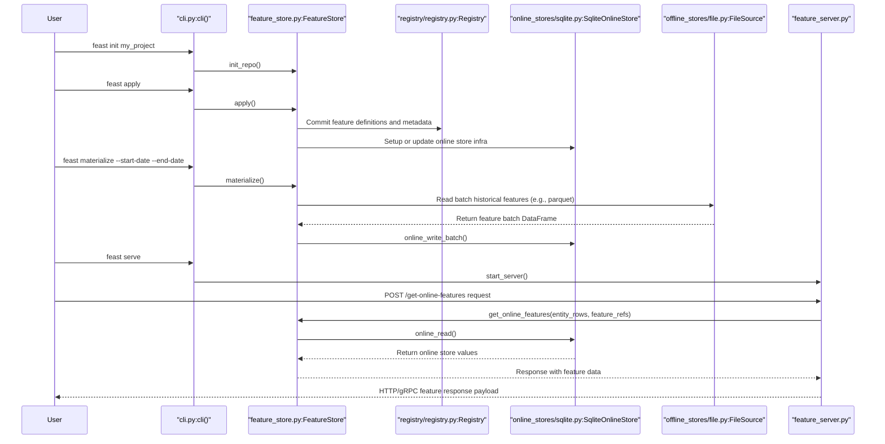

<!-- source: DeepWiki mcp.deepwiki.com · repo feast-dev/feast · page 1.2 Getting Started and CLI · fetched 2026-10-21 -->

# Getting Started and CLI

<details>
<summary>Relevant source files</summary>

The following files were used as context for generating this wiki page:

- [docs/getting-started/concepts/README.md](docs/getting-started/concepts/README.md)
- [docs/getting-started/concepts/entity.md](docs/getting-started/concepts/entity.md)
- [docs/getting-started/concepts/feature-retrieval.md](docs/getting-started/concepts/feature-retrieval.md)
- [docs/getting-started/concepts/feature-view.md](docs/getting-started/concepts/feature-view.md)
- [docs/getting-started/concepts/overview.md](docs/getting-started/concepts/overview.md)
- [docs/getting-started/concepts/stream-feature-view.md](docs/getting-started/concepts/stream-feature-view.md)
- [docs/getting-started/faq.md](docs/getting-started/faq.md)
- [docs/getting-started/quickstart.md](docs/getting-started/quickstart.md)
- [docs/reference/feast-cli-commands.md](docs/reference/feast-cli-commands.md)
- [docs/reference/offline-stores/spark.md](docs/reference/offline-stores/spark.md)
- [examples/java-demo/feature_repo/driver_repo.py](examples/java-demo/feature_repo/driver_repo.py)
- [examples/quickstart/quickstart.ipynb](examples/quickstart/quickstart.ipynb)
- [java/serving/src/test/resources/docker-compose/feast10/definitions.py](java/serving/src/test/resources/docker-compose/feast10/definitions.py)
- [java/serving/src/test/resources/docker-compose/feast10/materialize.py](java/serving/src/test/resources/docker-compose/feast10/materialize.py)
- [sdk/python/feast/aggregation/tiling/__init__.py](sdk/python/feast/aggregation/tiling/__init__.py)
- [sdk/python/feast/cli/cli.py](sdk/python/feast/cli/cli.py)
- [sdk/python/feast/templates/athena/feature_repo/feature_store.yaml](sdk/python/feast/templates/athena/feature_repo/feature_store.yaml)
- [sdk/python/feast/templates/athena/feature_repo/test_workflow.py](sdk/python/feast/templates/athena/feature_repo/test_workflow.py)
- [sdk/python/feast/templates/aws/feature_repo/feature_store.yaml](sdk/python/feast/templates/aws/feature_repo/feature_store.yaml)
- [sdk/python/feast/templates/cassandra/bootstrap.py](sdk/python/feast/templates/cassandra/bootstrap.py)
- [sdk/python/feast/templates/cassandra/feature_repo/feature_store.yaml](sdk/python/feast/templates/cassandra/feature_repo/feature_store.yaml)
- [sdk/python/feast/templates/hazelcast/bootstrap.py](sdk/python/feast/templates/hazelcast/bootstrap.py)
- [sdk/python/feast/templates/hbase/bootstrap.py](sdk/python/feast/templates/hbase/bootstrap.py)
- [sdk/python/feast/templates/hbase/feature_repo/feature_store.yaml](sdk/python/feast/templates/hbase/feature_repo/feature_store.yaml)
- [sdk/python/feast/templates/local/feature_repo/feature_store.yaml](sdk/python/feast/templates/local/feature_repo/feature_store.yaml)
- [sdk/python/feast/templates/minimal/feature_repo/feature_store.yaml](sdk/python/feast/templates/minimal/feature_repo/feature_store.yaml)
- [sdk/python/feast/templates/snowflake/bootstrap.py](sdk/python/feast/templates/snowflake/bootstrap.py)
- [sdk/python/feast/templates/snowflake/feature_repo/__init__.py](sdk/python/feast/templates/snowflake/feature_repo/__init__.py)
- [sdk/python/feast/templates/snowflake/feature_repo/feature_store.yaml](sdk/python/feast/templates/snowflake/feature_repo/feature_store.yaml)
- [sdk/python/feast/templates/spark/feature_repo/feature_store.yaml](sdk/python/feast/templates/spark/feature_repo/feature_store.yaml)
- [sdk/python/tests/unit/cli/test_cli.py](sdk/python/tests/unit/cli/test_cli.py)
- [sdk/python/tests/utils/cli_repo_creator.py](sdk/python/tests/utils/cli_repo_creator.py)
- [ui/feature_repo/features.py](ui/feature_repo/features.py)

</details>


## Purpose and Scope
This page covers the initial setup and command-line interface (CLI) for Feast. It details how to install the Feast package, initialize a feature repository using `feast init`, configure storage and metadata backends via `feature_store.yaml`, and execute core CLI commands such as `feast apply`, `feast materialize`, and `feast serve`.

Sources:  
[docs/getting-started/quickstart.md:27-40]()  
[docs/reference/feast-cli-commands.md:1-6]()

---

## Installation

Feast is distributed as a Python package and requires Python 3.9 or above [docs/getting-started/quickstart.md:19-19](). It can be installed directly from PyPI via `pip`:

```bash
pip install feast
```

This installation includes both the Python SDK and the `feast` command-line utility. At runtime, the core feature orchestration is managed by the `FeatureStore` class [sdk/python/feast/feature_store.py](), and configuration parsing is handled by `load_repo_config()` [sdk/python/feast/cli/cli.py:57-57]().

Sources:  
[docs/getting-started/quickstart.md:19-19]()  
[sdk/python/feast/cli/cli.py:57-57]()

---

## Initializing a Feature Repository

### The `feast init` Command

The `feast init` command bootstraps a new feature repository by copying template scaffolding to a target directory [docs/getting-started/quickstart.md:78-87](). It generates project directories, sample feature definitions, sample data, and the primary configuration file (`feature_store.yaml`) [docs/getting-started/quickstart.md:99-103]().

Example usage:

```bash
feast init my_project
cd my_project/feature_repo
```

Internally, `init_repo` in `sdk/python/feast/repo_operations.py` manages this initialization process by locating template directories, copying assets, and rendering configuration templates [sdk/python/feast/cli/cli.py:63-63]().

Sources:  
[docs/getting-started/quickstart.md:78-87]()  
[sdk/python/feast/cli/cli.py:63-63]()

### Repository Structure and Configuration

A typical initialized feature repository structure:

```
my_project/
├── feature_store.yaml          # Core configuration for Feast
├── feature_repo/
│   ├── example_repo.py         # Feature, entity, and data source definitions
│   └── test_workflow.py        # Example script demonstrating core Feast operations
└── data/
    └── driver_stats.parquet    # Parquet files for offline store demo
```

#### `feature_store.yaml` Basics

The `feature_store.yaml` file configures the project namespace, metadata registry storage, provider environments, and online/offline backends [docs/getting-started/quickstart.md:106-118]() [docs/reference/feature-store-yaml.md:5-63]().

```yaml
project: my_project
registry: data/registry.db
provider: local
online_store:
  type: sqlite
  path: data/online_store.db
entity_key_serialization_version: 3
```

| Field                         | Description                                                                                  |
|-------------------------------|----------------------------------------------------------------------------------------------|
| `project`                    | Namespace identifier for the feature store repository                                        |
| `registry`                   | File path or connection string for metadata storage (default: protobuf file or SQL registry) |
| `provider`                   | Workflow execution environment shorthand (`local`, `gcp`, `aws`, etc.)                       |
| `online_store`               | Configuration for low-latency key-value serving database (e.g., `sqlite`, `redis`, etc.)     |
| `entity_key_serialization_version` | Serialization format version for entity join keys (default: 3)                             |

Advanced configurations can specify metrics for a Python feature server (`feature_server`) and SQL-backed (MCP-enabled) registries (`registry`) [docs/reference/feature-store-yaml.md:37-50,58-63]().

Sources:  
[docs/getting-started/quickstart.md:106-118]()  
[docs/reference/feature-store-yaml.md:5-63]()  
[sdk/python/feast/cli/cli.py:63-63]()

---

## Core CLI Commands

The Feast CLI is built using `click` and defined in `sdk/python/feast/cli/cli.py` [sdk/python/feast/cli/cli.py:21-21](). Global options like `--chdir` (`-c`), `--log-level`, and `--feature-store-yaml` (`-f`) allow executing commands outside the target repository folder and using custom config locations [sdk/python/feast/cli/cli.py:86-102]().

### Primary Commands

- **`feast init`**: Creates a new feature store repository with example data, feature definitions, and configuration [sdk/python/feast/cli/cli.py:63-63]().

- **`feast apply`**:  
  Scans Python files in the feature repo for all Feast objects (`Entity`, `FeatureView`, `FeatureService`, etc.), validates definitions, stores metadata to the registry, and provisions infrastructure in the online and offline stores based on the configured `provider`. This executes through `FeatureStore.apply()` and updates the registry backend accordingly [docs/reference/feast-cli-commands.md:49-76]() [sdk/python/feast/cli/cli.py:154-194]().

- **`feast materialize` / `feast materialize-incremental`**:  
  Load feature data from offline storage into the online store for low-latency serving. These commands orchestrate reading historical features from offline sources and writing them to the online store. Incremental materialization enables efficient updates based on time windows [docs/reference/feast-cli-commands.md:28-29]().

- **`feast serve`**:  
  Launches the Python feature server exposing HTTP and gRPC APIs for `get-online-features`, feature ingestion (`push`), and registry access. It supports real-time serving of features to production applications [docs/reference/feast-cli-commands.md:33-34]().

- **`feast delete`**:  
  Deletes a Feast object (feature view, entity, etc.) from the registry and clears related infrastructure [sdk/python/feast/cli/cli.py:153-195]().

- **`feast configuration`**:  
  Displays the currently loaded configuration, merging user settings and defaults [docs/reference/feast-cli-commands.md:91-97]().

- **`feast demo-notebooks`**:  
  Generates demo Jupyter notebooks tailored for the project to showcase features, retrieval, and serving [docs/reference/feast-cli-commands.md:147-153]().

Sources:  
[sdk/python/feast/cli/cli.py:21-195]()  
[docs/reference/feast-cli-commands.md:20-161]()  

---

## CLI to Code Entity Mapping

This diagram provides a detailed mapping from the main CLI commands to their corresponding code entry points and core classes managing the feature store lifecycle and serving.

### CLI to Code Entity Space Mapping

```mermaid
graph TD
    CLIInit["cli.py:cli()"]
    CLIInit --> |"feast init"| RepoInit["repo_operations.py:init_repo()"]

    CLIApply["cli.py:apply()"]
    CLIApply --> |"feast apply"| FSApply["feature_store.py:FeatureStore.apply()"]
    FSApply --> |"update registry"| Reg["infra/registry/registry.py:Registry"]
    FSApply --> |"provision infra"| Prov["infra/provider.py:Provider.update_infra()"]

    CLIMaterialize["cli.py:materialize()"]
    CLIMaterialize --> |"feast materialize"| FSMat["feature_store.py:FeatureStore.materialize()"]
    FSMat --> |"read offline"| Offline["offline_stores/file.py:FileSource"]
    FSMat --> |"write online"| Online["infra/online_stores/sqlite.py:SqliteOnlineStore.online_write_batch()"]

    CLIServe["cli.py:serve_command()"]
    CLIServe --> |"feast serve"| Server["feature_server.py:start_server()"]
    Server --> |"handle /get-online-features"| GetOnline["feature_server.py:get_online_features_handler()"]
    Server --> |"handle /push"| PushAPI["feature_server.py:push_features_handler()"]

    CLIDelete["cli.py:delete()"]
    CLIDelete --> |"feast delete"| FSDelete["feature_store.py:FeatureStore.delete_*()"]

    CLIConfig["cli.py:configuration()"]
    CLIConfig --> |"feast configuration"| ConfigLoad["repo_config.py:load_repo_config()"]
```


Sources:  
[sdk/python/feast/cli/cli.py]()  
[sdk/python/feast/repo_operations.py]()  
[sdk/python/feast/feature_store.py]()  
[sdk/python/feast/infra/registry/registry.py]()  
[sdk/python/feast/infra/provider.py]()  
[sdk/python/feast/infra/online_stores/sqlite.py]()  
[sdk/python/feast/feature_server.py]()  
[sdk/python/feast/repo_config.py]()

---

## Quickstart Workflow

The typical user journey from repository initialization to feature serving is shown here. This sequence illustrates how CLI commands correspond to runtime processes, data flow, and internal API calls.

### Quickstart Execution Sequence


Sources:  
[docs/getting-started/quickstart.md:27-60]()  
[sdk/python/feast/cli/cli.py]()  
[sdk/python/feast/feature_store.py]()  
[sdk/python/feast/infra/registry/registry.py]()  
[sdk/python/feast/infra/online_stores/sqlite.py]()  
[sdk/python/feast/feature_server.py]()

---

# Summary

This page covered the fundamental steps to get started with Feast:

- Installation of the Feast Python SDK and CLI.
- Initialization of a feature repository via `feast init` with sample data and config.
- Overview of the `feature_store.yaml` configuration file and essential fields.
- Explanation and mapping of core CLI commands to code entities and workflows including `apply`, `materialize`, and `serve`.
- Illustration of the end-to-end quickstart workflow and the roles of key Feast components during operation.

This foundation enables users to define features, register them, ingest data, and serve features for real-time model inference using Feast's infrastructure.

For detailed tutorials, examples, and advanced usage, refer to the linked example repositories, quickstart notebooks, and other conceptual documentation pages.

# End of Page 1.2 - Getting Started and CLI

---

