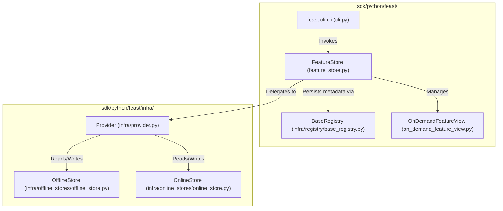
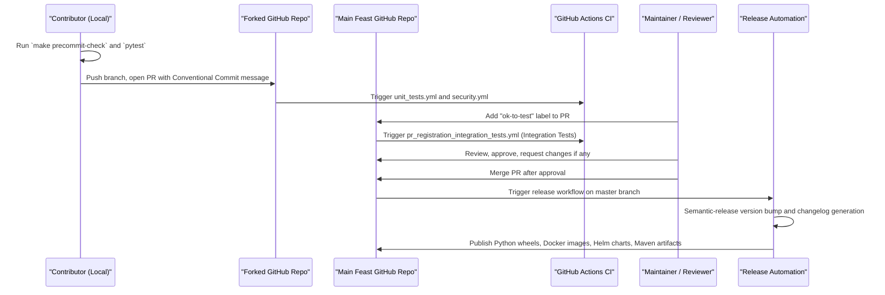

<!-- source: DeepWiki mcp.deepwiki.com · repo feast-dev/feast · page 1.3 Contributing and Development Setup · fetched 2026-10-21 -->

# Contributing and Development Setup

<details>
<summary>Relevant source files</summary>

The following files were used as context for generating this wiki page:

- [.github/auto_assign.yml](.github/auto_assign.yml)
- [.github/pull_request_template.md](.github/pull_request_template.md)
- [.prow/plugins.yaml](.prow/plugins.yaml)
- [CODEOWNERS](CODEOWNERS)
- [LICENSE](LICENSE)
- [OWNERS](OWNERS)
- [SECURITY.md](SECURITY.md)
- [community/README.md](community/README.md)
- [community/governance.md](community/governance.md)
- [community/maintainers.md](community/maintainers.md)
- [docs/how-to-guides/feast-operator/07-openlineage-and-materialization.md](docs/how-to-guides/feast-operator/07-openlineage-and-materialization.md)
- [docs/project/contributing.md](docs/project/contributing.md)
- [docs/project/development-guide.md](docs/project/development-guide.md)
- [docs/project/maintainers.md](docs/project/maintainers.md)
- [docs/project/release-process.md](docs/project/release-process.md)
- [docs/reference/data-sources/push.md](docs/reference/data-sources/push.md)
- [docs/reference/openlineage.md](docs/reference/openlineage.md)
- [docs/reference/registries/README.md](docs/reference/registries/README.md)
- [docs/reference/registries/sql.md](docs/reference/registries/sql.md)
- [docs/specs/firebase_online_example.monopic](docs/specs/firebase_online_example.monopic)
- [docs/specs/firebase_online_example.png](docs/specs/firebase_online_example.png)
- [docs/specs/online_store_format.md](docs/specs/online_store_format.md)
- [docs/tutorials/azure/README.md](docs/tutorials/azure/README.md)
- [examples/kind-quickstart/README.md](examples/kind-quickstart/README.md)
- [examples/rbac-remote/README.md](examples/rbac-remote/README.md)
- [java/CONTRIBUTING.md](java/CONTRIBUTING.md)
- [protos/feast/types/EntityKey.proto](protos/feast/types/EntityKey.proto)
- [sdk/python/feast/openlineage/client.py](sdk/python/feast/openlineage/client.py)
- [sdk/python/feast/openlineage/config.py](sdk/python/feast/openlineage/config.py)
- [skills/SKILL.md](skills/SKILL.md)
- [skills/references/configuration.md](skills/references/configuration.md)
- [skills/references/feature-definitions.md](skills/references/feature-definitions.md)
- [skills/references/retrieval-and-rag.md](skills/references/retrieval-and-rag.md)

</details>


## Purpose and Scope

This page guides contributors through setting up their development environment, executing tests, navigating the codebase, and following the contribution workflow for Feast. Feast is a polyglot operational ML data system spanning Python, Go, and Java, coordinated via a central `Makefile` and modern dependency management tools.

Sources: [docs/project/development-guide.md:1-45]()

---

## Development Environment Setup

Setting up a local development environment requires specific tools to handle the polyglot dependency graph and ensure reproducible builds across platforms.

### Tooling Requirements

| Tool           | Purpose                                                                                   |
| -------------- | ----------------------------------------------------------------------------------------- |
| Python 3.10–3.12 | Supported SDK runtime and development environments                                       |
| `uv`           | Python dependency management and virtual environments                                    |
| `pixi`         | Cross-version Python dependency locking                                                  |
| `make`         | Task runner for builds, tests, and environment initialization                             |
| `pre-commit`   | Git hooks for automated linting and formatting                                          |
| Go 1.25.0      | Required for building the Go feature server and Feast Operator                            |
| Node.js / Yarn | Required for building and testing the React-based Web UI                                 |

### Environment Initialization Steps

1. **Install Python Development Dependencies and SDK in Editable Mode:**
   ```bash
   make install-python-dependencies-dev
   ```
2. **Install Pre-commit Hooks:**
   ```bash
   make install-precommit
   ```
3. **Optional Hadoop Dependencies (for Spark/Hadoop testing):**
   ```bash
   make install-hadoop-dependencies-ci
   ```

Sources: [docs/project/development-guide.md:94-98](), [.github/workflows/pr_registration_integration_tests.yml:31-36](), [.github/workflows/security.yml:97-100]()

---

## Code Quality and Standards

Feast enforces strict static analysis, formatting, and type-checking standards.

- **Python Formatting & Linting:** The repository uses `ruff` to lint and format Python code. Pre-commit hooks auto-run `ruff check --fix` and `ruff format` on commit.
- **Push Linter Gate:** Before pushing, the `lint-push` hook checks that no formatting violations were introduced.
- **Secret Detection:** `detect-secrets` runs via pre-commit to prevent accidental credential commits.
- **Conventional Commits:** Commit messages are validated via `commitlint` to comply with semantic release guidelines.

Run all local quality checks with:
```bash
make precommit-check
```

Sources: [.pre-commit-config.yaml:1-70]()

---

## Running Tests and Test Infrastructure

Feast tests are divided into unit tests and integration tests.

### Test Suite Organization

- **Unit Tests:** Located in `sdk/python/tests/unit`, for isolated parts such as registry diffs, CLI commands, schema inference, and protobuf serialization.
- **Integration Tests:** Located in `sdk/python/tests/integration`, covering interactions with offline and online stores, end-to-end feature retrieval, and feature serving.
- **Universal Test Framework:** Parametrized test fixtures in `sdk/python/tests/integration/feature_repos/` allow reuse of core retrieval tests across backends, enabling consistent testing without duplication.

Sources: [docs/project/development-guide.md:20-31]()

---

## Agent Skill Files and AI-Assisted Development

Feast maintains dedicated configuration directories to support AI coding assistants and agentic workflows:

- `skills/`: Contains domain knowledge, natural language skill files describing Feast concepts such as feature definitions, retrieval, and RAG approaches.
- `.claude/` and `.cursor/`: Agent configuration files that provide context on code structure, protobuf generation, test framework, and Python SDK interface patterns.

These skill files enable AI agents to generate valid feature definitions, custom store adapters, and test cases consistent with Feast's idioms.

Sources: [sdk/python/docs/source/feast.rst:1-24]()

---

## Codebase Architecture for Contributors

To facilitate understanding, here are two mermaid diagrams bridging natural language concepts to specific code entities within the Python SDK:

### Diagram 1: Core Concepts to Python SDK Entity Mapping



### Diagram 2: Contribution Workflow and CI/CD Pipeline



Sources: [sdk/python/docs/source/feast.rst:1-321](), [docs/project/development-guide.md:54-78](), [.github/workflows/security.yml:1-112](), [.github/workflows/pr_registration_integration_tests.yml:1-91]()

---

## Governance, CODEOWNERS, and Pull Request Templates

### Maintainers and Code Ownership

- **`OWNERS` file:** Lists approvers and reviewers responsible for gating e2e CI and overseeing architecture. Key maintainers include `tmihalac`, `accorvin`, and others [OWNERS:1-17]().
- **`CODEOWNERS` file:** Maps directory paths to specific teams or maintainers to enforce mandatory reviews.
- **Prow Integration:** Automates PR labeling, approval, assignation, and lifecycle commands via `.prow/plugins.yaml` [`.prow/plugins.yaml:1-44`]().
- **Maintainer Directory:** Full list of project and emeritus maintainers by organization is maintained in `community/maintainers.md` [community/maintainers.md:1-38]().

### Pull Request Guidelines

- **Conventional Commits:** PR titles must use prefixes (`feat:`, `fix:`, `chore:`, `docs:`) for automatic changelog generation [docs/project/development-guide.md:72]().
- **Sign-off Commits:** Every commit must be signed off (`git commit -s`) to comply with Developer Certificate of Origin (DCO) [docs/project/development-guide.md:105-111]().
- **Pre-commit Hooks:** Running formatters, linters, and secret scanning before commit [docs/project/development-guide.md:93-98]().
- **PR Template:** Contributors should use the standard PR template `.github/pull_request_template.md` which includes checks, testing strategy, and issue references [.github/pull_request_template.md:1-37]().

Sources: [OWNERS:1-17](), [community/maintainers.md:1-38](), [.prow/plugins.yaml:1-44](), [docs/project/development-guide.md:72,105-111](), [.github/pull_request_template.md:1-37]()

---

## Community Resources

- **Slack:** Active Feast Community Workspace for discussions and support.
- **GitHub Issues & Discussions:** For bug reports, feature requests, and RFC processes.
- **Maintainer Contact:** Detailed roles and contacts in `community/maintainers.md` [community/maintainers.md:1-38]().

Sources: [community/maintainers.md:1-38]()

---

# Summary

This page has outlined the steps and tools needed to get started contributing to Feast, described the testing architecture and code quality practices, detailed governance and contribution norms, and bridged domain concepts to specific code artifacts to accelerate onboarding. The use of agent skill files supports AI-powered development workflows within Feast’s growing ecosystem.

-------

# Appendix: References

- Development Guide: `docs/project/development-guide.md` [1-118]()
- Maintainers: `community/maintainers.md` [1-38]()
- OWNERS file: `OWNERS` [1-17]()
- PR Template: `.github/pull_request_template.md` [1-37]()
- Prow Plugins: `.prow/plugins.yaml` [1-44]()

# End of Page

---

