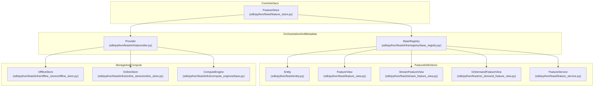
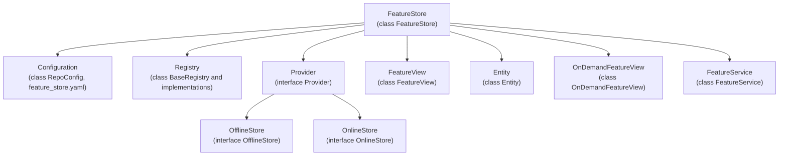

<!-- source: DeepWiki mcp.deepwiki.com · repo feast-dev/feast · page 2 Core Concepts · fetched 2026-10-21 -->

# Core Concepts

<details>
<summary>Relevant source files</summary>

The following files were used as context for generating this wiki page:

- [protos/feast/core/OnDemandFeatureView.proto](protos/feast/core/OnDemandFeatureView.proto)
- [sdk/python/feast/base_feature_view.py](sdk/python/feast/base_feature_view.py)
- [sdk/python/feast/diff/registry_diff.py](sdk/python/feast/diff/registry_diff.py)
- [sdk/python/feast/errors.py](sdk/python/feast/errors.py)
- [sdk/python/feast/feast_object.py](sdk/python/feast/feast_object.py)
- [sdk/python/feast/feature_store.py](sdk/python/feast/feature_store.py)
- [sdk/python/feast/feature_view.py](sdk/python/feast/feature_view.py)
- [sdk/python/feast/infra/compute_engines/spark/feature_builder.py](sdk/python/feast/infra/compute_engines/spark/feature_builder.py)
- [sdk/python/feast/infra/compute_engines/spark/nodes.py](sdk/python/feast/infra/compute_engines/spark/nodes.py)
- [sdk/python/feast/infra/online_stores/online_store.py](sdk/python/feast/infra/online_stores/online_store.py)
- [sdk/python/feast/infra/online_stores/sqlite.py](sdk/python/feast/infra/online_stores/sqlite.py)
- [sdk/python/feast/infra/passthrough_provider.py](sdk/python/feast/infra/passthrough_provider.py)
- [sdk/python/feast/infra/provider.py](sdk/python/feast/infra/provider.py)
- [sdk/python/feast/on_demand_feature_view.py](sdk/python/feast/on_demand_feature_view.py)
- [sdk/python/feast/repo_config.py](sdk/python/feast/repo_config.py)
- [sdk/python/feast/repo_operations.py](sdk/python/feast/repo_operations.py)
- [sdk/python/feast/transformation/pandas_transformation.py](sdk/python/feast/transformation/pandas_transformation.py)
- [sdk/python/feast/transformation/python_transformation.py](sdk/python/feast/transformation/python_transformation.py)
- [sdk/python/feast/transformation/ray_transformation.py](sdk/python/feast/transformation/ray_transformation.py)
- [sdk/python/feast/transformation/substrait_transformation.py](sdk/python/feast/transformation/substrait_transformation.py)
- [sdk/python/feast/transformation/udf_rehydrate.py](sdk/python/feast/transformation/udf_rehydrate.py)
- [sdk/python/feast/utils.py](sdk/python/feast/utils.py)
- [sdk/python/tests/component/spark/test_nodes.py](sdk/python/tests/component/spark/test_nodes.py)
- [sdk/python/tests/component/spark/test_spark.py](sdk/python/tests/component/spark/test_spark.py)
- [sdk/python/tests/foo_provider.py](sdk/python/tests/foo_provider.py)
- [sdk/python/tests/unit/infra/test_inference_unit_tests.py](sdk/python/tests/unit/infra/test_inference_unit_tests.py)
- [sdk/python/tests/unit/online_store/test_online_writes.py](sdk/python/tests/unit/online_store/test_online_writes.py)
- [sdk/python/tests/unit/test_on_demand_feature_view.py](sdk/python/tests/unit/test_on_demand_feature_view.py)
- [sdk/python/tests/unit/test_on_demand_python_transformation.py](sdk/python/tests/unit/test_on_demand_python_transformation.py)
- [sdk/python/tests/unit/test_utils.py](sdk/python/tests/unit/test_utils.py)
- [sdk/python/tests/unit/transformation/test_pandas_transformation.py](sdk/python/tests/unit/transformation/test_pandas_transformation.py)
- [sdk/python/tests/utils/test_wrappers.py](sdk/python/tests/utils/test_wrappers.py)

</details>


This page introduces the fundamental building blocks of Feast and how they interact to form an operational machine learning data system. These concepts provide the foundation for understanding how Feast manages feature definitions, stores metadata, handles data movement, and serves features for both training and inference.

As a parent page, this section provides a high-level architectural overview. For detailed subsystem implementations, configuration options, and deep dives, consult the respective child pages linked throughout.

---

## Overview

Feast is organized around a set of modular abstractions that work together to provide a complete feature store solution. At the center of this ecosystem is the `FeatureStore` class [sdk/python/feast/feature_store.py:164-174](), which coordinates interactions between feature definitions, metadata registries, providers, and storage backends.

### System Architecture and Component Relationships

The following diagram bridges the logical Feast architecture to its concrete codebase classes, showing how user definitions and registries coordinate through the central `FeatureStore` and `Provider` interfaces.

Title: "Feast Core Architecture and Class Mapping"



Sources: [sdk/python/feast/feature_store.py:164-174](), [sdk/python/feast/infra/provider.py:51-63](), [sdk/python/feast/repo_config.py:39-111]()

---

## 2.1. FeatureStore and Configuration

The `FeatureStore` class is the primary entry point for defining, creating, materializing, and retrieving features. It acts as the central orchestrator that manages feature definitions, interacts with the underlying registry and provider to manage metadata and infrastructure, and offers APIs for data retrieval and ingestion [sdk/python/feast/feature_store.py:164-204]().

`FeatureStore` is typically instantiated with a `RepoConfig` configuration object, which reads from the `feature_store.yaml` file in the feature repository directory to specify backend providers, offline and online stores, registry location, and other settings [sdk/python/feast/repo_config.py:39-111](). This config controls how Feast connects to storage and compute engines.

Key capabilities of the `FeatureStore` include:
- `apply()`: Registers or updates Feast objects (Entities, FeatureViews, etc.) in the registry.
- `get_historical_features()`: Constructs offline training datasets via point-in-time joins.
- `get_online_features()`: Retrieves low-latency feature vectors for inference requests.
- `materialize()`: Schedules or executes pipelines to move data from offline to online stores.

For a technical deep dive into the FeatureStore class, its configuration, and operation planning, see [FeatureStore and Configuration](#2.1).

Sources: [sdk/python/feast/feature_store.py:164-204](), [sdk/python/feast/repo_config.py:39-111]()

---

## 2.2. Provider and Store Abstractions

The `Provider` interface defines a pluggable backend abstraction responsible for managing data storage, retrieval, and infrastructure orchestration. It connects the core Feast runtime to specific storage implementations for both offline and online feature data, and the materialization compute engines [sdk/python/feast/infra/provider.py:51-63]().

Each provider is configured through the `RepoConfig` and implements methods such as:
- `update_infra()`: Synchronizes cloud or local infrastructure with Feast object definitions.
- `teardown_infra()`: Cleans up resources.
- `online_write_batch()`: Writes batches of feature rows to the online store.
- Integration with batch compute engines that execute point-in-time joins and materializations.

The default `PassthroughProvider` is a simple implementation that delegates calls directly to the configured offline store, online store, and batch engine, without additional orchestration logic [sdk/python/feast/infra/passthrough_provider.py:59-131](). This makes it easy to add new stores by implementing the offline or online store interfaces and configuring your repo.

For detailed interface definitions and descriptions of common provider implementations, see [Provider and Store Abstractions](#2.2).

Sources: [sdk/python/feast/infra/provider.py:51-63](), [sdk/python/feast/infra/passthrough_provider.py:59-131]()

---

## 2.3. Feature Views and Services

Feature views encapsulate a coherent group of related features along with their data sources, entities, and lifecycle parameters. A `FeatureView` declares the data source schema, entity associations, time-to-live (TTL) information, and online availability flags [sdk/python/feast/feature_view.py:110-183]().

Feast supports several types of feature views:
- **BatchFeatureView**: For batch offline data sources.
- **StreamFeatureView**: For real-time streaming data sources.
- **OnDemandFeatureView**: Experimental views that apply transformations on incoming data at request time to generate features dynamically [sdk/python/feast/on_demand_feature_view.py:115-184]().
- **LabelView**: To define labels for supervised learning.

`FeatureService` allows grouping multiple features across different feature views into coherent, versioned bundles intended for model training or serving [sdk/python/feast/feature_service.py]().

These abstractions facilitate managing feature lifecycle, versioning, and training-serving consistency.

For extensive documentation on FeatureView subclasses and FeatureServices, see [Feature Views and Services](#2.3).

Sources: [sdk/python/feast/feature_view.py:110-183](), [sdk/python/feast/on_demand_feature_view.py:115-184](), [sdk/python/feast/repo_operations.py:19-37]()

---

## 2.4. Entities, Fields, and Features

Entities represent core business objects identifiable by unique keys that link features to rows in offline and online stores. Each entity defines a name, join keys, and associated data types [sdk/python/feast/entity.py:28-108]().

Features are columns describing attributes or metrics associated with entities. `Field` objects define features or entity columns with names and data types, serving as schema primitives.

This layer manages how Feast serializes entity keys (`EntityKey` protobuf), performs schema inference, and controls joins in point-in-time correctness during training data computation and online lookups.

For a detailed explanation of entity composition, feature schemas, serialization, and join keys, see [Entities, Fields, and Features](#2.4).

Sources: [sdk/python/feast/entity.py:28-108](), [sdk/python/feast/field.py]()

---

## 2.5. Registry and Metadata Storage

The Registry is the authoritative metadata store for all Feast objects, including entities, feature views, data sources, permissions, saved datasets, and feature services. The base interface `BaseRegistry` and several implementations (`SqlRegistry`, `SnowflakeRegistry`, `RemoteRegistry`) support different storage backends for registry data [sdk/python/feast/infra/registry/base_registry.py:14-88](), [sdk/python/feast/repo_config.py:39-44]().

Registry management includes version tracking, caching, and concurrency controls to ensure consistency during `feast apply` workflows, schema upgrades, and feature retrieval operations.

The Registry is integral to the `FeatureStore` lifecycle, persisting object definitions and resolving feature requests.

For an in-depth review of registry design and implementations, see [Registry and Metadata Storage](#2.5).

Sources: [sdk/python/feast/infra/registry/base_registry.py:14-88](), [sdk/python/feast/repo_config.py:39-44]()

---

## 2.6. Type System and Conversions

Feast incorporates a comprehensive type system to provide consistent typing across feature definitions, runtime data, and storages. This system includes:
- `ValueType` enum defining supported primitive types such as integers, floats, strings, and complex types like vectors [sdk/python/feast/value_type.py:51]().
- `FeastType` classes (`Array`, `Map`, `Struct`) representing complex schema elements [sdk/python/feast/types.py]().
- Conversion utilities mapping Python native types to Feast types and Protobuf `Value` message serialization/deserialization [sdk/python/feast/utils.py:49-51]().

The type mapping ensures correctness and interoperability between Python SDK, offline compute engines, online stores, and registry representations.

For full details on Feast's type system and data conversion mechanics, see [Type System and Conversions](#2.6).

Sources: [sdk/python/feast/value_type.py:51](), [sdk/python/feast/utils.py:49-51](), [sdk/python/feast/types.py]()

---

# Summary Diagram: Natural Language Concepts to Code Entities



---

# Data Flow Pattern: Feature Registration to Serving

```mermaid
flowchart TB
    UserDefs["User-defined Feast Objects"] -->|apply()| Registry["Registry (Metadata Storage)"]
    Registry --> Provider["Provider (Backend Orchestration)"]
    Provider -->|manages| OfflineStore["OfflineStore (Historical Data)"]
    Provider -->|manages| OnlineStore["OnlineStore (Serving Store)"]
    Provider -.-> BatchEngine["ComputeEngine (Materialization)"]

    OfflineStore -->|point-in-time joins| FeatureStore["FeatureStore (Data Retrieval API)"]
    FeatureStore -->|get_online_features()| OnlineStore
    FeatureStore -->|get_historical_features()| OfflineStore
    FeatureStore --> UserApps["ML Model Training / Inference"]

    OnlineStore -->|low latency serving| UserApps
```

Sources: [sdk/python/feast/feature_store.py:164-204](), [sdk/python/feast/infra/provider.py:51-63](), [sdk/python/feast/infra/passthrough_provider.py:59-131](), [sdk/python/feast/feature_view.py:110-183](), [sdk/python/feast/on_demand_feature_view.py:115-184]()

---

## Navigation to Child Pages

- For an in-depth explanation of `FeatureStore` mechanics and configuration options, see [FeatureStore and Configuration](#2.1).
- To understand the `Provider` interface and how store abstractions enable backend flexibility, see [Provider and Store Abstractions](#2.2).
- To explore feature views, their variants, and feature service grouping, see [Feature Views and Services](#2.3).
- For details on entity definition, field and feature schemas, and join key serialization, see [Entities, Fields, and Features](#2.4).
- To learn about registry design, storage backends, and object versioning, see [Registry and Metadata Storage](#2.5).
- To study Feast’s type system and runtime conversions, see [Type System and Conversions](#2.6).

---

This page provides a high-level conceptual map of Feast’s core components to orient new technical contributors and users. Each subsection is linked to detailed child pages with implementation details, code examples, and configuration guidance.

# End of Core Concepts page.

---

