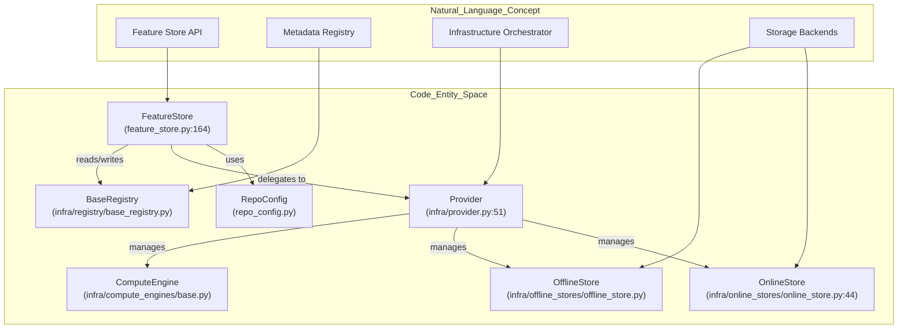
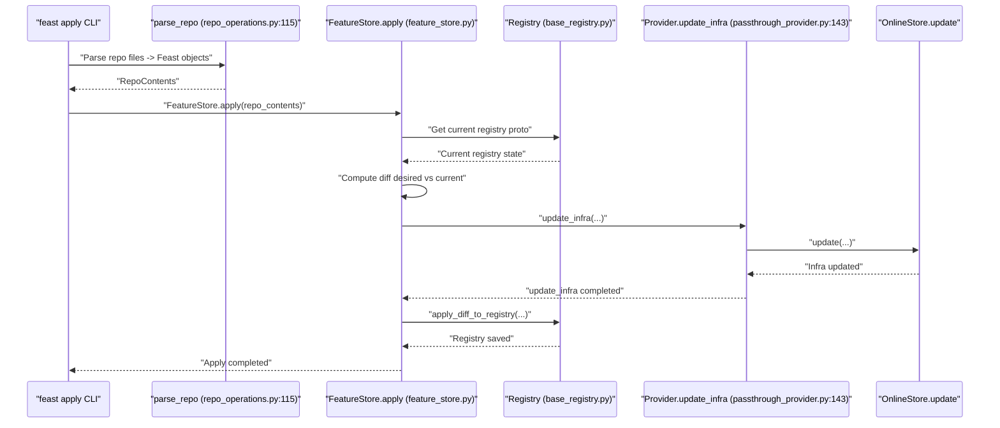
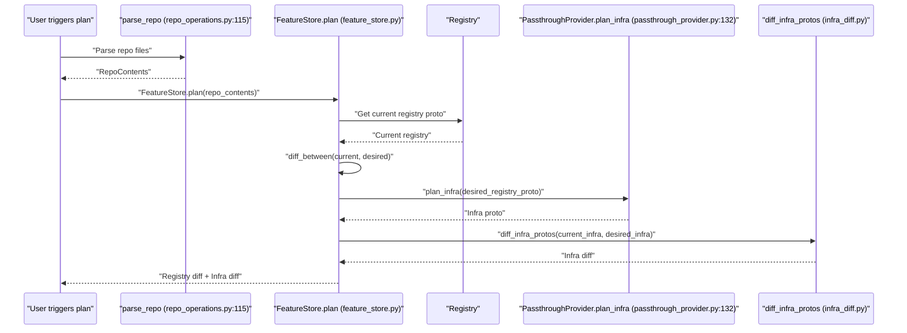
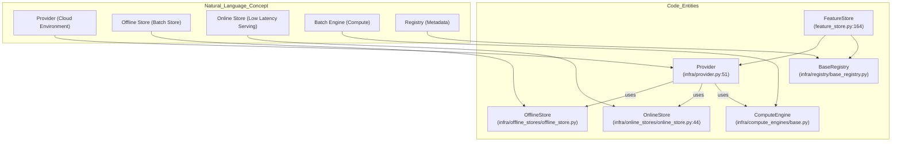

<!-- source: DeepWiki mcp.deepwiki.com · repo feast-dev/feast · page 2.1 FeatureStore and Configuration · fetched 2026-10-21 -->

# FeatureStore and Configuration

Relevant source files

The following files were used as context for generating this wiki page:

- [sdk/python/feast/constants.py](sdk/python/feast/constants.py)
- [sdk/python/feast/errors.py](sdk/python/feast/errors.py)
- [sdk/python/feast/feature_store.py](sdk/python/feast/feature_store.py)
- [sdk/python/feast/infra/online_stores/online_store.py](sdk/python/feast/infra/online_stores/online_store.py)
- [sdk/python/feast/infra/online_stores/sqlite.py](sdk/python/feast/infra/online_stores/sqlite.py)
- [sdk/python/feast/infra/passthrough_provider.py](sdk/python/feast/infra/passthrough_provider.py)
- [sdk/python/feast/infra/provider.py](sdk/python/feast/infra/provider.py)
- [sdk/python/feast/repo_config.py](sdk/python/feast/repo_config.py)
- [sdk/python/feast/repo_operations.py](sdk/python/feast/repo_operations.py)
- [sdk/python/feast/templates/local/bootstrap.py](sdk/python/feast/templates/local/bootstrap.py)
- [sdk/python/feast/templates/local/feature_repo/feature_definitions.py](sdk/python/feast/templates/local/feature_repo/feature_definitions.py)
- [sdk/python/tests/foo_provider.py](sdk/python/tests/foo_provider.py)
- [sdk/python/tests/unit/infra/scaffolding/test_repo_operations.py](sdk/python/tests/unit/infra/scaffolding/test_repo_operations.py)
- [ui/src/pages/label-views/ActiveLearningTab.tsx](ui/src/pages/label-views/ActiveLearningTab.tsx)
- [ui/src/pages/label-views/Index.tsx](ui/src/pages/label-views/Index.tsx)

This document provides a technical deep dive into the `FeatureStore` class, the primary interface in the Feast SDK, and the configuration system that governs its behavior. It explains the `FeatureStore` lifecycle, the structure and parsing of `RepoConfig` and `feature_store.yaml`, the internal apply and plan operations, and the plugin system leveraging providers for different backends.

---

## The FeatureStore Class

The `FeatureStore` class is the central orchestration point for defining, creating, and retrieving features. It is implemented in `[sdk/python/feast/feature_store.py:164-183]()` and integrates metadata handling, feature data retrieval, and backend interaction.

### Key Roles of `FeatureStore`

- **Metadata Management**: Interacts with the `Registry` to register, update, or fetch feature definitions.
- **Training Data Retrieval**: Provides point-in-time correct historical feature datasets via `get_historical_features`.
- **Online Serving**: Serves low-latency features with `get_online_features` `[sdk/python/feast/infra/online_stores/online_store.py:155-167]()`.
- **Materialization**: Moves features from offline to online stores through the `materialize` API.
- **Inference and Validation**: Uses inference utilities to automatically deduce event timestamp fields and feature schemas for improved developer experience `[sdk/python/feast/feature_store.py:82-85]()`.

#### Initialization and Configuration Resolution

When instantiating a `FeatureStore` object, configuration is established using this precedence:

1. **Direct `RepoConfig`**: If a `config` object of type `RepoConfig` is passed, it is used directly.
2. **Explicit YAML Path (`fs_yaml_file`)**: Feast loads the `feature_store.yaml` config from the specified path.
3. **Default YAML Path**: Defaults to `feature_store.yaml` inside the `repo_path` (default current working directory), or paths specified via environment variables.

This layered loading supports overriding config sources for flexibility in different deployment contexts.

#### Internal Components and Caching

- `_registry` (`Optional[BaseRegistry]`)  
  Lazily initialized registry instance managing metadata persistence and retrieval.

- `_provider` (`Optional[Provider]`)  
  Lazily initialized provider instance that manages offline/online stores and batch compute engines, determined dynamically by the `provider` field from `RepoConfig`.

- `_feature_service_cache` (`Dict[str, List[str]]`)  
  Caches expanded feature lists for feature services keyed by service name, improving query planning efficiency.

These components enable `FeatureStore` to serve as a unified interface between user-level feature definitions, persisted metadata, and operational backend stores.

---

### FeatureStore Entity Mapping Diagram

Title: FeatureStore Entity Mapping Diagram

Sources: `[sdk/python/feast/feature_store.py:164-183]()`, `[sdk/python/feast/infra/provider.py:51-174]()`, `[sdk/python/feast/infra/online_stores/online_store.py:44-154]()`, `[sdk/python/feast/infra/offline_stores/offline_store.py]()`

---

## RepoConfig and `feature_store.yaml`

`RepoConfig` encapsulates configuration parameters of a Feast repository. It is a Pydantic model parsed from the `feature_store.yaml` file, supporting type validation, defaults, and field mapping `[sdk/python/feast/repo_config.py]()`. The config governs backends, project settings, and feature serving options.

### Key Fields in RepoConfig

| Field                  | Description                                                                                     | Example Values           |
|------------------------|-------------------------------------------------------------------------------------------------|--------------------------|
| `project`              | Names the project, uniquely identifying the repository scope.                                   | `"my_project"`           |
| `provider`             | Cloud or environment identifier. Used to dynamically load appropriate `Provider` implementation. | `"gcp"`, `"aws"`, `"local"` |
| `registry`             | Registry backend details including `type` and `path`.                                           | `type: "file"`, `path: "registry.db"` |
| `offline_store`        | Configuration of the offline store for batch feature data.                                      | `type: "bigquery"`       |
| `online_store`         | Online store config for low-latency feature serving.                                            | `type: "redis"`          |
| `batch_engine_config`  | Batch compute engine config for materialization and offline retrieval compute.                  | `type: "local"`          |
| `feature_server`       | Optional feature server deployment configuration.                                               | `type: "local"`          |

These fields are extensible to include credentials, custom parameters, and any backend-specific options.

### Backend Plugin Mappings

Feast implements a plugin system to dynamically load classes based on the config `type` fields. The key mapping dicts enable extensibility and backward compatibility, as enumerated below:

| Component     | Mapping Dict Name            | Snippet Location                      |
|---------------|-----------------------------|-------------------------------------|
| Registry      | `REGISTRY_CLASS_FOR_TYPE`    | `[sdk/python/feast/repo_config.py:39-44]()` |
| Offline Store | `OFFLINE_STORE_CLASS_FOR_TYPE` | `[sdk/python/feast/repo_config.py:94-112]()` |
| Online Store  | `ONLINE_STORE_CLASS_FOR_TYPE`  | `[sdk/python/feast/repo_config.py:69-92]()` |
| Batch Engine  | `BATCH_ENGINE_CLASS_FOR_TYPE`  | `[sdk/python/feast/repo_config.py:46-55]()` |
| Provider      | `PROVIDERS_CLASS_FOR_TYPE`     | `[sdk/python/feast/infra/provider.py:42-48]()` |

The mappings correlate a string type identifier to a fully qualified Python import path. Feast loads the class dynamically, enabling custom or external infrastructure integrations.

Sources: `[sdk/python/feast/repo_config.py:1-115]()`, `[sdk/python/feast/infra/provider.py:42-48]()`

---

## Apply Operation Lifecycle

The `apply` method in `FeatureStore` synchronizes in-code Feast objects with the Registry persisted state and manages physical infrastructure changes accordingly. It embodies the logic behind the `feast apply` CLI command and programmatic repo synchronization.

### Apply Execution Flow

1. **Parse Feature Repo**  
   Python files in the feature repository are scanned for Feast objects such as `Entities`, `FeatureViews`, `FeatureServices`, etc., respecting `.feastignore` exclusions. This is performed by `parse_repo` in `[sdk/python/feast/repo_operations.py:51-133]()`.  
   
2. **Fetch Registry and Compute Diff**  
   The current registry proto is fetched from the registry backend. Feast synthesizes the desired registry proto from parsed Feast objects, then calculates the diff using `diff_between` in `[sdk/python/feast/diff/registry_diff.py]()`.  
   
3. **Update Infrastructure via Provider**  
   The `Provider`'s `update_infra` method reconciles actual infrastructure resources (online stores, offline stores, compute engines) based on the diff. For example, `PassthroughProvider` instructs underlying stores to update schemas or deployments `[sdk/python/feast/infra/passthrough_provider.py:143-176]()`.  
   
4. **Apply Registry Changes to Persist Metadata**  
   The diff is persisted to the Registry via `apply_diff_to_registry`, ensuring serving and retrieval are consistent with the updated definitions.

### Apply Execution Sequence Diagram

Title: Apply Execution Sequence Diagram

Sources: `[sdk/python/feast/feature_store.py]()`, `[sdk/python/feast/repo_operations.py:51-133]()`, `[sdk/python/feast/diff/registry_diff.py]()`, `[sdk/python/feast/infra/provider.py:69-94]()`, `[sdk/python/feast/infra/passthrough_provider.py:143-176]()`

---

## Infrastructure Planning (`plan`)

The `plan` method computes and displays diffs for registry and infrastructure changes without applying them. It is useful to understand the impact of changes before executing `apply`.

### Plan Operation Flow

1. **Parse Feature Repo**  
   Like `apply`, it parses Feast objects from repo files `[sdk/python/feast/repo_operations.py:115-133]()`.  
   
2. **Fetch Current Registry Proto**  
   Reads the current persisted metadata `[sdk/python/feast/feature_store.py]()`.  
   
3. **Diff Computation**  
   - Computes registry differences using `diff_between` `[sdk/python/feast/diff/registry_diff.py]()`.
   - Computes infra diff using provider's `plan_infra` returning `Infra` protos `[sdk/python/feast/infra/provider.py:96-107]()`.
   - Produces detailed infrastructure delta with `diff_infra_protos` `[sdk/python/feast/diff/infra_diff.py]()`.  

This process simulates what `apply` would do without modifying any state.

### Plan Execution Sequence Diagram

Title: Plan Execution Sequence Diagram

Sources: `[sdk/python/feast/feature_store.py]()`, `[sdk/python/feast/infra/provider.py:96-107]()`, `[sdk/python/feast/diff/infra_diff.py]()`, `[sdk/python/feast/repo_operations.py:115-133]()`

---

## Plugin System for Backends

Feast uses a plugin architecture to abstract integration with multiple offline stores, online stores, registries, and compute engines. This is centered around the `Provider` interface.

### Provider Interface

The abstract base class `Provider` defines the contract for different cloud environments or local setups. It manages lifecycle operations and orchestrates underlying components `[sdk/python/feast/infra/provider.py:51-174]()`. Key responsibilities:

- **Updating Infrastructure**: Provisioning/updating online and offline stores, compute engines.
- **Planning Infrastructure**: Dry-run plans to assess infra changes.
- **Teardown**: Removing cloud resources related to feature definitions.
- **Online Writes**: Writing feature rows to online stores in batches (sync/async).
- **Offline Retrieval and Materialization**: Delegates offline querying and batch materialization.
- **Supports Async Methods**: Explicit support indicators for async reads/writes.

### PassthroughProvider Example

`PassthroughProvider` is the default provider for local or simple cases. It directly delegates calls to configured offline store, online store, and batch compute engine without additional orchestration logic `[sdk/python/feast/infra/passthrough_provider.py:59-188]()`. It acts as a minimal bridge connecting Feast APIs to backend implementations.

#### Key delegation flow in PassthroughProvider:

- Lazily load offline store and online store based on `RepoConfig`.
- Provide a `batch_engine` instance for batch compute related operations.
- Update infrastructure only if online or batch engines exist.
- Teardown resources accordingly.
- Forward online writes and materialization commands to underlying stores/engines.

---

### Plugin Architecture Diagram

Title: Plugin Architecture Diagram

Sources: `[sdk/python/feast/infra/provider.py:51-174]()`, `[sdk/python/feast/infra/passthrough_provider.py:59-188]()`, `[sdk/python/feast/repo_config.py:39-112]()`, `[sdk/python/feast/feature_store.py:164-183]()`

---

*End of 2.1 FeatureStore and Configuration*

---

