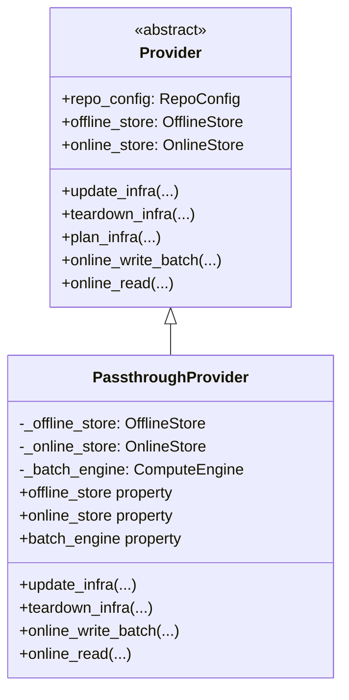
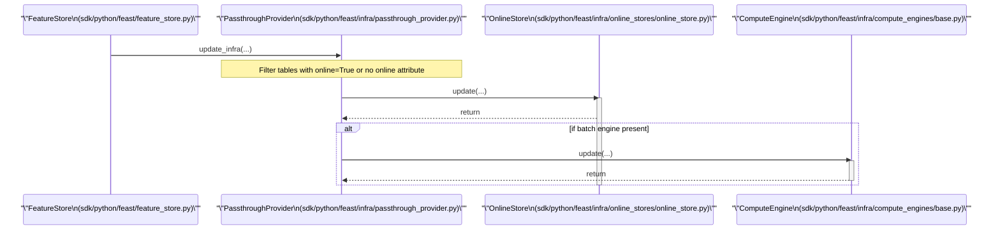

<!-- source: DeepWiki mcp.deepwiki.com · repo feast-dev/feast · page 2.2 Provider and Store Abstractions · fetched 2026-10-21 -->

# Provider and Store Abstractions

<details>
<summary>Relevant source files</summary>

The following files were used as context for generating this wiki page:

- [docs/how-to-guides/online-server-performance-tuning.md](docs/how-to-guides/online-server-performance-tuning.md)
- [docs/reference/online-stores/dynamodb.md](docs/reference/online-stores/dynamodb.md)
- [protos/feast/core/DatastoreTable.proto](protos/feast/core/DatastoreTable.proto)
- [protos/feast/core/InfraObject.proto](protos/feast/core/InfraObject.proto)
- [protos/feast/core/PrecomputedFeatureVector.proto](protos/feast/core/PrecomputedFeatureVector.proto)
- [protos/feast/core/SqliteTable.proto](protos/feast/core/SqliteTable.proto)
- [sdk/python/feast/diff/infra_diff.py](sdk/python/feast/diff/infra_diff.py)
- [sdk/python/feast/errors.py](sdk/python/feast/errors.py)
- [sdk/python/feast/feature_store.py](sdk/python/feast/feature_store.py)
- [sdk/python/feast/infra/infra_object.py](sdk/python/feast/infra/infra_object.py)
- [sdk/python/feast/infra/online_stores/datastore.py](sdk/python/feast/infra/online_stores/datastore.py)
- [sdk/python/feast/infra/online_stores/dynamodb.py](sdk/python/feast/infra/online_stores/dynamodb.py)
- [sdk/python/feast/infra/online_stores/online_store.py](sdk/python/feast/infra/online_stores/online_store.py)
- [sdk/python/feast/infra/online_stores/sqlite.py](sdk/python/feast/infra/online_stores/sqlite.py)
- [sdk/python/feast/infra/passthrough_provider.py](sdk/python/feast/infra/passthrough_provider.py)
- [sdk/python/feast/infra/provider.py](sdk/python/feast/infra/provider.py)
- [sdk/python/feast/repo_config.py](sdk/python/feast/repo_config.py)
- [sdk/python/feast/repo_operations.py](sdk/python/feast/repo_operations.py)
- [sdk/python/tests/foo_provider.py](sdk/python/tests/foo_provider.py)
- [sdk/python/tests/unit/diff/test_infra_diff.py](sdk/python/tests/unit/diff/test_infra_diff.py)
- [sdk/python/tests/unit/infra/online_store/test_dynamodb_online_store.py](sdk/python/tests/unit/infra/online_store/test_dynamodb_online_store.py)

</details>


## Purpose and Scope

This document explains Feast's **Provider** and **Store** abstraction layers, which enable pluggable infrastructure implementations compatible with different cloud providers and storage backends. The Provider acts as an orchestrator coordinating the `OfflineStore` (for batch historical feature retrieval), the `OnlineStore` (for low-latency feature serving), and the `ComputeEngine` (for batch materialization compute).

These abstractions facilitate Feast's support for multiple storage and compute combinations (e.g., BigQuery, Snowflake, Redis, DynamoDB) accessed through a unified interface, enabling extensibility and cloud/provider agnosticism.

Sources: [sdk/python/feast/feature_store.py:164-183](), [sdk/python/feast/infra/provider.py:51-56](), [sdk/python/feast/infra/passthrough_provider.py:59-62]()

---

## Architecture Overview

The Provider abstraction pattern enables Feast to be cloud-agnostic and storage-agnostic by delegating infrastructure operations to pluggable components. The `FeatureStore` class [sdk/python/feast/feature_store.py:164-183]() instantiates a `Provider` instance [sdk/python/feast/infra/provider.py:51-56](), which in turn instantiates and manages the lifecycle of underlying stores and compute engines.

### Component Hierarchy and Code Entities

```mermaid
graph TB
    FS["\"FeatureStore\n(sdk/python/feast/feature_store.py)\""]
    RC["\"RepoConfig\n(sdk/python/feast/repo_config.py)\""]
    
    subgraph "ProviderLayer"
        PROV["\"Provider (ABC)\n(sdk/python/feast/infra/provider.py)\""]
        PT["\"PassthroughProvider\n(sdk/python/feast/infra/passthrough_provider.py)\""]
    end
    
    subgraph "StorageLayer"
        OFF["\"OfflineStore (ABC)\n(sdk/python/feast/infra/offline_stores/offline_store.py)\""]
        ON["\"OnlineStore (ABC)\n(sdk/python/feast/infra/online_stores/online_store.py)\""]
        BATCH["\"ComputeEngine (ABC)\n(sdk/python/feast/infra/compute_engines/base.py)\""]
    end
    
    subgraph "Implementations"
        OFF_IMPL["\"BigQueryOfflineStore / SnowflakeOfflineStore / DaskOfflineStore\""]
        ON_IMPL["\"RedisOnlineStore / DynamoDBOnlineStore / SqliteOnlineStore\""]
        BATCH_IMPL["\"LocalComputeEngine / SnowflakeComputeEngine / LambdaComputeEngine\""]
    end
    
    FS -->|"config"| RC
    FS -->|"_provider"| PROV
    RC -->|"configures"| PROV
    PROV -.->|"implementation"| PT
    
    PT -->|"offline_store property"| OFF
    PT -->|"online_store property"| ON
    PT -->|"batch_engine property"| BATCH
    
    OFF -.->|"implements"| OFF_IMPL
    ON -.->|"implements"| ON_IMPL
    BATCH -.->|"implements"| BATCH_IMPL
```

Sources: [sdk/python/feast/feature_store.py:176-181](), [sdk/python/feast/infra/provider.py:58-61](), [sdk/python/feast/infra/passthrough_provider.py:66-69]()

---

## Provider Interface

The `Provider` abstract base class [sdk/python/feast/infra/provider.py:51-56]() specifies the contract for a provider managing infrastructure lifecycle, batch and online reads/writes, and feature store orchestration. Providers are instantiated with a `RepoConfig` [sdk/python/feast/repo_config.py:1-115]() and must provide components for the offline store, online store, and optionally a batch compute engine.



Sources: [sdk/python/feast/infra/provider.py:51-191](), [sdk/python/feast/infra/passthrough_provider.py:59-130]()

The interface includes:

- `update_infra()` to reconcile infrastructure resources with current Feast definitions [sdk/python/feast/infra/provider.py:71-93]().
- `teardown_infra()` to remove all infrastructure for a given project [sdk/python/feast/infra/provider.py:109-123]().
- `plan_infra()` to return an `Infra` object describing the required infrastructure for a desired state [sdk/python/feast/infra/provider.py:96-107]().
- `online_write_batch()` and `online_read()` for reading and writing to the online feature store [sdk/python/feast/infra/provider.py:126-150]().

Sources: [sdk/python/feast/infra/provider.py:51-191]()

---

### Provider Lifecycle Operations

| Method           | Purpose                                           | Implementation Details                                                                                  | Sources                                             |
|------------------|-------------------------------------------------|--------------------------------------------------------------------------------------------------------|-----------------------------------------------------|
| `update_infra()` | Reconcile existing infrastructure with Feast objects | Manages creation/deletion of feature view tables and entity resources; filters feature views based on `online` attribute | [sdk/python/feast/infra/provider.py:71-93](), [sdk/python/feast/infra/passthrough_provider.py:143-174]() |
| `teardown_infra()` | Destroy infrastructure associated with Feast objects | Removes online store and batch engine resources for specified views and entities                         | [sdk/python/feast/infra/provider.py:109-123](), [sdk/python/feast/infra/passthrough_provider.py:177-187]() |
| `plan_infra()`   | Generate Infra objects representing desired infra state | Returns an empty Infra by default; typically overridden by providers or delegated to underlying stores  | [sdk/python/feast/infra/provider.py:96-107](), [sdk/python/feast/infra/passthrough_provider.py:131-141]()  |

Sources: [sdk/python/feast/infra/provider.py:71-123](), [sdk/python/feast/infra/passthrough_provider.py:131-187]()

---

### Provider Instantiation

Providers are resolved from configuration using the mapping `PROVIDERS_CLASS_FOR_TYPE` [sdk/python/feast/infra/provider.py:42-48](). This allows `feature_store.yaml` to specify a provider type string (e.g. `"aws"`, `"gcp"`) which then loads the corresponding Provider class dynamically.

```mermaid
graph LR
    CONFIG["\"RepoConfig\n(sdk/python/feast/repo_config.py)\""]
    MAP["\"PROVIDERS_CLASS_FOR_TYPE\n(sdk/python/feast/infra/provider.py)\""]
    IMPORT["\"import_class()\n(sdk/python/feast/importer.py)\""]
    INSTANCE["\"PassthroughProvider\n(sdk/python/feast/infra/passthrough_provider.py)\""]
    
    CONFIG -->|"provider string"| MAP
    MAP -->|"class path"| IMPORT
    IMPORT -->|"instantiate"| INSTANCE
```

Sources: [sdk/python/feast/infra/provider.py:41-48](), [sdk/python/feast/repo_config.py:1-115](), [sdk/python/feast/infra/passthrough_provider.py:59-64]()

---

## Store Abstractions

Feast defines primary storage abstractions to separate concerns of feature serving and storage backend implementation:

- **OfflineStore**: retrieves features historically for training and batch jobs; supports retrieval jobs and batch SQL generation [sdk/python/feast/infra/offline_stores/offline_store.py:1-50]().
- **OnlineStore**: delivers low-latency feature data to production models, supports online reads and writes [sdk/python/feast/infra/online_stores/online_store.py:44-152]().

Sources: [sdk/python/feast/infra/offline_stores/offline_store.py:1-50](), [sdk/python/feast/infra/online_stores/online_store.py:44-152]()

---

### OnlineStore Interface

The `OnlineStore` interface [sdk/python/feast/infra/online_stores/online_store.py:44-52]() mandates async/sync methods for `online_read` and `online_write_batch`.

```mermaid
graph TB
    WRITE["\"online_write_batch()\n(sdk/python/feast/infra/online_stores/online_store.py)\""]
    DATA["\"List[Tuple[EntityKeyProto, Features, EventTimestamp, CreatedTimestamp]]\""]
    STORE["\"OnlineStore Implementations\n(RedisOnlineStore, DynamoDBOnlineStore, SqliteOnlineStore)\""]
    
    DATA --> WRITE
    WRITE --> STORE
    
    READ["\"online_read()\n(sdk/python/feast/infra/online_stores/online_store.py)\""]
    KEYS["\"List[EntityKeyProto]\""]
    RESULT["\"List[Tuple[Optional[datetime], Optional[Dict[str, ValueProto]]]]\""]
    
    KEYS --> READ
    STORE --> READ
    READ --> RESULT
```

Sources: [sdk/python/feast/infra/online_stores/online_store.py:55-152]()

---

### OnlineStore Implementation Examples

- **SqliteOnlineStore**: Local embedded key-value store supporting vector search features [sdk/python/feast/infra/online_stores/sqlite.py:1-72]().
- **DynamoDBOnlineStore**: Async AWS DynamoDB-backed store [sdk/python/feast/repo_config.py:74-74]().
- **RedisOnlineStore**: Supports multiple Redis modes and pipelined operations [sdk/python/feast/repo_config.py:73-73]().
- **MilvusOnlineStore**: Vector database integration for similarity search [sdk/python/feast/repo_config.py:88-88]().

Sources: [sdk/python/feast/infra/online_stores/sqlite.py:1-72](), [sdk/python/feast/repo_config.py:69-92]()

---

## Configuration System for Providers and Stores

Feast’s configuration system maps string keys from `feature_store.yaml` to Python classes via dictionaries in `repo_config.py`.

| Configuration Dictionary        | Description                                           | Example Mapping Entry                                                      | Sources                              |
|--------------------------------|-------------------------------------------------------|---------------------------------------------------------------------------|-------------------------------------|
| `PROVIDERS_CLASS_FOR_TYPE`       | Maps provider type strings to Provider classes        | `"aws": "feast.infra.passthrough_provider.PassthroughProvider"`            | [sdk/python/feast/infra/provider.py:42-46]() |
| `ONLINE_STORE_CLASS_FOR_TYPE`    | Maps online store strings to OnlineStore classes      | `"dynamodb": "feast.infra.online_stores.dynamodb.DynamoDBOnlineStore"`     | [sdk/python/feast/repo_config.py:69-92]()   |
| `OFFLINE_STORE_CLASS_FOR_TYPE`   | Maps offline store strings to OfflineStore classes    | `"bigquery": "feast.infra.offline_stores.bigquery.BigQueryOfflineStore"`   | [sdk/python/feast/repo_config.py:94-112]()  |
| `BATCH_ENGINE_CLASS_FOR_TYPE`    | Maps batch engine strings to ComputeEngine classes    | `"local": "feast.infra.compute_engines.local.compute.LocalComputeEngine"`  | [sdk/python/feast/repo_config.py:46-55]()   |
| `REGISTRY_CLASS_FOR_TYPE`        | Maps registry strings to Registry backends            | `"sql": "feast.infra.registry.sql.SqlRegistry"`                           | [sdk/python/feast/repo_config.py:39-44]()   |

Sources: [sdk/python/feast/repo_config.py:39-112](), [sdk/python/feast/infra/provider.py:41-48]()

---

## Provider-Store Integration: PassthroughProvider

The `PassthroughProvider` [sdk/python/feast/infra/passthrough_provider.py:59-62]() is Feast’s default provider implementation. It delegates operations to configured offline and online stores and batch engines based on the `RepoConfig`.

### Lazy Initialization of Stores and Batch Engine

```mermaid
graph TB
    subgraph "PassthroughProviderInstance"
        CONFIG["\"repo_config: RepoConfig\n(sdk/python/feast/repo_config.py)\""]
        NULL_OFF["\"_offline_store = None\""]
        NULL_ON["\"_online_store = None\""]
        NULL_BATCH["\"_batch_engine = None\""]
    end
    
    subgraph "LazyPropertyAccess"
        OFF_PROP["\"offline_store property\n(sdk/python/feast/infra/passthrough_provider.py)\""]
        ON_PROP["\"online_store property\n(sdk/python/feast/infra/passthrough_provider.py)\""]
        BATCH_PROP["\"batch_engine property\n(sdk/python/feast/infra/passthrough_provider.py)\""]
    end
    
    subgraph "StoreInitialization"
        OFF_RES["\"get_offline_store_from_config()\""]
        ON_RES["\"get_online_store_from_config()\""]
        BATCH_RES["\"Import and instantiate ComputeEngine\""]
    end
    
    CONFIG --> NULL_OFF
    CONFIG --> NULL_ON
    CONFIG --> NULL_BATCH
    
    NULL_OFF -->|"first access"| OFF_PROP
    NULL_ON -->|"first access"| ON_PROP
    NULL_BATCH -->|"first access"| BATCH_PROP
    
    OFF_PROP --> OFF_RES
    ON_PROP --> ON_RES
    BATCH_PROP --> BATCH_RES
```

Sources: [sdk/python/feast/infra/passthrough_provider.py:64-130](), [sdk/python/feast/repo_config.py:1-115]()

---

### Infrastructure Update Workflow in PassthroughProvider



Sources: [sdk/python/feast/infra/passthrough_provider.py:143-176](), [sdk/python/feast/feature_store.py:164-196]()

---

## Async Operations Support

Feast supports asynchronous operations via `async_supported` properties on both `Provider` [sdk/python/feast/infra/provider.py:67-68]() and `PassthroughProvider` [sdk/python/feast/infra/passthrough_provider.py:87-90]().

Sources: [sdk/python/feast/infra/provider.py:67-68](), [sdk/python/feast/infra/passthrough_provider.py:87-90]()

---

## Summary

The Feast Provider and Store abstractions enable:

1. **Cloud and Storage Backend Agnosticism:** Unified interfaces mapped via configuration [sdk/python/feast/infra/provider.py:42-48]().
2. **Modular Plug-ins:** Offline and online stores dynamically loaded from `repo_config.py` [sdk/python/feast/repo_config.py:39-112]().
3. **Provider Orchestration:** Coordinating resource lifecycles across backing stores [sdk/python/feast/infra/provider.py:51-56]().
4. **PassthroughProvider Adapter:** Default delegation mechanism [sdk/python/feast/infra/passthrough_provider.py:59-62]().
5. **Asynchronous Support:** Explicit protocol definitions for async reads/writes [sdk/python/feast/infra/provider.py:67-68]().

Sources: [sdk/python/feast/infra/provider.py:41-556](), [sdk/python/feast/infra/passthrough_provider.py:59-130](), [sdk/python/feast/repo_config.py:39-112]()

---

