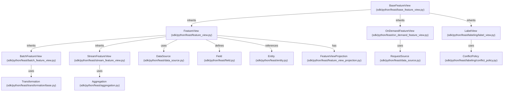
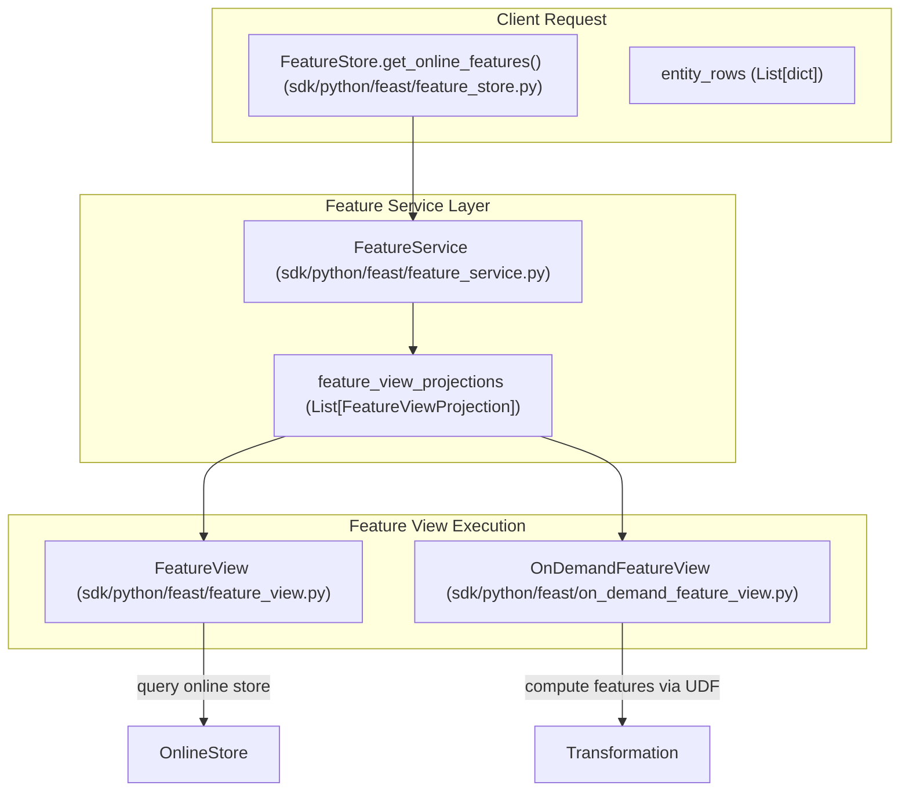

<!-- source: DeepWiki mcp.deepwiki.com · repo feast-dev/feast · page 2.3 Feature Views and Services · fetched 2026-10-21 -->

# Feature Views and Services

<details>
<summary>Relevant source files</summary>

The following files were used as context for generating this wiki page:

- [protos/feast/core/FeatureService.proto](protos/feast/core/FeatureService.proto)
- [protos/feast/core/FeatureView.proto](protos/feast/core/FeatureView.proto)
- [protos/feast/core/FeatureViewProjection.proto](protos/feast/core/FeatureViewProjection.proto)
- [protos/feast/core/OnDemandFeatureView.proto](protos/feast/core/OnDemandFeatureView.proto)
- [protos/feast/core/StreamFeatureView.proto](protos/feast/core/StreamFeatureView.proto)
- [sdk/python/feast/base_feature_view.py](sdk/python/feast/base_feature_view.py)
- [sdk/python/feast/batch_feature_view.py](sdk/python/feast/batch_feature_view.py)
- [sdk/python/feast/diff/registry_diff.py](sdk/python/feast/diff/registry_diff.py)
- [sdk/python/feast/feast_object.py](sdk/python/feast/feast_object.py)
- [sdk/python/feast/feature_service.py](sdk/python/feast/feature_service.py)
- [sdk/python/feast/feature_view.py](sdk/python/feast/feature_view.py)
- [sdk/python/feast/feature_view_projection.py](sdk/python/feast/feature_view_projection.py)
- [sdk/python/feast/infra/compute_engines/__init__.py](sdk/python/feast/infra/compute_engines/__init__.py)
- [sdk/python/feast/infra/compute_engines/kubernetes/main.py](sdk/python/feast/infra/compute_engines/kubernetes/main.py)
- [sdk/python/feast/infra/compute_engines/local/feature_builder.py](sdk/python/feast/infra/compute_engines/local/feature_builder.py)
- [sdk/python/feast/infra/compute_engines/spark/__init__.py](sdk/python/feast/infra/compute_engines/spark/__init__.py)
- [sdk/python/feast/infra/compute_engines/spark/feature_builder.py](sdk/python/feast/infra/compute_engines/spark/feature_builder.py)
- [sdk/python/feast/infra/compute_engines/spark/nodes.py](sdk/python/feast/infra/compute_engines/spark/nodes.py)
- [sdk/python/feast/on_demand_feature_view.py](sdk/python/feast/on_demand_feature_view.py)
- [sdk/python/feast/protos/feast/core/DataSource_pb2.py](sdk/python/feast/protos/feast/core/DataSource_pb2.py)
- [sdk/python/feast/protos/feast/core/DataSource_pb2.pyi](sdk/python/feast/protos/feast/core/DataSource_pb2.pyi)
- [sdk/python/feast/protos/feast/core/FeatureService_pb2.py](sdk/python/feast/protos/feast/core/FeatureService_pb2.py)
- [sdk/python/feast/protos/feast/core/FeatureService_pb2.pyi](sdk/python/feast/protos/feast/core/FeatureService_pb2.pyi)
- [sdk/python/feast/protos/feast/core/FeatureView_pb2.py](sdk/python/feast/protos/feast/core/FeatureView_pb2.py)
- [sdk/python/feast/protos/feast/core/FeatureView_pb2.pyi](sdk/python/feast/protos/feast/core/FeatureView_pb2.pyi)
- [sdk/python/feast/protos/feast/core/StreamFeatureView_pb2.py](sdk/python/feast/protos/feast/core/StreamFeatureView_pb2.py)
- [sdk/python/feast/protos/feast/core/StreamFeatureView_pb2.pyi](sdk/python/feast/protos/feast/core/StreamFeatureView_pb2.pyi)
- [sdk/python/feast/protos/feast/core/Transformation_pb2.pyi](sdk/python/feast/protos/feast/core/Transformation_pb2.pyi)
- [sdk/python/feast/stream_feature_view.py](sdk/python/feast/stream_feature_view.py)
- [sdk/python/feast/transformation/base.py](sdk/python/feast/transformation/base.py)
- [sdk/python/feast/transformation/factory.py](sdk/python/feast/transformation/factory.py)
- [sdk/python/feast/transformation/mode.py](sdk/python/feast/transformation/mode.py)
- [sdk/python/feast/transformation/pandas_transformation.py](sdk/python/feast/transformation/pandas_transformation.py)
- [sdk/python/feast/transformation/python_transformation.py](sdk/python/feast/transformation/python_transformation.py)
- [sdk/python/feast/transformation/ray_transformation.py](sdk/python/feast/transformation/ray_transformation.py)
- [sdk/python/feast/transformation/spark_transformation.py](sdk/python/feast/transformation/spark_transformation.py)
- [sdk/python/feast/transformation/substrait_transformation.py](sdk/python/feast/transformation/substrait_transformation.py)
- [sdk/python/feast/transformation/udf_rehydrate.py](sdk/python/feast/transformation/udf_rehydrate.py)
- [sdk/python/feast/utils.py](sdk/python/feast/utils.py)
- [sdk/python/tests/benchmarks/test_bigquery_partition_pruning_benchmark.py](sdk/python/tests/benchmarks/test_bigquery_partition_pruning_benchmark.py)
- [sdk/python/tests/component/spark/test_nodes.py](sdk/python/tests/component/spark/test_nodes.py)
- [sdk/python/tests/component/spark/test_spark.py](sdk/python/tests/component/spark/test_spark.py)
- [sdk/python/tests/unit/infra/offline_stores/contrib/spark_offline_store/test_spark_bfv_compute_on_read.py](sdk/python/tests/unit/infra/offline_stores/contrib/spark_offline_store/test_spark_bfv_compute_on_read.py)
- [sdk/python/tests/unit/infra/offline_stores/test_bigquery.py](sdk/python/tests/unit/infra/offline_stores/test_bigquery.py)
- [sdk/python/tests/unit/infra/test_inference_unit_tests.py](sdk/python/tests/unit/infra/test_inference_unit_tests.py)
- [sdk/python/tests/unit/online_store/test_online_writes.py](sdk/python/tests/unit/online_store/test_online_writes.py)
- [sdk/python/tests/unit/test_feature_service.py](sdk/python/tests/unit/test_feature_service.py)
- [sdk/python/tests/unit/test_feature_views.py](sdk/python/tests/unit/test_feature_views.py)
- [sdk/python/tests/unit/test_on_demand_feature_view.py](sdk/python/tests/unit/test_on_demand_feature_view.py)
- [sdk/python/tests/unit/test_on_demand_python_transformation.py](sdk/python/tests/unit/test_on_demand_python_transformation.py)
- [sdk/python/tests/unit/test_utils.py](sdk/python/tests/unit/test_utils.py)
- [sdk/python/tests/unit/transformation/test_pandas_transformation.py](sdk/python/tests/unit/transformation/test_pandas_transformation.py)
- [sdk/python/tests/utils/test_wrappers.py](sdk/python/tests/utils/test_wrappers.py)
- [ui/src/components/FeatureServiceFormModal.tsx](ui/src/components/FeatureServiceFormModal.tsx)

</details>


This page documents the core abstractions in Feast used to organize, transform, and serve features for machine learning:

- **Feature Views** define logical groups of features that map data sources to feature schemas, specifying how features are materialized and served.
- **Feature Services** group multiple feature views or other feature groupings into named collections used for training and serving.
- **LabelView** stores mutable labels or judgments separately from immutable feature data, supporting workflows with multiple labelers and conflict policies.

We cover the following classes and their responsibilities:

- `FeatureView` [sdk/python/feast/feature_view.py:111-161]()
- `BatchFeatureView` [sdk/python/feast/batch_feature_view.py:31-85]()
- `StreamFeatureView` [sdk/python/feast/stream_feature_view.py:46-151]()
- `OnDemandFeatureView` [sdk/python/feast/on_demand_feature_view.py:116-259]()
- `LabelView` [sdk/python/feast/labeling/label_view.py]()
- `FeatureService` [sdk/python/feast/feature_service.py:35-160]()

This section explains their implementation, data flow, key APIs, and transformation modes.

For related concepts:
- See [FeatureStore and Configuration (2.1)](2.1) for applying and managing feature views.
- See [Provider and Store Abstractions (2.2)](2.2) for storage backends.
- See [Entities, Fields, and Features (2.4)](2.4) for entity definitions and feature typing.

Sources: [sdk/python/feast/feature_view.py:111-161](), [sdk/python/feast/batch_feature_view.py:31-85](), [sdk/python/feast/stream_feature_view.py:46-151](), [sdk/python/feast/on_demand_feature_view.py:116-259](), [sdk/python/feast/feature_service.py:33-160]()

---

## Feature View Overview

Feature views are the primary abstraction for defining and grouping features in Feast. Each `FeatureView` represents a collection of features sharing:

- **Source data:** Batch or streaming data sources or projections thereof.
- **Schema:** Feature names, data types, and associated join keys.
- **Entities:** The keys used to join for feature retrieval.
- **TTL:** Time to live defining feature validity duration.
- **Serving properties:** Whether features can be served online and/or offline.

Feast defines several specialized feature views:

| Type | Description | Source Type | Transformations Supported |
|---|---|---|---|
| `FeatureView` [sdk/python/feast/feature_view.py:111]() | Core batch features with optional batch/stream sources | Batch and/or stream data sources | None (raw features from sources) |
| `BatchFeatureView` [sdk/python/feast/batch_feature_view.py:31]() | Batch features with UDF transformations | Batch data source or derived from other FVs | User-defined function-based transformations (Python, SQL, Spark, Pandas, Ray) |
| `StreamFeatureView` [sdk/python/feast/stream_feature_view.py:46]() | Features computed from streaming + batch data | Stream sources plus batch for aggregations | UDF + time windowed aggregations |
| `OnDemandFeatureView` [sdk/python/feast/on_demand_feature_view.py:116]() | Features computed at request time | Composed from feature views, projections, and request data sources | UDF transformations (Python, Pandas, Substrait) |

### LabelView - Storing Mutable Labels

The `LabelView` abstraction supports storing mutable labels or human judgments separately from immutable feature data. This is crucial for multi-labeler workflows where labels can be updated or corrected independently over time.

Key features of `LabelView`:

- Defines a label dataset keyed by entities and timestamp.
- Supports multi-labeler workflows by capturing labels from different sources.
- Implements conflict resolution via `ConflictPolicy`.
- Facilitates training dataset generation by joining label data with feature views.

Sources: [sdk/python/feast/feature_view.py:111-161](), [sdk/python/feast/batch_feature_view.py:31-85](), [sdk/python/feast/stream_feature_view.py:46-151](), [sdk/python/feast/on_demand_feature_view.py:116-259](), [sdk/python/feast/feature_service.py:33-160]()

---

## Feature View Class Hierarchy and Code Entities

**Diagram: Feature View Class Hierarchy and Code Entities**



This diagram illustrates inheritance and composition across core Python classes:

- All feature views inherit from `BaseFeatureView` [sdk/python/feast/base_feature_view.py:34]().
- `FeatureView` is the core batch grouping [sdk/python/feast/feature_view.py:111](), extended by `BatchFeatureView` and `StreamFeatureView` [sdk/python/feast/stream_feature_view.py:46]().
- `OnDemandFeatureView` [sdk/python/feast/on_demand_feature_view.py:116]() and `LabelView` [sdk/python/feast/labeling/label_view.py]() directly inherit from `BaseFeatureView` [sdk/python/feast/base_feature_view.py:34]().
- `FeatureView` and subclasses reference entities, data sources, and features [sdk/python/feast/feature_view.py:143-150]().
- Transformations and aggregations are used in batch and stream variants [sdk/python/feast/stream_feature_view.py:100-104]().
- `OnDemandFeatureView` consumes projections and request data [sdk/python/feast/on_demand_feature_view.py:144-145]().

Sources: [sdk/python/feast/base_feature_view.py:34](), [sdk/python/feast/feature_view.py:111-161](), [sdk/python/feast/batch_feature_view.py:31-85](), [sdk/python/feast/stream_feature_view.py:46-151](), [sdk/python/feast/on_demand_feature_view.py:116-259]()

---

## FeatureView (Base Batch FeatureView)

`FeatureView` defines a logical grouping of immutable features sourced directly from batch and optional stream data, without transformations.

### Key Attributes

| Attribute              | Type                                     | Description                                                    |
|------------------------|------------------------------------------|----------------------------------------------------------------|
| `name`                 | `str`                                   | Unique feature view identifier [sdk/python/feast/feature_view.py:143] |
| `entities`             | `List[str]`                             | Entity names (join keys) associated [sdk/python/feast/feature_view.py:144] |
| `ttl`                  | `Optional[timedelta]`                   | Validity duration of features (0 means no expiration) [sdk/python/feast/feature_view.py:145] |
| `batch_source`         | `Optional[DataSource]`                   | Batch source for offline features [sdk/python/feast/feature_view.py:146] |
| `stream_source`        | `Optional[DataSource]`                   | Real-time source for online features [sdk/python/feast/feature_view.py:147] |
| `features`             | `List[Field]`                           | Feature columns and types [sdk/python/feast/feature_view.py:150] |
| `entity_columns`       | `List[Field]`                           | Columns corresponding to entity join keys [sdk/python/feast/feature_view.py:149] |
| `online`               | `bool`                                 | Support for online retrieval [sdk/python/feast/feature_view.py:151] |
| `offline`              | `bool`                                 | Support for offline retrieval [sdk/python/feast/feature_view.py:152] |
| `mode`                 | `Optional[Union[TransformationMode, str]]` | Transformation mode (mostly unused here) [sdk/python/feast/feature_view.py:158] |
| `state`                | `FeatureViewState`                      | Lifecycle state (`CREATED`, `GENERATED`, etc.) [sdk/python/feast/feature_view.py:53-92] |

### Dummy Entity for Entityless FeatureViews

To support entityless feature views, a special dummy entity is used:

```python
DUMMY_ENTITY_ID = "__dummy_id"
DUMMY_ENTITY_NAME = "__dummy"
DUMMY_ENTITY = Entity(
    name=DUMMY_ENTITY_NAME,
    join_keys=[DUMMY_ENTITY_ID],
    value_type=ValueType.UNKNOWN,
)
```

This allows consistent treatment of feature retrieval keys, even when no explicit join keys exist [sdk/python/feast/feature_view.py:95-103]().

### Lifecycle

Feature views have defined lifecycle states (`FeatureViewState`) that govern transitions from creation through availability to materialization:

```python
class FeatureViewState(enum.IntEnum):
    STATE_UNSPECIFIED = 0
    CREATED = 1
    GENERATED = 2
    MATERIALIZING = 3
    AVAILABLE_ONLINE = 4

    def can_transition_to(self, target: "FeatureViewState") -> bool:
        """Return True if transitioning from this state to *target* is allowed."""
        allowed = _VALID_STATE_TRANSITIONS.get(self, set())
        return target in allowed

# Valid state transitions:
_VALID_STATE_TRANSITIONS = {
    FeatureViewState.STATE_UNSPECIFIED: {FeatureViewState.CREATED},
    FeatureViewState.CREATED: {FeatureViewState.GENERATED},
    FeatureViewState.GENERATED: {FeatureViewState.MATERIALIZING},
    FeatureViewState.MATERIALIZING: {
        FeatureViewState.AVAILABLE_ONLINE,
        FeatureViewState.GENERATED,
    },
    FeatureViewState.AVAILABLE_ONLINE: {FeatureViewState.MATERIALIZING},
}
```

Sources: [sdk/python/feast/feature_view.py:53-92](), [sdk/python/feast/feature_view.py:111-178]()

---

## BatchFeatureView

`BatchFeatureView` extends `FeatureView` to enable feature transformations applied during batch materialization. This includes UDFs written in Python, Pandas, SQL, Spark, or Ray.

### Transformation Modes Supported

| Mode     | Description               |
|----------|---------------------------|
| `PYTHON` | Python native UDFs        |
| `PANDAS` | Pandas vectorized         |
| `SPARK`  | Apache Spark transformations |
| `SQL`    | SQL query transformations |
| `RAY`    | Ray distributed           |

### Feature Transformation

- `BatchFeatureView` has the `feature_transformation` attribute that encapsulates user-defined function logic for feature computation during batch materialization. This transformation runs over input data to derive feature columns [sdk/python/feast/batch_feature_view.py:31-229]().
- Supports complex feature engineering pipelines, including chaining feature views and joining on entities [sdk/python/feast/batch_feature_view.py:31-229]().

### Validation

- Mandatory batch source to ingest features offline.
- Entity and schema consistency is required.
- UDF and source validation guards against misconfiguration (e.g., disallow stream-only sources in batch contexts) [sdk/python/feast/batch_feature_view.py:113-136]().

Sources: [sdk/python/feast/batch_feature_view.py:31-85](), [sdk/python/tests/unit/test_feature_views.py:52-85]()

---

## StreamFeatureView

`StreamFeatureView` supports features computed from streaming systems and associated batch data, allowing time-windowed aggregations and continuous feature computation.

### Stream Source Validation

- Stream source must be one of `KafkaSource`, `PushSource`, or a custom source [sdk/python/feast/stream_feature_view.py:42-148]().
- Aggregations require a valid timestamp field [sdk/python/feast/stream_feature_view.py:150-153]().

### Time-Window Aggregations

- Supports aggregations computed over time windows, grouped by entities [sdk/python/feast/stream_feature_view.py:100-104]().
- Supports tiling optimizations for efficient aggregation with attributes like `enable_tiling` and `tiling_hop_size` (defaulting to 5 minutes) [sdk/python/feast/stream_feature_view.py:46-151]().

Sources: [sdk/python/feast/stream_feature_view.py:42-151]()

---

## OnDemandFeatureView

`OnDemandFeatureView` defines features computed dynamically at retrieval time by applying transformations on input data sources (feature views and request sources). This enables flexible runtime feature generation without pre-materializing features.

### Design and Data Flow

**Diagram: On-Demand Feature View Data Flow and Code Entities**

```mermaid
graph TD
    subgraph "Input Sources"
        FV1["FeatureView (sdk/python/feast/feature_view.py)"]
        FV2["FeatureView (sdk/python/feast/feature_view.py)"]
        RS["RequestSource (sdk/python/feast/data_source.py)"]
    end
    
    subgraph "OnDemandFeatureView Definition"
        ODFV["OnDemandFeatureView (sdk/python/feast/on_demand_feature_view.py)"]
        Transform["Transformation (sdk/python/feast/transformation/base.py)"]
        Aggs["Aggregation (sdk/python/feast/aggregation.py)"]
    end
    
    FV1 -->|"feature projections" | SFVP["source_feature_view_projections"]
    FV2 -->|"feature projections" | SFVP
    RS -->|"request features" | SRS["source_request_sources"]
    
    SFVP -->| "inputs to" | ODFV
    SRS -->| "inputs to" | ODFV
    
    ODFV -->| "executes feature_transformation" | Transform
    ODFV -->| "optionally applies aggregations" | Aggs
    
    ODFV -->| "If write_to_online_store=True" | OnlineStore["OnlineStore"]
    ODFV -->| "Else: runtime computation" | RuntimeComputation["Runtime Computation Only"]
```

Description:

- Inputs can be projections of existing feature views and request-time data sources, which the on-demand feature view uses as sources [sdk/python/feast/on_demand_feature_view.py:144-145]().
- Feature transformation is expressed as a user-defined transformation, supporting multiple modes (Python, Pandas, Substrait) [sdk/python/feast/on_demand_feature_view.py:146-157]().
- Aggregations can optionally replace or augment transformations.
- If configured with `write_to_online_store=True`, transformed features can be materialized into the online store for faster retrieval; otherwise, features are computed on-the-fly at query time.

Sources: [sdk/python/feast/on_demand_feature_view.py:116-259]()

### Supported Transformation Modes

| Mode      | Transformation Class | Input Type     | Description                            |
|-----------|----------------------|----------------|--------------------------------------|
| `python`  | `PythonTransformation` [sdk/python/feast/transformation/python_transformation.py]() | `dict[str, Any]` | Native Python dictionary inputs, supports singleton mode (single row) |
| `pandas`  | `PandasTransformation` [sdk/python/feast/transformation/pandas_transformation.py]() | `pd.DataFrame`  | Vectorized transformation using Pandas |
| `substrait` | `SubstraitTransformation` [sdk/python/feast/transformation/substrait_transformation.py]() | Substrait execution plan | SQL-like cross-platform transformations |

Sources: [sdk/python/feast/on_demand_feature_view.py:34-36](), [sdk/python/feast/transformation/python_transformation.py:17-178]()

### Write to Online Store

- When `write_to_online_store=True`, features are precomputed and persisted to the online store for improved retrieval performance.
- This configuration requires entities to be defined to enable join keys; omitting entities in this case results in validation errors [sdk/python/feast/on_demand_feature_view.py:64-69]().
- Default `write_to_online_store=False` means features are computed at runtime on demand.

Sources: [sdk/python/feast/on_demand_feature_view.py:116-184](), [protos/feast/core/OnDemandFeatureView.proto]()

---

## LabelView

`LabelView` is a specialized primitive designed to capture mutable labels or judgments distinct from the immutable features stored by feature views.

### Purpose and Usage

- Store labels collected externally or via human annotation systems.
- Support multiple labelers to provide multiple versions or perspectives of labels.
- Enable defining conflict resolution strategies via `ConflictPolicy`.
- Labels are stored with association to entities and event timestamps, separate from immutable features.
- Supports generating training datasets by joining label views with feature views keyed by entity and event timestamp.

Sources: [sdk/python/feast/labeling/label_view.py]()

---

## FeatureService

A `FeatureService` defines a logical grouping of features from one or more feature views, on-demand feature views, and label views. This grouping allows retrieving a coherent set of features together for training or serving [sdk/python/feast/feature_service.py:35-160]().

### Core Attributes

| Attribute              | Description                                  |
|------------------------|----------------------------------------------|
| `name`                 | Unique name for the feature service [sdk/python/feast/feature_service.py:52]() |
| `_features`            | List of feature views, on-demand feature views, or label views included [sdk/python/feast/feature_service.py:53]() |
| `feature_view_projections` | List of `FeatureViewProjection` representing features available in this service [sdk/python/feast/feature_service.py:55]() |
| `description`          | Human-readable description [sdk/python/feast/feature_service.py:56]() |
| `tags`                 | User-defined metadata key-value pairs [sdk/python/feast/feature_service.py:57]() |
| `owner`                | Owner email or identifier [sdk/python/feast/feature_service.py:58]() |
| `logging_config`       | Optional feature request logging configuration [sdk/python/feast/feature_service.py:61]() |
| `precompute_online`    | Enables precomputed online feature vectors for fast serving [sdk/python/feast/feature_service.py:63]() |

### Feature Inference and Validation

- At construction, string references to features are stored in `_pending_feature_refs` and resolved into `FeatureViewProjection` objects during `resolve_pending_refs`.
- Supports pinning feature view versions (e.g., `"fv@v2"`) to resolve specific snapshots from the registry.
- When resolving, string refs are replaced with projections and validated that requested features exist, raising errors if features are missing [sdk/python/feast/feature_service.py:131-153]().

Sources: [sdk/python/feast/feature_service.py:33-160](), [protos/feast/core/FeatureService.proto]()

---

## Data Flow of Feature Retrieval

**Diagram: Feature Retrieval Data Flow and Code Entities**



- The client invokes `get_online_features` passing entity rows.
- The `FeatureService` resolves requested features into projections that specify exact features and versions [sdk/python/feast/feature_service.py:111-130]().
- `FeatureView`s use projections to directly query the online store for pre-materialized features.
- `OnDemandFeatureView`s compute features dynamically using transformations at query time or read precomputed data if `write_to_online_store=True`.

Sources: [sdk/python/feast/feature_service.py:33-160](), [sdk/python/feast/feature_view.py:111-183](), [sdk/python/feast/on_demand_feature_view.py:116-129]()

---

# Summary

This page covers Feast's abstractions for defining and composing features:

- `FeatureView`: Basic batch grouping mapping data sources to features [sdk/python/feast/feature_view.py:111-161]().
- `BatchFeatureView` and `StreamFeatureView`: Feature views extended with transformations and streaming/aggregation capabilities [sdk/python/feast/batch_feature_view.py:31-85](), [sdk/python/feast/stream_feature_view.py:46-151]().
- `OnDemandFeatureView`: Runtime feature computation via user-defined transformations on input sources [sdk/python/feast/on_demand_feature_view.py:116-259]().
- `LabelView`: Label dataset abstraction supporting mutable, multi-labeler workflows [sdk/python/feast/labeling/label_view.py]().
- `FeatureService`: Logical grouping of features for unified retrieval in training and serving [sdk/python/feast/feature_service.py:35-160]().

Sources: [sdk/python/feast/feature_view.py](), [sdk/python/feast/batch_feature_view.py](), [sdk/python/feast/stream_feature_view.py](), [sdk/python/feast/on_demand_feature_view.py](), [sdk/python/feast/feature_service.py](), [sdk/python/feast/feature_view_projection.py](), [sdk/python/feast/labeling/label_view.py](), [sdk/python/feast/base_feature_view.py]()

---

