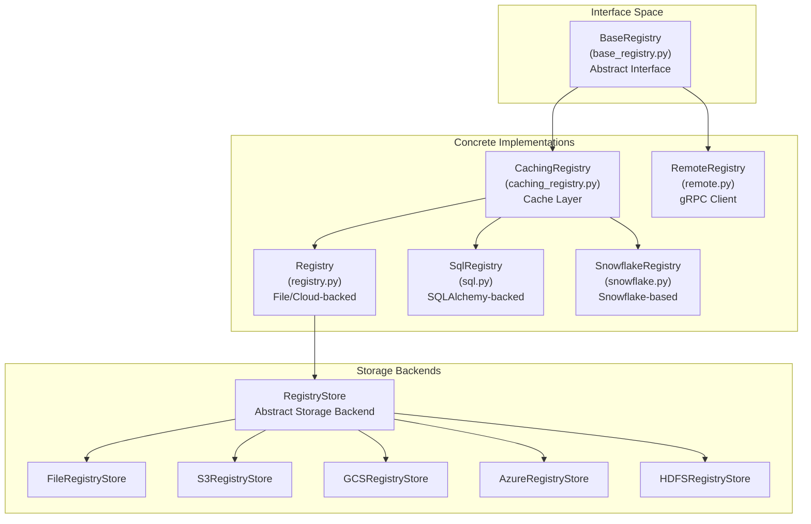
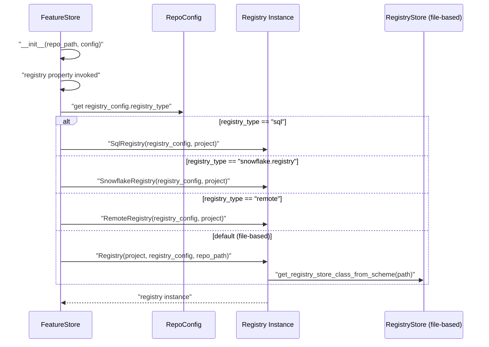
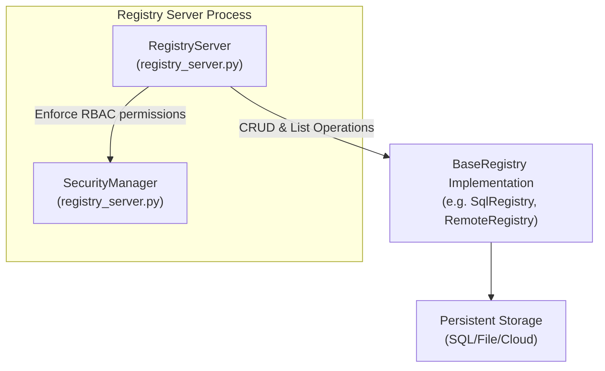

<!-- source: DeepWiki mcp.deepwiki.com · repo feast-dev/feast · page 2.5 Registry and Metadata Storage · fetched 2026-10-21 -->

# Registry and Metadata Storage

Relevant source files

The following files were used as context for generating this wiki page:

- [docs/getting-started/components/registry.md](docs/getting-started/components/registry.md)
- [docs/how-to-guides/starting-feast-servers-tls-mode.md](docs/how-to-guides/starting-feast-servers-tls-mode.md)
- [docs/reference/feature-servers/README.md](docs/reference/feature-servers/README.md)
- [docs/reference/registries/gcs.md](docs/reference/registries/gcs.md)
- [docs/reference/registries/local.md](docs/reference/registries/local.md)
- [docs/reference/registries/remote.md](docs/reference/registries/remote.md)
- [docs/reference/registries/s3.md](docs/reference/registries/s3.md)
- [docs/reference/registries/snowflake.md](docs/reference/registries/snowflake.md)
- [protos/feast/core/SavedDataset.proto](protos/feast/core/SavedDataset.proto)
- [protos/feast/registry/RegistryServer.proto](protos/feast/registry/RegistryServer.proto)
- [sdk/python/feast/infra/registry/base_registry.py](sdk/python/feast/infra/registry/base_registry.py)
- [sdk/python/feast/infra/registry/caching_registry.py](sdk/python/feast/infra/registry/caching_registry.py)
- [sdk/python/feast/infra/registry/proto_registry_utils.py](sdk/python/feast/infra/registry/proto_registry_utils.py)
- [sdk/python/feast/infra/registry/registry.py](sdk/python/feast/infra/registry/registry.py)
- [sdk/python/feast/infra/registry/remote.py](sdk/python/feast/infra/registry/remote.py)
- [sdk/python/feast/infra/registry/snowflake.py](sdk/python/feast/infra/registry/snowflake.py)
- [sdk/python/feast/infra/registry/sql.py](sdk/python/feast/infra/registry/sql.py)
- [sdk/python/feast/protos/feast/core/SavedDataset_pb2.py](sdk/python/feast/protos/feast/core/SavedDataset_pb2.py)
- [sdk/python/feast/protos/feast/core/SavedDataset_pb2.pyi](sdk/python/feast/protos/feast/core/SavedDataset_pb2.pyi)
- [sdk/python/feast/protos/feast/registry/RegistryServer_pb2.py](sdk/python/feast/protos/feast/registry/RegistryServer_pb2.py)
- [sdk/python/feast/protos/feast/registry/RegistryServer_pb2.pyi](sdk/python/feast/protos/feast/registry/RegistryServer_pb2.pyi)
- [sdk/python/feast/registry_server.py](sdk/python/feast/registry_server.py)
- [sdk/python/feast/saved_dataset.py](sdk/python/feast/saved_dataset.py)
- [sdk/python/tests/integration/registration/test_universal_registry.py](sdk/python/tests/integration/registration/test_universal_registry.py)
- [sdk/python/tests/unit/infra/offline_stores/contrib/spark_offline_store/test_spark_persist.py](sdk/python/tests/unit/infra/offline_stores/contrib/spark_offline_store/test_spark_persist.py)
- [sdk/python/tests/unit/infra/registry/test_remote_registry.py](sdk/python/tests/unit/infra/registry/test_remote_registry.py)
- [sdk/python/tests/unit/infra/registry/test_remote_registry_mtls.py](sdk/python/tests/unit/infra/registry/test_remote_registry_mtls.py)
- [sdk/python/tests/unit/infra/registry/test_sql_registry.py](sdk/python/tests/unit/infra/registry/test_sql_registry.py)
- [sdk/python/tests/unit/local_feast_tests/test_local_feature_store.py](sdk/python/tests/unit/local_feast_tests/test_local_feature_store.py)
- [sdk/python/tests/utils/ssl_certifcates_util.py](sdk/python/tests/utils/ssl_certifcates_util.py)

## Purpose and Scope

The Registry in Feast serves as the centralized metadata store responsible for managing and persisting feature store definitions and associated metadata such as entities, data sources, feature views, feature services, permissions, and infrastructure objects. It maintains the canonical state of a Feast feature store and supports multiple backend implementations for flexibility and scalability.

This page details the Registry architecture and implementation specifics, including:

- The core abstract interface `BaseRegistry` [sdk/python/feast/infra/registry/base_registry.py:62-66]().
- Concrete registry implementations: `Registry` (file-based) [sdk/python/feast/infra/registry/registry.py:69-82](), `SqlRegistry` (relational databases) [sdk/python/feast/infra/registry/sql.py:91-219](), `SnowflakeRegistry` (Snowflake-specific) [sdk/python/feast/infra/registry/snowflake.py:125-135](), `RemoteRegistry` (gRPC client) [sdk/python/feast/infra/registry/remote.py:97-105]().
- The caching layer `CachingRegistry` used to reduce backend hits via in-memory proto caching [sdk/python/feast/infra/registry/caching_registry.py:31-62]().
- The Feast Registry Server (`RegistryServer`) exposing the registry over gRPC and REST [sdk/python/feast/registry_server.py:181-184]().
- How feature definitions and metadata are serialized, stored, and retrieved, plus saved datasets [protos/feast/registry/RegistryServer.proto:64-68]().
- Data flow and interaction with the registry from upstream components.

For how `FeatureStore` interacts with the registry, refer to the pages on [FeatureStore and Configuration (2.1)](2.1) and [Provider and Store Abstractions (2.2)](2.2).

Sources: [sdk/python/feast/infra/registry/base_registry.py:62-66](), [sdk/python/feast/infra/registry/caching_registry.py:31-62](), [sdk/python/feast/infra/registry/registry.py:69-82](), [sdk/python/feast/infra/registry/remote.py:97-105](), [sdk/python/feast/infra/registry/snowflake.py:125-135](), [sdk/python/feast/infra/registry/sql.py:91-219](), [sdk/python/feast/registry_server.py:181-184](), [protos/feast/registry/RegistryServer.proto:64-68]()

---

## Registry Architecture

### Registry Interface and Implementation Hierarchy

Feast defines an abstract interface `BaseRegistry` that specifies the essential CRUD and list operations for feature store metadata. Different concrete classes implement this interface to persist metadata in various storage backends.

- `BaseRegistry` — Abstract base class outlining all metadata operations with methods to apply, get, list, and delete entities, data sources, feature views (and variants), feature services, permissions, saved datasets, projects, and infra [sdk/python/feast/infra/registry/base_registry.py:62-66]().
- `CachingRegistry` — Abstract caching wrapper for a `BaseRegistry` implementation, providing TTL-based caching of the full serialized registry protobuf [sdk/python/feast/infra/registry/caching_registry.py:31-62]().
- `Registry` — File-backed registry persisting a single serialized proto file. Supports local filesystem and cloud object storage (S3, GCS, Azure, HDFS) via `RegistryStore` backends [sdk/python/feast/infra/registry/registry.py:69-82]().
- `SqlRegistry` — SQL database-backed registry implemented using SQLAlchemy, with tables representing each Feast object type [sdk/python/feast/infra/registry/sql.py:10-28]().
- `SnowflakeRegistry` — Registry implemented on top of Snowflake, using tables to store Feast metadata, with SQL management scripts for initialization [sdk/python/feast/infra/registry/snowflake.py:125-135]().
- `RemoteRegistry` — gRPC client wrapper connecting to a remote Feast Registry Server exposing registry RPCs [sdk/python/feast/infra/registry/remote.py:97-105]().

Sources: [sdk/python/feast/infra/registry/base_registry.py:62-66](), [sdk/python/feast/infra/registry/caching_registry.py:31-62](), [sdk/python/feast/infra/registry/registry.py:69-82](), [sdk/python/feast/infra/registry/sql.py:10-28](), [sdk/python/feast/infra/registry/snowflake.py:125-135](), [sdk/python/feast/infra/registry/remote.py:97-105]()

---

### Registry Initialization Flow

At runtime, `FeatureStore` inspects the configured `registry` type from `feature_store.yaml` and lazily creates the appropriate Registry implementation. The conditional flow is:

Sources: [sdk/python/feast/infra/registry/registry.py:146-172](), [sdk/python/feast/infra/registry/sql.py:230-275](), [sdk/python/feast/infra/registry/snowflake.py:125-135](), [sdk/python/feast/infra/registry/remote.py:97-105]()

---

## Registry Implementations

### 1. File-Based Registry (`Registry`)

The `Registry` class persists the entire feature store metadata as a single serialized Protocol Buffer (`RegistryProto`) blob in the configured storage backend.

- Uses polymorphic storage backends implementing `RegistryStore`: local file system (`FileRegistryStore`), cloud object storage (`S3RegistryStore`, `GCSRegistryStore`, etc.) [sdk/python/feast/infra/registry/registry.py:69-82]().
- Serializes collections of Feast metadata objects (entities, feature views, data sources, permissions, etc.) into a top-level `RegistryProto` message.
- Employs thread locking (`threading.Lock()`) to guarantee safe concurrent access during read-write [sdk/python/feast/infra/registry/registry.py:18]().
- Updates the registry proto file atomically to maintain consistency.
  
This model simplifies coordination by bundling all metadata into one file, though it can be slower for large-scale metadata requiring frequent changes.

Sources: [sdk/python/feast/infra/registry/registry.py:69-82](), [protos/feast/registry/RegistryServer.proto:7]()

---

### 2. SQL-Based Registry (`SqlRegistry`)

`SqlRegistry` stores registry metadata in a relational database using SQLAlchemy ORM mapping tables to Feast object types.

#### Schema Overview

| Table | Primary Key(s) | Feast Object Type | Proto Blob Column |
|-------|----------------|-------------------|-------------------|
| `projects` | `project_id` | Project | `project_proto` (binary) [sql.py:120-127]() |
| `entities` | `entity_name`, `project_id` | Entity | `entity_proto` (binary) [sql.py:131-138]() |
| `data_sources` | `data_source_name`, `project_id` | DataSource | `data_source_proto` (binary) [sql.py:142-149]() |
| `feature_views` | `feature_view_name`, `project_id` | FeatureView | `feature_view_proto` (binary) [sql.py:153-162]() |
| `stream_feature_views` | `feature_view_name`, `project_id` | StreamFeatureView | `feature_view_proto` (binary) [sql.py:166-174]() |
| `on_demand_feature_views` | `feature_view_name`, `project_id` | OnDemandFeatureView | `feature_view_proto` (binary) [sql.py:178-182]() |
| `label_views` | `feature_view_name`, `project_id` | LabelView | `label_view_proto` (binary) [sql.py:70]() |
| `feature_services` | `feature_service_name`, `project_id` | FeatureService | `feature_service_proto` (binary) [sql.py:65]() |
| `saved_datasets` | `saved_dataset_name`, `project_id` | SavedDataset | `saved_dataset_proto` (binary) [sql.py:77]() |
| `validation_references` | `validation_reference_name`, `project_id` | ValidationReference | `validation_reference_proto` (binary) [sql.py:82]() |
| `managed_infra` | `infra_name`, `project_id` | Infra object | `infra_proto` (binary) [sql.py:69]() |
| `permissions` | `permission_name`, `project_id` | Permission | `permission_proto` (binary) [sql.py:74]() |

Each table also includes a `last_updated_timestamp` 64-bit integer column for concurrency control and caching [sql.py:91-219]().

#### Implementation Details

- Uses `ProtoBytes` SQLAlchemy column type to store large serialized protos safely across dialects, circumventing MySQL/MariaDB's 64KB `BLOB` truncation issue by using `LONGBLOB` [sql.py:113-117]().
- Supports separate `path` and `read_path` in `SqlRegistryConfig` to enable read replicas/load balancing in database deployments [test_sql_registry.py:72-86]().
- Explicit indices on project columns optimize query filtering [sql.py:129,140,151,164,176]().
- CRUD operations serialize Feast objects into protobuf bytes stored in respective tables; queries deserialize protos to return typed Feast objects.

This relational approach scales well for enterprise deployments requiring SQL-managed persistence and transactional capabilities.

Sources: [sdk/python/feast/infra/registry/sql.py:10-219](), [sdk/python/tests/unit/infra/registry/test_sql_registry.py:72-86]()

---

### 3. Snowflake Registry (`SnowflakeRegistry`)

`SnowflakeRegistry` is an implementation of `BaseRegistry` that stores registry metadata directly in Snowflake tables.

- On initialization, it connects to Snowflake via configured credentials in `SnowflakeRegistryConfig` [snowflake.py:75-122]().
- Executes bundled SQL schema creation scripts (`snowflake_table_creation.sql`) via Snowflake connection for initial setup [snowflake.py:141-150]().
- Synchronizes Feast project metadata in a dedicated table for tracking and purging if enabled [snowflake.py:174-187]().
- Maintains an in-memory cached registry proto with configurable TTL similar to `CachingRegistry` [snowflake.py:157-166]().
- Provides methods for CRUD operations via Snowflake SQL statements, storing serialized protos as binary columns.

This registry backs Feast metadata within the Snowflake data warehouse itself, easing integration and reducing dependencies on external registries.

Sources: [sdk/python/feast/infra/registry/snowflake.py:33-35,125-187]()

---

### 4. Remote Registry (`RemoteRegistry`)

`RemoteRegistry` delegates all registry operations via gRPC calls to a remote Feast Registry Server.

- Uses `RegistryServerStub` gRPC client generated from Feast protos to perform RPC calls for all metadata CRUD and listing operations [remote.py:112-116]().
- Manages secure TLS and mutual TLS (mTLS) credentials if configured in `RemoteRegistryConfig` [remote.py:116-153]().
- Intercepts gRPC calls with authentication headers via `GrpcClientAuthHeaderInterceptor` based on Feast's auth configuration [remote.py:113-114]().
- Abstracts the remote call details, exposing `BaseRegistry` interface methods transparently.
- Corresponding registry server (`RegistryServer`) implements server-side permission checks, pagination, and sorting [registry_server.py:50-112,181-184]().

This setup enables distributed Feast deployments where multiple clients access a centralized authoritative registry over secure gRPC.

Sources: [sdk/python/feast/infra/registry/remote.py:97-160](), [sdk/python/feast/registry_server.py:50-112,181-184]()

---

## Registry Data Model and Saved Datasets

Feast metadata objects are serialized as Protocol Buffer messages for efficient storage and transmission.

| Feast Object         | Python Class          | Proto Message Type                 |
|----------------------|----------------------|----------------------------------|
| Entity               | `Entity`             | `EntityProto` [sql.py:64]()      |
| FeatureView          | `FeatureView`        | `FeatureViewProto` [sql.py:68]() |
| StreamFeatureView    | `StreamFeatureView`  | `StreamFeatureViewProto` [sql.py:78]() |
| OnDemandFeatureView  | `OnDemandFeatureView`| `OnDemandFeatureViewProto` [sql.py:71]() |
| LabelView            | `LabelView`          | `LabelViewProto` [sql.py:70]()   |
| FeatureService       | `FeatureService`     | `FeatureServiceProto` [sql.py:65]() |
| DataSource           | `DataSource`         | `DataSourceProto` [sql.py:63]()  |
| SavedDataset         | `SavedDataset`       | `SavedDatasetProto` [sql.py:77]()|
| Permission           | `Permission`         | `PermissionProto` [sql.py:74]()  |

These protos are aggregated inside the top-level `RegistryProto`, the master representation of all Feast metadata persisted [sql.py:76]().

### Saved Datasets and Validation References

- `SavedDataset` and `ValidationReference` are entities representing persisted feature retrievals, training datasets, and data quality validation profiles.
- They are registered and managed through the registry interfaces to enable tracking and lineage auditing.
  
Sources: [sdk/python/feast/infra/registry/sql.py:63-83](), [sdk/python/feast/saved_dataset.py:1-50]()

---

## Registry Operations

### Core Interface (`BaseRegistry`)

`BaseRegistry` defines abstract methods to apply (create/update), retrieve, list, and delete all key Feast metadata objects:

**Entity Operations:**

- `apply_entity(entity, project, commit=True)` registers or updates an entity [base_registry.py:75-83]().
- `get_entity(name, project, allow_cache=False) -> Entity` retrieves an entity by name [base_registry.py:99-111]().
- `list_entities(project, allow_cache=False, tags=None) -> List[Entity]` lists entities optionally filtered by tag [base_registry.py:117-131]().
- `delete_entity(name, project, commit=True)` deletes an entity [base_registry.py:87-95]().

**DataSource Operations:**

- `apply_data_source(data_source, project, commit=True)` registers a data source [base_registry.py:136-146]().
- `get_data_source(name, project, allow_cache=False) -> DataSource` retrieves a data source [base_registry.py:162-175]().
- `list_data_sources(project, allow_cache=False, tags=None)` lists data sources filtered by project/tags [base_registry.py:180-192]().
- `delete_data_source(name, project, commit=True)` deletes a data source [base_registry.py:150-158]().

**FeatureView and Variants Operations:**

- `apply_feature_view(feature_view, project, commit=True)` applies a feature view [base_registry.py:223-233]().
- `get_feature_view(name, project, allow_cache=False) -> FeatureView` retrieves a feature view [base_registry.py:249-262]().
- `list_feature_views(project, allow_cache=False, tags=None)` lists feature views [base_registry.py:265-280]().
- `delete_feature_view(name, project, commit=True)` deletes a feature view [base_registry.py:236-246]().

**FeatureService Operations:**

- `apply_feature_service(feature_service, project, commit=True)` applies a feature service [base_registry.py:194-204]().
- `get_feature_service(name, project)` retrieves a feature service [base_registry.py:210-218]().
- `list_feature_services(project)` lists feature services [base_registry.py:283-297]().
- `delete_feature_service(name, project, commit=True)` deletes a feature service [base_registry.py:207-218]().

Each implementation is responsible for permission enforcement, validation, concurrency management, and project scoping.

Sources: [sdk/python/feast/infra/registry/base_registry.py:62-220]()

---

### Versioning Support

Feature views support versioned snapshots for reproducibility.

- The utility `get_feature_view_by_version` extracts a specific version record from registry version history (`feature_view_version_history` in `RegistryProto`) [proto_registry_utils.py:169-192]().
- Deserializes the stored proto bytes into the right type (`FeatureView`, `StreamFeatureView`, `OnDemandFeatureView`, or `LabelView`) [proto_registry_utils.py:187-199]().

This enables users and Feast internal processes to reference immutable versions of feature views for consistent training and auditing.

Sources: [sdk/python/feast/infra/registry/proto_registry_utils.py:169-199]()

---

## Caching Mechanism

To reduce backend loads and improve latency, Feast employs caching:

### CachingRegistry

- Wraps a `BaseRegistry` implementation and caches a fully deserialized `RegistryProto` in-memory.
- Maintains:
  - `cached_registry_proto` — the last cached full registry proto snapshot.
  - `cached_registry_proto_created` — the timestamp when cache was refreshed.
  - `cached_registry_proto_ttl` — configured TTL (seconds) after which cache should refresh.
- Supports synchronous refreshing on-demand (`sync` mode), or background asynchronous refreshing using a thread (`thread` mode).
- On registry read methods (e.g. `get_entity`, `list_feature_views`), if `allow_cache=True` it returns data from the cached proto for quick reads; otherwise it queries the backend directly.
  
Caching mitigates the overhead of repeated backend fetches and allows batch deserialization and filtering of the registry proto.

Sources: [sdk/python/feast/infra/registry/caching_registry.py:31-62]()

---

## Registry Server (gRPC & REST)

Feast exposes the Registry service as a network API for remote registry access:

### `RegistryServer` gRPC Service

- Implements the full `RegistryServerServicer` RPC interface over gRPC based on proto definitions [registry_server.py:181-184]().
- Supports CRUD and listing calls for all Feast object types: entities, feature views, data sources, feature services, permissions, saved datasets, projects, infra [protos/feast/registry/RegistryServer.proto:23-109]().
- Implements pagination, sorting, and filtering server-side using functions like `apply_pagination_and_sorting` [registry_server.py:50-112]().
- Enforces RBAC policies and permission checks via security manager and authentication interceptors [registry_server.py:24-31]().
- Calls to the underlying `BaseRegistry` implementation proxy the actual persistent storage actions.

Sources: [sdk/python/feast/registry_server.py:24-31,50-112,181-184](), [protos/feast/registry/RegistryServer.proto:23-109]()

---

## Persistence and Retrieval Data Flow

### Apply/Commit Flow

1. User invokes `FeatureStore.apply()` or CLI operations to register/update entities, feature views, etc.
2. The configured `Registry` implementation's `apply_*` methods are called internally.
3. The objects are serialized to protobuf messages containing all necessary metadata.
4. The registry persists these messages atomically in the backend store:
   - `Registry`: Updates full serialized proto file atomically in local/cloud storage.
   - `SqlRegistry`: Inserts or updates rows in the relational tables per Feast object.
   - `SnowflakeRegistry`: Runs SQL inserts/updates in Snowflake tables.
   - `RemoteRegistry`: Sends gRPC calls to the remote registry server.
5. If caching is enabled, cached proto snapshots are updated or invalidated.

### Read/Query Flow

1. User calls `get_*` or `list_*` methods on the registry.
2. If `allow_cache=True` and caching is enabled, returns unmarshalled objects from cached `RegistryProto`.
3. Otherwise, registry queries the backend directly:
   - `Registry`: Reads and deserializes proto file.
   - `SqlRegistry`: Reads rows from SQL tables and deserializes each object's proto blob.
   - `RemoteRegistry`: Invokes corresponding gRPC RPC calls.
4. Returns typed Feast domain objects (`Entity`, `FeatureView`, etc.) based on deserialized protos.

Sources: [sdk/python/feast/infra/registry/base_registry.py:62-220](), [sdk/python/feast/infra/registry/sql.py:91-219]()

---

## Summary

Feast employs a modular, extensible Registry architecture that centralizes feature store metadata persistence. The core interface `BaseRegistry` defines expected operations, supported by multiple implementations:

- **File Registry:** Single-file serialized proto backed by file system or cloud storage.
- **SQL Registry:** Relational database storage supporting large scale and robustness.
- **Snowflake Registry:** Snowflake-native storage and management using SQL tables.
- **Remote Registry:** gRPC client connecting to a centralized remote registry server.

A caching layer optimizes read performance while the Feast Registry Server exposes registry operations securely via gRPC APIs with RBAC enforcement.

This architecture ensures Feast metadata is strongly consistent, versioned, and accessible across distributed Feast components reliably and efficiently.

Sources: [sdk/python/feast/infra/registry/base_registry.py:62-66](), [sdk/python/feast/infra/registry/sql.py:91-219](), [sdk/python/feast/infra/registry/snowflake.py:125-135](), [sdk/python/feast/infra/registry/remote.py:97-105]()

---

