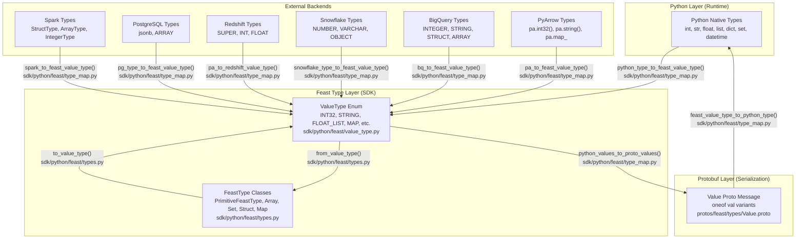
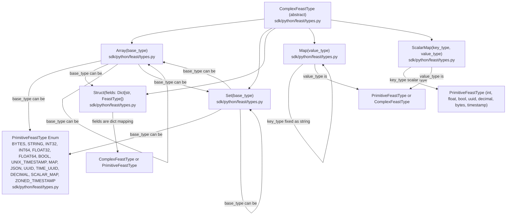

<!-- source: DeepWiki mcp.deepwiki.com · repo feast-dev/feast · page 2.6 Type System and Conversions · fetched 2026-10-21 -->

# Type System and Conversions

Relevant source files

The following files were used as context for generating this wiki page:

- [docs/getting-started/concepts/feast-types.md](docs/getting-started/concepts/feast-types.md)
- [docs/reference/type-system.md](docs/reference/type-system.md)
- [go/internal/feast/errors.go](go/internal/feast/errors.go)
- [go/internal/feast/featurestore_test.go](go/internal/feast/featurestore_test.go)
- [go/internal/test/feature_repo/example.py](go/internal/test/feature_repo/example.py)
- [go/types/typeconversion.go](go/types/typeconversion.go)
- [go/types/typeconversion_test.go](go/types/typeconversion_test.go)
- [protos/feast/types/Value.proto](protos/feast/types/Value.proto)
- [sdk/python/feast/dqm/profilers/ge_profiler.py](sdk/python/feast/dqm/profilers/ge_profiler.py)
- [sdk/python/feast/dqm/profilers/profiler.py](sdk/python/feast/dqm/profilers/profiler.py)
- [sdk/python/feast/infra/offline_stores/contrib/trino_offline_store/trino_type_map.py](sdk/python/feast/infra/offline_stores/contrib/trino_offline_store/trino_type_map.py)
- [sdk/python/feast/proto_json.py](sdk/python/feast/proto_json.py)
- [sdk/python/feast/protos/feast/types/Value_pb2.py](sdk/python/feast/protos/feast/types/Value_pb2.py)
- [sdk/python/feast/protos/feast/types/Value_pb2.pyi](sdk/python/feast/protos/feast/types/Value_pb2.pyi)
- [sdk/python/feast/type_map.py](sdk/python/feast/type_map.py)
- [sdk/python/feast/types.py](sdk/python/feast/types.py)
- [sdk/python/feast/value_type.py](sdk/python/feast/value_type.py)
- [sdk/python/tests/integration/materialization/test_lambda.py](sdk/python/tests/integration/materialization/test_lambda.py)
- [sdk/python/tests/integration/offline_store/test_offline_write.py](sdk/python/tests/integration/offline_store/test_offline_write.py)
- [sdk/python/tests/unit/infra/offline_stores/contrib/trino_offline_store/test_trino_type_map.py](sdk/python/tests/unit/infra/offline_stores/contrib/trino_offline_store/test_trino_type_map.py)
- [sdk/python/tests/unit/infra/test_provider.py](sdk/python/tests/unit/infra/test_provider.py)
- [sdk/python/tests/unit/test_type_map.py](sdk/python/tests/unit/test_type_map.py)
- [sdk/python/tests/unit/test_types.py](sdk/python/tests/unit/test_types.py)
- [sdk/python/tests/utils/online_write_benchmark.py](sdk/python/tests/utils/online_write_benchmark.py)

This page explains Feast's internal type system, detailing the `ValueType` enumeration, `FeastType` Python classes, Protobuf wire representations in `Value.proto`, type conversion logic in `type_map.py`, and how complex types (such as `Array`, `Map`, `Struct`, and `ScalarMap`) are mapped across various offline and online backends.

---

## Type System Architecture

Feast’s type system integrates multiple abstraction layers to ensure consistent typing and smooth conversions across components:

This structure guarantees consistent typing across Python runtime, Feast-defined types, their Protobuf serialization format, and backend integration.

Sources: [sdk/python/feast/type_map.py:137-230](), [sdk/python/feast/types.py:49-73](), [sdk/python/feast/value_type.py:35-87](), [protos/feast/types/Value.proto:26-73]()

---

## ValueType Enum

The `ValueType` enumeration defines all supported Feast types. It provides the foundational type identifiers used throughout Feast for primitive and complex data `[sdk/python/feast/value_type.py:35-87]()`. It corresponds closely to the Protobuf enum in `Value.proto` `[protos/feast/types/Value.proto:26-73]()`.

| ValueType Enum Key      | Python Representation        | Description                                         |
|------------------------|------------------------------|-----------------------------------------------------|
| `INT32`                | `int`                        | 32-bit signed integer                               |
| `INT64`                | `int`                        | 64-bit signed integer                               |
| `FLOAT`                | `float`                      | 32-bit floating point                               |
| `DOUBLE`               | `float`                      | 64-bit floating point                               |
| `STRING`               | `str`                        | UTF-8 string                                       |
| `BYTES`                | `bytes`                      | Raw binary data                                    |
| `BOOL`                 | `bool`                       | Boolean flag                                      |
| `UNIX_TIMESTAMP`       | `datetime` (nullable)        | Unix timestamp (seconds since epoch)              |
| `ZONED_TIMESTAMP`      | `datetime` (timezone-aware)  | Timezone aware timestamp with original zone info  |
| `MAP`                  | `Dict[str, Any]`             | Map/dict with string keys and arbitrary valid values |
| `JSON`                 | `str` or `dict`              | JSON string or parsed JSON dict                    |
| `UUID`                 | `uuid.UUID`                  | UUID identifier (all versions)                     |
| `TIME_UUID`            | `uuid.UUID`                  | Version 1 (time-based) UUID                         |
| `DECIMAL`              | `decimal.Decimal`            | Arbitrary precision decimal number                  |
| `PDF_BYTES`            | `bytes`                      | PDF document bytes (domain-specific, stored as bytes) |
| `IMAGE_BYTES`          | `bytes`                      | Image bytes (domain-specific, stored as bytes)    |

Besides primitives, Feast also supports list types (e.g., `INT32_LIST`), set types (e.g., `INT32_SET`), nested collections (`VALUE_LIST` / `VALUE_SET`), and specialized types like `STRUCT` and `SCALAR_MAP` `[sdk/python/feast/value_type.py:35-87]()`.

Sources: [sdk/python/feast/value_type.py:35-87](), [protos/feast/types/Value.proto:26-73](), [docs/reference/type-system.md:15-87]()

---

## FeastType Classes

To represent types in a Pythonic and recursive fashion, Feast defines `FeastType` classes in `sdk/python/feast/types.py`, implementing a hierarchical system with classes for primitives and complex collections:

### Detailed Notes

- **PrimitiveFeastType**: Enum corresponding to elementary types and domain-specific aliases, supporting conversion to/from the core `ValueType` enumeration `[sdk/python/feast/types.py:75-138]()`.
- **Array**: Parameterized by a base type which may be primitive, `Struct`, `Set`, or nested `Array`. Produces Feast `ValueType` list variants or `VALUE_LIST` for nested collections `[sdk/python/feast/types.py:182-227]()`.
- **Set**: Similar to `Array` but enforces uniqueness. Base types can be primitives or collections (nested arrays or sets). Corresponds to `*_SET` or `VALUE_SET` `ValueType` enums `[sdk/python/feast/types.py:229-266]()`.
- **Struct**: Defines a typed structure with named fields, each mapped to a FeastType. This supports user-defined schema for complex records `[sdk/python/feast/types.py:267-297]()`.
- **Map**: Dict-like type with string keys and arbitrary Feast-supported types as values. Used both for dynamic maps and Structs at the proto level `[protos/feast/types/Value.proto:199-201]()`.
- **ScalarMap**: Extends `Map` with arbitrary scalar keys (int, float, bool, UUID, decimal, bytes, datetime) for use cases requiring non-string keys. Represented as `ScalarMap` proto `[protos/feast/types/Value.proto:236-238]()`.

Sources: [sdk/python/feast/types.py:49-317](), [protos/feast/types/Value.proto:199-201](), [protos/feast/types/Value.proto:236-238]()

---

## Protobuf Value Message and Oneof Types

Feast serializes feature values using the Protobuf message `Value` defined in `protos/feast/types/Value.proto` `[protos/feast/types/Value.proto:76-126]()`. This message uses a `oneof val` union field with many type variants to capture all Feast types efficiently:

```mermaid
graph LR
    ValueProto["feast.types.Value<br/>protos/feast/types/Value.proto"]

    subgraph Scalar
        bytes_val["bytes_val (1)"]
        string_val["string_val (2)"]
        int32_val["int32_val (3)"]
        int64_val["int64_val (4)"]
        double_val["double_val (5)"]
        float_val["float_val (6)"]
        bool_val["bool_val (7)"]
        unix_timestamp_val["unix_timestamp_val (8)"]
        json_val["json_val (32)"]
        uuid_val["uuid_val (36)"]
        time_uuid_val["time_uuid_val (37)"]
        decimal_val["decimal_val (44)"]
        zoned_timestamp_val["zoned_timestamp_val (48)"]
    end

    subgraph List_Types ["List Types"]
        bytes_list_val["bytes_list_val (11)"]
        string_list_val["string_list_val (12)"]
        int32_list_val["int32_list_val (13)"]
        int64_list_val["int64_list_val (14)"]
        double_list_val["double_list_val (15)"]
        float_list_val["float_list_val (16)"]
        bool_list_val["bool_list_val (17)"]
        unix_timestamp_list_val["unix_timestamp_list_val (18)"]
        json_list_val["json_list_val (33)"]
        uuid_list_val["uuid_list_val (38)"]
        time_uuid_list_val["time_uuid_list_val (39)"]
        decimal_list_val["decimal_list_val (45)"]
        list_val["list_val (42)<br/>RepeatedValue"]
    end

    subgraph Set_Types ["Set Types"]
        bytes_set_val["bytes_set_val (22)"]
        string_set_val["string_set_val (23)"]
        int32_set_val["int32_set_val (24)"]
        int64_set_val["int64_set_val (25)"]
        double_set_val["double_set_val (26)"]
        float_set_val["float_set_val (27)"]
        bool_set_val["bool_set_val (28)"]
        unix_timestamp_set_val["unix_timestamp_set_val (29)"]
        uuid_set_val["uuid_set_val (40)"]
        time_uuid_set_val["time_uuid_set_val (41)"]
        decimal_set_val["decimal_set_val (46)"]
        set_val["set_val (43)<br/>RepeatedValue"]
    end

    subgraph Map_Struct_Types ["Map/Struct Types"]
        map_val["map_val (20)<br/>Map"]
        map_list_val["map_list_val (21)<br/>MapList"]
        struct_val["struct_val (34)<br/>Map"]
        struct_list_val["struct_list_val (35)<br/>MapList"]
        scalar_map_val["scalar_map_val (47)<br/>ScalarMap"]
    end
    
    ValueProto --> bytes_val
    ValueProto --> string_val
    ValueProto --> int32_val
    ValueProto --> int64_val
    ValueProto --> double_val
    ValueProto --> float_val
    ValueProto --> bool_val
    ValueProto --> unix_timestamp_val
    ValueProto --> bytes_list_val
    ValueProto --> string_list_val
    ValueProto --> int32_list_val
    ValueProto --> int64_list_val
    ValueProto --> double_list_val
    ValueProto --> float_list_val
    ValueProto --> bool_list_val
    ValueProto --> unix_timestamp_list_val
    ValueProto --> map_val
    ValueProto --> map_list_val
    ValueProto --> bytes_set_val
    ValueProto --> string_set_val
    ValueProto --> int32_set_val
    ValueProto --> int64_set_val
    ValueProto --> double_set_val
    ValueProto --> float_set_val
    ValueProto --> bool_set_val
    ValueProto --> unix_timestamp_set_val
    ValueProto --> json_val
    ValueProto --> json_list_val
    ValueProto --> struct_val
    ValueProto --> struct_list_val
    ValueProto --> uuid_val
    ValueProto --> time_uuid_val
    ValueProto --> uuid_list_val
    ValueProto --> time_uuid_list_val
    ValueProto --> uuid_set_val
    ValueProto --> time_uuid_set_val
    ValueProto --> list_val
    ValueProto --> set_val
    ValueProto --> decimal_val
    ValueProto --> decimal_list_val
    ValueProto --> decimal_set_val
    ValueProto --> scalar_map_val
    ValueProto --> zoned_timestamp_val
```

- Both `Map` and `Struct` types use the `Map` proto message; `Struct` is semantically a typed map `[protos/feast/types/Value.proto:110-111]()`.
- `ScalarMap` supports maps with non-string scalar keys `[protos/feast/types/Value.proto:236-238]()`.
- Nested collections leverage the `list_val` and `set_val` repeated message fields inside `RepeatedValue` messages `[protos/feast/types/Value.proto:209-211]()`.
- The `ZonedTimestamp` message carries both UTC instant and zone info to allow lossless datetime round trips `[protos/feast/types/Value.proto:135-141]()`.

Sources: [protos/feast/types/Value.proto:76-126](), [sdk/python/feast/type_map.py:137-230]()

---

## Type Conversion Logic (`sdk/python/feast/type_map.py`)

The `type_map.py` module implements the core logic for converting between Feast types, Python native types, Protobuf messages, and various backend storage formats:

### Key Functions

- `feast_value_type_to_python_type(field_value_proto, feature_type=None) -> Any`  
  Converts a Protobuf `Value` message into the corresponding native Python type value. It recursively handles nested maps, lists, sets, struct types, and special types like UUID, decimal, JSON, and zoned timestamps, preserving type fidelity `[sdk/python/feast/type_map.py:137-230]()`.
  
- `python_values_to_proto_values(values, value_type) -> List[ProtoValue]`  
  Converts Python native values into a list of Feast Protobuf `Value` messages, accounting for the target Feast `ValueType`. Supports nulls, nested collections, and complex types `[sdk/python/tests/unit/test_type_map.py:32-136]()`.
  
- Backend-specific type conversions:  
  - `pa_to_feast_value_type()` and `feast_value_type_to_pa()` handle conversions between PyArrow types and Feast `ValueType`.  
  - BigQuery, Snowflake, Redshift, PostgreSQL, and Spark have dedicated `*_to_feast_value_type()` functions to infer Feast types from their native schema types `[sdk/python/feast/type_map.py:290-462]()`.
  
### Handling Nested Collections

For nested arrays and sets, Feast uses recursive `Array` and `Set` classes combined with `VALUE_LIST` and `VALUE_SET` enums. Inner type information is preserved through metadata (`feast:nested_inner_type` tag) to support arbitrary nesting depths.

### Zoned Timestamps

Special care is taken to serialize and deserialize timezone-aware datetimes with preserved zone information, avoiding data loss during conversions `[sdk/python/feast/type_map.py:193-197]()`. Null timestamps have canonical integer representations to aid in proto serialization `[sdk/python/feast/type_map.py:72]()`.

Sources: [sdk/python/feast/type_map.py:137-285](), [sdk/python/tests/unit/test_type_map.py:32-136]()

---

## Backend Type Mappings

Feast provides extensive mappings between external system types and Feast internal types to enable schema inference and seamless data flow:

| Backend    | Feast Conversion Function                                | Source Code Location                  |
|------------|---------------------------------------------------------|-------------------------------------|
| PyArrow    | `pa_to_feast_value_type()`, `feast_value_type_to_pa()`   | [sdk/python/feast/type_map.py:663-758]() |
| BigQuery   | `bq_to_feast_value_type()`                               | [sdk/python/feast/type_map.py:761-807]() |
| Snowflake  | `snowflake_type_to_feast_value_type()`                   | [sdk/python/feast/type_map.py:315-376]() |
| Redshift   | `pa_to_redshift_value_type()`                            | [sdk/python/feast/type_map.py:375-415]() |
| PostgreSQL | `pg_type_to_feast_value_type()`                          | [sdk/python/feast/type_map.py:290-314]() |
| Spark      | `spark_to_feast_value_type()`                            | [sdk/python/feast/type_map.py:416-462]() |
| Trino (contrib) | `trino_to_feast_value_type()`, `trino_to_pa_value_type()`          | [sdk/python/feast/infra/offline_stores/contrib/trino_offline_store/trino_type_map.py:9-174]() |

Mappings consider complex external types such as arrays, structs, maps, and decimals with scale/precision. For example, PyArrow decimal types map to Feast’s `DECIMAL` type with precision preserved.

Sources: [sdk/python/feast/type_map.py:290-462](), [sdk/python/feast/type_map.py:663-758](), [sdk/python/feast/infra/offline_stores/contrib/trino_offline_store/trino_type_map.py:9-174]()

---

## Complex Types in Practice: Array, Map, and Struct

### Array

`Array` is modeled as a list of elements with a known base type. It supports nesting with other arrays or sets as base types. The `to_value_type()` method returns a `ValueType` reflecting the nested list structure (`*_LIST` or `VALUE_LIST`) `[sdk/python/feast/types.py:182-215]()`. 

Arrays are heavily used to represent variable-length sequences of primitive or complex elements in feature data.

### Set

`Set` represents a unique collection of elements by eliminating duplicates. Sets can also be nested or combined with arrays. Sets map to corresponding `*_SET` or `VALUE_SET` `ValueType`s. While sets are supported in Python SDK and serving, many backends do not natively infer or support sets, requiring explicit schema declarations `[sdk/python/feast/types.py:229-266]()`, `[docs/reference/type-system.md:84-91]()`.

Sets are ideal for online serving scenarios where uniqueness and fast membership tests matter.

### Map and Struct

- `Map` accommodates arbitrary dictionaries keyed by strings with values of any Feast-supported type, including nested maps. Used in dynamic unstructured feature data.
- `Struct` is a typed record with a predefined schema mapping field names to Feast types, essentially a statically typed map.  
- `ScalarMap` expands maps to support scalar keys other than strings, for indexed or associative features requiring integer, float, UUID keys, etc.  
Both `Map` and `ScalarMap` correspond to distinct proto message types used in serialization `[sdk/python/feast/types.py:267-317]()`, `[protos/feast/types/Value.proto:199-201,236-238]()`.

Sources: [sdk/python/feast/types.py:182-317](), [sdk/python/feast/type_map.py:179-191]()

---

# Summary

Feast's type system centrally relies on the `ValueType` enum and a rich Python class hierarchy of `FeastType`s to represent features' data types. The system supports primitive types, arrays, sets, maps, structs, UUIDs, decimals, and more. Conversion logic in `type_map.py` bridges native Python types, Protobuf serialization, and various backend schema representations, enabling robust, consistent data handling across Feast's complex distributed feature store architecture.

Sources:
- [sdk/python/feast/type_map.py:1-660]()
- [sdk/python/feast/types.py:1-317]()
- [sdk/python/feast/value_type.py:1-90]()
- [protos/feast/types/Value.proto:26-126]()
- [docs/reference/type-system.md]()

---

