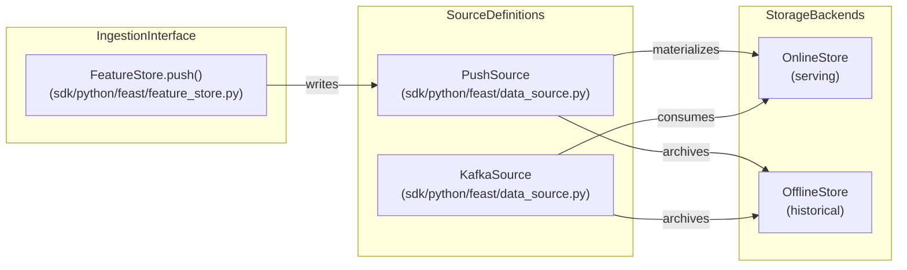

<!-- source: DeepWiki mcp.deepwiki.com · repo feast-dev/feast · page 3.1 Data Sources · fetched 2026-10-21 -->

# Data Sources

<details>
<summary>Relevant source files</summary>

The following files were used as context for generating this wiki page:

- [docs/reference/data-sources/bigquery.md](docs/reference/data-sources/bigquery.md)
- [docs/reference/data-sources/file.md](docs/reference/data-sources/file.md)
- [docs/reference/data-sources/overview.md](docs/reference/data-sources/overview.md)
- [docs/reference/data-sources/postgres.md](docs/reference/data-sources/postgres.md)
- [docs/reference/data-sources/redshift.md](docs/reference/data-sources/redshift.md)
- [docs/reference/data-sources/snowflake.md](docs/reference/data-sources/snowflake.md)
- [docs/reference/data-sources/spark.md](docs/reference/data-sources/spark.md)
- [docs/reference/data-sources/trino.md](docs/reference/data-sources/trino.md)
- [docs/reference/offline-stores/redshift.md](docs/reference/offline-stores/redshift.md)
- [docs/reference/providers/amazon-web-services.md](docs/reference/providers/amazon-web-services.md)
- [protos/feast/core/DataSource.proto](protos/feast/core/DataSource.proto)
- [sdk/python/feast/data_source.py](sdk/python/feast/data_source.py)
- [sdk/python/feast/infra/offline_stores/bigquery_source.py](sdk/python/feast/infra/offline_stores/bigquery_source.py)
- [sdk/python/feast/infra/offline_stores/contrib/athena_offline_store/athena_source.py](sdk/python/feast/infra/offline_stores/contrib/athena_offline_store/athena_source.py)
- [sdk/python/feast/infra/offline_stores/contrib/couchbase_offline_store/couchbase_source.py](sdk/python/feast/infra/offline_stores/contrib/couchbase_offline_store/couchbase_source.py)
- [sdk/python/feast/infra/offline_stores/contrib/mssql_offline_store/mssqlserver_source.py](sdk/python/feast/infra/offline_stores/contrib/mssql_offline_store/mssqlserver_source.py)
- [sdk/python/feast/infra/offline_stores/contrib/postgres_offline_store/postgres_source.py](sdk/python/feast/infra/offline_stores/contrib/postgres_offline_store/postgres_source.py)
- [sdk/python/feast/infra/offline_stores/contrib/spark_offline_store/spark_source.py](sdk/python/feast/infra/offline_stores/contrib/spark_offline_store/spark_source.py)
- [sdk/python/feast/infra/offline_stores/contrib/trino_offline_store/trino_source.py](sdk/python/feast/infra/offline_stores/contrib/trino_offline_store/trino_source.py)
- [sdk/python/feast/infra/offline_stores/file_source.py](sdk/python/feast/infra/offline_stores/file_source.py)
- [sdk/python/feast/infra/offline_stores/redshift_source.py](sdk/python/feast/infra/offline_stores/redshift_source.py)
- [sdk/python/feast/infra/offline_stores/snowflake_source.py](sdk/python/feast/infra/offline_stores/snowflake_source.py)
- [sdk/python/tests/unit/infra/offline_stores/test_snowflake.py](sdk/python/tests/unit/infra/offline_stores/test_snowflake.py)
- [sdk/python/tests/unit/test_data_sources.py](sdk/python/tests/unit/test_data_sources.py)

</details>


## Purpose and Scope

This document details the `DataSource` abstraction in Feast, which defines where feature data originates for batch ingestion, historical training retrieval, online materialization, and streaming/real-time updates. Data sources connect Feast to external storage systems and specify how to read feature values with point-in-time correctness.

For details on how data sources participate in offline feature retrieval, see [Offline Stores (3.2)](). For streaming ingestion patterns, see [Streaming Features and Push API (8.2)](). Configuration of target stores during materialization is covered in [Online Stores (3.3)]().

Sources:  
[sdk/python/feast/data_source.py:1-34]()  
[protos/feast/core/DataSource.proto:61-100]()

---

## Overview and Class Architecture

A `DataSource` represents a table, query, or stream in an external system containing feature values paired with event timestamps. Each data source specifies the physical or logical location of the data, the event timestamp field used for point-in-time joins, optional field mappings, and backend-specific options.

The following diagram bridges the natural language concepts of data sources to their concrete Python implementation classes in the codebase.

**Natural Language to Code Entity Space: DataSource Mappings**

```mermaid
graph TB
    subgraph "CoreAbstractions"
        DS["DataSource<br/>(sdk/python/feast/data_source.py)"]
    end
    
    subgraph "BatchSources"
        BQ["BigQuerySource<br/>(sdk/python/feast/infra/offline_stores/bigquery_source.py)"]
        SF["SnowflakeSource<br/>(sdk/python/feast/infra/offline_stores/snowflake_source.py)"]
        RS["RedshiftSource<br/>(sdk/python/feast/infra/offline_stores/redshift_source.py)"]
        FILE["FileSource<br/>(sdk/python/feast/infra/offline_stores/file_source.py)"]
        SPARK["SparkSource<br/>(sdk/python/feast/infra/offline_stores/contrib/spark_offline_store/spark_source.py)"]
        PG["PostgreSQLSource<br/>(sdk/python/feast/infra/offline_stores/contrib/postgres_offline_store/postgres_source.py)"]
    end
    
    subgraph "StreamingAndPushSources"
        PUSH["PushSource<br/>(sdk/python/feast/data_source.py)"]
        KAFKA["KafkaSource<br/>(sdk/python/feast/data_source.py)"]
        KINESIS["KinesisSource<br/>(sdk/python/feast/data_source.py)"]
    end
    
    subgraph "RuntimeSources"
        REQ["RequestSource<br/>(sdk/python/feast/data_source.py)"]
    end
    
    DS --> BQ
    DS --> SF
    DS --> RS
    DS --> FILE
    DS --> SPARK
    DS --> PG
    DS --> PUSH
    DS --> KAFKA
    DS --> KINESIS
    DS --> REQ
```



Sources:  
[sdk/python/feast/data_source.py:151-166]()  
[sdk/python/feast/infra/offline_stores/bigquery_source.py:23-29]()  
[protos/feast/core/DataSource.proto:63-85]()

---

## Core DataSource Abstraction

The `DataSource` abstract base class defines the common interface, proto serialization logic, and validation hooks for all underlying batch, stream, push, and request data sources.

### Key Attributes and Methods

| Attribute / Method          | Type                    | Description                                                                                  |
|----------------------------|-------------------------|----------------------------------------------------------------------------------------------|
| `name`                     | `str`                   | Unique identifier for the data source within a project [protos/feast/core/DataSource.proto:87-88]() |
| `timestamp_field`           | `Optional[str]`         | Event timestamp column used for point-in-time joins [protos/feast/core/DataSource.proto:105-106]() |
| `created_timestamp_column`  | `Optional[str]`         | Optional row creation timestamp used for deduplication [protos/feast/core/DataSource.proto:112-113]() |
| `field_mapping`             | `Dict[str, str]`        | Column name map from source columns to feature view schema [protos/feast/core/DataSource.proto:101-103]() |
| `date_partition_column`     | `Optional[str]`         | Partition column for pruning large file/lake data sources [protos/feast/core/DataSource.proto:108-110]() |
| `connection_ref`            | `Optional[ConnectionRef]` | Encapsulates per-source credential references overriding global config [protos/feast/core/DataSource.proto:128-133]() |
| `to_proto()`                | Method                  | Serializes the data source to a protobuf `DataSourceProto` message [sdk/python/feast/data_source.py:79-98]() |
| `from_proto()`              | Classmethod             | Deserializes a protobuf message to a concrete data source instance [sdk/python/feast/data_source.py:52-77]() |

### ConnectionRef and Per-DataSource Credentials

Feast allows each data source to declare its own connection identity via `ConnectionRef`, overriding global `feature_store.yaml` settings. This enables multi-tenant deployments and credential isolation at runtime:

- `provider`: Credential backend type such as `"kubernetes"`, `"vault"`, `"env"`, or cloud secrets managers.
- `name`: Provider-specific secret or path name.
- `namespace`: Optional scope qualifier.
- `connection_type`: Optional offline store/backend type override.
- `auth_type`: Optional authentication mechanism.
- `params`: Non-sensitive backend connection parameters.

```python
from feast.credentials import ConnectionRef
from feast.infra.offline_stores.snowflake_source import SnowflakeSource

source = SnowflakeSource(
    table="USER_FEATURES",
    connection_ref=ConnectionRef(
        provider="kubernetes",
        name="snowflake-creds",
        namespace="ml-team",
        connection_type="snowflake.offline",
        auth_type="secret",
        params={"account": "xy12345", "warehouse": "COMPUTE_WH"},
    ),
)
```

Sources:  
[sdk/python/feast/data_source.py:1-34]()  
[protos/feast/core/DataSource.proto:37-59]()  
[docs/reference/data-sources/overview.md:13-84]()

---

## Concrete Batch Sources

Batch data sources provide access to stored historical feature data for training pipelines and offline materialization.

### FileSource

- **Overview:** Represents file-based data in object storage or local file systems to be consumed by offline stores like Dask or DuckDB.
- **Implementation:** Defined in `sdk/python/feast/infra/offline_stores/file_source.py`
- **Key Parameters:** `path` (e.g., `s3://bucket/path.parquet`), optional explicit `file_format` (parquet, delta, etc.), `timestamp_field`.
- **Validation:** Checks existence and schema correctness of the data file, ensuring timestamp and entity columns exist.

```python
file_source = FileSource(
    path="s3://my-bucket/my-file.parquet",
    timestamp_field="event_timestamp",
)
```

### BigQuerySource

- **Overview:** Defines a BigQuery table or SQL query as the batch source.
- **Implementation:** Defined in `sdk/python/feast/infra/offline_stores/bigquery_source.py`
- **Key Parameters:** `table` (in `project:dataset.table` syntax), or `query`, `timestamp_field_type` for handling DATE vs TIMESTAMP.
- **Usage:** Supports both table-based and query-based ingestion with priority given to queries when both are set.

```python
bq_source = BigQuerySource(
    table="my_project:my_dataset.my_table",
    timestamp_field="event_timestamp"
)
```

### SnowflakeSource

- **Overview:** Defines a Snowflake table or query as the data source, supports database and schema specification.
- **Implementation:** Defined in `sdk/python/feast/infra/offline_stores/snowflake_source.py`
- **Key Parameters:** `database`, `schema` (defaults to "PUBLIC"), `table` or `query`.
- **Note:** Warehouse specification inside the source is deprecated in favor of offline store config.

```python
sf_source = SnowflakeSource(
    table="USER_FEATURES",
    database="MY_DB",
    schema="PUBLIC",
    timestamp_field="event_timestamp",
)
```

### SparkSource (Community Contributed)

- **Overview:** Specifies a Spark table, SQL query, or file path accessible via Spark offline store.
- **Implementation:** Defined in `sdk/python/feast/infra/offline_stores/contrib/spark_offline_store/spark_source.py`
- **Features:** Supports multiple file formats (parquet, csv, json, avro), optional table format (Iceberg, Delta).
- **Experimental:** The API is marked as experimental and subject to change.

```python
spark_source = SparkSource(
    table="spark_db.feature_table",
    file_format="parquet",
    timestamp_field="event_timestamp"
)
```

### PostgreSQLSource (Community Contributed)

- **Overview:** Defines a PostgreSQL query or table source for use with a PostgreSQL offline store.
- **Implementation:** Defined in `sdk/python/feast/infra/offline_stores/contrib/postgres_offline_store/postgres_source.py`
- **Key Operations:** Supports introspection of table schema and type inference; query must return the necessary timestamp and entity columns.

```python
pg_source = PostgreSQLSource(
    query="SELECT * FROM feature_table",
    timestamp_field="event_timestamp",
)
```

Sources:  
[sdk/python/feast/infra/offline_stores/file_source.py:33-168]()  
[sdk/python/feast/infra/offline_stores/bigquery_source.py:24-164]()  
[sdk/python/feast/infra/offline_stores/snowflake_source.py:23-177]()  
[sdk/python/feast/infra/offline_stores/contrib/spark_offline_store/spark_source.py:32-112]()  
[sdk/python/feast/infra/offline_stores/contrib/postgres_offline_store/postgres_source.py:20-148]()

---

## Streaming and Push Sources

Streaming and push sources enable real-time or near-real-time ingestion of feature data into Feast with optional historical archiving.

### PushSource

- **Role:** Data source for explicitly pushed records, typically via `FeatureStore.push()`.
- **Batch Source:** Optional `batch_source` may be provided to maintain historical feature data.
- **Use Case:** Online-only data ingestion for features that arrive as real-time events without a persistent external table.

### KafkaSource and KinesisSource

- **KafkaSource:** Configured with bootstrap servers, topic, and message format (using Feast's `StreamFormat` abstraction).
- **KinesisSource:** Configured with AWS region, stream name, and record format.
- **Common:** Both integrate with streaming ingestion pipelines, optionally archiving data to offline stores.



Sources:  
[sdk/python/feast/data_source.py:35-150]()  
[sdk/python/tests/unit/test_data_sources.py:19-47]()

---

## RequestSource

`RequestSource` is a special data source used for `OnDemandFeatureView` feature retrieval where features are computed dynamically from request data.

- **No physical storage:** No association with event timestamps or physical tables.
- **Schema:** Defined by a list of `Field` objects specifying input parameters provided during retrieval.
- Suitable for scenarios needing dynamic, request-driven feature computation.

Sources:  
[sdk/python/feast/data_source.py:164]()  
[sdk/python/tests/unit/test_data_sources.py:49-63]()

---

## Configuration in Feature Views

Feature views, stream feature views, and on-demand feature views bind to data sources to define input data locations and data schemas.

```mermaid
graph TD
    subgraph "FeatureViewClasses"
        FV["FeatureView<br/>(sdk/python/feast/feature_view.py)"]
        SFV["StreamFeatureView<br/>(sdk/python/feast/stream_feature_view.py)"]
        ODFV["OnDemandFeatureView<br/>(sdk/python/feast/on_demand_feature_view.py)"]
    end

    subgraph "DataSourceBase"
        DS["DataSource<br/>(sdk/python/feast/data_source.py)"]
    end

    subgraph "ConcreteSources"
        BQ["BigQuerySource"]
        PUSH["PushSource"]
        REQ["RequestSource"]
    end

    FV -- "batch_source" --> DS
    SFV -- "stream_source" --> DS
    ODFV -- "sources" --> DS
    
    DS <|-- BQ
    DS <|-- PUSH
    DS <|-- REQ
```

Sources:  
[sdk/python/feast/data_source.py:152-166]()  
[sdk/python/tests/unit/test_data_sources.py:56-63]()

---

## Summary

The `DataSource` abstraction unifies how Feast interacts with various storage backends for batch, streaming, push, and request-driven workflows. By utilizing structured proto definitions, per-source credentials (`ConnectionRef`), and extensible Python implementations (`FileSource`, `BigQuerySource`, `SnowflakeSource`, `SparkSource`, `PostgreSQLSource`, `PushSource`, `RequestSource`), Feast achieves flexible, multi-tenant feature ingestion and retrieval.

---

## References

- Core DataSource implementation: [sdk/python/feast/data_source.py:1-166]()
- DataSource Protocol Buffers: [protos/feast/core/DataSource.proto:37-135]()
- BigQuerySource implementation: [sdk/python/feast/infra/offline_stores/bigquery_source.py:23-96]()
- SnowflakeSource implementation: [sdk/python/feast/infra/offline_stores/snowflake_source.py:23-106]()
- FileSource implementation: [sdk/python/feast/infra/offline_stores/file_source.py:32-97]()
- SparkSource implementation: [sdk/python/feast/infra/offline_stores/contrib/spark_offline_store/spark_source.py:31-112]()
- PostgreSQLSource implementation: [sdk/python/feast/infra/offline_stores/contrib/postgres_offline_store/postgres_source.py:20-76]()
- Data sources unit tests: [sdk/python/tests/unit/test_data_sources.py:1-204]()

---

