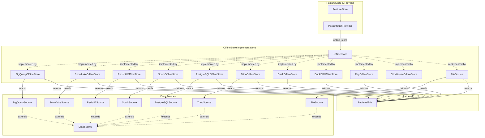
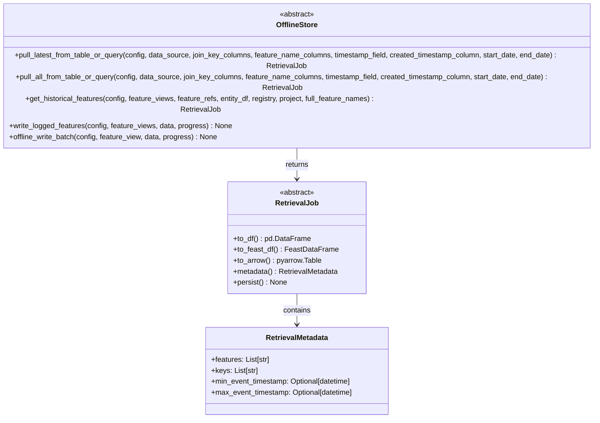
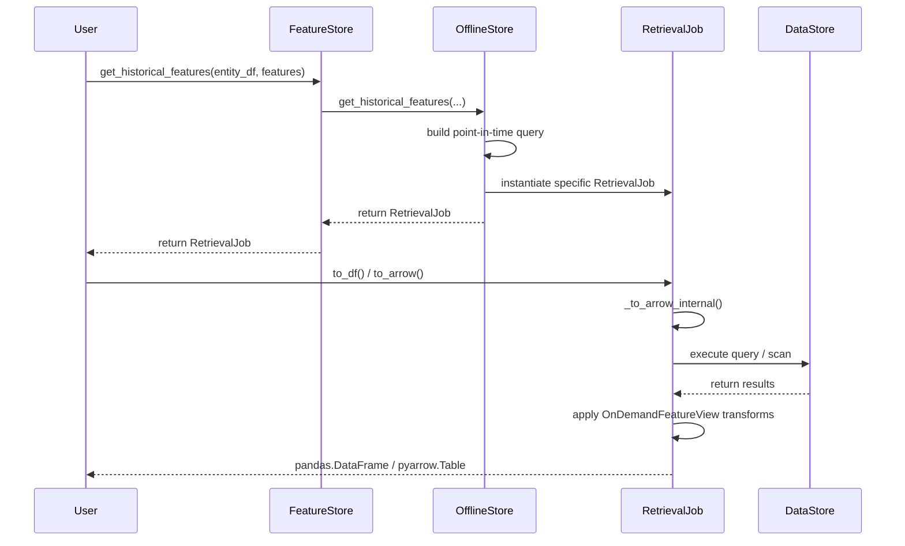
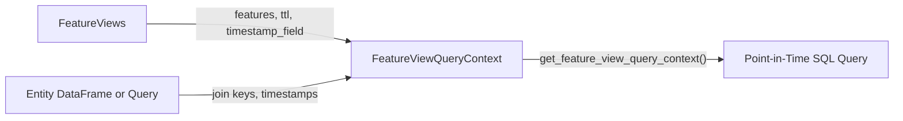

<!-- source: DeepWiki mcp.deepwiki.com · repo feast-dev/feast · page 3.2 Offline Stores · fetched 2026-10-21 -->

# Offline Stores

Relevant source files

The following files were used as context for generating this wiki page:

- [.cursor/rules/feast-ui.mdc](.cursor/rules/feast-ui.mdc)
- [docs/how-to-guides/feature-monitoring.md](docs/how-to-guides/feature-monitoring.md)
- [docs/how-to-guides/production-deployment-topologies.md](docs/how-to-guides/production-deployment-topologies.md)
- [docs/reference/compute-engine/ray.md](docs/reference/compute-engine/ray.md)
- [docs/reference/offline-stores/ray.md](docs/reference/offline-stores/ray.md)
- [sdk/python/feast/api/registry/rest/monitoring.py](sdk/python/feast/api/registry/rest/monitoring.py)
- [sdk/python/feast/infra/common/serde.py](sdk/python/feast/infra/common/serde.py)
- [sdk/python/feast/infra/compute_engines/ray/compute.py](sdk/python/feast/infra/compute_engines/ray/compute.py)
- [sdk/python/feast/infra/compute_engines/ray/config.py](sdk/python/feast/infra/compute_engines/ray/config.py)
- [sdk/python/feast/infra/compute_engines/ray/feature_builder.py](sdk/python/feast/infra/compute_engines/ray/feature_builder.py)
- [sdk/python/feast/infra/compute_engines/ray/job.py](sdk/python/feast/infra/compute_engines/ray/job.py)
- [sdk/python/feast/infra/compute_engines/ray/nodes.py](sdk/python/feast/infra/compute_engines/ray/nodes.py)
- [sdk/python/feast/infra/compute_engines/ray/utils.py](sdk/python/feast/infra/compute_engines/ray/utils.py)
- [sdk/python/feast/infra/offline_stores/bigquery.py](sdk/python/feast/infra/offline_stores/bigquery.py)
- [sdk/python/feast/infra/offline_stores/contrib/athena_offline_store/athena.py](sdk/python/feast/infra/offline_stores/contrib/athena_offline_store/athena.py)
- [sdk/python/feast/infra/offline_stores/contrib/clickhouse_offline_store/clickhouse.py](sdk/python/feast/infra/offline_stores/contrib/clickhouse_offline_store/clickhouse.py)
- [sdk/python/feast/infra/offline_stores/contrib/clickhouse_offline_store/tests/data_source.py](sdk/python/feast/infra/offline_stores/contrib/clickhouse_offline_store/tests/data_source.py)
- [sdk/python/feast/infra/offline_stores/contrib/mssql_offline_store/mssql.py](sdk/python/feast/infra/offline_stores/contrib/mssql_offline_store/mssql.py)
- [sdk/python/feast/infra/offline_stores/contrib/oracle_offline_store/oracle.py](sdk/python/feast/infra/offline_stores/contrib/oracle_offline_store/oracle.py)
- [sdk/python/feast/infra/offline_stores/contrib/postgres_offline_store/postgres.py](sdk/python/feast/infra/offline_stores/contrib/postgres_offline_store/postgres.py)
- [sdk/python/feast/infra/offline_stores/contrib/ray_offline_store/ray.py](sdk/python/feast/infra/offline_stores/contrib/ray_offline_store/ray.py)
- [sdk/python/feast/infra/offline_stores/contrib/spark_offline_store/spark.py](sdk/python/feast/infra/offline_stores/contrib/spark_offline_store/spark.py)
- [sdk/python/feast/infra/offline_stores/contrib/trino_offline_store/connectors/upload.py](sdk/python/feast/infra/offline_stores/contrib/trino_offline_store/connectors/upload.py)
- [sdk/python/feast/infra/offline_stores/contrib/trino_offline_store/tests/test_trino_monitoring.py](sdk/python/feast/infra/offline_stores/contrib/trino_offline_store/tests/test_trino_monitoring.py)
- [sdk/python/feast/infra/offline_stores/contrib/trino_offline_store/trino.py](sdk/python/feast/infra/offline_stores/contrib/trino_offline_store/trino.py)
- [sdk/python/feast/infra/offline_stores/dask.py](sdk/python/feast/infra/offline_stores/dask.py)
- [sdk/python/feast/infra/offline_stores/duckdb.py](sdk/python/feast/infra/offline_stores/duckdb.py)
- [sdk/python/feast/infra/offline_stores/ibis.py](sdk/python/feast/infra/offline_stores/ibis.py)
- [sdk/python/feast/infra/offline_stores/offline_store.py](sdk/python/feast/infra/offline_stores/offline_store.py)
- [sdk/python/feast/infra/offline_stores/offline_utils.py](sdk/python/feast/infra/offline_stores/offline_utils.py)
- [sdk/python/feast/infra/offline_stores/redshift.py](sdk/python/feast/infra/offline_stores/redshift.py)
- [sdk/python/feast/infra/offline_stores/snowflake.py](sdk/python/feast/infra/offline_stores/snowflake.py)
- [sdk/python/feast/infra/ray_initializer.py](sdk/python/feast/infra/ray_initializer.py)
- [sdk/python/feast/infra/ray_shared_utils.py](sdk/python/feast/infra/ray_shared_utils.py)
- [sdk/python/feast/infra/utils/aws_utils.py](sdk/python/feast/infra/utils/aws_utils.py)
- [sdk/python/feast/infra/utils/clickhouse/clickhouse_config.py](sdk/python/feast/infra/utils/clickhouse/clickhouse_config.py)
- [sdk/python/feast/infra/utils/clickhouse/connection_utils.py](sdk/python/feast/infra/utils/clickhouse/connection_utils.py)
- [sdk/python/feast/monitoring/monitoring_service.py](sdk/python/feast/monitoring/monitoring_service.py)
- [sdk/python/feast/monitoring/monitoring_utils.py](sdk/python/feast/monitoring/monitoring_utils.py)
- [sdk/python/tests/component/ray/test_nodes.py](sdk/python/tests/component/ray/test_nodes.py)
- [sdk/python/tests/component/ray/test_resource_scheduling.py](sdk/python/tests/component/ray/test_resource_scheduling.py)
- [sdk/python/tests/integration/offline_store/test_universal_historical_retrieval.py](sdk/python/tests/integration/offline_store/test_universal_historical_retrieval.py)
- [sdk/python/tests/unit/infra/offline_stores/contrib/postgres_offline_store/test_postgres.py](sdk/python/tests/unit/infra/offline_stores/contrib/postgres_offline_store/test_postgres.py)
- [sdk/python/tests/unit/infra/offline_stores/test_clickhouse.py](sdk/python/tests/unit/infra/offline_stores/test_clickhouse.py)
- [sdk/python/tests/unit/infra/offline_stores/test_ibis.py](sdk/python/tests/unit/infra/offline_stores/test_ibis.py)
- [sdk/python/tests/unit/infra/offline_stores/test_offline_store.py](sdk/python/tests/unit/infra/offline_stores/test_offline_store.py)
- [sdk/python/tests/unit/monitoring/test_compute_correctness.py](sdk/python/tests/unit/monitoring/test_compute_correctness.py)
- [ui/src/pages/monitoring/FeatureMetricsTable.tsx](ui/src/pages/monitoring/FeatureMetricsTable.tsx)
- [ui/src/pages/monitoring/Index.tsx](ui/src/pages/monitoring/Index.tsx)
- [ui/src/queries/useMonitoringApi.ts](ui/src/queries/useMonitoringApi.ts)

Offline stores are a critical component of Feast responsible for storing and initializing historical feature data from various backends including data warehouses, data lakes, and file systems [sdk/python/feast/infra/offline_stores/offline_store.py:1-46](). They enable point-in-time correct feature retrieval, ensuring training datasets reflect feature values as they existed at correct event times without data leakage. Offline stores also support batch materialization pipelines and feature logging. For real-time serving, see [Online Stores (3.3)](). For materialization engines orchestrating data movement between offline and online stores, see [Materialization and Compute Engines (3.4)]().

---

## Architecture Overview

Offline stores are accessed via the `Provider.offline_store` property and orchestrated through the `FeatureStore` class [sdk/python/feast/infra/offline_stores/offline_store.py:1-46](). They serve as the abstraction layer for heterogeneous storage backends, unifying data retrieval and ingestion semantics.

### System Components and Code Mapping

The following diagram bridges natural language concepts to concrete code entities, mapping providers, offline store implementations, data sources, and retrieval abstractions across the codebase.

Sources:  
[sdk/python/feast/infra/offline_stores/bigquery.py:140-140]()  
[sdk/python/feast/infra/offline_stores/snowflake.py:183-183]()  
[sdk/python/feast/infra/offline_stores/redshift.py:127-127]()  
[sdk/python/feast/infra/offline_stores/offline_store.py:92-92]()  
[sdk/python/feast/infra/offline_stores/contrib/spark_offline_store/spark.py:95-166]()  
[sdk/python/feast/infra/offline_stores/dask.py:145-155]()  
[sdk/python/feast/infra/offline_stores/duckdb.py:17-38]()  
[sdk/python/feast/infra/offline_stores/contrib/trino_offline_store/trino.py:151-213]()  
[sdk/python/feast/infra/offline_stores/contrib/postgres_offline_store/postgres.py:77-150]()

---

## OfflineStore Interface

The `OfflineStore` is an abstract base class defining the required interface for all offline store implementations [sdk/python/feast/infra/offline_stores/offline_store.py:17-230](). It encapsulates methods for querying historical features, materializing, and writing feature logs.

### Key Methods and Classes

| Method                          | Purpose                                                    | Returns        |
|--------------------------------|------------------------------------------------------------|----------------|
| `get_historical_features()`     | Retrieve point-in-time correct historical features for training datasets [sdk/python/feast/infra/offline_stores/contrib/postgres_offline_store/postgres.py:153-163]() | `RetrievalJob` [sdk/python/feast/infra/offline_stores/offline_store.py:92-93]() |
| `pull_latest_from_table_or_query()` | Pull latest feature values for materialization [sdk/python/feast/infra/offline_stores/bigquery.py:143-153]() | `RetrievalJob` [sdk/python/feast/infra/offline_stores/offline_store.py:92-93]() |
| `pull_all_from_table_or_query()`| Pull all feature values in range [sdk/python/feast/infra/offline_stores/redshift.py:189-189]() | `RetrievalJob` [sdk/python/feast/infra/offline_stores/offline_store.py:92-93]() |
| `write_logged_features()`       | Write logged features (feature logging) [sdk/python/feast/infra/offline_stores/offline_store.py:1-46]() | `None` |
| `offline_write_batch()`         | Write features to offline store (batch ingest) [sdk/python/feast/infra/offline_stores/offline_store.py:1-46]() | `None` |

Sources:  
[sdk/python/feast/infra/offline_stores/offline_store.py:17-230]()  
[sdk/python/feast/infra/offline_stores/contrib/postgres_offline_store/postgres.py:153-163]()  
[sdk/python/feast/infra/offline_stores/bigquery.py:143-153]()

---

## RetrievalJob Abstraction

`RetrievalJob` manages the execution of queries to retrieve data from the offline store [sdk/python/feast/infra/offline_stores/offline_store.py:92-93](). It supports multiple target formats including Pandas DataFrames, `FeastDataFrame`, and PyArrow Tables.

### Data Retrieval Flow

#### Key Methods of `RetrievalJob`

- `to_df()`: Executes the job synchronously and returns a Pandas DataFrame [sdk/python/feast/infra/offline_stores/offline_store.py:95-114]().  
- `to_feast_df()`: Returns a `FeastDataFrame` preserving engine metadata and on-demand feature view information [sdk/python/feast/infra/offline_stores/offline_store.py:116-157]().  
- `to_arrow()`: Returns a PyArrow Table from the query result [sdk/python/feast/infra/offline_stores/offline_store.py:159-173]().  

Sources:  
[sdk/python/feast/infra/offline_stores/offline_store.py:92-230]()

---

## Point-in-Time Joins and SQL Generation Pipeline

Point-in-time joins ensure training datasets reflect feature values as they existed at the specific event time of each observation without data leakage.

### Principles of Point-in-Time Join in Feast

- Join condition includes feature event timestamp ≤ entity event timestamp.  
- Feature rows filtered by TTL (time-to-live).  
- Deduplicate feature rows using window functions (e.g., `ROW_NUMBER()`) to select the latest row per entity as of the event timestamp.

### SQL Generation Pipeline

The `FeatureViewQueryContext` dataclass holds all required information for templating point-in-time SQL queries [sdk/python/feast/infra/offline_stores/offline_utils.py:87-106]().

Sources:  
[sdk/python/feast/infra/offline_stores/offline_utils.py:87-190]()  
[sdk/python/feast/infra/offline_stores/bigquery.py:186-193]()

---

## Built-in and Contrib Offline Store Implementations

### BigQueryOfflineStore
- **Backend:** Google BigQuery.
- **Config:** `BigQueryOfflineStoreConfig` [sdk/python/feast/infra/offline_stores/bigquery.py:100-139]().
- **Behavior:** Uses partition pruning and `ROW_NUMBER()` over partition keys for deduplication. Supports filtering by created timestamp for point-in-time correctness. Query built with escape handling for columns and timestamp filters using BigQuery SQL [sdk/python/feast/infra/offline_stores/bigquery.py:143-189]().

### SnowflakeOfflineStore
- **Backend:** Snowflake Data Warehouse.
- **Config:** `SnowflakeOfflineStoreConfig` [sdk/python/feast/infra/offline_stores/snowflake.py:124-181]().
- **Behavior:** Queries from tables or SQL subqueries with connector config overrides and manages Snowflake connection parameters. Uses stored procedures that submit queries and retrieve results asynchronously. Applies timestamp filters and deduplication using window functions for point-in-time correctness [sdk/python/feast/infra/offline_stores/snowflake.py:183-194]().

### RedshiftOfflineStore
- **Backend:** AWS Redshift.
- **Config:** `RedshiftOfflineStoreConfig` [sdk/python/feast/infra/offline_stores/redshift.py:79-125]().
- **Behavior:** Executes queries via the Redshift Data API client (`aws_utils.get_redshift_data_client`) and stages data in Amazon S3. Query uses `ROW_NUMBER()` window function partitioned by join keys, ordered by timestamps descending, to pull latest rows [sdk/python/feast/infra/offline_stores/redshift.py:127-187]().

### SparkOfflineStore
- **Backend:** Apache Spark.
- **Config:** `SparkOfflineStoreConfig` [sdk/python/feast/infra/offline_stores/contrib/spark_offline_store/spark.py:75-87]().
- **Behavior:** Uses PySpark DataFrames and distributed Spark SQL for pulling latest features and historical retrieval. Builds SQL queries with window functions and partitioning by join keys. Supports event timestamp filters and optional date partitioning to prune data [sdk/python/feast/infra/offline_stores/contrib/spark_offline_store/spark.py:95-166]().

### DaskOfflineStore
- **Backend:** Dask.
- **Config:** `DaskOfflineStoreConfig` [sdk/python/feast/infra/offline_stores/dask.py:63-69]().
- **Behavior:** Processes larger-than-memory datasets locally or on clusters using Dask DataFrames via `DaskRetrievalJob`. Lazy evaluation functions generate final historical retrieval data, which can be persisted to file storage like Parquet. Supports fallback for non-entity mode retrieval where entity_df is None [sdk/python/feast/infra/offline_stores/dask.py:70-143]().

### DuckDBOfflineStore
- **Backend:** DuckDB via Ibis.
- **Behavior:** Executes high-performance in-process SQL queries over parquet files and local tables. Supports reading from multiple data sources including Iceberg and MLflow datasets through Ibis abstraction. Implements query and write methods that operate on Ibis tables, converting to/from Arrow when necessary [sdk/python/feast/infra/offline_stores/duckdb.py:1-182]().

### RayOfflineStore
- **Backend:** Ray / Ray Data.
- **Behavior:** Leverages Ray's distributed compute engine for executing offline feature transformations and joins. Uses Ray-specific `RetrievalJob` to manage distributed feature retrieval and materialization [sdk/python/feast/infra/offline_stores/contrib/ray_offline_store/ray.py:1-50]().

### ClickHouseOfflineStore
- **Backend:** ClickHouse.
- **Behavior:** Connects to ClickHouse tables to execute point-in-time-correct queries, building SQL queries with join keys, event timestamps, and `ROW_NUMBER()` function for deduplication. Supports connector configuration for ClickHouse cluster access [sdk/python/feast/infra/offline_stores/contrib/clickhouse_offline_store/clickhouse.py:1-50]().

### FileOfflineStore / File Source
- **Backend:** Local file system (Parquet/CSV/Feather).
- **Behavior:** Reads feature data directly from files using Pandas and PyArrow for local development and testing. Supports in-memory lazy evaluation and persistence to files. Integrates with `SavedDatasetFileStorage` for managing saved dataset artifacts [sdk/python/feast/infra/offline_stores/file_source.py:1-50]().

### PostgreSQLOfflineStore
- **Backend:** PostgreSQL.
- **Config:** `PostgreSQLOfflineStoreConfig` [sdk/python/feast/infra/offline_stores/contrib/postgres_offline_store/postgres.py:72-75]().
- **Behavior:** Supports temporary tables or embedded queries (`EntitySelectMode`) for point-in-time feature joins. Constructs SQL queries with PostgreSQL syntax including `DISTINCT ON` for deduplication or window functions as fallback [sdk/python/feast/infra/offline_stores/contrib/postgres_offline_store/postgres.py:65-150]().

### TrinoOfflineStore
- **Backend:** Trino.
- **Config:** `TrinoOfflineStoreConfig` [sdk/python/feast/infra/offline_stores/contrib/trino_offline_store/trino.py:151-213]().
- **Behavior:** Uses Trino cluster connectors and authentication models (`AuthConfig`) to perform distributed historical queries. Constructs SQL using feature view contexts and executes queries asynchronously through the `TrinoRetrievalJob` abstraction [sdk/python/feast/infra/offline_stores/contrib/trino_offline_store/trino.py:192-212]().

---

This comprehensive offline store abstraction and its rich set of implementation options allow Feast to support many popular data environments and optimize for high-fidelity, point-in-time-correct offline feature retrieval necessary for ML training and batch workflows.

Sources:  
[sdk/python/feast/infra/offline_stores/bigquery.py:100-200]()  
[sdk/python/feast/infra/offline_stores/snowflake.py:93-194]()  
[sdk/python/feast/infra/offline_stores/redshift.py:79-125]()  
[sdk/python/feast/infra/offline_stores/contrib/spark_offline_store/spark.py:75-166]()  
[sdk/python/feast/infra/offline_stores/dask.py:63-143]()  
[sdk/python/feast/infra/offline_stores/contrib/postgres_offline_store/postgres.py:65-150]()  
[sdk/python/feast/infra/offline_stores/contrib/trino_offline_store/trino.py:137-212]()  
[sdk/python/feast/infra/offline_stores/duckdb.py:1-182]()

---

