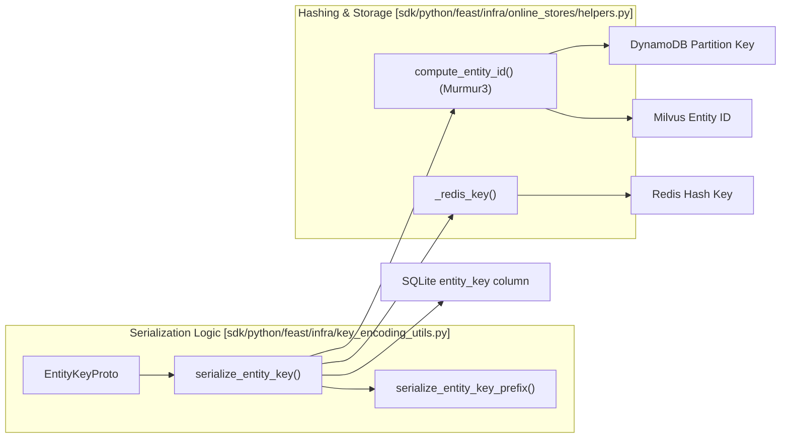

<!-- source: DeepWiki mcp.deepwiki.com · repo feast-dev/feast · page 3.3 Online Stores · fetched 2026-10-21 -->

# Online Stores

<details>
<summary>Relevant source files</summary>

The following files were used as context for generating this wiki page:

- [docs/getting-started/genai.md](docs/getting-started/genai.md)
- [docs/how-to-guides/online-server-performance-tuning.md](docs/how-to-guides/online-server-performance-tuning.md)
- [docs/reference/alpha-vector-database.md](docs/reference/alpha-vector-database.md)
- [docs/reference/feature-repository/feature-store-yaml.md](docs/reference/feature-repository/feature-store-yaml.md)
- [docs/reference/offline-stores/bigquery.md](docs/reference/offline-stores/bigquery.md)
- [docs/reference/offline-stores/overview.md](docs/reference/offline-stores/overview.md)
- [docs/reference/offline-stores/snowflake.md](docs/reference/offline-stores/snowflake.md)
- [docs/reference/offline-stores/trino.md](docs/reference/offline-stores/trino.md)
- [docs/reference/online-stores/cassandra.md](docs/reference/online-stores/cassandra.md)
- [docs/reference/online-stores/datastore.md](docs/reference/online-stores/datastore.md)
- [docs/reference/online-stores/dynamodb.md](docs/reference/online-stores/dynamodb.md)
- [docs/reference/online-stores/elasticsearch.md](docs/reference/online-stores/elasticsearch.md)
- [docs/reference/online-stores/overview.md](docs/reference/online-stores/overview.md)
- [docs/reference/online-stores/qdrant.md](docs/reference/online-stores/qdrant.md)
- [docs/reference/online-stores/redis.md](docs/reference/online-stores/redis.md)
- [docs/reference/online-stores/scylladb.md](docs/reference/online-stores/scylladb.md)
- [docs/reference/online-stores/snowflake.md](docs/reference/online-stores/snowflake.md)
- [docs/reference/online-stores/sqlite.md](docs/reference/online-stores/sqlite.md)
- [docs/reference/providers/google-cloud-platform.md](docs/reference/providers/google-cloud-platform.md)
- [docs/tutorials/azure/notebooks/src/score.py](docs/tutorials/azure/notebooks/src/score.py)
- [infra/feast-operator/bundle/manifests/openlineage-secret_v1_secret.yaml](infra/feast-operator/bundle/manifests/openlineage-secret_v1_secret.yaml)
- [protos/feast/core/DatastoreTable.proto](protos/feast/core/DatastoreTable.proto)
- [protos/feast/core/InfraObject.proto](protos/feast/core/InfraObject.proto)
- [protos/feast/core/PrecomputedFeatureVector.proto](protos/feast/core/PrecomputedFeatureVector.proto)
- [protos/feast/core/SqliteTable.proto](protos/feast/core/SqliteTable.proto)
- [sdk/python/feast/diff/infra_diff.py](sdk/python/feast/diff/infra_diff.py)
- [sdk/python/feast/infra/infra_object.py](sdk/python/feast/infra/infra_object.py)
- [sdk/python/feast/infra/online_stores/cassandra_online_store/cassandra_online_store.py](sdk/python/feast/infra/online_stores/cassandra_online_store/cassandra_online_store.py)
- [sdk/python/feast/infra/online_stores/datastore.py](sdk/python/feast/infra/online_stores/datastore.py)
- [sdk/python/feast/infra/online_stores/dynamodb.py](sdk/python/feast/infra/online_stores/dynamodb.py)
- [sdk/python/feast/infra/online_stores/elasticsearch_online_store/elasticsearch.py](sdk/python/feast/infra/online_stores/elasticsearch_online_store/elasticsearch.py)
- [sdk/python/feast/infra/online_stores/faiss_online_store.py](sdk/python/feast/infra/online_stores/faiss_online_store.py)
- [sdk/python/feast/infra/online_stores/helpers.py](sdk/python/feast/infra/online_stores/helpers.py)
- [sdk/python/feast/infra/online_stores/postgres_online_store/postgres.py](sdk/python/feast/infra/online_stores/postgres_online_store/postgres.py)
- [sdk/python/feast/infra/online_stores/qdrant_online_store/qdrant.py](sdk/python/feast/infra/online_stores/qdrant_online_store/qdrant.py)
- [sdk/python/feast/infra/online_stores/redis.py](sdk/python/feast/infra/online_stores/redis.py)
- [sdk/python/feast/infra/online_stores/scylladb_online_store/__init__.py](sdk/python/feast/infra/online_stores/scylladb_online_store/__init__.py)
- [sdk/python/feast/infra/online_stores/scylladb_online_store/scylladb.py](sdk/python/feast/infra/online_stores/scylladb_online_store/scylladb.py)
- [sdk/python/feast/infra/online_stores/snowflake.py](sdk/python/feast/infra/online_stores/snowflake.py)
- [sdk/python/feast/infra/online_stores/vector_store.py](sdk/python/feast/infra/online_stores/vector_store.py)
- [sdk/python/feast/infra/utils/snowflake/registry/snowflake_table_creation.sql](sdk/python/feast/infra/utils/snowflake/registry/snowflake_table_creation.sql)
- [sdk/python/feast/infra/utils/snowflake/registry/snowflake_table_deletion.sql](sdk/python/feast/infra/utils/snowflake/registry/snowflake_table_deletion.sql)
- [sdk/python/feast/infra/utils/snowflake/snowflake_utils.py](sdk/python/feast/infra/utils/snowflake/snowflake_utils.py)
- [sdk/python/tests/conftest.py](sdk/python/tests/conftest.py)
- [sdk/python/tests/integration/online_store/conftest.py](sdk/python/tests/integration/online_store/conftest.py)
- [sdk/python/tests/integration/online_store/test_push_features_to_online_store.py](sdk/python/tests/integration/online_store/test_push_features_to_online_store.py)
- [sdk/python/tests/integration/online_store/test_scylladb_online_store.py](sdk/python/tests/integration/online_store/test_scylladb_online_store.py)
- [sdk/python/tests/integration/online_store/test_universal_online.py](sdk/python/tests/integration/online_store/test_universal_online.py)
- [sdk/python/tests/unit/diff/test_infra_diff.py](sdk/python/tests/unit/diff/test_infra_diff.py)
- [sdk/python/tests/unit/infra/online_store/test_cassandra_online_store.py](sdk/python/tests/unit/infra/online_store/test_cassandra_online_store.py)
- [sdk/python/tests/unit/infra/online_store/test_dynamodb_online_store.py](sdk/python/tests/unit/infra/online_store/test_dynamodb_online_store.py)
- [sdk/python/tests/unit/infra/online_store/test_faiss_versioning.py](sdk/python/tests/unit/infra/online_store/test_faiss_versioning.py)
- [sdk/python/tests/unit/infra/online_store/test_redis.py](sdk/python/tests/unit/infra/online_store/test_redis.py)
- [sdk/python/tests/unit/infra/registry/test_file_registry.py](sdk/python/tests/unit/infra/registry/test_file_registry.py)
- [sdk/python/tests/unit/infra/utils/snowflake/test_snowflake_utils.py](sdk/python/tests/unit/infra/utils/snowflake/test_snowflake_utils.py)
- [sdk/python/tests/universal/feature_repos/universal/online_store/scylladb.py](sdk/python/tests/universal/feature_repos/universal/online_store/scylladb.py)

</details>


## Purpose and Scope

Online stores in Feast serve as low-latency key-value databases optimized to provide real-time feature values for online machine learning inference. They persist the latest state of entity features at millisecond latency, enabling ML models to fetch current data during serving.

This page documents the `OnlineStore` interface and key operations such as `online_read` and `online_write_batch`. It covers implementations across multiple backends, including Redis, DynamoDB, SQLite, PostgreSQL, Snowflake, Milvus, Qdrant, Cassandra/ScyllaDB, and others. Important aspects such as entity key encoding, TTL management, and vector search capabilities are also detailed.

For offline data storage and processing, refer to **Offline Stores** (3.2) and for feature materialization processes, see **Materialization and Compute Engines** (3.4).

Sources:  
[sdk/python/feast/infra/online_stores/online_store.py]()  
[sdk/python/feast/infra/online_stores/redis.py]()  
[sdk/python/feast/infra/online_stores/dynamodb.py]()  

---

## Architecture Overview

Online stores are integrated through Feast's **Provider** abstraction, which manages coordination between offline storage, online storage, and compute engines. Feature data is ingested into the online stores either by materialization jobs or direct writes, and features are retrieved from these stores by serving APIs.

The following diagram illustrates core components relating to online stores and data flow during feature serving and ingestion:

```mermaid
graph TB
    subgraph "FeatureStore [sdk/python/feast/feature_store.py]"
        FS["FeatureStore"]
        FS_APPLY["apply()"]
        FS_MAT["materialize()"]
        FS_GET["get_online_features()"]
        FS_WRITE["write_to_online_store()"]
        FS --> FS_APPLY
        FS --> FS_MAT
        FS --> FS_GET
        FS --> FS_WRITE
    end
    
    subgraph "PassthroughProvider [sdk/python/feast/infra/passthrough_provider.py]"
        PROV["PassthroughProvider"]
        PROV_PROP["@property online_store"]
        PROV_READ["online_read()"]
        PROV_WRITE["online_write_batch()"]
        PROV --> PROV_PROP
        PROV_PROP --> OS_ABC
    end
    
    subgraph "OnlineStore Abstract Base Class [sdk/python/feast/infra/online_stores/online_store.py]"
        OS_ABC["OnlineStore"]
        OS_READ["online_read()"]
        OS_WRITE["online_write_batch()"]
        OS_ABC --> OS_READ
        OS_ABC --> OS_WRITE
    end
    
    subgraph "Implementations"
        SQLITE["SqliteOnlineStore"]
        REDIS["RedisOnlineStore"]
        DYNAMO["DynamoDBOnlineStore"]
        POSTGRES["PostgreSQLOnlineStore"]
        SNOWFLAKE["SnowflakeOnlineStore"]
        MILVUS["MilvusOnlineStore"]
        DATASTORE["DatastoreOnlineStore"]
        ELASTICSEARCH["ElasticsearchOnlineStore"]
        QDRANT["QdrantOnlineStore"]
        FAISS["FaissOnlineStore"]
        SCYLLADB["ScyllaDBOnlineStore"]
        REMOTE["RemoteOnlineStore"]
    end
    
    FS_APPLY --> PROV
    FS_MAT --> PROV
    FS_GET --> PROV
    FS_WRITE --> PROV
    
    PROV --> PROV_PROP
    PROV_PROP --> OS_ABC
    
    OS_ABC -. "implements" .-> SQLITE
    OS_ABC -. "implements" .-> REDIS
    OS_ABC -. "implements" .-> DYNAMO
    OS_ABC -. "implements" .-> POSTGRES
    OS_ABC -. "implements" .-> SNOWFLAKE
    OS_ABC -. "implements" .-> MILVUS
    OS_ABC -. "implements" .-> DATASTORE
    OS_ABC -. "implements" .-> ELASTICSEARCH
    OS_ABC -. "implements" .-> QDRANT
    OS_ABC -. "implements" .-> FAISS
    OS_ABC -. "implements" .-> SCYLLADB
    OS_ABC -. "implements" .-> REMOTE
```



Sources:  
[sdk/python/feast/feature_store.py]()  
[sdk/python/feast/infra/passthrough_provider.py]()  
[sdk/python/feast/infra/online_stores/online_store.py]()  
[sdk/python/feast/repo_config.py]()  

---

## OnlineStore Abstract Base Class and Core Operations

`OnlineStore` is the abstract base class that all online store implementations must inherit, defining the interface and expected functionality. Concrete implementations are dynamically instantiated using helper functions based on configuration [sdk/python/feast/infra/online_stores/helpers.py:16-23]().

### Key Interface Methods

| Method | Description | Reference |
|---|---|---|
| `online_write_batch(config, table, data, progress)` | Writes a batch of feature rows to the online store. Data is a list of tuples containing entity keys, feature values, event timestamps, and optional creation timestamps. | [sdk/python/feast/infra/online_stores/online_store.py]() |
| `online_read(config, table, entity_keys, requested_features)` | Reads feature values for a list of entity keys, optionally filtered by requested feature names. Returns pairs of event timestamp and dictionary of feature values. | [sdk/python/feast/infra/online_stores/online_store.py]() |
| `online_write_batch_async(...)` | Asynchronous version of batch write for supported stores. | [sdk/python/feast/infra/online_stores/online_store.py]() |
| `online_read_async(...)` | Asynchronous version of batch read. | [sdk/python/feast/infra/online_stores/online_store.py]() |
| `update(...)` | Synchronizes infrastructure with registry definitions, including creating and deleting tables or entity data as needed. | [sdk/python/feast/infra/online_stores/online_store.py]() |
| `teardown(...)` | Removes online store tables and data during feature repository deletion or cleanup. | [sdk/python/feast/infra/online_stores/online_store.py]() |

### Async Support

Some online stores implement asynchronous operations and explicitly declare support using the `async_supported` property.

- **Redis**: Supports both async read and write via `async_supported` returning `SupportedAsyncMethods(read=True, write=True)` [sdk/python/feast/infra/online_stores/redis.py:118-120]().
- **DynamoDB**: Implements asynchronous client capabilities through `aiobotocore` for high-throughput concurrency [sdk/python/feast/infra/online_stores/dynamodb.py:14-46]().

Sources:  
[sdk/python/feast/infra/online_stores/online_store.py]()  
[sdk/python/feast/infra/online_stores/redis.py:118-120]()  
[sdk/python/feast/infra/online_stores/dynamodb.py:14-46]()  
[sdk/python/feast/infra/online_stores/helpers.py:16-23]()  

---

## Key Encoding and Serialization

Online stores require deterministic and stable serialization of entity keys for consistent storage and retrieval across different compute engines and languages.

Title: "Entity Key Serialization to Storage Mapping"


- `serialize_entity_key()`: The canonical binary form for entity keys. Version 3 includes the entity key size for better deserialization and handles sorting of multi-entity keys [sdk/python/feast/infra/key_encoding_utils.py:123-142]().
- `compute_entity_id()`: Generates a hex string Murmur3 hash of the serialized key, used by DynamoDB and Milvus [sdk/python/feast/infra/online_stores/helpers.py:52-65]().
- `_redis_key()`: Concatenates the serialized key and project name for Redis storage [sdk/python/feast/infra/online_stores/helpers.py:25-35]().
- `serialize_entity_key_prefix()`: Used for prefix-scanning items in the online store [sdk/python/feast/infra/key_encoding_utils.py:50-74]().

Sources:  
[sdk/python/feast/infra/key_encoding_utils.py:50-142]()  
[sdk/python/feast/infra/online_stores/helpers.py:25-65]()  

---

## Online Store Implementations

### Redis Online Store

- Implemented in `RedisOnlineStore` [sdk/python/feast/infra/online_stores/redis.py:102]() supporting multiple Redis types: standalone, cluster, and sentinel [sdk/python/feast/infra/online_stores/redis.py:68-72]().
- Feature data is stored inside Redis Hashes keyed by a combination of serialized entity key and project name, as generated by helper `_redis_key()` [sdk/python/feast/infra/online_stores/helpers.py:25-35]().
- TTL support is configurable via the `key_ttl_seconds` field allowing automatic expiry of keys [sdk/python/feast/infra/online_stores/redis.py:90-91]().
- `delete_table` uses an efficient multi-phase pipelined scanning approach to delete all records related to a feature view without excessive latency or blocking [sdk/python/feast/infra/online_stores/redis.py:137-185]().
- Supports `skip_dedup` to optimize write throughput by skipping timestamp deduplication checks, at the risk of occasional out-of-order overwrites [sdk/python/feast/infra/online_stores/redis.py:96-99]().

Sources:  
[sdk/python/feast/infra/online_stores/redis.py]()  
[sdk/python/feast/infra/online_stores/helpers.py:25-35]()  

---

### DynamoDB Online Store

- Provided by `DynamoDBOnlineStore` class [sdk/python/feast/infra/online_stores/dynamodb.py:122-1394]().
- Configured via `DynamoDBOnlineStoreConfig` which includes tuning parameters such as `batch_size`, `max_read_workers` (parallelism), and `warmup_connections` for connection pooling [sdk/python/feast/infra/online_stores/dynamodb.py:56-121]().
- Implements asynchronous clients using `aiobotocore` for concurrency and throughput in batch reads and writes.
- Uses a class-level cached `TypeDeserializer` for efficient conversion between DynamoDB native types and Feast protobuf types.
- Provides connection warming on initialization to reduce latency for the first read requests.
- Enables configurable table name templating, consistent reads, and connection management parameters like keepalive and timeouts.
- Supports partitioning keys using the `compute_entity_id()` Murmur3 hash, ensuring uniform key distribution.

Sources:  
[sdk/python/feast/infra/online_stores/dynamodb.py]()  
[docs/reference/online-stores/dynamodb.md]()  

---

### SQLite Online Store

- Implements a local SQLite database to store entity features [sdk/python/feast/infra/online_stores/sqlite.py]().
- Uses schema with `entity_key` as a binary column containing serialized entity keys.
- Supports SQL queries with translated filters via `SqliteFilterTranslator` converting Feast Filters into SQLite WHERE clauses.
- Supports local vector storage and retrieval (alpha state), enabling embedded vector search capabilities aligned with GenAI integrations.
- Useful for local testing and small-scale deployment scenarios.

Sources:  
[sdk/python/feast/infra/online_stores/sqlite.py]()  
[docs/reference/alpha-vector-database.md:16]()  

---

### PostgreSQL Online Store

- Provided by `PostgreSQLOnlineStore` implementation [sdk/python/feast/infra/online_stores/postgres_online_store/postgres.py]() including native support for `pgvector` extension.
- Supports vector feature fields to enable vector searches natively in Postgres.
- Has an `enable_openai_compatible_store` flag which creates an additional `value_num` column for numeric types to support accurate numeric filtering (instead of lexical string comparison) [docs/reference/alpha-vector-database.md:106-117]().
- Used in production deployments where relational and vector search workloads are combined.

Sources:  
[sdk/python/feast/infra/online_stores/postgres_online_store/postgres.py]()  
[docs/reference/alpha-vector-database.md:12]()  
[docs/reference/alpha-vector-database.md:106-117]()  

---

### Snowflake Online Store

- Implemented in `SnowflakeOnlineStore` [sdk/python/feast/infra/online_stores/snowflake.py]() leveraging Snowflake's SQL engine and relational storage capabilities.
- Features are stored in Snowflake tables keyed by serialized entity keys.
- Uses batch upload and insertion techniques to efficiently write feature data.
- Online reads execute SQL queries filtering on serialized entity keys.
- Supports typical Snowflake connection authentication configurations including key pairs and role-based access.
- Leverages Snowflake's performance and concurrency for serving features at scale.

Sources:  
[sdk/python/feast/infra/online_stores/snowflake.py]()  
[sdk/python/feast/infra/utils/snowflake/snowflake_utils.py]()  

---

### Milvus Online Store

- Milvus integration is provided for vector similarity search capabilities [sdk/python/feast/infra/online_stores/milvus_online_store/milvus.py]() supporting both storage and retrieval of vectors.
- Feast primitive and array feature types are mapped to Milvus data types.
- Implements translation of Feast predicates (via `ComparisonFilter`) into Milvus expressions for filtering candidate vectors during search.
- Supports vector search along with standard feature retrieval via the `retrieve_online_documents_v2` mechanism enabling richer context for GenAI workflows.
- Bridges Feast's entity key semantics with Milvus's entity ID system using Murmur3 hashes.

Sources:  
[sdk/python/feast/infra/online_stores/milvus_online_store/milvus.py]()  
[docs/reference/alpha-vector-database.md:33-35]()  

---

### Qdrant and ScyllaDB / Cassandra Online Stores

- **Qdrant** is integrated as a vector database providing vector storage, indexing, and retrieval [docs/reference/alpha-vector-database.md:17]().

- **ScyllaDB / Cassandra** provide a highly scalable NoSQL backend supporting native vector `<float, N>` data types with HNSW indexing for approximate nearest neighbor search. They support Feast's v2 document retrieval API (`retrieve_online_documents_v2`) and feature co-location by feature view and entity key [docs/reference/alpha-vector-database.md:18]().

Sources:  
[docs/reference/alpha-vector-database.md:17-18]()  

---

### Other Online Store Backends

- **Google Cloud Datastore:** Uses Python multithreading to batch writes concurrently, with batched minibatches meeting transactional limits [sdk/python/feast/infra/online_stores/datastore.py:183-190]().
- **Remote Online Store:** Acts as an HTTP client wrapper to a remote Feast online server, used in remote serving setups [sdk/python/feast/infra/online_stores/remote.py:101-103]().

Sources:  
[sdk/python/feast/infra/online_stores/datastore.py]()  
[sdk/python/feast/infra/online_stores/remote.py]()  

---

## Vector Search Capabilities

Feast enables vector similarity search to support Generative AI (GenAI) and Retrieval Augmented Generation (RAG) use cases. This allows combining structured feature retrieval with embedding-based nearest neighbor search.

### Supported Vector Databases Matrix

| Vector Database | Retrieval | Indexing | V2 Support | Online Read |
|---|---|---|---|---|
| **Pgvector** | ✓ | × | × | × |
| **Elasticsearch**| ✓ | ✓ | × | × |
| **Milvus** | ✓ | ✓ | ✓ | ✓ |
| **SQLite** | ✓ | × | ✓ | ✓ |
| **ScyllaDB** | ✓ | ✓ | ✓ | ✓ |
| **Qdrant** | ✓ | ✓ | × | × |

- `V2 Support` indicates support for the Feast SDK's enhanced `retrieve_online_documents_v2` that supports combined vector and feature retrieval.
- SQLite, Milvus and ScyllaDB are prominent implementations with mature vector search and retrieval support.

Sources:  
[docs/reference/alpha-vector-database.md:10-19]()  

---

## TTL and Expiration Management

- **Redis** supports native expiration of entity keys using the `key_ttl_seconds` configuration, allowing entity features to expire automatically if not updated [sdk/python/feast/infra/online_stores/redis.py:90-91]().
- Other online stores generally rely on offline pruning or TTL management outside the online store layer.
- Feast normalizes event timestamps to naive UTC datetime objects during storage and reads, ensuring temporal consistency [sdk/python/feast/infra/online_stores/helpers.py:68-72]().

Sources:  
[sdk/python/feast/infra/online_stores/redis.py:90-91]()  
[sdk/python/feast/infra/online_stores/helpers.py:68-72]()  

---

## Code Entity Mapping

This diagram bridges natural system names and implementation classes for easy navigation and searching of code artifacts.

```mermaid
graph LR
  "Redis" --> "RedisOnlineStore [sdk/python/feast/infra/online_stores/redis.py]"
  "DynamoDB" --> "DynamoDBOnlineStore [sdk/python/feast/infra/online_stores/dynamodb.py]"
  "SQLite" --> "SqliteOnlineStore [sdk/python/feast/infra/online_stores/sqlite.py]"
  "PostgreSQL" --> "PostgreSQLOnlineStore [sdk/python/feast/infra/online_stores/postgres_online_store/postgres.py]"
  "Snowflake" --> "SnowflakeOnlineStore [sdk/python/feast/infra/online_stores/snowflake.py]"
  "Milvus" --> "MilvusOnlineStore [sdk/python/feast/infra/online_stores/milvus_online_store/milvus.py]"
  "Datastore" --> "DatastoreOnlineStore [sdk/python/feast/infra/online_stores/datastore.py]"
  "ScyllaDB" --> "ScyllaDBOnlineStore [sdk/python/feast/infra/online_stores/scylladb_online_store/scylladb.py]"
  "Elasticsearch" --> "ElasticSearchOnlineStore [sdk/python/feast/infra/online_stores/elasticsearch_online_store/elasticsearch.py]"
  "Qdrant" --> "QdrantOnlineStore [sdk/python/feast/infra/online_stores/qdrant_online_store/qdrant.py]"
  "Remote" --> "RemoteOnlineStore [sdk/python/feast/infra/online_stores/remote.py]"
```

Sources:  
[sdk/python/feast/infra/online_stores/redis.py]()  
[sdk/python/feast/infra/online_stores/dynamodb.py]()  
[sdk/python/feast/infra/online_stores/sqlite.py]()  
[sdk/python/feast/infra/online_stores/postgres_online_store/postgres.py]()  
[sdk/python/feast/infra/online_stores/snowflake.py]()  
[sdk/python/feast/infra/online_stores/milvus_online_store/milvus.py]()  
[sdk/python/feast/infra/online_stores/datastore.py]()  
[sdk/python/feast/repo_config.py]()  

---

---

