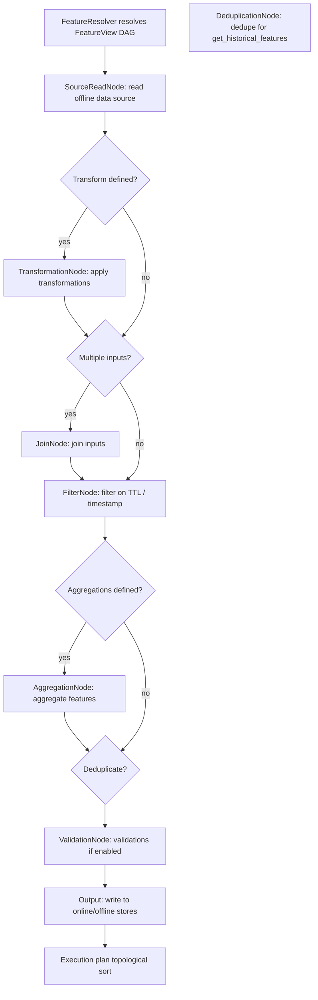
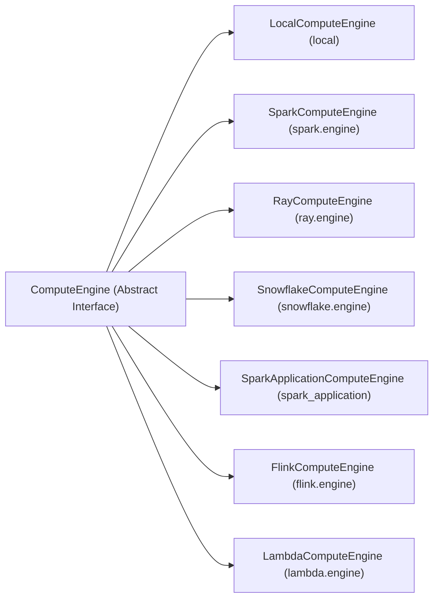
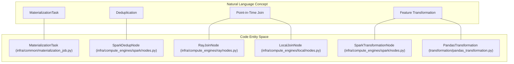
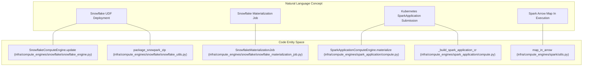

<!-- source: DeepWiki mcp.deepwiki.com · repo feast-dev/feast · page 3.4 Materialization and Compute Engines · fetched 2026-10-21 -->

# Materialization and Compute Engines

<details>
<summary>Relevant source files</summary>

The following files were used as context for generating this wiki page:

- [docs/assets/feast_model_inference_architecture.png](docs/assets/feast_model_inference_architecture.png)
- [docs/getting-started/architecture/model-inference.md](docs/getting-started/architecture/model-inference.md)
- [docs/getting-started/components/compute-engine.md](docs/getting-started/components/compute-engine.md)
- [docs/how-to-guides/feast-operator/06-batch-and-jobs.md](docs/how-to-guides/feast-operator/06-batch-and-jobs.md)
- [docs/reference/compute-engine/README.md](docs/reference/compute-engine/README.md)
- [docs/reference/compute-engine/snowflake.md](docs/reference/compute-engine/snowflake.md)
- [docs/reference/compute-engine/spark_application.md](docs/reference/compute-engine/spark_application.md)
- [docs/reference/data-sources/kafka.md](docs/reference/data-sources/kafka.md)
- [docs/reference/data-sources/kinesis.md](docs/reference/data-sources/kinesis.md)
- [docs/tutorials/building-streaming-features.md](docs/tutorials/building-streaming-features.md)
- [sdk/python/feast/infra/compute_engines/base.py](sdk/python/feast/infra/compute_engines/base.py)
- [sdk/python/feast/infra/compute_engines/snowflake/snowflake_engine.py](sdk/python/feast/infra/compute_engines/snowflake/snowflake_engine.py)
- [sdk/python/feast/infra/compute_engines/spark_application/.dockerignore](sdk/python/feast/infra/compute_engines/spark_application/.dockerignore)
- [sdk/python/feast/infra/compute_engines/spark_application/Dockerfile](sdk/python/feast/infra/compute_engines/spark_application/Dockerfile)
- [sdk/python/feast/infra/compute_engines/spark_application/__init__.py](sdk/python/feast/infra/compute_engines/spark_application/__init__.py)
- [sdk/python/feast/infra/compute_engines/spark_application/compute.py](sdk/python/feast/infra/compute_engines/spark_application/compute.py)
- [sdk/python/feast/infra/compute_engines/spark_application/config.py](sdk/python/feast/infra/compute_engines/spark_application/config.py)
- [sdk/python/feast/infra/compute_engines/spark_application/job.py](sdk/python/feast/infra/compute_engines/spark_application/job.py)
- [sdk/python/feast/infra/compute_engines/spark_application/main.py](sdk/python/feast/infra/compute_engines/spark_application/main.py)
- [sdk/python/feast/infra/utils/snowflake/snowpark/snowflake_python_udfs_creation.sql](sdk/python/feast/infra/utils/snowflake/snowpark/snowflake_python_udfs_creation.sql)
- [sdk/python/feast/infra/utils/snowflake/snowpark/snowflake_udfs.py](sdk/python/feast/infra/utils/snowflake/snowpark/snowflake_udfs.py)
- [sdk/python/tests/integration/materialization/test_snowflake.py](sdk/python/tests/integration/materialization/test_snowflake.py)
- [sdk/python/tests/unit/infra/compute_engines/snowflake/__init__.py](sdk/python/tests/unit/infra/compute_engines/snowflake/__init__.py)
- [sdk/python/tests/unit/infra/compute_engines/snowflake/test_snowflake_compute_engine.py](sdk/python/tests/unit/infra/compute_engines/snowflake/test_snowflake_compute_engine.py)
- [sdk/python/tests/unit/infra/compute_engines/test_spark_application.py](sdk/python/tests/unit/infra/compute_engines/test_spark_application.py)
- [sdk/python/tests/unit/infra/utils/snowflake/test_snowflake_udfs.py](sdk/python/tests/unit/infra/utils/snowflake/test_snowflake_udfs.py)
- [sdk/python/tests/universal/feature_repos/repo_configuration.py](sdk/python/tests/universal/feature_repos/repo_configuration.py)

</details>


This page documents Feast's materialization subsystem, the `ComputeEngine` pluggable DAG (Directed Acyclic Graph) abstraction, and concrete engine implementations including Local, Spark, Ray, Snowflake, Flink, Lambda, and Kubernetes-native SparkApplications. Materialization synchronizes offline feature data into online stores for low-latency inference.

---

## 1. Overview and Materialization Flow

When a `FeatureView` [sdk/python/feast/feature_view.py:111-141]() defines `online=True`, its feature data must be continuously synchronized from the offline store (used for batch processing and model training) to the online store (used for online inference). The materialization workflow is orchestrated by a pluggable `ComputeEngine` interface [sdk/python/feast/infra/compute_engines/base.py:26-33](), which translates feature definitions into execution plans implemented as DAGs.

The typical materialization call flow:

```mermaid
sequenceDiagram
    participant U as "User / CLI"
    participant FS as "FeatureStore"
    participant P as "Provider"
    participant E as "ComputeEngine"
    participant OFF as "OfflineStore"
    participant ON as "OnlineStore"
    participant REG as "BaseRegistry"

    U->>FS: materialize(start_time, end_time)
    FS->>FS: _get_feature_views_to_materialize()
    loop "for each FeatureView"
        FS->>P: materialize_single_feature_view()
        P->>E: materialize_single_feature_view()
        E->>OFF: pull_latest_from_table_or_query()
        OFF-->>E: RetrievalJob
        E->>ON: online_write_batch()
        E-->>P: MaterializationJobStatus
        P-->>FS: done
        FS->>REG: apply_materialization()
    end
```

Materialization populates the online store so low-latency inference clients can fetch recent feature values. The offline store holds historical data used for batch pipelines and training.

Sources: [sdk/python/feast/infra/compute_engines/base.py:106-132](), [sdk/python/feast/feature_view.py:111-141]()

---

## 2. ComputeEngine and BatchEngine Interfaces

The `ComputeEngine` interface encapsulates compute backends responsible for performing feature transformation pipelines, materializing features, and retrieving historical datasets [sdk/python/feast/infra/compute_engines/base.py:26-33]().

### Key Interface Methods and Properties

| Method / Property       | Description                                                                                     | File Reference                            |
|------------------------|-------------------------------------------------------------------------------------------------|-------------------------------------------|
| `update()`             | Prepares or updates infrastructure needed for batch materialization of the Feast objects       | [base.py:48-72]()                         |
| `teardown_infra()`     | Tears down or cleans up resources allocated by the compute engine                               | [base.py:75-89]()                         |
| `materialize()`        | Executes materialization tasks for one or more `MaterializationTask` objects                    | [base.py:106-128]()                       |
| `get_historical_features()` | Retrieves point-in-time correct historical training datasets                                 | [base.py:140-143]()                       |
| `supports_batch`       | Whether engine accepts all materialization tasks in a single batch call                         | [base.py:91-100]()                        |
| `applies_materialization` | Whether engine handles writing materialization watermark/state itself                        | [base.py:101-104]()                       |

Batch engine configuration can be specified globally in `feature_store.yaml` or overridden per feature view [docs/getting-started/components/compute-engine.md:31-82]().

Sources: [sdk/python/feast/infra/compute_engines/base.py:26-182](), [docs/getting-started/components/compute-engine.md:31-82]()

---

## 3. The DAG Execution Model & FeatureBuilder

Feast models data transformations and feature generation as Directed Acyclic Graphs (DAGs), composed of typed nodes representing data operations: reads, transforms, joins, filters, aggregations, deduplication, validation, and output writing [docs/reference/compute-engine/README.md:1-10](). The `FeatureBuilder` class assembles these DAGs from `FeatureView` definitions and materialization tasks [sdk/python/feast/infra/compute_engines/feature_builder.py:18-35](). The nodes abstract backend operations but maintain a unified execution model.

### DAG Construction Flow



Sources: [sdk/python/feast/infra/compute_engines/feature_builder.py:81-142]()

### Core DAG Node Types

| Node Class             | Description                                          | Code Examples / Files                                               |
|------------------------|------------------------------------------------------|-------------------------------------------------------------------|
| `ReadNode`             | Loads offline data or data sources                   | `SparkReadNode` [spark/nodes.py:166-182](), `RayReadNode` [ray/nodes.py:40-60]() |
| `JoinNode`             | Point-in-time join of features with entity rows      | `RayJoinNode` [ray/nodes.py:104-199](), `LocalJoinNode` [local/nodes.py:60-115]() |
| `FilterNode`           | Applies TTL and timestamp filters                     | `LocalFilterNode` [local/nodes.py:117-158]()                      |
| `AggregationNode`      | Performs feature aggregation (sum, max, count, etc.) | `LocalAggregationNode` [local/nodes.py:160-181]()                 |
| `DeduplicationNode`    | Deduplicates feature rows (latest entity-time key)   | `LocalDedupNode` [local/nodes.py:183-207]()                       |
| `TransformationNode`   | Executes user-defined feature transformations         | `LocalTransformationNode` [local/nodes.py:209-236]()              |
| `OutputNode`           | Final node writing results to stores                   | `LocalOutputNode` [local/nodes.py:238-270]()                      |

Sources: [sdk/python/feast/infra/compute_engines/feature_builder.py:18-142](), [sdk/python/feast/infra/compute_engines/local/nodes.py:26-270]()

---

## 4. Compute Engine Implementations

Feast supports various compute engines targeting different infrastructures and workloads [docs/reference/compute-engine/README.md:49-105]().

### Compute Engine Hierarchy and Supported Backends



### LocalComputeEngine (`local`)

- Runs DAGs synchronously on a single machine using Apache Arrow and dataframe libraries like Pandas or Polars.
- Designed for quick development, testing, or lightweight materialization.
- Implements materialization with `LocalMaterializationJob` and retrieval with `LocalHistoricalRetrievalJob`.
- Uses `ExecutionPlan` to execute DAG nodes locally in dependency order [docs/reference/compute-engine/README.md:84-91]().

Sources: [docs/reference/compute-engine/README.md:84-91]()

---

### SparkComputeEngine (`spark.engine`)

- Performs distributed feature computations using Apache Spark.
- Converts Apache Arrow schemas into Spark native schemas `from_arrow_schema` [spark/nodes.py:9-22]().
- Executes DAG nodes as Spark transformations.
- Writes online store data efficiently using `map_in_arrow` to avoid excessive serialization overhead [spark/utils.py:128-176]().
- Used for large-scale batch and stream feature pipelines [docs/reference/compute-engine/README.md:52-59]().

Sources: [docs/reference/compute-engine/README.md:52-59](), [sdk/python/feast/infra/compute_engines/spark/nodes.py:9-22](), [sdk/python/feast/infra/compute_engines/spark/utils.py:128-176]()

---

### RayComputeEngine (`ray.engine`)

- Executes DAG operations in a distributed Ray cluster, leveraging `ray.data.Dataset` abstractions.
- Implements intelligent join strategies (broadcast vs distributed joins).
- Supports automatic resource management and parallelism tuning.
- Uses `RayJoinNode` for point-in-time joins [ray/nodes.py:104-199]().
- Initialized and configured by `RayConfigManager` [infra/ray_initializer.py:41-131]().
- Suitable for distributed ML workloads requiring horizontal scaling [docs/reference/compute-engine/README.md:76-82]().

Sources: [docs/reference/compute-engine/README.md:76-82](), [sdk/python/feast/infra/compute_engines/ray/nodes.py:104-199](), [sdk/python/feast/infra/ray_initializer.py:41-131]()

---

### SnowflakeComputeEngine (`snowflake.engine`)

- Runs entirely inside Snowflake using Snowpark Python UDFs for feature transformations and aggregations.
- Materialization jobs submit SQL statements and invoke UDFs for conversion of data to Feast's protobuf types during processing.
- Deploys UDFs via `CREATE OR REPLACE FUNCTION` using templated `snowflake_python_udfs_creation.sql` and related Python handlers in `snowflake_udfs.py` [infra/utils/snowflake/snowpark/snowflake_udfs.py:1-484]().
- Applies feature data movement inside Snowflake without needing an external runner.
- The engine disallows retrieval (`get_historical_features`) currently [snowflake_engine.py:127-172]().
- Materialization linkage happens through `SnowflakeMaterializationJob` which abstracts SQL execution.
- Requires network storage and configured Snowflake connection parameters [snowflake_engine.py:47-172]().
- Example materialization tests verify behavioral correctness with Snowflake online/offline store integration [tests/integration/materialization/test_snowflake.py:1-196]().

Sources: [sdk/python/feast/infra/compute_engines/snowflake/snowflake_engine.py:127-172](), [sdk/python/feast/infra/utils/snowflake/snowpark/snowflake_udfs.py:1-209](), [sdk/python/tests/integration/materialization/test_snowflake.py:1-196]()

---

### SparkApplicationComputeEngine (`spark_application`)

- Executes batch materialization by submitting Kubernetes-native SparkApplication Custom Resources (CRs) via the Kubeflow Spark Operator.
- Creates a SparkApplication CR per materialize call, allowing multi-feature view batching.
- Manages Kubernetes API clients lazily, avoiding loading Kubernetes config during `feast apply` but loading during `materialize`.
- Requires network-accessible online/offline/registry stores; file-based stores (e.g., SQLite, Faiss, DuckDB) are unsupported because local storage is lost after pod termination.
- Implements `materialize()` by creating K8s ConfigMaps and submitting SparkApplication resources in cluster mode [compute.py:44-190]().
- Currently does not support `get_historical_features()`, planned for future phases.
- Includes configurable sparkConf passthrough, resource requests, environment variables for executor and driver pods.
- Validates incompatible offline, online, or registry store types upfront, raising errors for unsuitable file-based backends.
- Supported for production distributed feature generation in cloud-native Kubernetes environments.
- Unit tests cover config validation, Kubernetes client mocking, and CR structure verification [test_spark_application.py:1-202]().

Sources: [sdk/python/feast/infra/compute_engines/spark_application/compute.py:44-190](), [sdk/python/tests/unit/infra/compute_engines/test_spark_application.py:1-202](), [docs/reference/compute-engine/README.md:60-67]()

---

### FlinkComputeEngine (`flink.engine`) (Experimental)

- Executes DAGs through Apache Flink's PyFlink Table API.
- Supports distributed feature materialization and historical retrieval.
- Integrates with `FlinkMaterializationJob` and `FlinkDAGRetrievalJob`.
- Designed for stream and batch processing on Flink [docs/reference/compute-engine/README.md:68-74]().

Sources: [docs/reference/compute-engine/README.md:68-74]()

---

### LambdaComputeEngine (`lambda.engine`)

- Uses serverless AWS Lambda functions for feature generation.
- Ideal for lightweight, event-driven, or on-demand materialization.
- Provides a serverless compute option for materializing feature views [docs/reference/compute-engine/README.md:100-103](), [docs/getting-started/components/compute-engine.md:10-11]().

Sources: [docs/reference/compute-engine/README.md:100-103](), [docs/getting-started/components/compute-engine.md:10-11]()

---

## 5. Natural Language to Code Entity Mapping: Core Operations

This diagram bridges conceptual materialization and transformation operations to concrete Feast Python classes implementing them:



Sources: [sdk/python/feast/infra/common/materialization_job.py:15-20](), [sdk/python/feast/infra/compute_engines/spark/nodes.py:7-22](), [sdk/python/feast/infra/compute_engines/ray/nodes.py:104-121](), [sdk/python/feast/transformation/pandas_transformation.py:18-52]()

---

## 6. Natural Language to Code Entity Mapping: Distributed & Cloud UDF Execution

This diagram maps cloud orchestration and distributed execution entities to Feast code components:



Sources: [sdk/python/feast/infra/compute_engines/snowflake/snowflake_engine.py:135-171](), [sdk/python/feast/infra/utils/snowflake/snowflake_utils.py:30-37](), [sdk/python/feast/infra/compute_engines/spark_application/compute.py:159-190](), [sdk/python/feast/infra/compute_engines/spark/utils.py:128-140]()

---

## 7. Backends Abstraction and Transformations

The compute engines support integration with pluggable backends and feature transformation representations:

- **Transformation Modes**: Includes `PandasTransformation`, `PythonTransformation`, and `SubstraitTransformation`, allowing flexible execution across engines [docs/reference/compute-engine/README.md:1-10]().

- **Execution Context**: `ExecutionContext` holds all relevant runtime information such as repo config, offline/online stores, registry, and entity dataframe used during DAG execution [sdk/python/feast/infra/compute_engines/dag/context.py:1-50](), [sdk/python/feast/infra/compute_engines/base.py:145-165]().

Sources: [sdk/python/feast/infra/compute_engines/base.py:145-165](), [docs/reference/compute-engine/README.md:1-10]()

---

# Summary

Feast’s materialization system is built on a modular, extensible `ComputeEngine` interface that allows rich feature pipelines described by DAGs to be efficiently executed on diverse backends. Different engines target different infrastructure scales and environments:

- The **LocalComputeEngine** supports lightweight local execution for ease of development.
- The **SparkComputeEngine** and **RayComputeEngine** enable distributed large-scale DAG processing.
- The **SnowflakeComputeEngine** moves all logic inside Snowflake via Snowpark UDFs for cloud-native data warehouse-centric execution.
- The **SparkApplicationComputeEngine** runs jobs as Kubernetes SparkApplication resources, designed for cloud-native batch workflows.
- Serverless and streaming focused engines like **LambdaComputeEngine** and **FlinkComputeEngine** provide additional patterns for feature materialization.

This architecture provides Feast users powerful flexibility to integrate feature engineering with their preferred data processing ecosystems.

---

Sources:

- [sdk/python/feast/infra/compute_engines/base.py:26-182]()
- [sdk/python/feast/infra/compute_engines/feature_builder.py:18-142]()
- [sdk/python/feast/infra/compute_engines/local/nodes.py:26-270]()
- [docs/reference/compute-engine/README.md:1-157]()
- [sdk/python/feast/infra/compute_engines/snowflake/snowflake_engine.py:47-172]()
- [sdk/python/feast/infra/utils/snowflake/snowpark/snowflake_udfs.py:1-209]()
- [sdk/python/feast/infra/compute_engines/spark_application/compute.py:44-190]()
- [sdk/python/tests/integration/materialization/test_snowflake.py:1-196]()
- [sdk/python/tests/unit/infra/compute_engines/test_spark_application.py:1-202]()
- [sdk/python/feast/infra/ray_initializer.py:41-131]()
- [docs/getting-started/components/compute-engine.md:1-157]()

---

