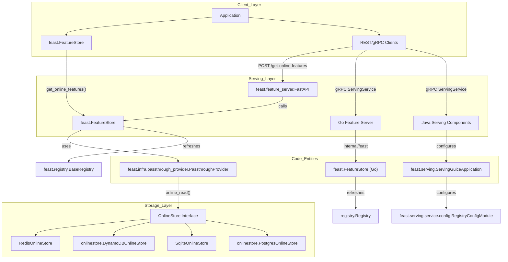
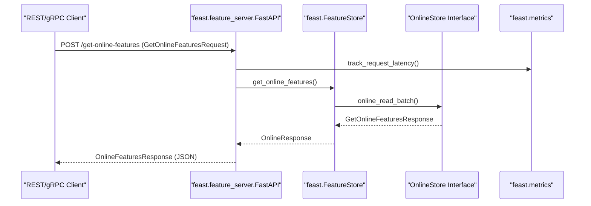

<!-- source: DeepWiki mcp.deepwiki.com · repo feast-dev/feast · page 4 Feature Serving · fetched 2026-10-21 -->

# Feature Serving

Relevant source files

The following files were used as context for generating this wiki page:

- [docs/reference/feature-servers/python-feature-server.md](docs/reference/feature-servers/python-feature-server.md)
- [infra/feast-operator/config/samples/v1_featurestore_serving.yaml](infra/feast-operator/config/samples/v1_featurestore_serving.yaml)
- [protos/feast/serving/ServingService.proto](protos/feast/serving/ServingService.proto)
- [sdk/python/feast/audit/__init__.py](sdk/python/feast/audit/__init__.py)
- [sdk/python/feast/audit/audit_logger.py](sdk/python/feast/audit/audit_logger.py)
- [sdk/python/feast/audit/audit_middleware.py](sdk/python/feast/audit/audit_middleware.py)
- [sdk/python/feast/feature_server.py](sdk/python/feast/feature_server.py)
- [sdk/python/feast/infra/feature_servers/base_config.py](sdk/python/feast/infra/feature_servers/base_config.py)
- [sdk/python/feast/infra/mcp_servers/mcp_server.py](sdk/python/feast/infra/mcp_servers/mcp_server.py)
- [sdk/python/feast/metrics.py](sdk/python/feast/metrics.py)
- [sdk/python/tests/unit/audit/__init__.py](sdk/python/tests/unit/audit/__init__.py)
- [sdk/python/tests/unit/audit/test_audit_logger.py](sdk/python/tests/unit/audit/test_audit_logger.py)
- [sdk/python/tests/unit/audit/test_audit_middleware.py](sdk/python/tests/unit/audit/test_audit_middleware.py)
- [sdk/python/tests/unit/audit/test_mcp_audit_handler.py](sdk/python/tests/unit/audit/test_mcp_audit_handler.py)
- [sdk/python/tests/unit/test_feature_server.py](sdk/python/tests/unit/test_feature_server.py)
- [sdk/python/tests/unit/test_metrics.py](sdk/python/tests/unit/test_metrics.py)

## Purpose and Scope

This document explains Feast's feature serving capabilities, which enable low-latency retrieval of feature values for real-time model inference. Feature serving bridges the gap between pre-computed feature values stored in online stores and ML models that consume them during prediction.

For information about:
- **Historical feature retrieval for training**: See [Data Integration](#3)
- **Feature computation and materialization**: See [Materialization and Compute Engines](#3.4)
- **Feature definitions**: See [Feature Views and Services](#2.3)

Sources: [sdk/python/feast/feature_server.py:1-48](), [protos/feast/serving/ServingService.proto:1-33]()

---

## Architecture Overview

Feature serving in Feast operates through a layered architecture that separates the serving interface from the underlying storage backend. It supports multiple language implementations (Python, Go, Java) to meet different performance requirements and deployment environments.

### System Components Diagram

The following diagram bridges natural language system concepts to underlying code entities across the client, serving, and storage layers:

Sources: [sdk/python/feast/feature_server.py:32-48](), [protos/feast/serving/ServingService.proto:28-33]()

---

## Core Serving Patterns

Feast supports several primary feature serving and data ingestion patterns:

| Pattern | Use Case | Latency | API Method / Endpoint |
|---|---|---|---|
| **Online Retrieval** | Real-time inference | <10ms (p99) | `get_online_features()` / `/get-online-features` [sdk/python/feast/feature_server.py:123-130](), [protos/feast/serving/ServingService.proto:31-33]() |
| **Push Ingestion** | Streaming feature ingestion | <100ms writes | `push()` / `/push` [sdk/python/feast/feature_server.py:87-93]() |
| **Materialization** | Bulk updates to online store | Variable | `materialize()` / `/materialize` [sdk/python/feast/feature_server.py:95-108]() |
| **Document Retrieval** | Vector search / RAG | Variable | `/get-online-documents` [sdk/python/feast/feature_server.py:131-142]() |

### Online Feature Retrieval Code Flow Diagram

The following sequence diagram illustrates the code-level execution path when handling online feature requests via `feast.feature_server.FastAPI` and `feast.FeatureStore`:

Sources: [sdk/python/feast/feature_server.py:122-194](), [protos/feast/serving/ServingService.proto:80-113](), [sdk/python/feast/metrics.py:106-163]()

---

## Feature Server Implementations

Feast provides three main feature server implementations supporting diverse environments and performance goals. For detailed information, see the linked child pages below.

### Python Feature Server

The Python feature server is the reference implementation built on `FastAPI` [sdk/python/feast/feature_server.py:32-34](), providing HTTP and gRPC endpoints for online feature serving, push ingestion, and materialization. It supports multiprocess worker scaling, registry caching, Prometheus metrics instrumentation [sdk/python/feast/metrics.py:28-42](), audit logging [sdk/python/feast/infra/feature_servers/base_config.py:115-135](), and Model Context Protocol (MCP) integrations [sdk/python/feast/infra/mcp_servers/mcp_server.py:1-32]().

For details, see [Python Feature Server](#4.1).

### Go Feature Server

The Go feature server provides a compiled binary implementation optimized for high-throughput, low-latency production environments with built-in Prometheus metrics and OpenTelemetry tracing.

For details, see [Go Feature Server](#4.2).

### Java Serving Components

The Java serving module offers a JVM-native gRPC serving interface using Maven (`java/serving/pom.xml`) and Guice dependency injection (`ServingGuiceApplication`), designed for enterprise Java architectures.

For details, see [Java Serving Components](#4.3).

Sources: [sdk/python/feast/feature_server.py:32-48](), [sdk/python/feast/metrics.py:28-42](), [sdk/python/feast/infra/mcp_servers/mcp_server.py:1-32]()

---

## Feature Transformations

Feast supports dynamic on-demand feature transformations applied at retrieval time via `OnDemandFeatureView`, as well as transformations applied during write operations via push APIs [sdk/python/feast/feature_server.py:79-93]().

For details, see [Feature Transformations](#4.4).

Sources: [sdk/python/feast/feature_server.py:79-93]()

---

## Monitoring, Observability, and Audit Logging

Feast includes integrated monitoring and audit subsystems for feature serving to track request latency, resource usage, and structured security auditing:

- **Prometheus Metrics:** Tracks request counts (`request_count`) and latencies (`request_latency`) via central definitions in `feast.metrics` [sdk/python/feast/metrics.py:16-42](), [sdk/python/tests/unit/test_metrics.py:79-119]().
- **Resource Monitoring:** Tracks CPU and memory utilization via `cpu_usage_gauge` and `memory_usage_gauge` [sdk/python/feast/metrics.py:170-179]().
- **Multiprocess Support:** Uses `PROMETHEUS_MULTIPROCESS_DIR` to aggregate metrics across Gunicorn worker processes [sdk/python/feast/metrics.py:73-86]().
- **Audit Logging:** Emits structured JSONL audit events for REST requests, MCP tool calls, and authorization checks via `AuditLogger` and `AuditLoggingConfig` [sdk/python/feast/infra/feature_servers/base_config.py:115-135](), [sdk/python/feast/audit/audit_logger.py:1-45]().

Audit logging expands beyond HTTP: the MCP integration module wraps the MCP Server CallToolRequest handlers for rich tool call event logging, preserving principal identities and tool outcomes without JSON-RPC parsing [sdk/python/feast/infra/mcp_servers/mcp_server.py:1-172]().

For details, see [Feature Logging and Monitoring](#8.3).

Sources: [sdk/python/feast/metrics.py:73-179](), [sdk/python/tests/unit/test_metrics.py:79-119](), [sdk/python/feast/infra/feature_servers/base_config.py:115-135](), [sdk/python/feast/infra/mcp_servers/mcp_server.py:1-172]()

---

## Web UI

Feast provides a React-based Web UI for exploring feature definitions, monitoring status, and visualizing registry metadata.

For details, see [Web UI](#4.5).

Sources: [sdk/python/feast/feature_server.py:32-141](), [protos/feast/serving/ServingService.proto:28-144]()

---

