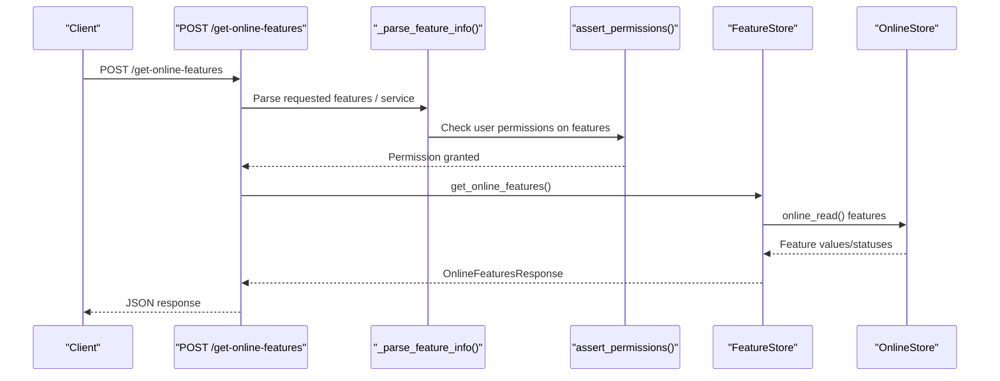
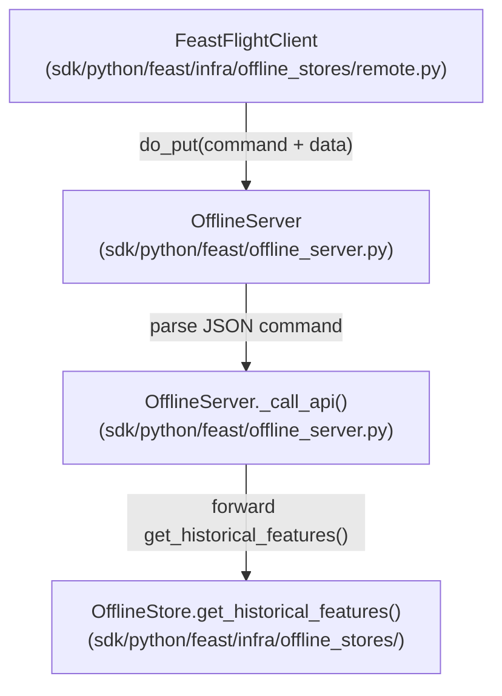
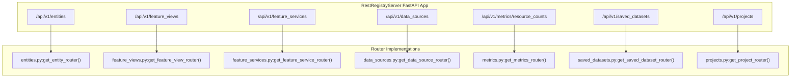

<!-- source: DeepWiki mcp.deepwiki.com · repo feast-dev/feast · page 4.1 Python Feature Server · fetched 2026-10-21 -->

# Python Feature Server

<details>
<summary>Relevant source files</summary>

The following files were used as context for generating this wiki page:

- [.github/workflows/docker_smoke_tests.yml](.github/workflows/docker_smoke_tests.yml)
- [docs/reference/feature-servers/python-feature-server.md](docs/reference/feature-servers/python-feature-server.md)
- [docs/reference/feature-servers/registry-server.md](docs/reference/feature-servers/registry-server.md)
- [docs/reference/feature-store-yaml.md](docs/reference/feature-store-yaml.md)
- [infra/feast-operator/config/samples/v1_featurestore_serving.yaml](infra/feast-operator/config/samples/v1_featurestore_serving.yaml)
- [infra/scripts/feature_server_docker_smoke.py](infra/scripts/feature_server_docker_smoke.py)
- [sdk/python/feast/api/registry/rest/__init__.py](sdk/python/feast/api/registry/rest/__init__.py)
- [sdk/python/feast/api/registry/rest/data_sources.py](sdk/python/feast/api/registry/rest/data_sources.py)
- [sdk/python/feast/api/registry/rest/entities.py](sdk/python/feast/api/registry/rest/entities.py)
- [sdk/python/feast/api/registry/rest/feature_services.py](sdk/python/feast/api/registry/rest/feature_services.py)
- [sdk/python/feast/api/registry/rest/feature_views.py](sdk/python/feast/api/registry/rest/feature_views.py)
- [sdk/python/feast/api/registry/rest/features.py](sdk/python/feast/api/registry/rest/features.py)
- [sdk/python/feast/api/registry/rest/lineage.py](sdk/python/feast/api/registry/rest/lineage.py)
- [sdk/python/feast/api/registry/rest/metrics.py](sdk/python/feast/api/registry/rest/metrics.py)
- [sdk/python/feast/api/registry/rest/permissions.py](sdk/python/feast/api/registry/rest/permissions.py)
- [sdk/python/feast/api/registry/rest/projects.py](sdk/python/feast/api/registry/rest/projects.py)
- [sdk/python/feast/api/registry/rest/rest_registry_server.py](sdk/python/feast/api/registry/rest/rest_registry_server.py)
- [sdk/python/feast/api/registry/rest/rest_utils.py](sdk/python/feast/api/registry/rest/rest_utils.py)
- [sdk/python/feast/api/registry/rest/saved_datasets.py](sdk/python/feast/api/registry/rest/saved_datasets.py)
- [sdk/python/feast/api/registry/rest/search.py](sdk/python/feast/api/registry/rest/search.py)
- [sdk/python/feast/arrow_error_handler.py](sdk/python/feast/arrow_error_handler.py)
- [sdk/python/feast/audit/__init__.py](sdk/python/feast/audit/__init__.py)
- [sdk/python/feast/audit/audit_logger.py](sdk/python/feast/audit/audit_logger.py)
- [sdk/python/feast/audit/audit_middleware.py](sdk/python/feast/audit/audit_middleware.py)
- [sdk/python/feast/cli/ui.py](sdk/python/feast/cli/ui.py)
- [sdk/python/feast/feature_server.py](sdk/python/feast/feature_server.py)
- [sdk/python/feast/feature_server_utils.py](sdk/python/feast/feature_server_utils.py)
- [sdk/python/feast/infra/feature_servers/base_config.py](sdk/python/feast/infra/feature_servers/base_config.py)
- [sdk/python/feast/infra/mcp_servers/mcp_server.py](sdk/python/feast/infra/mcp_servers/mcp_server.py)
- [sdk/python/feast/infra/offline_stores/remote.py](sdk/python/feast/infra/offline_stores/remote.py)
- [sdk/python/feast/metrics.py](sdk/python/feast/metrics.py)
- [sdk/python/feast/offline_server.py](sdk/python/feast/offline_server.py)
- [sdk/python/feast/online_response.py](sdk/python/feast/online_response.py)
- [sdk/python/feast/permissions/client/arrow_flight_auth_interceptor.py](sdk/python/feast/permissions/client/arrow_flight_auth_interceptor.py)
- [sdk/python/tests/integration/offline_store/test_dqm_validation.py](sdk/python/tests/integration/offline_store/test_dqm_validation.py)
- [sdk/python/tests/unit/api/test_api_rest_registry.py](sdk/python/tests/unit/api/test_api_rest_registry.py)
- [sdk/python/tests/unit/api/test_api_rest_registry_server.py](sdk/python/tests/unit/api/test_api_rest_registry_server.py)
- [sdk/python/tests/unit/api/test_search_api.py](sdk/python/tests/unit/api/test_search_api.py)
- [sdk/python/tests/unit/audit/__init__.py](sdk/python/tests/unit/audit/__init__.py)
- [sdk/python/tests/unit/audit/test_audit_logger.py](sdk/python/tests/unit/audit/test_audit_logger.py)
- [sdk/python/tests/unit/audit/test_audit_middleware.py](sdk/python/tests/unit/audit/test_audit_middleware.py)
- [sdk/python/tests/unit/audit/test_mcp_audit_handler.py](sdk/python/tests/unit/audit/test_mcp_audit_handler.py)
- [sdk/python/tests/unit/infra/registry/__init__.py](sdk/python/tests/unit/infra/registry/__init__.py)
- [sdk/python/tests/unit/infra/registry/test_registry.py](sdk/python/tests/unit/infra/registry/test_registry.py)
- [sdk/python/tests/unit/test_arrow_error_decorator.py](sdk/python/tests/unit/test_arrow_error_decorator.py)
- [sdk/python/tests/unit/test_feature_server.py](sdk/python/tests/unit/test_feature_server.py)
- [sdk/python/tests/unit/test_feature_server_utils.py](sdk/python/tests/unit/test_feature_server_utils.py)
- [sdk/python/tests/unit/test_feature_view_state.py](sdk/python/tests/unit/test_feature_view_state.py)
- [sdk/python/tests/unit/test_metrics.py](sdk/python/tests/unit/test_metrics.py)
- [sdk/python/tests/unit/test_offline_server.py](sdk/python/tests/unit/test_offline_server.py)
- [sdk/python/tests/unit/test_online_response.py](sdk/python/tests/unit/test_online_response.py)
- [sdk/python/tests/unit/test_registry_string_config.py](sdk/python/tests/unit/test_registry_string_config.py)

</details>


## Purpose and Scope

The Python Feature Server provides a FastAPI-based HTTP and JSON-over-REST service that exposes Feast’s online serving capabilities through a language-agnostic interface. It acts as a stateless bridging layer between production clients and the core `FeatureStore` class, supporting online feature retrieval, streaming feature push, batch materialization triggering, vector similarity and RAG search, metadata exploration, audit logging, and registry REST API access. It also supports Tabular Arrow Flight RPC for offline feature retrieval and write batching for high-throughput ingestion.

Key functionality lives primarily in `sdk/python/feast/feature_server.py`, with offline serving handled by `OfflineServer` (`sdk/python/feast/offline_server.py`) and registry REST handled by `RestRegistryServer` (`sdk/python/feast/api/registry/rest/rest_registry_server.py`).

Sources:  
[sdk/python/feast/feature_server.py:1-48](),  
[sdk/python/feast/offline_server.py:83-191](),  
[sdk/python/feast/api/registry/rest/rest_registry_server.py:32-102]()

---

## Architecture and FastAPI Integration

The Python Feature Server encapsulates Feast serving logic inside a FastAPI application assembled by the `get_app()` function (`sdk/python/feast/feature_server.py:236-347`).

### Core Components
- **FastAPI Application**: Registers REST endpoints for core serving and control functions such as `/get-online-features`, `/retrieve-online-documents` (vector/RAG search), `/push` (feature ingestion), `/materialize` and `/materialize-incremental` (batch materialization). Also provides `/live`, `/ready` health probes.  
- **FeatureStore**: The principal Feast class that the server calls to access online/offline stores, registry, providers, and perform feature retrieval and ingestion.  
- **Background Registry Refresher**: An async background task runs `FeatureStore.async_refresh()` polling for registry updates to refresh the in-memory cache per a configured TTL, avoiding stale schemas during serving.  
- **Offline Write Batcher**: Aggregates and batches feature writes to offline storage asynchronously while immediately applying to online storage for low latency push requests.  
- **Vector Store Registry**: Enables vector-based search supporting RAG-style document retrieval from feature documents.

### High-Level Architecture Diagram

```mermaid
graph TB
    subgraph "HTTP Layer"
        CLIENT["HTTP Client"]
        APP["FastAPI App\nget_app()\nsdk/python/feast/feature_server.py"]
        ENDPOINTS["REST Endpoints\n/get-online-features\n/push\n/materialize\n/retrieve-online-documents"]
    end

    subgraph "Server Process Layer"
        FS["FeatureStore\nsdk/python/feast/feature_store.py"]
        REFRESH["async_refresh()\nBackground Refresh\nsdk/python/feast/feature_server.py"]
        BATCHER["OfflineWriteBatcher\nsdk/python/feast/feature_server.py"]
        VECTOR["VectorStoreRegistry\nsdk/python/feast/feature_server.py"]
    end

    subgraph "Backends"
        REGISTRY["SqlRegistry / BaseRegistry"]
        PROVIDER["PassthroughProvider"]
        ONLINESTORE["OnlineStore\nRedis / DynamoDB / SQLite"]
    end

    CLIENT --> ENDPOINTS
    ENDPOINTS --> APP
    APP --> FS
    REFRESH -->|refresh_registry()| FS
    BATCHER -->|push(write requests)| FS
    FS --> REGISTRY
    FS --> PROVIDER
    PROVIDER --> ONLINESTORE
    PROVIDER --> REGISTRY
    VECTOR --> APP
```

Sources:  
[sdk/python/feast/feature_server.py:236-347](),  
[sdk/python/feast/feature_server.py:321-332](),  
[sdk/python/feast/feature_server.py:846-882]()

---

## Python Feature Server REST API Endpoints

The Python Feature Server exposes a set of HTTP JSON APIs facilitating online feature serving, feature ingestion, batch materialization, and advanced retrieval queries.

### Online Serving and Search Endpoints

| Endpoint                   | Description                                                      | Request Model                 | Response Model               |
| -------------------------- | ---------------------------------------------------------------- | ----------------------------- | ---------------------------- |
| `POST /get-online-features` | Fetches online feature vectors for specified entity keys.       | `GetOnlineFeaturesRequest`    | `OnlineFeaturesResponse`     |
| `POST /retrieve-online-documents` | Allows vector similarity and text search for retrieval-augmented generation (RAG) on document features. | `GetOnlineDocumentsRequest`   | `OnlineFeaturesResponse`     |

These endpoints support either explicit feature lists or feature service names to resolve feature sets. They enforce permission checks and return per-feature value arrays with statuses and event timestamps.

### Feature Push and Materialization Endpoints

| Endpoint                     | Description                                                      | Request Model              |
| ---------------------------- | ---------------------------------------------------------------- | -------------------------- |
| `POST /push`                 | Ingest streaming or push features to online/offline stores via push sources. | `PushFeaturesRequest`      |
| `POST /materialize`           | Trigger batch materialization within a start and end timestamp window. | `MaterializeRequest`       |
| `POST /materialize-incremental` | Trigger incremental batch materialization up to a given end timestamp. | `MaterializeIncrementalRequest` |

The push endpoint supports various push modes and transparently handles transform-on-write logic before storing data.

### Health and Readiness Probes

| Endpoint  | Purpose              |
| --------- | -------------------- |
| `GET /live` | Kubernetes liveness probe, always returns HTTP 200. |
| `GET /ready` | Kubernetes readiness probe, returns HTTP 200 if healthy. |

### Online Feature Retrieval Sequence (simplified)



Sources:  
[sdk/python/feast/feature_server.py:86-141](),  
[sdk/python/feast/feature_server.py:190-194](),  
[sdk/python/feast/feature_server.py:355-418](),  
[sdk/python/feast/feature_server.py:420-512](),  
[sdk/python/feast/feature_server.py:562-626](),  
[sdk/python/feast/feature_server.py:349-353]()

---

## Offline Server Integration (Arrow Flight)

Feast provides an offline serving implementation via `OfflineServer` subclassing `pyarrow.flight.FlightServerBase` to expose arrow-flight RPC serving of batch/historical features in Feather/Parquet formats.

### Key Details:
- The server is started by instantiating `OfflineServer` with a `FeatureStore` instance and listening on a GRPC endpoint.
- Supports client commands like `get_historical_features` forwarded to the configured `OfflineStore` implementation.
- IO carries serialized Arrow tables for high-performance data transfer.
- Supports authentication middleware integrating Feast permissioning.
- Supports TLS, including FIPS-compliant cipher suites configuration based on system detection.
- Handles flight listing, do_put, get_flight_info APIs respecting flight descriptors encoded as JSON commands.

### Offline Server Architecture Diagram



Sources:  
[sdk/python/feast/offline_server.py:22-191](),  
[sdk/python/feast/infra/offline_stores/remote.py:44-57]()

---

## Registry Server REST API Integration

The Registry Server exposes Feast metadata (entities, feature views, feature services, data sources, saved datasets, projects) over HTTP JSON via REST API implemented by `RestRegistryServer` using FastAPI (`sdk/python/feast/api/registry/rest/rest_registry_server.py`).

### Key Features
- Supports global cross-project listing endpoints (`/all` suffix) aggregating metadata.
- Provides pagination, sorting, filtering by tags, and inclusion of relationships.
- Supports authentication via Bearer tokens integrated with Feast permissions.
- Includes exception handlers for Feast-specific errors with appropriate HTTP status codes.
- Supports Model Context Protocol (MCP) via optional integration with `fastapi_mcp` for exposing metadata to LLMs and agents.
- Serves documentation with OpenAPI UI and is mounted under `/api/v1` root path.

### Registry REST Server Internal Routing Diagram



Sources:  
[sdk/python/feast/api/registry/rest/rest_registry_server.py:10-102](),  
[sdk/python/feast/api/registry/rest/__init__.py:33-55](),  
[docs/reference/feature-servers/registry-server.md:5-148]()

---

## Audit Logging System

Feast includes a comprehensive audit logging facility integrated into the Python Feature Server:

- **Audit Middleware**: Applied as a FastAPI middleware layers in `feature_server.py`, intercepts every HTTP request and response, recording user identity, request metadata, response status, and timing information.  
- **Audit Logger**: Centralizes emitting audit events to configured sinks, supporting storage to files, external logging systems, or metrics backends.  
- **Audit Events**: Capture detailed feature serving actions, including read operations, push events, and materialization updates for compliance and observability.

This system uses security and authentication context from Feast’s RBAC system to associate audit records with authenticated callers.

Sources:  
[sdk/python/feast/audit/audit_middleware.py:1-50](),  
[sdk/python/feast/audit/audit_logger.py:1-50](),  
[sdk/python/feast/feature_server.py:400-450]() (audit middleware usage)

---

## MCP Server for GenAI and LLM Integration

Feast supports the Model Context Protocol (MCP) on the Registry REST server to facilitate LLMs and AI agents:

- Enabled by configuration: `registry.mcp.enabled: true` in `feature_store.yaml`.  
- Implementation uses `fastapi_mcp` to serve MCP protocol endpoints wrapping Feast metadata hosted by `RestRegistryServer`.  
- Enables LLMs to perform contextual introspection and querying on the feature store metadata as native "tools."  
- Provides server-sent event streaming and OpenAPI schema integrations for LLM tooling ecosystems.

Sources:  
[sdk/python/feast/api/registry/rest/rest_registry_server.py:80-96](),  
[docs/reference/feature-servers/registry-server.md:5-15]()

---

## Serverless and Cloud Deployments (AWS Lambda, GCP Cloud Run)

The Python Feature Server’s FastAPI app is stateless, facilitating packaging as container images for serverless execution patterns such as:

- **AWS Lambda**: Deployment via container images enabling Feast serving in FaaS model with controlled concurrency.
- **Google Cloud Run**: Containerized deployment supporting autoscaling HTTP serving.

Key deployment considerations:

- Configuration of the feature store via environment variable `FEAST_FS_YAML_FILE_PATH_ENV_NAME` pointing to the runtime `feature_store.yaml` location for dynamic registry and store configuration.  
- Use of multi-worker deployment using the `feast serve` CLI with flags such as `--workers -1` to auto-calculate workers based on CPU cores, `--registry_ttl_sec` to tune registry refresh intervals, `--worker-connections` and `--max-requests` for connection and lifecycle tuning.  
- Recommended defaults support optimal production performance balancing freshness and latency.

### CLI Example for Running Feature Server

```bash
# Basic server start (single worker)
feast serve

# Production-style server with multiple workers and tuned TTL
feast serve --workers -1 --worker-connections 1000 --registry_ttl_sec 60
```

Sources:  
[docs/reference/feature-servers/python-feature-server.md:3-54](),  
[sdk/python/feast/utils.py:179-183](),  
[docs/how-to-guides/running-feast-in-production.md:12-16]()

---

# Summary

The Python Feature Server is a comprehensive serving component of Feast providing:

- **HTTP/gRPC APIs** to serve features with JSON and Arrow Flight protocols.
- **Push ingestion** endpoint supporting streaming and batch writes.
- **Batch trigger APIs** to initiate materialization workflows.
- **Arrow Flight offline server** for efficient historical feature retrieval.
- **Registry REST API server** exposing rich feature metadata with authentication and MCP support.
- **Audit logging** integrating with Feast security for compliance monitoring.
- **Flexible deployment patterns** supporting local, serverless, and containerized cloud usage.

This powerful, extensible Python server is fundamental for online feature serving use cases in production ML systems.

---

# References

- `sdk/python/feast/feature_server.py` [1-211, 236-347, 321-332, 846-882]()  
- `sdk/python/feast/offline_server.py` [22-191]()  
- `sdk/python/feast/api/registry/rest/rest_registry_server.py` [32-102]()  
- `docs/reference/feature-servers/python-feature-server.md` [1-54]()  
- `docs/reference/feature-servers/registry-server.md` [1-148]()  
- `sdk/python/feast/audit/audit_middleware.py` [1-50]()  
- `sdk/python/feast/audit/audit_logger.py` [1-50]()  
- `sdk/python/feast/infra/offline_stores/remote.py` [44-57]()  
- `sdk/python/feast/utils.py` [177-183]()

---

