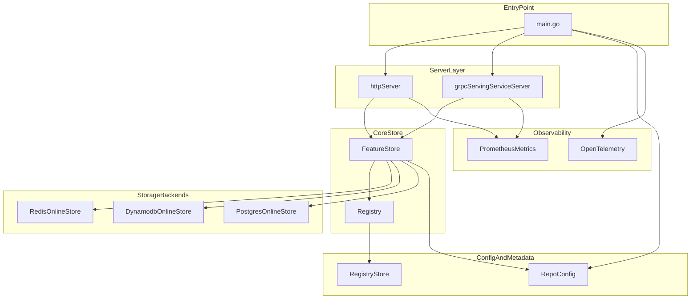
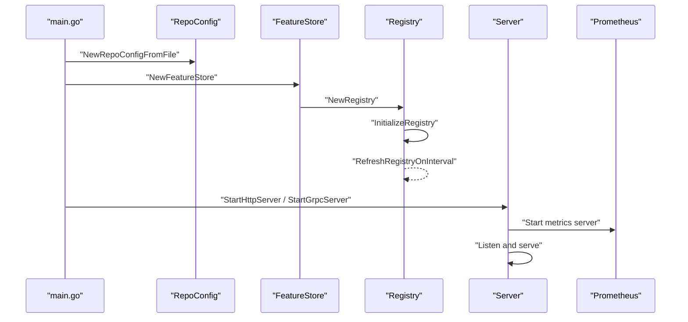
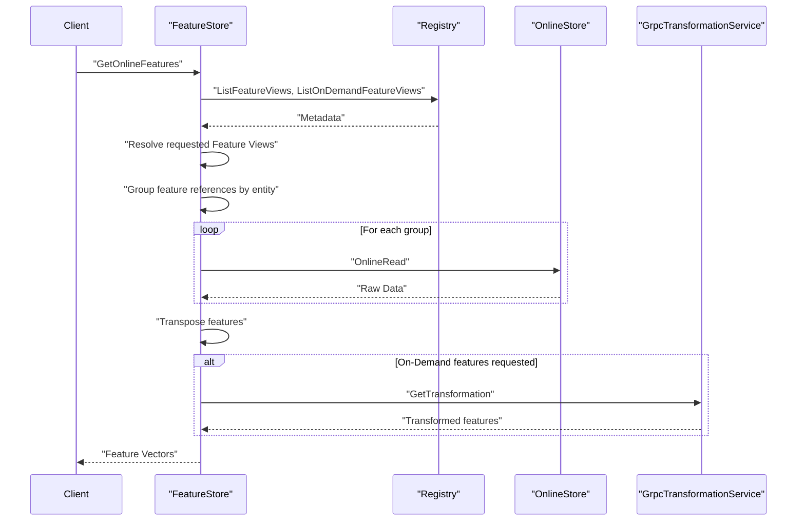
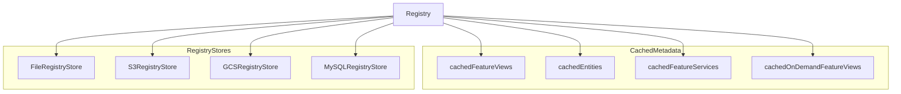
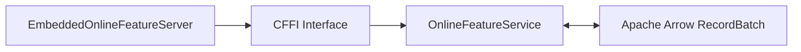

<!-- source: DeepWiki mcp.deepwiki.com · repo feast-dev/feast · page 4.2 Go Feature Server · fetched 2026-10-21 -->

# Go Feature Server

<details>
<summary>Relevant source files</summary>

The following files were used as context for generating this wiki page:

- [go.mod](go.mod)
- [go.sum](go.sum)
- [go/README.md](go/README.md)
- [go/embedded/online_features.go](go/embedded/online_features.go)
- [go/internal/feast/featurestore.go](go/internal/feast/featurestore.go)
- [go/internal/feast/metrics/metrics.go](go/internal/feast/metrics/metrics.go)
- [go/internal/feast/model/featureview.go](go/internal/feast/model/featureview.go)
- [go/internal/feast/onlineserving/serving.go](go/internal/feast/onlineserving/serving.go)
- [go/internal/feast/onlinestore/dynamodbonlinestore.go](go/internal/feast/onlinestore/dynamodbonlinestore.go)
- [go/internal/feast/onlinestore/dynamodbonlinestore_test.go](go/internal/feast/onlinestore/dynamodbonlinestore_test.go)
- [go/internal/feast/onlinestore/onlinestore.go](go/internal/feast/onlinestore/onlinestore.go)
- [go/internal/feast/onlinestore/onlinestore_test.go](go/internal/feast/onlinestore/onlinestore_test.go)
- [go/internal/feast/onlinestore/redisonlinestore.go](go/internal/feast/onlinestore/redisonlinestore.go)
- [go/internal/feast/onlinestore/redisonlinestore_test.go](go/internal/feast/onlinestore/redisonlinestore_test.go)
- [go/internal/feast/registry/gcs.go](go/internal/feast/registry/gcs.go)
- [go/internal/feast/registry/local.go](go/internal/feast/registry/local.go)
- [go/internal/feast/registry/registry.go](go/internal/feast/registry/registry.go)
- [go/internal/feast/registry/registry_test.go](go/internal/feast/registry/registry_test.go)
- [go/internal/feast/registry/s3.go](go/internal/feast/registry/s3.go)
- [go/internal/feast/server/grpc_server.go](go/internal/feast/server/grpc_server.go)
- [go/internal/feast/server/http_server.go](go/internal/feast/server/http_server.go)
- [go/internal/feast/server/server_commons.go](go/internal/feast/server/server_commons.go)
- [go/internal/feast/transformation/transformation.go](go/internal/feast/transformation/transformation.go)
- [go/internal/test/feature_repo/feature_store.yaml](go/internal/test/feature_repo/feature_store.yaml)
- [go/main.go](go/main.go)
- [go/main_test.go](go/main_test.go)
- [java/infra/docker/feature-server/Dockerfile](java/infra/docker/feature-server/Dockerfile)
- [sdk/python/feast/embedded_go/online_features_service.py](sdk/python/feast/embedded_go/online_features_service.py)
- [sdk/python/feast/embedded_go/type_map.py](sdk/python/feast/embedded_go/type_map.py)
- [sdk/python/feast/templates/spark/feature_store.yaml](sdk/python/feast/templates/spark/feature_store.yaml)
- [sdk/python/tests/unit/test_serialization_version.py](sdk/python/tests/unit/test_serialization_version.py)

</details>


The Go Feature Server is a high-performance, production-ready implementation of Feast's online feature serving layer. It provides HTTP and gRPC endpoints to serve online feature data with low latency and efficient resource use. This server is designed for production deployment scenarios requiring high throughput.

This page explains the Go feature server architecture, configuration and startup, its HTTP/gRPC serving modes, feature retrieval flow, observability, supported online stores and registry backends, and the embedded Go server exposed to Python clients.

For information on other feature servers, see the [Python Feature Server (4.1)] and [Java Serving Components (4.3)] pages.

---

## Architecture Overview

The Go feature server has a layered modular architecture:



- The **Entry Point** (`main.go`) loads configuration and starts servers.
- The **Server Layer** exposes HTTP and gRPC APIs via `httpServer` and `grpcServingServiceServer`.
- The **FeatureStore** is the core component managing registry metadata (`Registry`) and online feature access (`OnlineStore`).
- **Online Stores** supported include Redis, DynamoDB, Postgres.
- The **Registry** caches metadata and supports multiple backends like local files, GCS, S3, MySQL.
- **Observability** is enabled using Prometheus metrics and OpenTelemetry tracing.

Sources: `[go/internal/feast/featurestore.go:23-29]`, `[go/internal/feast/registry/registry.go:17-23]`, `[go.mod:17-31]`

---

## Entry Point and Server Startup

The Go feature server is launched from `main.go`. Key command-line flags configure the server:

| Flag           | Default | Description                        |
|----------------|---------|----------------------------------|
| `--type`       | `http`  | Server protocol mode (`http` or `grpc`) |
| `--host`       | (empty) | Host address to bind              |
| `--port`       | `8080`  | Port for HTTP or gRPC server      |
| `--metrics-port`| `9090`  | Port for Prometheus metrics server|
| `--chdir`      | `.`     | Directory for `feature_store.yaml` config |

### Startup Flow



- Configuration is parsed from `feature_store.yaml` into a `RepoConfig`.
- `FeatureStore` is constructed using the config; it initializes `Registry` and `OnlineStore`.
- `Registry` loads metadata and refreshes it periodically.
- The chosen server mode (`http` or `grpc`) is started along with a Prometheus metrics endpoint.

Sources: `[go/internal/feast/featurestore.go:49-82]`, `[go/internal/feast/registry/registry.go:44-91]`

---

## Configuration and FeatureStore Initialization

### Configuration File

- The Go feature server reads `feature_store.yaml` for project, registry, online store, and feature server options.
- `RepoConfig` converts this YAML into Go structs for runtime use.

### FeatureStore Component

Defined as:

```go
type FeatureStore struct {
	config                 *registry.RepoConfig
	registry               *registry.Registry
	onlineStore            onlinestore.OnlineStore
	transformationCallback transformation.TransformationCallback
	transformationService  *transformation.GrpcTransformationService
}
```

- `config`: Parsed repo configuration.
- `registry`: Metadata cache and registry backend access.
- `onlineStore`: Interface to configured online feature store.
- `transformationCallback`: Local function callback for feature transformations.
- `transformationService`: Optional gRPC service for scalable on-demand transformations.

### Initialization Steps

The constructor `NewFeatureStore` performs:

1. Online store creation via `onlinestore.NewOnlineStore(config)` [lines 50-53].
2. Registry creation via `registry.NewRegistry` and initialization (`InitializeRegistry()`) [lines 54-65].
3. Optional instantiation of gRPC transformation service if configured under `feature_server.transformation_service_endpoint` [lines 67-73].

Sources: `[go/internal/feast/featurestore.go:49-82]`, `[go/internal/feast/registry/registry.go:44-67]`

---

## Server Modes

### HTTP Server

- Provides an HTTP API on `/get-online-features` accepting POST requests with JSON describing features, entities, and request context.
- Parses request to `getOnlineFeaturesRequest` structure.
- Calls `FeatureStore.GetOnlineFeatures()` to fetch feature vectors.
- Returns JSON response with feature values.
- Produces Prometheus HTTP metrics for requests and latency.

The HTTP server is implemented in `server/http_server.go` with `httpServer` struct handling routing and request processing.

### gRPC Server

- Implements Feast's `ServingService` defined in protobufs.
- gRPC method `GetOnlineFeatures` accepts protobuf requests and responds with Arrow-encoded feature vectors.
- Integrates Prometheus gRPC metrics middleware.
- Optionally supports OpenTelemetry tracing.

The gRPC server implementation is located in `server/grpc_server.go` (not shown in above files excerpt).

Sources: `[go/internal/feast/featurestore.go:86-205]`, `[go/internal/feast/server/http_server.go:25-229]`, `[go.mod:17-31]`

---

## Feature Retrieval Flow

The online feature retrieval process in the Go Feature Server is:



- Features are specified either by explicit references or via a feature service object.
- Feature views and on-demand feature views are resolved from cached registry metadata.
- Features are grouped for efficient batch retrieval by entity sets.
- Raw feature data is retrieved from the underlying online store(s).
- On-demand transformations, if any, are applied via the transformation service.
- Resulting feature vectors with values, status, and timestamps are returned.

Sources: `[go/internal/feast/featurestore.go:86-216]`, `[go/internal/feast/onlineserving/serving.go:72-196]`

---

## Registry and Metadata Storage

The `Registry` caches metadata and abstracts the registry backend store:



- Registry store types are chosen by URI scheme (`file`, `gs`, `s3`, `mysql`).
- Registry initializes by loading metadata proto from the store.
- A background goroutine refreshes the registry cache periodically based on TTL setting.

Sources: `[go/internal/feast/registry/registry.go:30-126]`, `[go/internal/feast/registry/registry_test.go:10-101]`

---

## Online Store Backends

The Go Feature Server supports these online store implementations, all implementing an `OnlineRead` interface:

| Store Type  | Description                                           | Key Details                                           |
|-------------|-------------------------------------------------------|-----------------------------------------------------|
| **Redis**   | Pipelined batch reads to Redis or Redis Cluster       | High throughput using batch pipelining              |
| **DynamoDB**| AWS DynamoDB with batch get requests and retries      | Uses MMH3 128-bit hash as entity key, batch chunking, concurrency controlled by semaphore, exponential backoff on retries |
| **Postgres**| Relational DB with connection pooling                  | Uses `pgx` package for efficient connection pooling |

### DynamoDB Backend Details

The `DynamodbOnlineStore` ([go/internal/feast/onlinestore/dynamodbonlinestore.go]):

- Serializes entity keys (using configured serialization version), hashes keys with Murmur3 128-bit, encodes as hex.
- Sends batch `BatchGetItem` requests to DynamoDB (controlled by configured batch size).
- Uses Go concurrency with weighted semaphore limiting parallelism (based on CPU count).
- Retries `UnprocessedKeys` with jittered exponential backoff up to max retries.
- Maps retrieved items back to features.

Sources: `[go/internal/feast/onlinestore/dynamodbonlinestore.go:25-229]`, `[go/internal/feast/onlinestore/redisonlinestore.go:54-141]`, `[go/internal/feast/onlinestore/onlinestore.go:1-65]`

---

## Observability

### Prometheus Metrics

- A Prometheus metrics HTTP server runs independently, usually on port 9090.
- HTTP endpoints record latencies and request counts.
- gRPC middleware instruments server calls with Prometheus metrics.
- Uses `github.com/prometheus/client_golang` and `grpc-ecosystem/go-grpc-middleware/providers/prometheus`.

### OpenTelemetry Tracing

- Uses OpenTelemetry Go SDK with OTLP exporters.
- Traces feature retrieval operations and HTTP/gRPC requests.
- The trace instrumentation is created in the `FeatureStore` level.

Sources: `[go.mod:17-31]`, `[go/internal/feast/featurestore.go:21-21]`

---

## Embedded Go Feature Server for Python

Feast exposes an embedded Go feature server usable from Python via CFFI bindings. This enables Python clients to call the Go serving logic without separate process IPC.



- The Python SDK calls into Go through CFFI wrappers ([sdk/python/feast/embedded_go/online_features_service.py]).
- Data exchange of entities and feature vectors uses Apache Arrow via the Arrow C data interface.
- The Go side processes requests in `OnlineFeatureService` ([go/embedded/online_features.go]).

Sources: `[sdk/python/feast/embedded_go/online_features_service.py:43-191]`, `[go/embedded/online_features.go:38-94]`

---

# Summary

The Go Feature Server is a robust, efficient implementation providing low-latency serving of features via HTTP and gRPC protocols. Its architecture includes modular layers handling configuration, registry metadata caching, online store access, on-demand transformation, and observability. Supported online stores include Redis, DynamoDB, and Postgres, while registries can use file, S3, GCS, or MySQL backends. Additionally, the embedded Go server enables Python SDKs to benefit from Go serving logic with zero-copy Arrow data interchange.

---

# References

- Main FeatureStore and serving layer: `[go/internal/feast/featurestore.go:23-205]`
- Registry backend and caching: `[go/internal/feast/registry/registry.go:17-129]`
- DynamoDB online store: `[go/internal/feast/onlinestore/dynamodbonlinestore.go:25-229]`
- HTTP server: `[go/internal/feast/server/http_server.go:25-229]`
- Python embedded Go server: `[sdk/python/feast/embedded_go/online_features_service.py:43-191]`
- Go embedded server: `[go/embedded/online_features.go:38-94]`
- `go.mod` dependencies and tracing: `[go.mod:17-31]`

---

This page is a leaf in the wiki hierarchy and thus has no further child pages.

---

