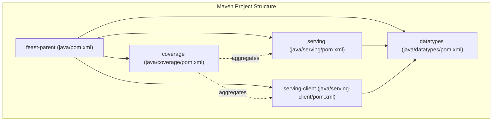
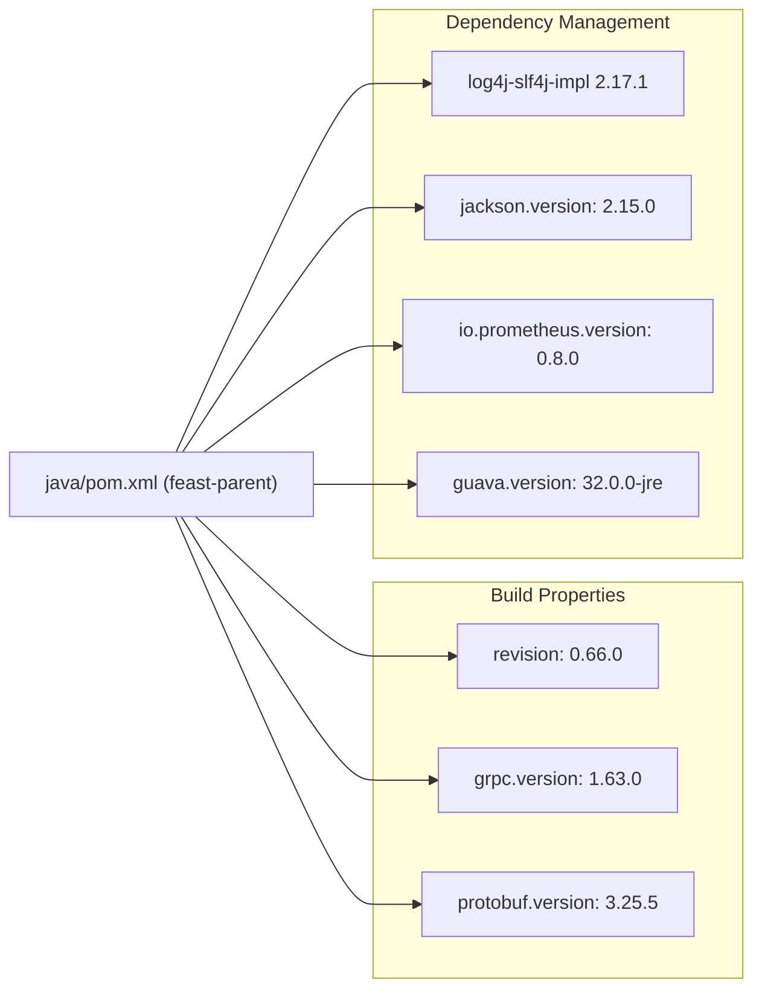
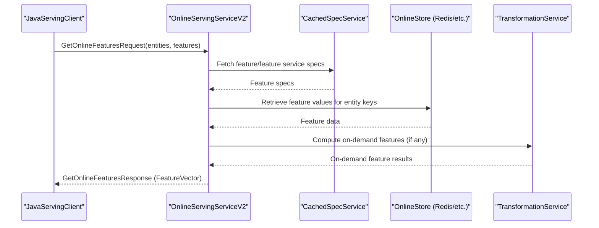
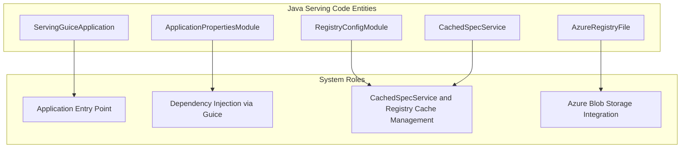
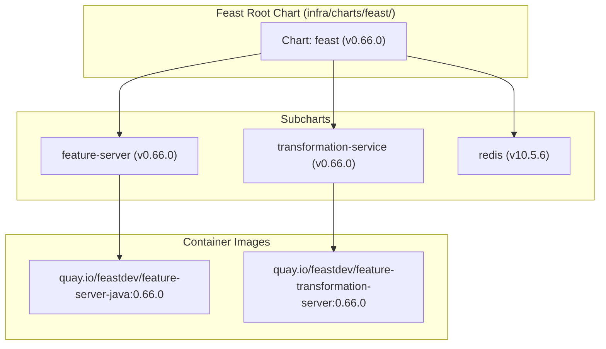

<!-- source: DeepWiki mcp.deepwiki.com · repo feast-dev/feast · page 4.3 Java Serving Components · fetched 2026-10-21 -->

# Java Serving Components

Relevant source files

The following files were used as context for generating this wiki page:

- [CHANGELOG.md](CHANGELOG.md)
- [examples/java-demo/README.md](examples/java-demo/README.md)
- [examples/java-demo/feature_repo/__init__.py](examples/java-demo/feature_repo/__init__.py)
- [examples/java-demo/feature_repo/application-override.yaml](examples/java-demo/feature_repo/application-override.yaml)
- [examples/java-demo/feature_repo/data/driver_stats_with_string.parquet](examples/java-demo/feature_repo/data/driver_stats_with_string.parquet)
- [examples/java-demo/feature_repo/feature_store.yaml](examples/java-demo/feature_repo/feature_store.yaml)
- [examples/java-demo/feature_repo/test.py](examples/java-demo/feature_repo/test.py)
- [examples/java-demo/redis-screenshot.png](examples/java-demo/redis-screenshot.png)
- [infra/charts/feast/Chart.yaml](infra/charts/feast/Chart.yaml)
- [infra/charts/feast/README.md](infra/charts/feast/README.md)
- [infra/charts/feast/charts/feature-server/Chart.yaml](infra/charts/feast/charts/feature-server/Chart.yaml)
- [infra/charts/feast/charts/feature-server/README.md](infra/charts/feast/charts/feature-server/README.md)
- [infra/charts/feast/charts/feature-server/templates/configmap.yaml](infra/charts/feast/charts/feature-server/templates/configmap.yaml)
- [infra/charts/feast/charts/feature-server/templates/secret.yaml](infra/charts/feast/charts/feature-server/templates/secret.yaml)
- [infra/charts/feast/charts/feature-server/values.yaml](infra/charts/feast/charts/feature-server/values.yaml)
- [infra/charts/feast/charts/transformation-service/Chart.yaml](infra/charts/feast/charts/transformation-service/Chart.yaml)
- [infra/charts/feast/charts/transformation-service/README.md](infra/charts/feast/charts/transformation-service/README.md)
- [infra/charts/feast/charts/transformation-service/config/feature_store.yaml](infra/charts/feast/charts/transformation-service/config/feature_store.yaml)
- [infra/charts/feast/charts/transformation-service/values.yaml](infra/charts/feast/charts/transformation-service/values.yaml)
- [infra/charts/feast/requirements.yaml](infra/charts/feast/requirements.yaml)
- [java/datatypes/pom.xml](java/datatypes/pom.xml)
- [java/pom.xml](java/pom.xml)
- [java/serving-client/pom.xml](java/serving-client/pom.xml)
- [java/serving/README.md](java/serving/README.md)
- [java/serving/pom.xml](java/serving/pom.xml)
- [java/serving/src/test/java/feast/serving/it/ServingEnvironment.java](java/serving/src/test/java/feast/serving/it/ServingEnvironment.java)
- [java/serving/src/test/java/feast/serving/it/TestUtils.java](java/serving/src/test/java/feast/serving/it/TestUtils.java)
- [java/serving/src/test/java/feast/serving/it/TransformationServiceIT.java](java/serving/src/test/java/feast/serving/it/TransformationServiceIT.java)
- [java/serving/src/test/resources/docker-compose/docker-compose-redis-it.yml](java/serving/src/test/resources/docker-compose/docker-compose-redis-it.yml)
- [java/serving/src/test/resources/docker-compose/feast10/Dockerfile](java/serving/src/test/resources/docker-compose/feast10/Dockerfile)
- [java/serving/src/test/resources/docker-compose/feast10/entrypoint.sh](java/serving/src/test/resources/docker-compose/feast10/entrypoint.sh)
- [java/serving/src/test/resources/docker-compose/feast10/feature_store.yaml](java/serving/src/test/resources/docker-compose/feast10/feature_store.yaml)
- [sdk/python/feast/flags_helper.py](sdk/python/feast/flags_helper.py)
- [ui/feature_repo/feature_store.yaml](ui/feature_repo/feature_store.yaml)

## Purpose and Scope

This page documents the Java-based serving infrastructure in Feast, designed for high-performance online feature retrieval and client interaction. The Java serving components serve as a JVM-based alternative and complement to the primary Python SDK and Go Feature Server implementations, enabling deployment of feature-serving workloads in Java environments [java/README.md]().

This page covers the structure and build configuration of the Java serving modules, the gRPC serving interface implementation, the `CachedSpecService` for caching feature specifications from the Feast registry, integration with cloud storage registries, the Java serving client library, deployment via Helm charts, and the integration tests ensuring robustness and correctness within Feast’s ecosystem [java/pom.xml:1-35](), [java/serving/pom.xml:18-109](), [java/serving/README.md]().

Sources: [java/pom.xml:1-35](), [java/serving/pom.xml:18-109](), [java/README.md](), [java/serving/README.md]()

---

## Module Structure

Feast's Java codebase is organized as a multi-module Maven project under the `java/` directory. It comprises the following main modules:

| Module           | Directory                | Purpose                                   |
|------------------|--------------------------|-------------------------------------------|
| **datatypes**    | `java/datatypes/`         | Core feature data types and protobuf messages [java/pom.xml:31]() |
| **serving**      | `java/serving/`           | Feature server implementation and API [java/pom.xml:32]()          |
| **serving-client** | `java/serving-client/`   | Java client SDK for seamless serving interaction [java/pom.xml:33]() |
| **coverage**     | `java/coverage/`          | Test coverage reporting and aggregation [java/pom.xml:34]()         |

Total project orchestration is handled by the parent POM located at the root of the Java directory `java/pom.xml` [java/pom.xml:18-29]().

### Maven Project Structure Diagram

Sources: [java/pom.xml:18-36]()

---

## Build Configuration

### Maven Parent Configuration

The root Maven POM (`java/pom.xml`) centrally manages project metadata and versioning [java/pom.xml:18-36](). Key aspects include:

- Project version controlled by `${revision}`, currently set to `0.66.0` [java/pom.xml:37-38]().
- Dependency versions for core libraries like gRPC (`1.63.0`), Protobuf (`3.25.5`), Guava (`32.0.0-jre`), Log4j2, Jackson, and Prometheus [java/pom.xml:44-72]().
- Declares submodules: `datatypes`, `serving`, `serving-client`, and `coverage` [java/pom.xml:30-35]().
- Centralized dependency management configurations control artifact versions and provide consistent builds [java/pom.xml:162-188]().

### Build and Dependency Management Diagram

Sources: [java/pom.xml:37-99](), [java/pom.xml:162-188]()

---

### Serving Module Build Configuration

The `serving` module’s POM (`java/serving/pom.xml`) specifies build plugins and dependencies [java/serving/pom.xml:18-207]():

- **Build Plugins:**
  - `maven-jar-plugin`: Configures executable JAR with main class `feast.serving.ServingGuiceApplication` [java/serving/pom.xml:49-60]().
  - `maven-assembly-plugin`: Creates a fat JAR bundling all dependencies for distribution via `jar-with-dependencies` [java/serving/pom.xml:62-83]().
  - `exec-maven-plugin`: Runs Python `setup_it.py` script during the `process-test-resources` phase to prepare the integration test environment [java/serving/pom.xml:86-107]().

- **Dependencies:**
  - Feast datatypes module (`dev.feast:feast-datatypes`) [java/serving/pom.xml:112-116]().
  - gRPC libraries (`grpc-api`, `grpc-stub`, `grpc-netty-shaded`) [java/serving/pom.xml:156-176]().
  - Azure Blob storage clients (`azure-storage-blob`, `azure-identity`) for registry reading [java/serving/pom.xml:126-135]().
  - Logging (`slf4j-api`, `slf4j-simple`, `log4j-web`), Guava, and Joda-Time utilities [java/serving/pom.xml:138-195]().

Sources: [java/serving/pom.xml:18-207]()

---

## gRPC Serving Interface

### Serving Service Definition

The Java serving module implements the `ServingService` gRPC interface. This service enables clients to retrieve online features and server metadata [protos/feast/serving/ServingService.proto:28-113]().

Key elements:

- **RPC Methods:**
  - `GetOnlineFeatures`: The primary method to request feature data for given entity keys and feature references or feature service names.
  - `GetFeastServingInfo`: Provides serving system metadata such as version and capabilities.

- **Request Structures:**
  - `GetOnlineFeaturesRequest`: Allows specifying feature retrieval through:
    - A named `feature_service` (referring to a set of features).
    - An explicit `FeatureList` of desired feature references.
  - `entities`: Columnar map from entity names to lists of entity key values.
  - `request_context`: Provides context for On-Demand Feature Transformations.

### Feature Retrieval Execution Flow

This flow outlines that upon receiving a feature retrieval request, the serving service consults the local cached spec, queries the backend online store(s), triggers any on-demand transformations if required, and assembles the response.

Sources: [protos/feast/serving/ServingService.proto:28-113](), [infra/charts/feast/charts/feature-server/values.yaml:74-78]()

---

## CachedSpecService and Registry Integration

### Spec Cache and Registry Refresh

The `CachedSpecService` component functions as the Java serving module's local in-memory cache for registry metadata (entities, feature views, feature services, etc).

- Regularly refreshes by downloading the registry protobuf file, typically named `registry.db`.
- Configurable cache TTL (`cache_ttl_seconds`) controls refresh frequency.
- Enables rapid validation of incoming requests against consistent feature specifications, avoiding remote calls on every request [infra/charts/feast/README.md:51]().

### Registry File Access

Feast stores the registry protobuf in cloud or local storage. The Java serving integrates with such storage backends via:

- **Azure Blob Storage Integration:** `AzureRegistryFile` implements the download and refresh logic from Azure Blob Storage containers [java/serving/src/main/java/feast/serving/registry/AzureRegistryFile.java:1-40]().

Configuration parameters such as `global.registry.path` and `global.registry.cache_ttl_seconds` influence file location and cache lifetime respectively [infra/charts/feast/README.md:77-79]().

### Java Serving Code Entities and Roles

This diagram connects key Java classes/modules to their system roles.

Sources: [java/serving/src/main/java/feast/serving/registry/AzureRegistryFile.java:1-40](), [java/serving/src/main/java/feast/serving/service/config/RegistryConfigModule.java](), [java/serving/src/main/java/feast/serving/service/config/ApplicationPropertiesModule.java](), [java/serving/src/main/java/feast/serving/service/CachedSpecService.java]()

---

## Helm Chart Deployment

Feast Java serving components are deployable on Kubernetes via official Helm charts providing configurable, production-ready deployments [infra/charts/feast/README.md:1-55]().

### Chart Architecture

The root Feast Helm chart (`infra/charts/feast/`) consolidates several important subcharts needed for Java serving:

- `feature-server`: JVM-based feature serving implementation [infra/charts/feast/requirements.yaml:2-6]() and [infra/charts/feast/charts/feature-server/README.md]() 
- `transformation-service`: For on-demand feature computation [infra/charts/feast/requirements.yaml:7-11]() and [infra/charts/feast/charts/transformation-service/README.md]()
- `redis`: Optional online store for caching features [infra/charts/feast/requirements.yaml:12-15]().

### Helm Deployment Components Diagram

The `feature-server` and `transformation-service` images are maintained and versioned consistently with the Feast release cycle.

Sources: [infra/charts/feast/requirements.yaml:1-15](), [infra/charts/feast/Chart.yaml:1-4](), [infra/charts/feast/charts/feature-server/values.yaml:6-8]()

---

## Integration and Testing

The Java serving module includes extensive integration tests to validate feature server behavior in realistic settings with external dependencies.

### Test Environment Setup

- The `ServingEnvironment` class sets up test infrastructure using Testcontainers to orchestrate:
  - Redis online store instance.
  - A Python Feast instance which deploys a running Feast server with a demo feature repository.
- These components are composed via Docker Compose (`docker-compose-redis-it.yml` and `feast10/docker-compose.yml`).
- The test Python instance initializes with feature definitions and materialization scripts (`setup_it.py` run during Maven test phases) [java/serving/src/test/java/feast/serving/it/ServingEnvironment.java:47-69](), [java/serving/pom.xml:86-107]().

### Cloud Registry Integration Tests

Tests ensure compatibility with different cloud-hosted registry backends, emulating respective storage layers:

- `ServingRedisGSRegistryIT`: Google Cloud Storage registry integration via `fake-gcs-server`.
- `ServingRedisS3RegistryIT`: Amazon S3-compatible registry integration via `S3MockContainer`.
- `ServingRedisAzureRegistryIT`: Azure Blob Storage-based registry integration tests [java/serving/src/test/java/feast/serving/it/ServingRedisGSRegistryIT.java:30-39](), [java/serving/src/test/java/feast/serving/it/ServingRedisS3RegistryIT.java:32-37](), [java/serving/src/test/java/feast/serving/it/ServingRedisAzureRegistryIT.java]().

These tests validate correct registry synchronization and feature serving behavior in multi-cloud contexts.

Sources: [java/serving/src/test/java/feast/serving/it/ServingEnvironment.java](), [java/serving/src/test/java/feast/serving/it/ServingRedisGSRegistryIT.java](), [java/serving/src/test/java/feast/serving/it/ServingRedisS3RegistryIT.java](), [java/serving/src/test/java/feast/serving/it/ServingRedisAzureRegistryIT.java](), [java/serving/pom.xml:86-107]()

---

# Summary

The Java Serving Components of Feast comprise a multi-module Maven project implementing online feature serving via gRPC. It includes mechanisms for caching registry metadata efficiently, supports cloud storage based registry file access (notably Azure Blob Storage), and integrates with the ecosystem's online stores and on-demand transformation services. Comprehensive integration tests utilizing Docker Compose and cloud mocks assure cross-environment resilience. Deployment is managed via Helm charts facilitating Kubernetes orchestration.

This module provides a performant JVM-based serving alternative complementing Feast’s Python and Go implementations.

---

# References

- [java/pom.xml:1-36]()
- [java/serving/pom.xml:18-207]()
- [protos/feast/serving/ServingService.proto:28-113]()
- [java/serving/src/main/java/feast/serving/registry/AzureRegistryFile.java:1-40]()
- [java/serving/src/main/java/feast/serving/service/config/*.java]()
- [infra/charts/feast/README.md:1-55]()
- [infra/charts/feast/requirements.yaml:1-15]()
- [infra/charts/feast/Chart.yaml:1-4]()
- [infra/charts/feast/charts/feature-server/values.yaml:6-10]()
- [java/serving/src/test/java/feast/serving/it/*.java]()
- [java/serving/pom.xml:86-107]()

---

