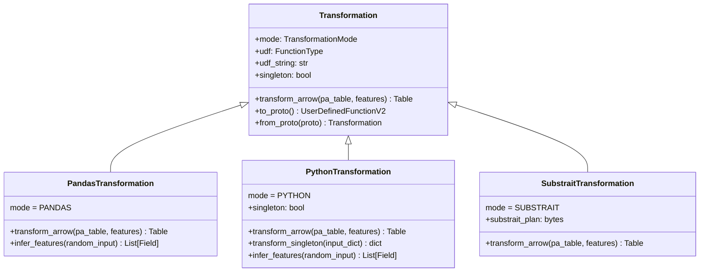
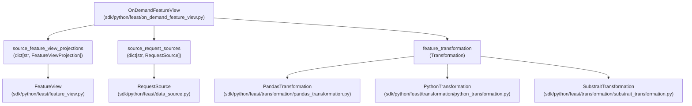
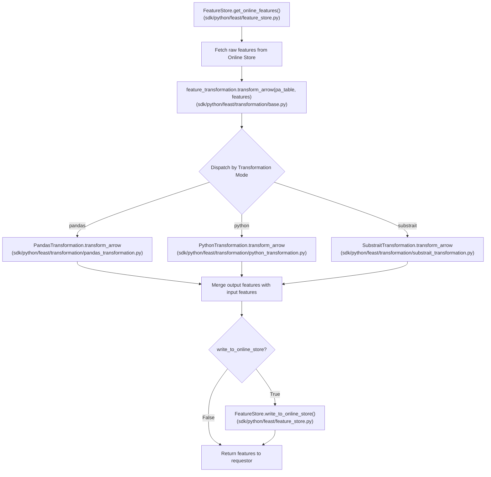

<!-- source: DeepWiki mcp.deepwiki.com · repo feast-dev/feast · page 4.4 Feature Transformations · fetched 2026-10-21 -->

# Feature Transformations

<details>
<summary>Relevant source files</summary>

The following files were used as context for generating this wiki page:

- [.gitbook.yaml](.gitbook.yaml)
- [docs/getting-started/architecture/push-vs-pull-model.md](docs/getting-started/architecture/push-vs-pull-model.md)
- [docs/getting-started/architecture/write-patterns.md](docs/getting-started/architecture/write-patterns.md)
- [docs/getting-started/components/README.md](docs/getting-started/components/README.md)
- [docs/getting-started/components/feature-server.md](docs/getting-started/components/feature-server.md)
- [docs/getting-started/components/online-store.md](docs/getting-started/components/online-store.md)
- [docs/getting-started/components/open-telemetry.md](docs/getting-started/components/open-telemetry.md)
- [docs/getting-started/components/overview.md](docs/getting-started/components/overview.md)
- [docs/getting-started/concepts/batch-feature-view.md](docs/getting-started/concepts/batch-feature-view.md)
- [docs/getting-started/concepts/data-ingestion.md](docs/getting-started/concepts/data-ingestion.md)
- [docs/getting-started/concepts/label-view.md](docs/getting-started/concepts/label-view.md)
- [docs/getting-started/concepts/point-in-time-joins.md](docs/getting-started/concepts/point-in-time-joins.md)
- [docs/getting-started/concepts/tiling.md](docs/getting-started/concepts/tiling.md)
- [docs/how-to-guides/customizing-feast/README.md](docs/how-to-guides/customizing-feast/README.md)
- [docs/reference/beta-on-demand-feature-view.md](docs/reference/beta-on-demand-feature-view.md)
- [docs/reference/feature-repository.md](docs/reference/feature-repository.md)
- [docs/reference/feature-repository/README.md](docs/reference/feature-repository/README.md)
- [infra/website/docs/blog/feast-openai-compatible-api.md](infra/website/docs/blog/feast-openai-compatible-api.md)
- [infra/website/public/images/blog/feast-openai-compat-flow.png](infra/website/public/images/blog/feast-openai-compat-flow.png)
- [protos/feast/core/Aggregation.proto](protos/feast/core/Aggregation.proto)
- [protos/feast/core/OnDemandFeatureView.proto](protos/feast/core/OnDemandFeatureView.proto)
- [sdk/python/feast/aggregation/__init__.py](sdk/python/feast/aggregation/__init__.py)
- [sdk/python/feast/aggregation/tiling/base.py](sdk/python/feast/aggregation/tiling/base.py)
- [sdk/python/feast/aggregation/tiling/orchestrator.py](sdk/python/feast/aggregation/tiling/orchestrator.py)
- [sdk/python/feast/aggregation/tiling/tile_subtraction.py](sdk/python/feast/aggregation/tiling/tile_subtraction.py)
- [sdk/python/feast/base_feature_view.py](sdk/python/feast/base_feature_view.py)
- [sdk/python/feast/diff/registry_diff.py](sdk/python/feast/diff/registry_diff.py)
- [sdk/python/feast/feast_object.py](sdk/python/feast/feast_object.py)
- [sdk/python/feast/feature_view.py](sdk/python/feast/feature_view.py)
- [sdk/python/feast/infra/compute_engines/spark/compute.py](sdk/python/feast/infra/compute_engines/spark/compute.py)
- [sdk/python/feast/infra/compute_engines/spark/feature_builder.py](sdk/python/feast/infra/compute_engines/spark/feature_builder.py)
- [sdk/python/feast/infra/compute_engines/spark/nodes.py](sdk/python/feast/infra/compute_engines/spark/nodes.py)
- [sdk/python/feast/on_demand_feature_view.py](sdk/python/feast/on_demand_feature_view.py)
- [sdk/python/feast/protos/feast/core/Aggregation_pb2.py](sdk/python/feast/protos/feast/core/Aggregation_pb2.py)
- [sdk/python/feast/transformation/pandas_transformation.py](sdk/python/feast/transformation/pandas_transformation.py)
- [sdk/python/feast/transformation/python_transformation.py](sdk/python/feast/transformation/python_transformation.py)
- [sdk/python/feast/transformation/ray_transformation.py](sdk/python/feast/transformation/ray_transformation.py)
- [sdk/python/feast/transformation/substrait_transformation.py](sdk/python/feast/transformation/substrait_transformation.py)
- [sdk/python/feast/transformation/udf_rehydrate.py](sdk/python/feast/transformation/udf_rehydrate.py)
- [sdk/python/feast/utils.py](sdk/python/feast/utils.py)
- [sdk/python/tests/component/spark/test_nodes.py](sdk/python/tests/component/spark/test_nodes.py)
- [sdk/python/tests/component/spark/test_spark.py](sdk/python/tests/component/spark/test_spark.py)
- [sdk/python/tests/unit/infra/test_inference_unit_tests.py](sdk/python/tests/unit/infra/test_inference_unit_tests.py)
- [sdk/python/tests/unit/online_store/test_online_writes.py](sdk/python/tests/unit/online_store/test_online_writes.py)
- [sdk/python/tests/unit/test_aggregation_ops.py](sdk/python/tests/unit/test_aggregation_ops.py)
- [sdk/python/tests/unit/test_on_demand_feature_view.py](sdk/python/tests/unit/test_on_demand_feature_view.py)
- [sdk/python/tests/unit/test_on_demand_feature_view_aggregation.py](sdk/python/tests/unit/test_on_demand_feature_view_aggregation.py)
- [sdk/python/tests/unit/test_on_demand_feature_view_input_schema.py](sdk/python/tests/unit/test_on_demand_feature_view_input_schema.py)
- [sdk/python/tests/unit/test_on_demand_python_transformation.py](sdk/python/tests/unit/test_on_demand_python_transformation.py)
- [sdk/python/tests/unit/test_utils.py](sdk/python/tests/unit/test_utils.py)
- [sdk/python/tests/unit/transformation/test_pandas_transformation.py](sdk/python/tests/unit/transformation/test_pandas_transformation.py)
- [sdk/python/tests/utils/test_wrappers.py](sdk/python/tests/utils/test_wrappers.py)

</details>


Feature transformations in Feast define functions that compute derived feature values from raw feature data and request inputs at serving time. The outputs can be returned directly in responses or optionally cached in the online store.

For background on the feature view types that host transformations, see **2.3 Feature Views and Services**. For the Python Feature Server that orchestrates execution, see **4.1 Python Feature Server**. For the Go Feature Server's transformation delegation model, see **4.2 Go Feature Server**.

---

## Transformation Backends

Three primary execution backends are supported, selected via the `mode` parameter in `OnDemandFeatureView`, `BatchFeatureView`, or `StreamFeatureView`:
- The `mode` parameter is specified in `OnDemandFeatureView` [sdk/python/feast/on_demand_feature_view.py:173]().
- It is also specified in `StreamFeatureView` [sdk/python/feast/stream_feature_view.py:123]() and in `FeatureView` [sdk/python/feast/feature_view.py:158]() (inherited by `BatchFeatureView`).

| Mode string | Class | UDF Signature | Notes |
|---|---|---|---|
| `"pandas"` | `PandasTransformation` | `(pd.DataFrame) -> pd.DataFrame` | Default mode; used in OnDemandFeatureView, BatchFeatureView, StreamFeatureView. |
| `"python"` | `PythonTransformation` | `(dict[str, Any]) -> dict[str, Any]` | Also called native Python mode; supports singleton mode. |
| `"substrait"`| `SubstraitTransformation`| ibis expression compiled to Substrait plan | Supported in OnDemandFeatureView only; executes with `pyarrow.substrait`. |

### PandasTransformation
The `PandasTransformation` class is defined in `sdk/python/feast/transformation/pandas_transformation.py`. It accepts a pandas `DataFrame` of input features as columns and returns a pandas `DataFrame` of output features [sdk/python/feast/transformation/pandas_transformation.py:98-99](). The transformation's source code is serialized for persistence in the registry.

### PythonTransformation
The `PythonTransformation` class (defined in `sdk/python/feast/transformation/python_transformation.py`) accepts input as a dictionary mapping feature names to lists of values (batched rows) and outputs a similar dictionary of features [sdk/python/feast/transformation/python_transformation.py:85-88](). It supports a "singleton" mode where the UDF is called with a dictionary of scalar values instead of batches [sdk/python/feast/transformation/python_transformation.py:90-96](). This singleton mode requires `mode='python'` and is checked during construction of `OnDemandFeatureView` [sdk/python/feast/on_demand_feature_view.py:56-61]().

### SubstraitTransformation
`SubstraitTransformation` is defined in `sdk/python/feast/transformation/substrait_transformation.py`. It is constructed by compiling an Ibis expression into a Substrait binary plan. At serving time, the plan is executed on a PyArrow Table using `pyarrow.substrait.run_query()` to produce transformed data [sdk/python/feast/transformation/substrait_transformation.py:90-103]().

Sources:
- [sdk/python/feast/on_demand_feature_view.py:173]()
- [sdk/python/feast/stream_feature_view.py:123]()
- [sdk/python/feast/feature_view.py:158]()
- [sdk/python/feast/transformation/pandas_transformation.py:98-99]()
- [sdk/python/feast/transformation/python_transformation.py:85-96]()
- [sdk/python/feast/on_demand_feature_view.py:56-61]()
- [sdk/python/feast/transformation/substrait_transformation.py:90-103]()

---

## Transformation Class Hierarchy

The transformation classes share a base interface `Transformation` which defines attributes such as `mode`, `udf`, `singleton`, and key methods for transforming Arrow tables and converting to/from protobufs.

### Transformation Class Hierarchy Diagram



Each subclass implements the Arrow table transformation `transform_arrow` method using the specific UDF style. Feature inference methods help deduce output schema automatically by running the UDF on example inputs.

Sources:
- [sdk/python/feast/transformation/python_transformation.py:17-77]()
- [sdk/python/feast/transformation/pandas_transformation.py:18-52]()
- [sdk/python/feast/transformation/substrait_transformation.py:22-42]()

---

## OnDemandFeatureView

An `OnDemandFeatureView` (ODFV) encapsulates on-demand feature transformations for derived features based on input sources such as other feature views, projections, or request metadata. It contains the set of input sources, the transformation object (any subclass of `Transformation`), along with metadata like name, features, mode, and entity associations [sdk/python/feast/on_demand_feature_view.py:141-160]().

ODFVs support attributes including `write_to_online_store` to specify whether transformations are applied at write time (ingestion) or read time (serving). It also supports `singleton` mode for native Python transformations that operate on per-row dictionaries [sdk/python/feast/on_demand_feature_view.py:178-180]().

### OnDemandFeatureView Code Entity Relationships Diagram



ODFVs are commonly defined using the `@on_demand_feature_view` decorator that wraps a Python function and attaches the necessary metadata and transformation instance [sdk/python/feast/on_demand_feature_view.py:28,95-110]().

Sources:
- [sdk/python/feast/on_demand_feature_view.py:141-160]()
- [sdk/python/feast/on_demand_feature_view.py:28]()
- [sdk/python/tests/unit/test_on_demand_python_transformation.py:95-110]()

---

## Serving-Time Execution Flow

When features from an OnDemandFeatureView are requested in online serving, Feast performs the following steps:

1.  **Fetch Raw Features:** Retrieves raw input features from the online store based on entity keys.
2.  **Apply Transformation:** Applies the transformation's `transform_arrow()` method on the retrieved PyArrow Table of inputs to produce the transformed feature columns.
3.  **Merge Features:** The transformed features are merged with the original raw features.
4.  **Cache Transformed Output:** If the ODFV is configured with `write_to_online_store=True`, the transformed features are written back to the online store for future faster retrieval [sdk/python/feast/on_demand_feature_view.py:178]().
5.  **Return Features:** Finally, the combined features are returned to the client.

### Transformation Execution Pipeline Diagram



In `PythonTransformation`, `transform_arrow()` converts the PyArrow Table to a dictionary, applies the Python UDF, and converts back to a PyArrow Table [sdk/python/feast/transformation/python_transformation.py:78-83](). `PandasTransformation` works natively on pandas DataFrames [sdk/python/feast/transformation/pandas_transformation.py:92-96](). `SubstraitTransformation` runs the compiled binary with `pyarrow.substrait.run_query()` [sdk/python/feast/transformation/substrait_transformation.py:90-103]().

Sources:
- [sdk/python/feast/transformation/python_transformation.py:78-83]()
- [sdk/python/feast/transformation/pandas_transformation.py:92-96]()
- [sdk/python/feast/transformation/substrait_transformation.py:90-103]()
- [sdk/python/tests/unit/online_store/test_online_writes.py:141-148]()
- [sdk/python/feast/on_demand_feature_view.py:178]()

---

## Aggregations in OnDemandFeatureView

`OnDemandFeatureView` supports native aggregations that compute aggregate statistics over groups of rows. Aggregations are defined using the `Aggregation` class [sdk/python/feast/on_demand_feature_view.py:157](). When aggregations are specified, they replace the transformation function [docs/reference/beta-on-demand-feature-view.md:46-47]().

```python
from feast import Aggregation
from datetime import timedelta
from feast import Field, on_demand_feature_view
from feast.types import Float64, Int64

@on_demand_feature_view(
    sources=[driver_hourly_stats_view],
    schema=[
        Field(name="total_trips", dtype=Int64),
        Field(name="avg_rating", dtype=Float64),
    ],
    aggregations=[
        Aggregation(column="trips", function="sum"),
        Aggregation(column="rating", function="mean"),
    ],
)
def driver_aggregated_stats(inputs):
    pass
```

Aggregated columns are automatically named using the pattern `{function}_{column}` (e.g., `sum_trips`, `mean_rating`) [docs/reference/beta-on-demand-feature-view.md:70](). When the input data is not already stored as a feature view, `input_schema` can be used to describe request-time fields for aggregations [docs/reference/beta-on-demand-feature-view.md:73-76]().

Sources:
- [sdk/python/feast/on_demand_feature_view.py:157]()
- [sdk/python/feast/on_demand_feature_view.py:181]()
- [docs/reference/beta-on-demand-feature-view.md:46-47]()
- [docs/reference/beta-on-demand-feature-view.md:70]()
- [docs/reference/beta-on-demand-feature-view.md:73-76]()

---

## Ray/Spark Transformations

Feast integrates with distributed compute engines like Ray and Spark to execute transformations, particularly for offline materialization and historical feature retrieval.

### Spark Transformations
The `SparkFeatureBuilder` [sdk/python/feast/infra/compute_engines/spark/feature_builder.py]() is responsible for constructing a DAG of operations for Spark. It includes a `build_transformation_node` method [sdk/python/feast/infra/compute_engines/spark/feature_builder.py:109-117]() that creates a `SparkTransformationNode`. This node encapsulates the UDF and its string representation for execution within a Spark environment. The `from_feast_to_spark_type` function [sdk/python/feast/infra/compute_engines/spark/nodes.py:53-107]() maps Feast `ValueType`s to PySpark `DataType`s, ensuring type compatibility during Spark transformations.

### Ray Transformations
Similar to Spark, Feast supports Ray for distributed transformations through classes such as `RayTransformation` [sdk/python/feast/transformation/ray_transformation.py:1-50](), which coordinates serialization and execution across worker nodes in a Ray cluster.

Sources:
- [sdk/python/feast/infra/compute_engines/spark/feature_builder.py:109-117]()
- [sdk/python/feast/infra/compute_engines/spark/nodes.py:53-107]()
- [sdk/python/feast/transformation/ray_transformation.py:1-50]()

---

## Transformation Service

Feast supports a dedicated transformation service, which runs transformations in a separate microservice environment. This service is primarily used by the Go Feature Server to delegate Python transformation executions via gRPC.

The service's gRPC interface is defined in the protobuf definitions under `protos/feast/core/FeatureView.proto` and related transformation descriptors [protos/feast/core/FeatureView.proto:109-115](), allowing safe transport and execution of transformation code outside the primary feature server container.

Sources:
- [protos/feast/core/FeatureView.proto:109-115]()

---

## Validation and Inference

### Feature Inference
Transformation classes provide an `infer_features()` method. This method runs an example (random) input through the transformation UDF and inspects the output to automatically infer output feature names and their data types as Feast `Field`s [sdk/python/feast/transformation/python_transformation.py:98-141]().

### Validation
- `PandasTransformation` checks that the UDF return signature is `pd.DataFrame` [sdk/python/feast/transformation/pandas_transformation.py:76-79]().
- Equality operator `__eq__` compares transformation `udf_string` to detect changes requiring redeployment [sdk/python/feast/transformation/python_transformation.py:143-156]().
- Registry diffing during `feast apply` incorporates transformation differences to trigger updates on changed transformations.

Sources:
- [sdk/python/feast/transformation/python_transformation.py:98-141]()
- [sdk/python/feast/transformation/python_transformation.py:143-156]()
- [sdk/python/feast/transformation/pandas_transformation.py:76-79]()

---

