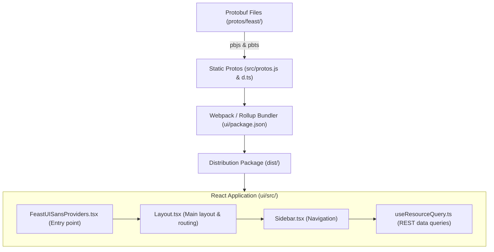
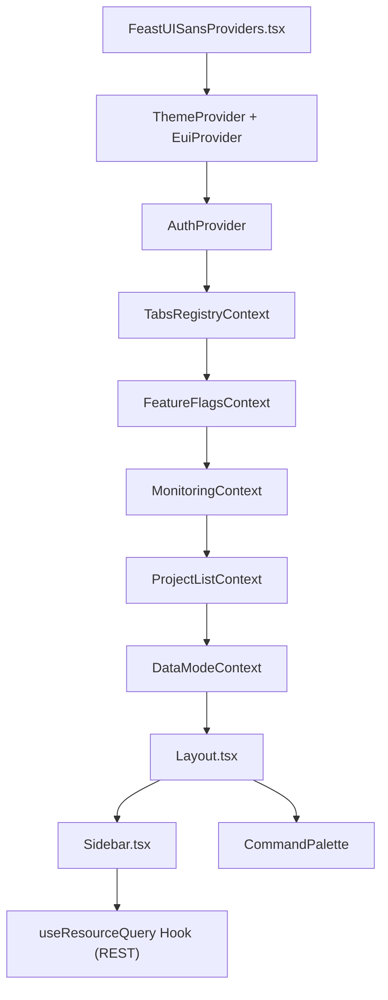

<!-- source: DeepWiki mcp.deepwiki.com · repo feast-dev/feast · page 4.5 Web UI · fetched 2026-10-21 -->

# Web UI

<details>
<summary>Relevant source files</summary>

The following files were used as context for generating this wiki page:

- [docs/reference/alpha-web-ui.md](docs/reference/alpha-web-ui.md)
- [sdk/python/feast/api/registry/rest/system.py](sdk/python/feast/api/registry/rest/system.py)
- [sdk/python/feast/dataset_utils.py](sdk/python/feast/dataset_utils.py)
- [sdk/python/feast/openlineage/consumer.py](sdk/python/feast/openlineage/consumer.py)
- [sdk/python/feast/ui/package.json](sdk/python/feast/ui/package.json)
- [sdk/python/feast/ui/yarn.lock](sdk/python/feast/ui/yarn.lock)
- [sdk/python/feast/ui_server.py](sdk/python/feast/ui_server.py)
- [sdk/python/tests/unit/api/test_system.py](sdk/python/tests/unit/api/test_system.py)
- [sdk/python/tests/unit/test_ui_server.py](sdk/python/tests/unit/test_ui_server.py)
- [ui/README.md](ui/README.md)
- [ui/config/env.js](ui/config/env.js)
- [ui/config/getHttpsConfig.js](ui/config/getHttpsConfig.js)
- [ui/config/jest/babelTransform.js](ui/config/jest/babelTransform.js)
- [ui/config/jest/cssTransform.js](ui/config/jest/cssTransform.js)
- [ui/config/jest/fileTransform.js](ui/config/jest/fileTransform.js)
- [ui/config/modules.js](ui/config/modules.js)
- [ui/config/paths.js](ui/config/paths.js)
- [ui/config/webpack.config.js](ui/config/webpack.config.js)
- [ui/config/webpack/persistentCache/createEnvironmentHash.js](ui/config/webpack/persistentCache/createEnvironmentHash.js)
- [ui/config/webpackDevServer.config.js](ui/config/webpackDevServer.config.js)
- [ui/jest.config.js](ui/jest.config.js)
- [ui/package-lock.json](ui/package-lock.json)
- [ui/package.json](ui/package.json)
- [ui/public/registry.db](ui/public/registry.db)
- [ui/src/FeastUI.tsx](ui/src/FeastUI.tsx)
- [ui/src/FeastUISansProviders.test.tsx](ui/src/FeastUISansProviders.test.tsx)
- [ui/src/FeastUISansProviders.tsx](ui/src/FeastUISansProviders.tsx)
- [ui/src/components/CommandPalette.tsx](ui/src/components/CommandPalette.tsx)
- [ui/src/components/DataSourceFormModal.tsx](ui/src/components/DataSourceFormModal.tsx)
- [ui/src/components/ExportButton.tsx](ui/src/components/ExportButton.tsx)
- [ui/src/components/FeastVersion.test.tsx](ui/src/components/FeastVersion.test.tsx)
- [ui/src/components/FeastVersion.tsx](ui/src/components/FeastVersion.tsx)
- [ui/src/components/FeatureViewFormModal.tsx](ui/src/components/FeatureViewFormModal.tsx)
- [ui/src/components/FeaturesInServiceDisplay.tsx](ui/src/components/FeaturesInServiceDisplay.tsx)
- [ui/src/components/FeaturesListDisplay.tsx](ui/src/components/FeaturesListDisplay.tsx)
- [ui/src/components/GlobalSearchShortcut.tsx](ui/src/components/GlobalSearchShortcut.tsx)
- [ui/src/components/LineageEventsList.tsx](ui/src/components/LineageEventsList.tsx)
- [ui/src/components/OpenLineageGraph.tsx](ui/src/components/OpenLineageGraph.tsx)
- [ui/src/components/ProjectSelector.test.tsx](ui/src/components/ProjectSelector.test.tsx)
- [ui/src/components/RegistrySearch.tsx](ui/src/components/RegistrySearch.tsx)
- [ui/src/components/RegistryVisualization.test.tsx](ui/src/components/RegistryVisualization.test.tsx)
- [ui/src/components/RegistryVisualization.tsx](ui/src/components/RegistryVisualization.tsx)
- [ui/src/components/RegistryVisualizationTab.tsx](ui/src/components/RegistryVisualizationTab.tsx)
- [ui/src/contexts/ProjectListContext.ts](ui/src/contexts/ProjectListContext.ts)
- [ui/src/contexts/RegistryRefreshContext.ts](ui/src/contexts/RegistryRefreshContext.ts)
- [ui/src/custom-tabs/TabsRegistryContext.tsx](ui/src/custom-tabs/TabsRegistryContext.tsx)
- [ui/src/custom-tabs/stream-fv-demo-tab/useDemoQuery.tsx](ui/src/custom-tabs/stream-fv-demo-tab/useDemoQuery.tsx)
- [ui/src/custom-tabs/types.ts](ui/src/custom-tabs/types.ts)
- [ui/src/hooks/useFCOExploreSuggestions.ts](ui/src/hooks/useFCOExploreSuggestions.ts)
- [ui/src/hooks/useRegistryRefresh.ts](ui/src/hooks/useRegistryRefresh.ts)
- [ui/src/index.tsx](ui/src/index.tsx)
- [ui/src/mocks/handlers.ts](ui/src/mocks/handlers.ts)
- [ui/src/pages/Layout.tsx](ui/src/pages/Layout.tsx)
- [ui/src/pages/ProjectOverviewPage.tsx](ui/src/pages/ProjectOverviewPage.tsx)
- [ui/src/pages/RootProjectSelectionPage.tsx](ui/src/pages/RootProjectSelectionPage.tsx)
- [ui/src/pages/Sidebar.tsx](ui/src/pages/Sidebar.tsx)
- [ui/src/pages/data-sources/BatchSourcePropertiesView.tsx](ui/src/pages/data-sources/BatchSourcePropertiesView.tsx)
- [ui/src/pages/data-sources/DataSourceOverviewTab.tsx](ui/src/pages/data-sources/DataSourceOverviewTab.tsx)
- [ui/src/pages/data-sources/DataSourcesListingTable.tsx](ui/src/pages/data-sources/DataSourcesListingTable.tsx)
- [ui/src/pages/data-sources/Index.tsx](ui/src/pages/data-sources/Index.tsx)
- [ui/src/pages/entities/EntitiesListingTable.tsx](ui/src/pages/entities/EntitiesListingTable.tsx)
- [ui/src/pages/entities/EntityOverviewTab.tsx](ui/src/pages/entities/EntityOverviewTab.tsx)
- [ui/src/pages/entities/FeatureViewEdgesList.tsx](ui/src/pages/entities/FeatureViewEdgesList.tsx)
- [ui/src/pages/entities/Index.tsx](ui/src/pages/entities/Index.tsx)
- [ui/src/pages/feature-services/FeatureServiceListingTable.tsx](ui/src/pages/feature-services/FeatureServiceListingTable.tsx)
- [ui/src/pages/feature-services/FeatureServiceOverviewTab.tsx](ui/src/pages/feature-services/FeatureServiceOverviewTab.tsx)
- [ui/src/pages/feature-services/Index.tsx](ui/src/pages/feature-services/Index.tsx)
- [ui/src/pages/feature-views/ConsumingFeatureServicesList.tsx](ui/src/pages/feature-views/ConsumingFeatureServicesList.tsx)
- [ui/src/pages/feature-views/CurlGeneratorTab.tsx](ui/src/pages/feature-views/CurlGeneratorTab.tsx)
- [ui/src/pages/feature-views/FeatureViewLineageTab.tsx](ui/src/pages/feature-views/FeatureViewLineageTab.tsx)
- [ui/src/pages/feature-views/FeatureViewListingTable.tsx](ui/src/pages/feature-views/FeatureViewListingTable.tsx)
- [ui/src/pages/feature-views/Index.tsx](ui/src/pages/feature-views/Index.tsx)
- [ui/src/pages/feature-views/RegularFeatureViewInstance.tsx](ui/src/pages/feature-views/RegularFeatureViewInstance.tsx)
- [ui/src/pages/feature-views/RegularFeatureViewOverviewTab.tsx](ui/src/pages/feature-views/RegularFeatureViewOverviewTab.tsx)
- [ui/src/pages/feature-views/StreamFeatureViewOverviewTab.tsx](ui/src/pages/feature-views/StreamFeatureViewOverviewTab.tsx)
- [ui/src/pages/feature-views/components/RequestDataDisplayPanel.tsx](ui/src/pages/feature-views/components/RequestDataDisplayPanel.tsx)
- [ui/src/pages/feature-views/useLoadFeatureView.ts](ui/src/pages/feature-views/useLoadFeatureView.ts)
- [ui/src/pages/features/FeatureListPage.tsx](ui/src/pages/features/FeatureListPage.tsx)
- [ui/src/pages/features/FeatureOverviewTab.tsx](ui/src/pages/features/FeatureOverviewTab.tsx)
- [ui/src/pages/lineage/Index.tsx](ui/src/pages/lineage/Index.tsx)
- [ui/src/pages/saved-data-sets/CreateDatasetForm.tsx](ui/src/pages/saved-data-sets/CreateDatasetForm.tsx)
- [ui/src/pages/saved-data-sets/DatasetCatalogBrowser.tsx](ui/src/pages/saved-data-sets/DatasetCatalogBrowser.tsx)
- [ui/src/pages/saved-data-sets/DatasetOverviewTab.tsx](ui/src/pages/saved-data-sets/DatasetOverviewTab.tsx)
- [ui/src/pages/saved-data-sets/DatasetUsageTab.tsx](ui/src/pages/saved-data-sets/DatasetUsageTab.tsx)
- [ui/src/pages/saved-data-sets/DatasetsCardGrid.tsx](ui/src/pages/saved-data-sets/DatasetsCardGrid.tsx)
- [ui/src/pages/saved-data-sets/DatasetsListingTable.tsx](ui/src/pages/saved-data-sets/DatasetsListingTable.tsx)
- [ui/src/pages/saved-data-sets/EditDatasetModal.tsx](ui/src/pages/saved-data-sets/EditDatasetModal.tsx)
- [ui/src/pages/saved-data-sets/Index.tsx](ui/src/pages/saved-data-sets/Index.tsx)
- [ui/src/pages/saved-data-sets/RegisterDatasetModal.tsx](ui/src/pages/saved-data-sets/RegisterDatasetModal.tsx)
- [ui/src/parsers/mergedFVTypes.ts](ui/src/parsers/mergedFVTypes.ts)
- [ui/src/parsers/parseEntityRelationships.ts](ui/src/parsers/parseEntityRelationships.ts)
- [ui/src/parsers/types.ts](ui/src/parsers/types.ts)
- [ui/src/queries/mutations/useDataSourceMutations.ts](ui/src/queries/mutations/useDataSourceMutations.ts)
- [ui/src/queries/useFeastVersion.ts](ui/src/queries/useFeastVersion.ts)
- [ui/src/queries/useLoadRegistry.ts](ui/src/queries/useLoadRegistry.ts)
- [ui/src/test-document.txt](ui/src/test-document.txt)
- [ui/src/test-utils.tsx](ui/src/test-utils.tsx)
- [ui/src/utils/custom-tabs/StreamFeatureViewCustomTabLoadingWrapper.tsx](ui/src/utils/custom-tabs/StreamFeatureViewCustomTabLoadingWrapper.tsx)
- [ui/src/utils/timestamp.ts](ui/src/utils/timestamp.ts)
- [ui/yarn.lock](ui/yarn.lock)

</details>


## Purpose and Scope

This page documents the React-based Web UI for the Feast feature store. It covers the architecture, build system, how the UI integrates with the Python SDK through the FastAPI-based UI server, UI routing, context providers, extensibility with custom tabs, and specialized pages for registry visualization, monitoring, and label-view workflows.

The key implementation files referenced include:

- Python UI server: `sdk/python/feast/ui_server.py`
- React UI application source: `ui/src/FeastUISansProviders.tsx`, `ui/src/pages/Layout.tsx`, `ui/src/pages/Sidebar.tsx`
- UI dependencies and build config: `ui/package.json`
- Documentation and usage examples: `docs/reference/alpha-web-ui.md`

Sources: [sdk/python/feast/ui_server.py:1-208](), [ui/package.json:1-161](), [ui/src/FeastUISansProviders.tsx:1-189](), [ui/src/pages/Layout.tsx:1-191](), [ui/src/pages/Sidebar.tsx:1-177](), [docs/reference/alpha-web-ui.md:1-164]()

---

## 1. Architecture and Build System

The Feast Web UI is a modular, TypeScript React application bundled with a combination of Webpack (for development and app startup) and Rollup (for library build and distribution). Before the bundling step, protocol buffer (`.proto`) files defining Feast's API are compiled to static JavaScript modules and TypeScript typings using `pbjs` and `pbts` tools (`ui/package.json:49-58]`).

The frontend leverages the **Elastic UI Framework** (`@elastic/eui`) for most UI components, alongside other libraries such as `react-query` for data fetching and caching, and `react-router-dom` for client-side routing (`ui/package.json:11-48]`).

### Build and Frontend Component Architecture



The UI source code organizes pages and components logically by Feast feature store resources: feature views, entities, data sources, feature services, label views, saved datasets, monitoring, and lineage visualizations.

Sources: [ui/package.json:49-58](), [ui/src/FeastUISansProviders.tsx:70-101](), [ui/src/pages/Layout.tsx:41-191](), [ui/src/pages/Sidebar.tsx:30-101]()

---

## 2. UI Server Integration with Python SDK

The Python SDK exposes a FastAPI application in `sdk/python/feast/ui_server.py` which serves the React Web UI's static assets, wraps Feast registry APIs into REST endpoints, and handles UI-specific logic:

- Serves static UI files from the React build output.
- Provides `/api/v1` REST endpoints that proxy to Feast's `RegistryServer` gRPC server.
- Handles project discovery via dynamic JSON (`/projects-list.json`) based on the registered projects in the Feast registry.
- Implements a `/push` REST endpoint to allow pushing label data or streaming data directly from the UI.
- Supports authentication metadata (e.g., OIDC provider) injection for the UI client.

### Key Functions and Their Roles

| Function/Component              | Responsibility                                                 |
|-------------------------------|----------------------------------------------------------------|
| `_setup_rest_mode`             | Creates FastAPI instance under `/api/v1`, registers Feast REST routes, sets up security dependencies |
| `_build_projects_list`          | Queries the Feast registry for registered projects, falls back to defaults if unreachable |
| `_build_auth_config_json`       | Serializes Feast store's auth configuration for UI consumption |
| `/push` endpoint                | Accepts JSON push payload, converts to Pandas DataFrame, calls `store.push()` for ingestion |

### UI Server Integration Diagram

```mermaid
graph TD
  FS["feast.FeatureStore Instance"]
  Reg["store.registry (Registry)"]
  AuthCfg["store.config.auth_config (AuthConfig)"]
  RegSrv["RegistryServer (registry_server.py)"]
  FastAPIApp["FastAPI App (ui_server.py)"]
  Routes["register_all_routes() under /api/v1"]
  PushEP["POST /api/v1/push Endpoint"]

  FS --> Reg
  FS --> AuthCfg
  Reg --> RegSrv
  FastAPIApp --> Routes
  Routes --> PushEP
  PushEP -->|store.push()| FS
  RegSrv --> Routes
```

Sources: [sdk/python/feast/ui_server.py:31-194]()

---

## 3. Frontend Routing and Context Providers

The React entry point is the `FeastUISansProviders` component, which wraps the entire application in numerous React context providers managing cross-cutting concerns:

- **ThemeContext** for light/dark mode styling.
- **AuthProvider** for user authentication and permissions.
- **ProjectListContext** to provide the set of available projects and their metadata.
- **TabsRegistryContext** for extensible custom tabs (described in next section).
- **MonitoringContext** for feature monitoring and metrics configuration.
- **FeatureFlagsContext** to enable/disable experimental UI features.
- **DataModeContext** for configuring API fetch options and UI data behaviors.

The main UI layout (`Layout.tsx`) handles:

- Sidebar navigation with resource counts and links.
- Project selection and scoping.
- Global keyboard shortcut (`Ctrl+K` / `Cmd+K`) to open the command palette for fast searching through Feast entities, feature views, and other resources.
- Displays toasts and status for registry refresh operations.
- Loads project-specific registry data via REST queries and provides global registries data for cross-project search.

The sidebar (`Sidebar.tsx`) fetches and displays Feasts resource lists such as data sources, entities, feature views, feature services, label views, saved datasets with item counts using the `useResourceQuery` hook that abstracts REST API requests.

### Frontend Routing and Context Providers Diagram



Sources: [ui/src/FeastUISansProviders.tsx:70-181](), [ui/src/pages/Layout.tsx:41-191](), [ui/src/pages/Sidebar.tsx:30-101]()

---

## 4. Custom Tabs and Extensibility

The Web UI allows teams to inject custom tabs into object detail views to extend functionality without modifying core code. This is enabled via the `TabsRegistryContext` React context, which defines registries of tabs keyed by Feast resource type:

- `RegularFeatureViewCustomTabs`
- `OnDemandFeatureViewCustomTabs`
- `StreamFeatureViewCustomTabs`
- `FeatureServiceCustomTabs`
- `FeatureCustomTabs`
- `DataSourceCustomTabs`
- `EntityCustomTabs`
- `DatasetCustomTabs`

By default, the UI registers built-in extensibility points such as the **CURL Generator** tab for Regular Feature Views, which helps users generate example curl commands for feature retrieval requests against a configurable feature server URL.

Example tab registry snippet:

```typescript
const tabsRegistry = {
  RegularFeatureViewCustomTabs: [
    {
      label: "Custom Tab Demo", // Navigation label
      path: "demo-tab",         // URL subpath for routing
      Component: RFVDemoCustomTab, // React component to render
    },
  ]
}
```

Users can pass their custom `tabsRegistry` object to the main `<FeastUI>` component via its `feastUIConfigs` prop to add tabs programmatically.

Sources: [ui/src/FeastUISansProviders.tsx:34-176](), [docs/reference/alpha-web-ui.md:38-48]()

---

## 5. Monitoring, Label Views, and Registry Visualization

The Web UI exposes detailed pages and interface components to visualize Feast resources and assist operations:

- **Registry & Resource Views:** Pages for listing and managing Data Sources, Entities, Feature Views, Feature Services, Label Views, and Saved Datasets. These pages include tables, search/filter capabilities, and instance detail views (`ui/src/pages/data-sources/Index.tsx`, etc.).

- **Label Views:** Specialized pages allow browsing label data, batch uploading labels, and exporting training datasets associated with LabelView objects.

- **Monitoring Dashboard:** Uses the `MonitoringContext` to access feature freshness and metrics data, providing detail pages such as Feature Metrics Detail. Supports anomaly detection and data quality monitoring (`ui/src/FeastUISansProviders.tsx`, `ui/src/pages/monitoring/Index.tsx`).

- **Registry Visualization:** Graph visualizations of entity relationships and feature view dependencies are provided by components such as `RegistryVisualization.tsx`, facilitating intuitive exploration of feature lineage and metadata.

- **Global Search Command Palette:** From the layout and sidebar, keyboard shortcuts and global search capabilities enable quick lookup across all Feast projects and resources.

These features collectively enhance observability, troubleshooting, and metadata exploration for Feast users via the Web UI.

Sources: [ui/src/FeastUISansProviders.tsx:25-33](), [ui/src/pages/Layout.tsx:76-152](), [ui/src/pages/data-sources/Index.tsx:1-39]()

---

# Summary

The Feast Web UI is a React application designed for comprehensive exploration and management of Feast feature stores. It integrates closely with Feast's Python SDK through a FastAPI UI server that proxies RESTful registry APIs and serves the SPA frontend.

The UI combines a modular routing and context provider system with extensible custom tabs and rich resource visualizations. Monitoring and anomaly detection augment operational visibility. The build system efficiently handles proto compilation and bundling, while the architecture organizes the UI into re-usable logical units around Feast concepts.

This design facilitates seamless management, inspecting feature metadata, and improving development and operational workflows around Feast.

---

# References

- `sdk/python/feast/ui_server.py`
- `ui/package.json`
- `ui/src/FeastUISansProviders.tsx`
- `ui/src/pages/Layout.tsx`
- `ui/src/pages/Sidebar.tsx`
- `docs/reference/alpha-web-ui.md`
- `ui/src/pages/data-sources/Index.tsx`

Sources: All above sections and files

---

