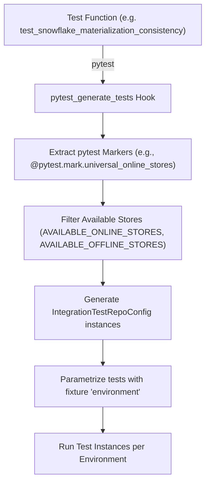
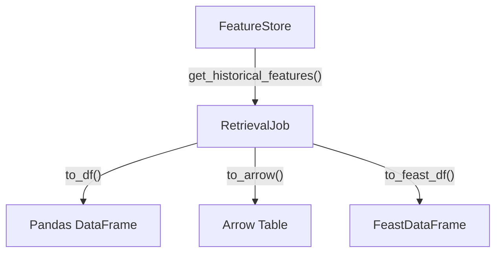
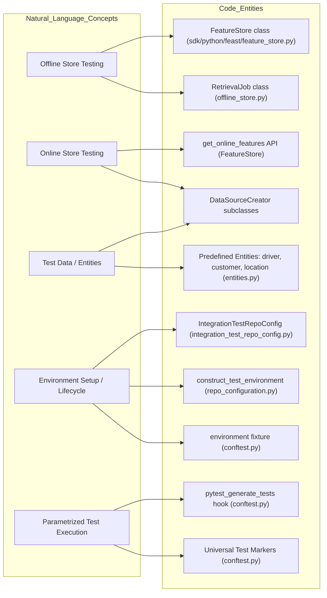

<!-- source: DeepWiki mcp.deepwiki.com · repo feast-dev/feast · page 5.1 Universal Testing Framework · fetched 2026-10-21 -->

# Universal Testing Framework

<details>
<summary>Relevant source files</summary>

The following files were used as context for generating this wiki page:

- [docs/how-to-guides/adding-or-reusing-tests.md](docs/how-to-guides/adding-or-reusing-tests.md)
- [infra/feast-operator/bundle/manifests/openlineage-secret_v1_secret.yaml](infra/feast-operator/bundle/manifests/openlineage-secret_v1_secret.yaml)
- [infra/scripts/redis-cluster.sh](infra/scripts/redis-cluster.sh)
- [sdk/python/feast/infra/offline_stores/contrib/__init__.py](sdk/python/feast/infra/offline_stores/contrib/__init__.py)
- [sdk/python/feast/infra/online_stores/helpers.py](sdk/python/feast/infra/online_stores/helpers.py)
- [sdk/python/feast/infra/online_stores/redis.py](sdk/python/feast/infra/online_stores/redis.py)
- [sdk/python/tests/README.md](sdk/python/tests/README.md)
- [sdk/python/tests/conftest.py](sdk/python/tests/conftest.py)
- [sdk/python/tests/integration/materialization/test_snowflake.py](sdk/python/tests/integration/materialization/test_snowflake.py)
- [sdk/python/tests/integration/online_store/conftest.py](sdk/python/tests/integration/online_store/conftest.py)
- [sdk/python/tests/integration/online_store/test_push_features_to_online_store.py](sdk/python/tests/integration/online_store/test_push_features_to_online_store.py)
- [sdk/python/tests/integration/online_store/test_universal_online.py](sdk/python/tests/integration/online_store/test_universal_online.py)
- [sdk/python/tests/unit/infra/online_store/test_redis.py](sdk/python/tests/unit/infra/online_store/test_redis.py)
- [sdk/python/tests/unit/infra/registry/test_file_registry.py](sdk/python/tests/unit/infra/registry/test_file_registry.py)
- [sdk/python/tests/universal/feature_repos/repo_configuration.py](sdk/python/tests/universal/feature_repos/repo_configuration.py)

</details>


## Purpose and Scope

The Universal Testing Framework is a parametrized integration test system that runs Feast core functionality tests across a range of offline and online store backend combinations. This ensures the consistency and correctness of features like point-in-time joins, materialization, feature ingestion, and online retrieval, independent of the underlying infrastructure backend (e.g., BigQuery, Snowflake, Redis, PostgreSQL, SQLite, DynamoDB).

This framework avoids duplicative test code by defining test logic once and dynamically applying it to multiple store environments using `pytest` hooks, markers, and abstract environment constructs.

Sources: [sdk/python/tests/integration/materialization/test_snowflake.py:51](), [sdk/python/tests/integration/offline_store/test_universal_historical_retrieval.py:44-49](), [sdk/python/tests/integration/online_store/test_universal_online.py:53-58]()

---

## Architecture Overview

The framework dynamically generates test instances for all supported combinations of offline and online stores using `pytest` parametrize hooks guided by custom markers. It constructs rich test environments with well-defined lifecycle functions.

### Pytest Parametrization and Test Instance Generation Flow



In this process:
- Tests declare the store types they exercise via markers (`universal_online_stores`, `universal_offline_stores`).
- The conftest infrastructure filters and computes the Cartesian product of offline and online store combinations.
- For each combo, an `IntegrationTestRepoConfig` configures the environment.
- The `environment` fixture is parametrized with these configs, injecting the right feature store setup into each test.

Sources: [sdk/python/tests/conftest.py:144-165](), [sdk/python/tests/integration/materialization/test_snowflake.py:51](), [sdk/python/tests/integration/offline_store/test_universal_historical_retrieval.py:44-49](), [sdk/python/tests/integration/online_store/test_universal_online.py:53-58](), [sdk/python/tests/universal/feature_repos/repo_configuration.py:111-152]()

---

### Environment Setup and Lifecycle

```mermaid
graph LR
    IntegrationTestRepoConfig["IntegrationTestRepoConfig"] --> construct_test_environment["construct_test_environment()"]
    construct_test_environment --> Environment["Environment object"]
    Environment --> environment.setup()["environment.setup()"]
    environment.setup() --> FeatureStore["FeatureStore instance (environment.feature_store)"]
    FeatureStore --> TestRun["Test Execution"]
    TestRun --> environment.teardown()["environment.teardown()"]
```

- The `IntegrationTestRepoConfig` contains provider, offline store creator, online store configuration, and batch engine info.
- `construct_test_environment()` instantiates an `Environment` which manages lifecycle and holds the `FeatureStore` instance configured for the test backend.
- Each test uses this `FeatureStore` instance to apply feature definitions, materialize data, or retrieve features.
- After test completion, `environment.teardown()` cleans any persistent state.

Sources: [sdk/python/tests/conftest.py:97-109](), [sdk/python/tests/integration/materialization/test_snowflake.py:59-60](), [sdk/python/tests/integration/materialization/test_snowflake.py:83-94]()

---

## Core Components

### Pytest Markers

Markers declare which stores a test should run against and facilitate filtering and parametrization in the test suite:

| Marker                  | Description                           | Usage Example                         |
|-------------------------|-------------------------------------|-------------------------------------|
| `universal_online_stores`  | Test runs against multiple online stores | `@pytest.mark.universal_online_stores` |
| `universal_offline_stores` | Test runs against multiple offline stores | `@pytest.mark.universal_offline_stores` |
| `integration`              | Marks tests that have external dependencies | `@pytest.mark.integration`            |

These enable selective execution of tests for particular storage backends or integration levels.

Sources: [sdk/python/tests/conftest.py:149-165](), [sdk/python/tests/integration/materialization/test_snowflake.py:51](), [sdk/python/tests/integration/offline_store/test_universal_historical_retrieval.py:44-46](), [sdk/python/tests/integration/online_store/test_universal_online.py:53-55]()

---

### The `environment` Fixture

The key fixture `environment` constructs the backend-configured testing context for each test iteration. It includes:
- A configured `FeatureStore` instance (`environment.feature_store`) with the appropriate provider and stores.
- The `data_source_creator`, which is responsible for preparing test data sources and uploading DataFrames for offline stores.

Tests interact primarily through this `FeatureStore` interface to abstract away store-specific details.

Sources: [sdk/python/tests/conftest.py:37-43](), [sdk/python/tests/integration/materialization/test_snowflake.py:59-60](), [sdk/python/tests/integration/offline_store/test_universal_historical_retrieval.py:50-51](), [sdk/python/tests/integration/offline_store/test_universal_historical_retrieval.py:158-165]()

---

## Universal Data Sources and Test Data

### TestData and Data Provisioning

The universal tests work on predefined, reusable datasets and entities that represent typical feature store data workloads:

- **Entities**: Common entities such as `driver`, `customer`, and `location` define join keys used in features. These are defined in code under `feature_repos/universal/entities.py`.

- **Datasets**: DataFrames like `driver_df`, `customer_df`, and `orders_df` seeded with realistic data used for testing. These enable reusable scenarios for offline feature retrieval and materialization.

- **Test Data Functions**: Examples include `create_basic_driver_dataset()` returning Pandas DataFrames representing feature data [sdk/python/tests/data/data_creator.py:12-39](), [sdk/python/driver_test_data.py:37-85]().

```mermaid
classDiagram
    class "create_basic_driver_dataset" {
        +entity_type: FeastType
        +feature_dtype: str
        +create_basic_driver_dataset() DataFrame
    }

    class "create_orders_df" {
        +customers: List
        +drivers: List
        +create_orders_df() DataFrame
    }

    class "driver_test_data" {
        +EventTimestampType
        +create_orders_df()
        +create_driver_hourly_stats_df()
    }

    "create_basic_driver_dataset" --> "driver_test_data"
```

Sources: [sdk/python/tests/conftest.py:98-109](), [sdk/python/tests/data/data_creator.py:12-39](), [sdk/python/driver_test_data.py:37-85]()

---

### DataSourceCreator Abstraction

The `DataSourceCreator` is an abstraction that manages uploading and provisioning test datasets in backend-specific formats. It hides complexities of preparing the data source for offline store ingestion:

```mermaid
classDiagram
    class "DataSourceCreator" {
        <<abstract>>
        +create_data_source(df, project, field_mapping) DataSource
        +create_logged_features_destination() LoggingDestination
    }

    class "FileDataSourceCreator" {
        +create_data_source()
        +create_logged_features_destination()
    }

    class "BigQueryDataSourceCreator" {
        +create_data_source()
    }

    class "SnowflakeDataSourceCreator" {
        +create_data_source()
    }

    class "RedshiftDataSourceCreator" {
        +create_data_source()
    }

    "DataSourceCreator" <|-- "FileDataSourceCreator"
    "DataSourceCreator" <|-- "BigQueryDataSourceCreator"
    "DataSourceCreator" <|-- "SnowflakeDataSourceCreator"
    "DataSourceCreator" <|-- "RedshiftDataSourceCreator"
```

- Each concrete creator prepares a feature data source in its specific backend (e.g., uploading Parquet files locally or uploading tables to BigQuery).
- Supports creating logging destinations for feature logging tests.
- Facilitates seamless testing by decoupling data provisioning from test logic.

Sources: [sdk/python/tests/conftest.py:109](), [sdk/python/tests/universal/feature_repos/universal/data_sources/snowflake.py:19-20](), [sdk/python/tests/integration/offline_store/test_feature_logging.py:46]()

---

## Test Execution Model

### Offline Store Testing

- Tests run `FeatureStore.get_historical_features()` to verify point-in-time joins and materialization correctness.
- The returned `RetrievalJob` supports multiple result formats: Pandas DataFrame `.to_df()`, Arrow Table `.to_arrow()`, or Feast's extended `.to_feast_df()`.
- This checks compatibility and correctness across all supported offline stores.



Sources: [sdk/python/feast/infra/offline_stores/offline_store.py]()

---

### Online Store Testing

- Tests perform `write_to_online_store` or `push` to ingest feature data into the online store, then verify consistency via `get_online_features`.
- Online store implementations (e.g., Redis, Snowflake, DynamoDB) serialize entity keys and feature values differently but expose a uniform interface.
- Example: Snowflake online store parses protobuf-serialized entity keys and batches inserts into Snowflake tables [sdk/python/feast/infra/online_stores/snowflake.py:73-155](), relying on key serialization utilities [sdk/python/feast/infra/key_encoding_utils.py]().

Sources: [sdk/python/feast/infra/online_stores/snowflake.py:73-155](), [sdk/python/feast/infra/key_encoding_utils.py](), [sdk/python/tests/integration/online_store/test_universal_online.py:53-90]()

---

### Feature Logging Testing

- Defines `FeatureServiceLoggingSource` containing schemas for logged feature requests and system columns (e.g., `__request_id`, `__log_timestamp`, `__log_date`) [sdk/python/feast/feature_logging.py:23-25]().
- Tests prepare log dataframes using `prepare_logs` and write them into logging destinations backed by offline stores.
- After ingestion, tests validate the correctness and completeness of logged data retrieval.

Sources: [sdk/python/feast/feature_logging.py:23-25](), [sdk/python/tests/integration/offline_store/test_feature_logging.py:46](), [sdk/python/tests/integration/offline_store/test_feature_logging.py:76-122]()

---

### Inference and Metadata Registration Testing

- Tests verify schema and metadata inference logic, ensuring features' timestamp fields and types can be inferred correctly from underlying data.
- For instance, `offline_utils.infer_event_timestamp_from_entity_df` provides default logic to recognize event timestamp columns in dataframes [sdk/python/feast/infra/offline_stores/offline_utils.py]().

Sources: [sdk/python/feast/infra/offline_stores/offline_utils.py]()

---

# Summary Diagram: Linking Natural Language Concepts to Code Entities



---

# Summary

The Feast Universal Testing Framework provides a comprehensive and scalable way to verify key Feast functionalities across a variety of backend store technologies. By parametrizing offline and online store configurations, it ensures consistent test coverage without redundant test code. Key abstractions such as `Environment`, `DataSourceCreator`, and custom pytest markers enable tests to be dynamically instantiated and executed against any supported storage combination. This framework underpins Feast's confidence in multi-cloud and multi-backend support for ML feature management.

---

# References

- `sdk/python/tests/conftest.py` — Pytest hooks, fixtures, marker definitions, environment construction
- `sdk/python/tests/universal/feature_repos/repo_configuration.py` — Offline/online store configurations, environment factory
- `sdk/python/tests/universal/feature_repos/integration_test_repo_config.py` — Test environment config classes
- `sdk/python/tests/integration/offline_store/test_universal_historical_retrieval.py` — Offline store universal tests
- `sdk/python/tests/integration/online_store/test_universal_online.py` — Online store universal tests
- `sdk/python/feast/infra/offline_stores/offline_store.py` — Offline store interface and RetrievalJob
- `sdk/python/feast/infra/online_stores/snowflake.py` — Snowflake online store implementation
- `sdk/python/feast/feature_logging.py` — Feature logging infrastructure

Sources: All as cited in respective sections above.

---

