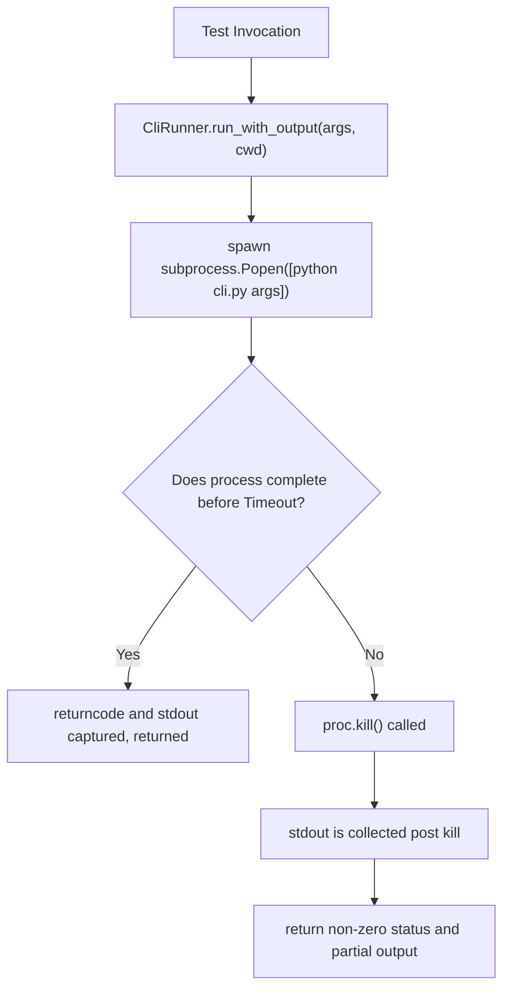
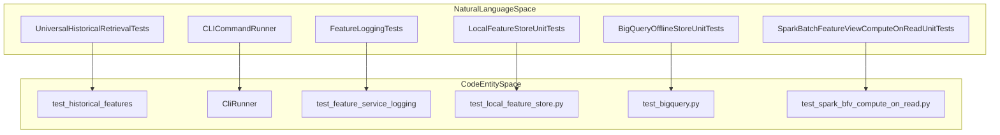
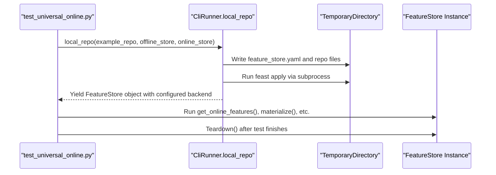
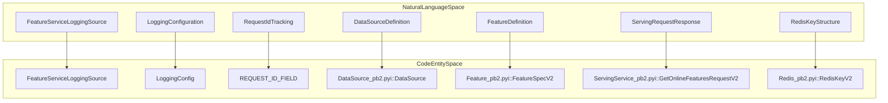

<!-- source: DeepWiki mcp.deepwiki.com · repo feast-dev/feast · page 5.2 Test Infrastructure and Patterns · fetched 2026-10-21 -->

# Test Infrastructure and Patterns

Relevant source files

The following files were used as context for generating this wiki page:

- [.github/workflows/pr_registration_integration_tests.yml](.github/workflows/pr_registration_integration_tests.yml)
- [.github/workflows/security.yml](.github/workflows/security.yml)
- [.pre-commit-config.yaml](.pre-commit-config.yaml)
- [sdk/python/feast/driver_test_data.py](sdk/python/feast/driver_test_data.py)
- [sdk/python/feast/feature_logging.py](sdk/python/feast/feature_logging.py)
- [sdk/python/feast/feature_view_utils.py](sdk/python/feast/feature_view_utils.py)
- [sdk/python/pytest.ini](sdk/python/pytest.ini)
- [sdk/python/tests/data/data_creator.py](sdk/python/tests/data/data_creator.py)
- [sdk/python/tests/integration/offline_store/test_feature_logging.py](sdk/python/tests/integration/offline_store/test_feature_logging.py)
- [sdk/python/tests/utils/cli_repo_creator.py](sdk/python/tests/utils/cli_repo_creator.py)

This page documents the test infrastructure of Feast's Python SDK, detailing the pytest setup, test runner implementations, fixture strategies, test data generation utilities, and the layered structure of unit, integration, and end-to-end tests. It also covers critical infrastructure patterns to ensure test reliability and repeatability.

---

## Pytest Configuration and Environment Setup

Feast's Python test suite uses pytest configured via the central `pytest.ini` file located in `sdk/python/pytest.ini`. This file specifies global pytest behaviors essential for Feast's extensive test coverage [sdk/python/pytest.ini:1-29]().

Key configuration details:

- **Asyncio Handling**: The `asyncio_mode = auto` setting enables automatic event loop handling, ensuring asynchronous tests run smoothly without explicit decorators [sdk/python/pytest.ini:2-2]().
- **Environment Variables**: Sets `IS_TEST=True` in the test environment to activate test-specific code paths [sdk/python/pytest.ini:3-4]().
- **Warnings Filters**: Downgrades or ignores certain deprecation warnings from dependencies to reduce noise in test output [sdk/python/pytest.ini:5-12]().
- **Test Markers**: Defines markers such as `universal_offline_stores`, `universal_online_stores`, `integration`, `benchmark`, `slow`, and others to categorize tests by scope and requirements [sdk/python/pytest.ini:14-25]().
- **Timeout Management**: Enforces a global per-test timeout limit of 300 seconds using the `thread`-based timeout method to avoid deadlocks or endlessly running tests [sdk/python/pytest.ini:26-27]().
- **Default CLI Options**: Uses verbose output, short tracebacks, and duration reporting for the slowest 20 tests to aid in debugging and performance monitoring [sdk/python/pytest.ini:29-29]().

These settings orchestrate Feast's comprehensive testing approach, balancing robustness and practicality for CI and local environments.

**Sources:**  
[sdk/python/pytest.ini:1-29]()

---

## Test Runner and Subprocess Management

### Motivation for Independent Subprocess Test Runs

Dynamic import of feature repository modules during tests can lead to state contamination between tests if executed in the same interpreter. To circumvent this, Feast leverages a specialized test runner utility called `CliRunner` defined in `sdk/python/tests/utils/cli_repo_creator.py` [sdk/python/tests/utils/cli_repo_creator.py:50-55]().

`CliRunner` runs CLI commands in fresh Python subprocesses per test invocation. This ensures a clean runtime environment and isolates side effects such as global imports and configuration changes, significantly improving test reliability.

### Managing Subprocess Hangs Due to Dask and PySpark

Certain Feast operations, particularly materialization jobs that use Dask, suffer from known hangs on shutdown due to Dask's `atexit` handler. This handler attempts to shut down a thread pool executor that sometimes blocks indefinitely. `CliRunner` addresses this elegantly by running CLI commands using `subprocess.Popen` with a finite timeout on `communicate()` calls.

Upon timeout expiration, the process is forcibly killed (`proc.kill()`) and any buffered standard output/error is captured for error diagnosis. This design allows tests to fail fast and show relevant error messages even when the underlying command experiences a hang.

### Process Flow for `CliRunner.run_with_output`

This subprocess management layer is critical for Feast's tests that invoke CLI commands such as `apply`, `materialize`, and `teardown` repeatedly and unpredictably.

**Sources:**  
[sdk/python/tests/utils/cli_repo_creator.py:4-20]()  
[sdk/python/tests/utils/cli_repo_creator.py:104-138]()

---

## Test Categories and Directory Structure

Feast organizes tests primarily within `sdk/python/tests/` subdivided into unit, integration, and universal parameterized tests. This structure ensures targeted, reusable, and scalable test coverage [sdk/python/tests/README.md:11-67]().

| Layer           | Purpose                                                         | Location                          |
|-----------------|-----------------------------------------------------------------|---------------------------------|
| Unit Tests      | Validate isolated class and function logic without external dependencies.| `tests/unit`                    |
| Integration Tests| Full workflows involving resource access to databases or network services.| `tests/integration`             |
| Universal Tests | Parametrized tests running the same test logic across different offline/online store combinations via fixtures.| `tests/universal`               |

### Examples:

- **Unit Test Example:**  
  `test_apply_entity` in `tests/unit/local_feast_tests/test_local_feature_store.py` verifies local `Entity` application logic without external dependencies [sdk/python/tests/unit/local_feast_tests/test_local_feature_store.py:39-60]().

- **Integration Test Example:**  
  Testing BigQuery offline store query generation mocks external cloud calls to validate SQL correctness [sdk/python/tests/unit/infra/offline_stores/test_bigquery.py:90-122]().

- **Universal Test Example:**  
  Parameterized Pytest fixtures like `environment` and `universal_data_sources` enable executing the same feature repo tests across all supported offline and online store backend combinations for comprehensive compatibility checks [sdk/python/tests/README.md:72-79]().

### Natural Language to Code Entity Mapping for Testing

**Sources:**  
[sdk/python/tests/README.md:50-53]()  
[sdk/python/tests/utils/cli_repo_creator.py:50-55]()  
[sdk/python/tests/unit/local_feast_tests/test_local_feature_store.py:39-60]()  
[sdk/python/tests/unit/infra/offline_stores/test_bigquery.py:90-122]()  
[sdk/python/tests/unit/infra/offline_stores/contrib/spark_offline_store/test_spark_bfv_compute_on_read.py:94-106]()

---

## Test Data Creation and Environment Setup

Feast includes utilities for generating representative test data, covering common data patterns such as drivers, orders, and embedding datasets, which help to validate various feature types like numeric, string, timestamp, and complex types.

### Core Test Data Generator Utilities

- **Driver Dataset Generator**:  
  `create_basic_driver_dataset` produces driver-related feature data with varying entity types (`Int32`, `Int64`, `Float32`, `String`), multiple feature dtypes, timezone-aware timestamps, and optional lists for traits like driver trips [sdk/python/tests/data/data_creator.py:12-39]().

- **Document Dataset Generator**:  
  `create_document_dataset` builds small artificial datasets containing embedding vectors and various data types to test vector similarity and embedding retrieval pipelines [sdk/python/tests/data/data_creator.py:85-103]().

- **Image Dataset Generator with Synthetic Bytes**:  
  `create_image_dataset` synthesizes test image data and byte arrays for validating image feature ingestion and vector search. It attempts to use PIL to generate JPEG bytes or fallback to dummy raw bytes if necessary [sdk/python/tests/data/data_creator.py:106-152]().

### Lifecycle and Environment Setup for Feature Repo Tests

The `CliRunner.local_repo` context manager sets up ephemeral feature repositories in temporary directories, writes the required `feature_store.yaml` config and Python repo source file (e.g., `example_repo.py`), runs `feast apply` commands, and yields a ready-to-use `FeatureStore` instance for test interactions.

This approach provides a reproducible sandboxed environment for end-to-end feature repo testing while ensuring dependencies are isolated.

**Sources:**  
[sdk/python/tests/utils/cli_repo_creator.py:140-178]()  
[sdk/python/tests/README.md:72-79]()  
[sdk/python/tests/data/data_creator.py:12-152]()

---

## Validation and Feature Logging Patterns

Feast features a sophisticated integration test pattern for feature logging — the recording of served feature data and usage in offline stores for auditing and monitoring.

### FeatureService Logging Test Example

The integration test `test_feature_service_logging` [sdk/python/tests/integration/offline_store/test_feature_logging.py:31-122]() validates that features served via a `FeatureService` are logged correctly:

- Constructs a `FeatureService` combining multiple feature views with specified logging configuration targeting an offline store destination.
- Applies entities, feature views, and feature service specs to the `FeatureStore` and registry.
- Produces a synthetic Pandas DataFrame with logged feature values to simulate served logs.
- Converts the DataFrame to PyArrow tables using the schema derived from `FeatureServiceLoggingSource`.
- Writes logged features to the backend offline store in batches.
- Retrieves and verifies the persisted logs are identical to the input, ignoring the synthetic log date field.

### Logging Schema Construction

The `FeatureServiceLoggingSource` class generates an Apache Arrow schema for logged data, including:

- Entity join keys remapped by projections
- Feature columns with timestamp and status subfields suffixed
- System-level metadata such as log timestamp, log date, and request ID fields [sdk/python/feast/feature_logging.py:45-102]().

### Natural Language to Code Entity Mapping for Feature Logging

This pattern ensures the correctness of logging end-to-end, enabling reliable event tracking for feature serving.

**Sources:**  
[sdk/python/tests/integration/offline_store/test_feature_logging.py:31-122]()  
[sdk/python/feast/feature_logging.py:23-102]()  
[sdk/python/feast/protos/feast/core/DataSource_pb2.pyi:40-40]()  
[sdk/python/feast/protos/feast/core/Feature_pb2.pyi:34-34]()  
[sdk/python/feast/protos/feast/serving/ServingService_pb2.pyi:125-125]()  
[sdk/python/feast/protos/feast/storage/Redis_pb2.pyi:34-34]()

---

# Summary

Feast's Python test infrastructure is designed with extensibility, robustness, and reproducibility in mind through:

- A carefully tuned pytest configuration for async testing, timeouts, and selective markers.
- A dedicated CLI-based subprocess runner to isolate feature repo tests and avoid deadlocks.
- Clear layered test organization for unit, integration, and universal cross-backend tests.
- Rich fixture and test data creation utilities for consistent and varied test inputs.
- Validation patterns that cover logging, schema enforcement, and offline/online data flows.

This infrastructure enables comprehensive validation of Feast’s complex feature store ecosystem in CI and local development environments.

---

