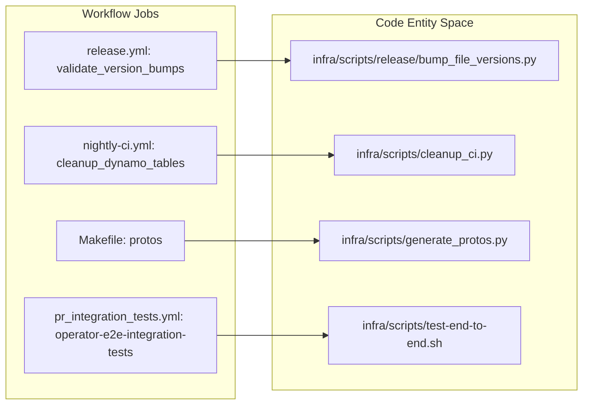
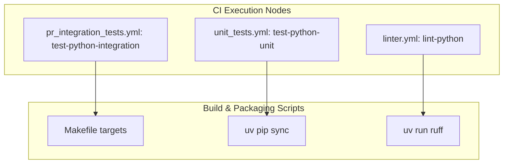

<!-- source: DeepWiki mcp.deepwiki.com · repo feast-dev/feast · page 5.3 CI/CD Workflows · fetched 2026-10-21 -->

# CI/CD Workflows

Relevant source files

The following files were used as context for generating this wiki page:

- [.github/actions/get-semantic-release-version/action.yml](.github/actions/get-semantic-release-version/action.yml)
- [.github/fork_workflows/fork_pr_integration_tests_aws.yml](.github/fork_workflows/fork_pr_integration_tests_aws.yml)
- [.github/fork_workflows/fork_pr_integration_tests_gcp.yml](.github/fork_workflows/fork_pr_integration_tests_gcp.yml)
- [.github/fork_workflows/fork_pr_integration_tests_snowflake.yml](.github/fork_workflows/fork_pr_integration_tests_snowflake.yml)
- [.github/workflows/build_wheels.yml](.github/workflows/build_wheels.yml)
- [.github/workflows/linter.yml](.github/workflows/linter.yml)
- [.github/workflows/master_only.yml](.github/workflows/master_only.yml)
- [.github/workflows/nightly-ci.yml](.github/workflows/nightly-ci.yml)
- [.github/workflows/nightly_python_sdk_release.yml](.github/workflows/nightly_python_sdk_release.yml)
- [.github/workflows/operator-e2e-integration-tests.yml](.github/workflows/operator-e2e-integration-tests.yml)
- [.github/workflows/operator_pr.yml](.github/workflows/operator_pr.yml)
- [.github/workflows/pr_integration_tests.yml](.github/workflows/pr_integration_tests.yml)
- [.github/workflows/pr_local_integration_tests.yml](.github/workflows/pr_local_integration_tests.yml)
- [.github/workflows/pr_remote_rbac_integration_tests.yml](.github/workflows/pr_remote_rbac_integration_tests.yml)
- [.github/workflows/publish.yml](.github/workflows/publish.yml)
- [.github/workflows/publish_helm_charts.yml](.github/workflows/publish_helm_charts.yml)
- [.github/workflows/publish_images.yml](.github/workflows/publish_images.yml)
- [.github/workflows/publish_python_sdk.yml](.github/workflows/publish_python_sdk.yml)
- [.github/workflows/registry-rest-api-tests.yml](.github/workflows/registry-rest-api-tests.yml)
- [.github/workflows/release.yml](.github/workflows/release.yml)
- [.github/workflows/smoke_tests.yml](.github/workflows/smoke_tests.yml)
- [.github/workflows/unit_tests.yml](.github/workflows/unit_tests.yml)
- [.prow/config.yaml](.prow/config.yaml)
- [.releaserc.js](.releaserc.js)
- [Makefile](Makefile)
- [infra/feast-operator/.golangci.bck.yml](infra/feast-operator/.golangci.bck.yml)
- [infra/feast-operator/internal/controller/authz/authz.go](infra/feast-operator/internal/controller/authz/authz.go)
- [infra/feast-operator/internal/controller/featurestore_controller_db_store_test.go](infra/feast-operator/internal/controller/featurestore_controller_db_store_test.go)
- [infra/feast-operator/internal/controller/featurestore_controller_ephemeral_test.go](infra/feast-operator/internal/controller/featurestore_controller_ephemeral_test.go)
- [infra/feast-operator/internal/controller/featurestore_controller_kubernetes_auth_test.go](infra/feast-operator/internal/controller/featurestore_controller_kubernetes_auth_test.go)
- [infra/feast-operator/internal/controller/featurestore_controller_objectstore_test.go](infra/feast-operator/internal/controller/featurestore_controller_objectstore_test.go)
- [infra/feast-operator/internal/controller/featurestore_controller_oidc_auth_test.go](infra/feast-operator/internal/controller/featurestore_controller_oidc_auth_test.go)
- [infra/feast-operator/internal/controller/featurestore_controller_pvc_test.go](infra/feast-operator/internal/controller/featurestore_controller_pvc_test.go)
- [infra/feast-operator/test/previous-version/previous_version_suite_test.go](infra/feast-operator/test/previous-version/previous_version_suite_test.go)
- [infra/feast-operator/test/upgrade/upgrade_suite_test.go](infra/feast-operator/test/upgrade/upgrade_suite_test.go)
- [infra/feast-operator/test/utils/utils.go](infra/feast-operator/test/utils/utils.go)
- [infra/scripts/setup-common-functions.sh](infra/scripts/setup-common-functions.sh)
- [infra/scripts/test-end-to-end.sh](infra/scripts/test-end-to-end.sh)
- [sdk/python/tests/integration/rest_api/conftest.py](sdk/python/tests/integration/rest_api/conftest.py)

This document details Feast's continuous integration and continuous deployment (CI/CD) infrastructure, including GitHub Actions workflows, Prow CI configuration, automated security gating, fork workflows, nightly regression runs, and the automated pipeline from code changes to published artifacts. For information about the testing strategies and test infrastructure used within these workflows, see [Test Infrastructure and Patterns](5.2). For details about the build system and release process, see [Build System and Dependency Management](6.1) and [Release Process and Versioning](6.4).

## Overview

Feast employs a multi-tier CI/CD system that combines:
- **GitHub Actions**: Primary CI/CD platform for unit tests, linting, integration tests, builds, and releases.
- **Prow CI**: Kubernetes-based CI system optimized for exhaustive testing across store combinations, and automated merging via Tide [[.prow/config.yaml:49-70]]().
- **Semantic Release**: Automated versioning and release management based on commit messages and branch patterns [[.releaserc.js:24-94]]().

This pipeline validates code across multiple Python versions (3.10, 3.11, 3.12), operating systems (Ubuntu, macOS), and various storage backends ensuring robustness across environments [[Makefile:32]]().

Sources: [[.prow/config.yaml:49-70]](), [[.releaserc.js:24-94]](), [[Makefile:32]]()

---

## CI/CD Pipeline Architecture

The flow from code changes through testing, building, and publishing is orchestrated using specific workflows triggered by pull requests, pushes to master, nightly cron schedules, and manual release dispatches.

### Feast CI/CD Pipeline Flow

```mermaid
flowchart TB
    subgraph Pull_Request_Lifecycle["Pull Request Lifecycle"]
        PR["Pull Request Opened/Updated"]
        PR --> LINT["linter.yml (pre-commit + mypy)"]
        PR --> UNIT["unit_tests.yml (Python 3.10-3.12)"]
        PR --> LOCAL["pr_local_integration_tests.yml (Local stubs)"]
        PR --> LABEL_GATE{"Label Check"}
        LABEL_GATE -->|"approved/lgtm/ok-to-test"| FULL_INTEGRATION["pr_integration_tests.yml (Cloud Stores)"]
    end

    subgraph Master_Branch_Pipeline["Master Branch Pipeline"]
        PUSH_MASTER["Push to master"]
        PUSH_MASTER --> MASTER_INTEGRATION["master_only.yml (test-python-integration)"]
        PUSH_MASTER --> BUILD_DOCKER_DEV["master_only.yml (build-all-docker-images)"]
        MASTER_INTEGRATION --> UPLOAD_BENCHMARKS["Benchmark + S3 Upload"]
    end

    subgraph Release_Pipeline["Release Pipeline"]
        TAG_V["Git Tag v*.*.*"]
        TAG_V --> DRY_RUN_VERSIONS["get_dry_release_versions"]
        DRY_RUN_VERSIONS --> VALIDATE_BUMPS["validate_version_bumps"]
        VALIDATE_BUMPS --> SEMANTIC_RELEASE["release.yml semantic-release"]
        SEMANTIC_RELEASE --> PUBLISH_ARTIFACTS["publish.yml"]

        subgraph Parallel_Publishing["Parallel Publishing"]
            PUBLISH_ARTIFACTS --> PYPI_SDK["publish_python_sdk.yml"]
            PUBLISH_ARTIFACTS --> QUAY_IMAGES["publish_images.yml"]
            PUBLISH_ARTIFACTS --> HELM_CHARTS["publish_helm_charts.yml"]
            PUBLISH_ARTIFACTS --> NPM_UI["publish_web_ui.yml"]
        end
    end

    subgraph Maintenance["Maintenance"]
        CRON_SCHEDULE["Cron: 08:00 UTC"]
        CRON_SCHEDULE --> NIGHTLY_CI["nightly-ci.yml"]
        NIGHTLY_CI --> RESOURCE_CLEANUP["cleanup_ci.py"]
    end
```

Sources: [[.github/workflows/linter.yml:1-3]](), [[.github/workflows/unit_tests.yml:1-13]](), [[.github/workflows/pr_integration_tests.yml:1-13]](), [[.github/workflows/master_only.yml:1-7]](), [[.github/workflows/release.yml:1-21]](), [[.github/workflows/publish.yml:1-39]](), [[.github/workflows/nightly-ci.yml:1-5]]()

---

## GitHub Actions Workflow Organization

### Workflow Types and Triggers

Feast CI workflows are specialized by purpose and trigger events:

| Workflow                        | Trigger                         | Purpose                                            |
|--------------------------------|--------------------------------|----------------------------------------------------|
| `linter.yml`                   | Push, PR                       | Code quality checks: formatting, linting, typing  |
| `unit_tests.yml`               | Push, PR                       | Unit tests for core logic with multiple Python versions |
| `pr_local_integration_tests.yml` | PR with labels              | Integration tests using local Docker container stubs |
| `pr_integration_tests.yml`     | PR with labels                | Full integration testing against cloud data stores   |
| `master_only.yml`              | Push to master                 | Post-merge verification and Docker image builds    |
| `nightly-ci.yml`               | Scheduled (Cron)               | Nightly regression tests and environment cleanup    |
| `release.yml`                  | Manual workflow_dispatch       | Automated release candidate creation with semantic-release |
| `publish.yml`                  | Git tag `v*.*.*`               | Artifact publishing for Python, Docker images, Helm, UI |

Sources: [[.github/workflows/linter.yml:3]](), [[.github/workflows/unit_tests.yml:3-7]](), [[.github/workflows/pr_integration_tests.yml:3-9]](), [[.github/workflows/master_only.yml:3-7]](), [[.github/workflows/nightly-ci.yml:3-5]](), [[.github/workflows/release.yml:3-21]](), [[.github/workflows/publish.yml:3-6]]()

---

### Security Model and Fork Workflows

To safely run workflows that require secrets on pull requests from external contributors, Feast uses:

- **`pull_request_target` trigger** for secure context with base repo secrets.
- **Label gating**: Require PR labels `approved`, `lgtm`, or `ok-to-test` for sensitive integration tests to execute involving secrets [[.github/workflows/pr_integration_tests.yml:21-23]]().
- **Explicit PR checkout** using the merged ref for the PR branch prevents code injection risks [[.github/workflows/pr_integration_tests.yml:45-52]]().
- **Credential persistence disabled** to avoid credential leaks during checkout.
- **Fork workflows** under `.github/fork_workflows/` run integrated CI for external forks without access to private secrets, triggered on normal `pull_request` events.

This architecture ensures balance between security and developer experience for external contributions.

Sources: [[.github/workflows/pr_integration_tests.yml:20-52]](), [[.github/fork_workflows/fork_pr_integration_tests_gcp.yml:1-10]]()

---

## Core CI Workflows

### Linting and Type Checking (`linter.yml`)

The lint workflow enforces code quality using multiple tools:

- Runs `pre-commit` hooks configured for formatting and checks.
- Executes `ruff` checks and enforces formatting compliance.
- Uses `mypy` for static type verification on the Python SDK.
- Caches `mypy` results at `sdk/python/.mypy_cache` to improve speed.
- The Makefile target `lint-python` wraps `ruff` and `mypy` calls.

This workflow runs on both PRs and pushes excluding documentation and examples.

Sources: [[.github/workflows/linter.yml:39-50]](), [[Makefile:61-64]]()

---

### Unit Testing (`unit_tests.yml`)

Unit tests target foundational system logic providing quick feedback:

- Runs on a matrix of Python versions (`3.10`, `3.11`, `3.12`) and OSes (Ubuntu, macOS).
- Utilizes `uv` to install Python dependencies efficiently in isolated virtual environments [[Makefile:106-121]]().
- Includes special environment tweaks for macOS Ray compatibility.
- Comprises separate jobs for Python, Go, and UI client testing.
- Python test suites cover unit tests extensively; coverage reports are optionally uploaded.
- Go tests cover the feature server and core libraries with coverage.

Sources: [[.github/workflows/unit_tests.yml:24-171]](), [[Makefile:106-121]]()

---

### Integration Testing

Integration tests are split into local stub-based and full cloud integration tests:

- **Local Integration** (`pr_local_integration_tests.yml`):
  - Runs Python integration tests with local container emulators.
  - Validates operator data source types.
- **Cloud Integration** (`pr_integration_tests.yml`):
  - Runs tests in a secured context with GCP and AWS authentication.
  - Spins up Redis clusters to mimic online stores.
  - Runs full Python integration tests against cloud environments.
- **MCP Feature Server Runtime Validation**:
  - The `mcp-feature-server-runtime` job ensures the MCP HTTP protocol endpoints function correctly in PR integrations.

Both workflows use label gating and run on secured `pull_request_target` events.

Sources: [[.github/workflows/pr_integration_tests.yml:59-166]](), [[.github/workflows/pr_local_integration_tests.yml:56-64]]()

---

## Build and Release Pipeline

### Master Branch Post-Merge (`master_only.yml`)

Upon successful merge to `master`, Feast runs:

- Full integration test suite with cloud stores.
- Benchmark tests using pytest's benchmark plugin.
- Upload of benchmark results to S3 bucket for historical tracking.
- Multi-architecture Docker image builds for key components (feature server, transformation server, operator).
- Pushes Docker images to `quay.io/feastdev-ci` with `develop` tag using Buildx and QEMU for cross-platform compatibility.

Sources: [[.github/workflows/master_only.yml:74-142]]()

---

### Release Automation (`release.yml`)

The release workflow leverages semantic-release for version management:

- Runs a dry run to calculate current and next versions.
- Executes `bump_file_versions.py` script to synchronize version numbers across codebase, UI, and Helm charts [[infra/scripts/release/bump_file_versions.py]]().
- Builds UI assets, Helm chart READMEs, and operator installer bundles.
- Produces and uploads operator e2e test binaries as release assets.
- Supports both dry run and full release dispatch modes.

Sources: [[.github/workflows/release.yml:54-190]](), [[.releaserc.js:24-94]]()

---

### Publishing (`publish.yml`)

Triggered on `v*.*.*` tags, this workflow coordinates publishing through sub-workflows:

- Python SDK is published via `publish_python_sdk.yml`.
- Docker images are published via `publish_images.yml`.
- Helm charts are published via `publish_helm_charts.yml`.
- Web UI packages are published to NPM using `publish_web_ui.yml`.

This modular approach enables parallel, clear artifact distribution.

Sources: [[.github/workflows/publish.yml:41-72]]()

---

## Nightly CI and Maintenance

The nightly CI workflow (`nightly-ci.yml`) maintains system health and regression quality:

- Runs daily at 08:00 UTC to ensure recent changes remain stable.
- Cleans up leaked DynamoDB tables and Bigtable instances using a cleanup script (`cleanup_ci.py`) to prevent resource leakage in cloud accounts [[infra/scripts/cleanup_ci.py]]().
- Executes full integration test suite on master.
- Uses Redis cluster emulators and authenticates with GCP and AWS services.

This ensures the repository is continuously validated and cloud environment hygiene is maintained.

Sources: [[.github/workflows/nightly-ci.yml:1-150]](), [[infra/scripts/cleanup_ci.py]]()

---

## Prow Configuration

Feast uses the Prow platform for advanced PR automation and merge gating:

- **Tide** manages merge queues, ensuring PRs have necessary labels (`lgtm`, `approved`), enforcing no conflicting labels (`do-not-merge*`, `needs-rebase`) [[.prow/config.yaml:49-70]]().
- **Plank** configures pod timeouts (1 hour), grace periods, and Google Cloud Storage for artifact storage (`gs://feast-prow-artifacts`).
- **Spyglass** provides build logs, test reports, and artifact analysis, enhancing PR and CI visibility.

These configurations provide robust merge control and artifact management at scale.

Sources: [[.prow/config.yaml:8-70]]()

---

## Code Entity Mapping Diagrams

### CI Workflow to Code Entity Mapping

Sources: [[.github/workflows/release.yml:101]](), [[.github/workflows/nightly-ci.yml:63]](), [[Makefile:53]](), [[infra/scripts/test-end-to-end.sh]]()

---

### Build and Test Pipeline Architecture Mapping

Sources: [[Makefile:51-64]](), [[.github/workflows/linter.yml:39-50]](), [[.github/workflows/unit_tests.yml:57-81]]()

---

| Task                     | Makefile Target             | File Reference                      |
|--------------------------|----------------------------|-----------------------------------|
| Python Dependencies       | `install-python-dependencies-ci` | [[Makefile:106-121]]()              |
| Unit Tests               | `test-python-unit`          | [[Makefile:51]]()                   |
| Integration Tests        | `test-python-integration`   | [[Makefile:169]]()                  |
| Local Integration Tests  | `test-python-integration-local` | [[Makefile:172]]()               |
| Linting                 | `lint-python`               | [[Makefile:61-65]]()                |
| UI Build                | `build-ui`                  | [[Makefile:198]]()                  |
| Docker Build            | `build-docker`              | [[Makefile:55]]()                   |

Sources: [[Makefile:51-198]](), [[.github/workflows/unit_tests.yml]](), [[.github/workflows/pr_integration_tests.yml]]()

---

This concludes the technical overview of Feast's CI/CD infrastructure and workflows. The system is designed to ensure code quality, robust multi-environment testing, secure handling of secrets, smooth release automation, and continuous artifact publishing.

---

