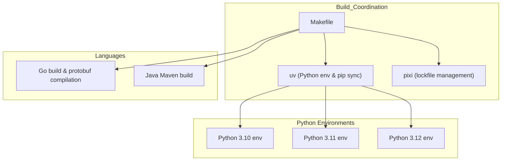
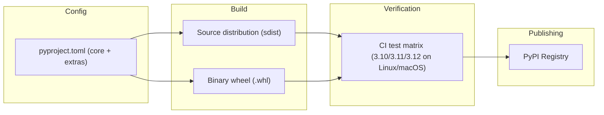
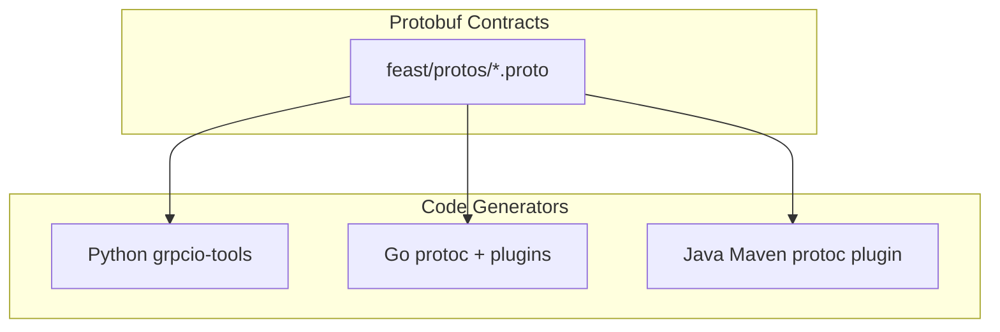
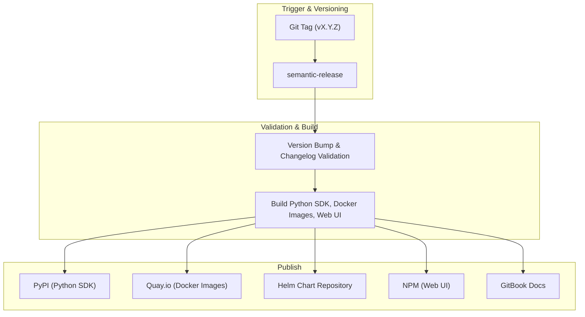

<!-- source: DeepWiki mcp.deepwiki.com · repo feast-dev/feast · page 6 Build and Release · fetched 2026-10-21 -->

# Build and Release

Relevant source files

The following files were used as context for generating this wiki page:

- [.github/fork_workflows/fork_pr_integration_tests_aws.yml](.github/fork_workflows/fork_pr_integration_tests_aws.yml)
- [.github/fork_workflows/fork_pr_integration_tests_gcp.yml](.github/fork_workflows/fork_pr_integration_tests_gcp.yml)
- [.github/fork_workflows/fork_pr_integration_tests_snowflake.yml](.github/fork_workflows/fork_pr_integration_tests_snowflake.yml)
- [.github/workflows/build_wheels.yml](.github/workflows/build_wheels.yml)
- [.github/workflows/linter.yml](.github/workflows/linter.yml)
- [.github/workflows/master_only.yml](.github/workflows/master_only.yml)
- [.github/workflows/nightly-ci.yml](.github/workflows/nightly-ci.yml)
- [.github/workflows/pr_integration_tests.yml](.github/workflows/pr_integration_tests.yml)
- [.github/workflows/pr_local_integration_tests.yml](.github/workflows/pr_local_integration_tests.yml)
- [.github/workflows/publish.yml](.github/workflows/publish.yml)
- [.github/workflows/release.yml](.github/workflows/release.yml)
- [.github/workflows/unit_tests.yml](.github/workflows/unit_tests.yml)
- [.releaserc.js](.releaserc.js)
- [Makefile](Makefile)
- [pixi.lock](pixi.lock)
- [pyproject.toml](pyproject.toml)
- [sdk/python/requirements/py3.10-ci-requirements.txt](sdk/python/requirements/py3.10-ci-requirements.txt)
- [sdk/python/requirements/py3.10-minimal-requirements.txt](sdk/python/requirements/py3.10-minimal-requirements.txt)
- [sdk/python/requirements/py3.10-minimal-sdist-requirements.txt](sdk/python/requirements/py3.10-minimal-sdist-requirements.txt)
- [sdk/python/requirements/py3.10-requirements.txt](sdk/python/requirements/py3.10-requirements.txt)
- [sdk/python/requirements/py3.11-ci-requirements.txt](sdk/python/requirements/py3.11-ci-requirements.txt)
- [sdk/python/requirements/py3.11-minimal-requirements.txt](sdk/python/requirements/py3.11-minimal-requirements.txt)
- [sdk/python/requirements/py3.11-minimal-sdist-requirements.txt](sdk/python/requirements/py3.11-minimal-sdist-requirements.txt)
- [sdk/python/requirements/py3.11-requirements.txt](sdk/python/requirements/py3.11-requirements.txt)
- [sdk/python/requirements/py3.12-ci-requirements.txt](sdk/python/requirements/py3.12-ci-requirements.txt)
- [sdk/python/requirements/py3.12-minimal-requirements.txt](sdk/python/requirements/py3.12-minimal-requirements.txt)
- [sdk/python/requirements/py3.12-minimal-sdist-requirements.txt](sdk/python/requirements/py3.12-minimal-sdist-requirements.txt)

This page provides a high-level overview of Feast's build system, dependency management, multi-language packaging for Python, Java, and Go, and the automated release process. Feast coordinates multiple language runtimes and artifact registries to deliver a unified feature store ecosystem.

For deep technical details, see the child pages:
- [Build System and Dependency Management](#6.1)
- [Python SDK Packaging](#6.2)
- [Multi-Language Support and Protocol Buffers](#6.3)
- [Release Process and Versioning](#6.4)

---

## Build System and Dependency Management

Feast uses a centralized `Makefile` as the core orchestrator of build targets for compiling protobufs, building Docker images, running tests, formatting, and linting across Python, Go, and Java components [Makefile:1-160](). The `Makefile` also manages virtual environments and tool installation in the project-local `tools/` directory to avoid polluting global paths [Makefile:17-23]().

Python dependencies are managed with [`uv`](https://github.com/astral-sh/uv), a fast Python environment manager that installs packages strictly according to hashed requirements for reproducible and isolated builds [Makefile:93-121](). Multiple `requirements` files target different Python versions (3.10, 3.11, 3.12) and usage profiles (CI, production, minimal installs) with locks generated by `pixi` to ensure consistency across platforms and Python versions [Makefile:132-160]().

This multi-tool coordination supports seamless environment setup, dependency syncing, and cross-language protobuf compilation workflows.

### Build System Coordination Architecture

Sources: [Makefile:1-160](), [pyproject.toml:1-227]()

For details on available Makefile targets, Python dependency pinning strategies, lockfile generation with pixi, and the overall multi-language build coordination, see [Build System and Dependency Management](#6.1).

---

## Python SDK Packaging

The Python SDK packaging configuration is defined in `pyproject.toml`, which specifies core runtime dependencies and a comprehensive catalog of optional extras to support various cloud providers (AWS, GCP, Azure), online/offline stores (Redis, Snowflake, Postgres, Milvus, etc.), and AI/ML related features (pytorch, rag, mlflow) [pyproject.toml:1-227]().

Wheels (`.whl`) and source distributions (`sdist`) are built using standard Python packaging tools in CI workflows [.github/workflows/build_wheels.yml:49-88](). Post-build, the wheel artifacts go through cross-platform installation and verification tests on multiple Python versions and OS configurations [.github/workflows/build_wheels.yml:131-182]() to ensure compatibility and correctness.

Optional dependency extras enable installing minimal or extended feature sets as needed for various deployment scenarios, with separate minimal-sdist profiles for lean source distributions.

### Python SDK Packaging Flow

Sources: [pyproject.toml:1-227](), [.github/workflows/build_wheels.yml:49-182]()

For details on optional extras, wheel and sdist build profiles including minimal-sdist builds, and PyPI publishing workflows, see [Python SDK Packaging](#6.2).

---

## Multi-Language Support and Protocol Buffers

Feast supports polyglot clients in Python, Java, and Go through a unified set of Protocol Buffer definitions stored in `.proto` files. These protobuf contracts define the canonical data schema and RPC service interfaces shared across the entire ecosystem.

The root `Makefile` includes targets to compile these protobufs for each language using respective tooling: `protoc` with Go plugins, Maven protobuf compilation for Java, and Python grpcio-tools [Makefile:24](), [.github/workflows/unit_tests.yml:116-121]().

This shared contract approach ensures consistent serialization, data typing, and versioning across language boundaries and enables the type system bridging described elsewhere.

### Polyglot Protocol Buffers Compilation Architecture

Sources: [Makefile:24](), [.github/workflows/unit_tests.yml:117-121]()

For comprehensive details on protobuf definition organization, generation workflows, and multi-language client stubs, see [Multi-Language Support and Protocol Buffers](#6.3).

---

## Release Process and Versioning

Feast utilizes `semantic-release` for automated semantic versioning, changelog generation, and version bumping across multiple submodules, including Python SDK, Java SDK, Helm charts, web UI, and operators. This process is codified in GitHub Actions workflows orchestrated in `.github/workflows/release.yml` and `.github/workflows/publish.yml` [ .github/workflows/release.yml:54-132 ](), [ .github/workflows/publish.yml:1-73 ]().

Releases begin with dry run validation of version bumps, file updates, and build verification. Upon approval, artifacts are published: Python packages to PyPI, Docker images to Quay.io, Helm charts to chart repositories, and web UI components to NPM. The workflow also supports manual triggering, dry runs, and controlled publishing of documentation versions.

### Release and Publication Pipeline

Sources: [.github/workflows/release.yml:50-132](), [.github/workflows/publish.yml:1-73]()

For detailed explanation of version bump scripts, changelog management, artifact signing, publishing steps, and documentation deployment, see [Release Process and Versioning](#6.4).

---

# Summary

The build and release architecture in Feast is designed to handle a multifaceted project involving multiple languages (Python, Go, Java), strict dependency versioning, reproducible environment setup, and cross-platform packaging. The combination of `Makefile` orchestration, locked Python dependency sets managed by `uv` and `pixi`, protobuf compilation for clients in all supported languages, and an automated version-controlled release pipeline ensures consistent, stable delivery of Feast artifacts across its ecosystem.

The child pages provide detailed instructions and deep technical coverage for each part:
- [Build System and Dependency Management](#6.1)
- [Python SDK Packaging](#6.2)
- [Multi-Language Support and Protocol Buffers](#6.3)
- [Release Process and Versioning](#6.4)

Sources:  
[Makefile:1-160](), [pyproject.toml:1-227](), [.github/workflows/unit_tests.yml:116-121](), [.github/workflows/release.yml:54-132](), [.github/workflows/publish.yml:1-73](), [.github/workflows/build_wheels.yml:49-182]()

---

