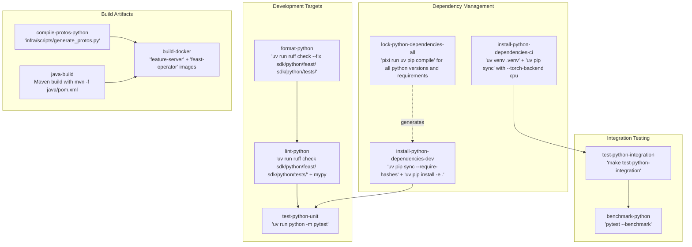
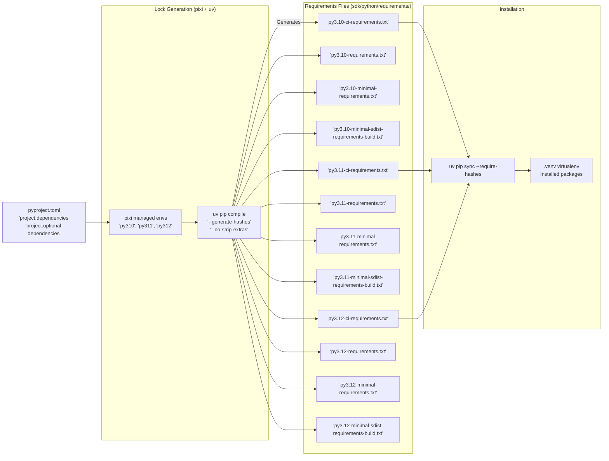
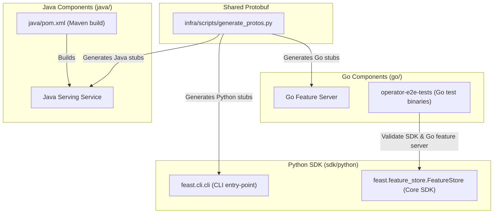

<!-- source: DeepWiki mcp.deepwiki.com · repo feast-dev/feast · page 6.1 Build System and Dependency Management · fetched 2026-10-21 -->

# Build System and Dependency Management

<details>
<summary>Relevant source files</summary>

The following files were used as context for generating this wiki page:

- [.github/fork_workflows/fork_pr_integration_tests_aws.yml](.github/fork_workflows/fork_pr_integration_tests_aws.yml)
- [.github/fork_workflows/fork_pr_integration_tests_gcp.yml](.github/fork_workflows/fork_pr_integration_tests_gcp.yml)
- [.github/fork_workflows/fork_pr_integration_tests_snowflake.yml](.github/fork_workflows/fork_pr_integration_tests_snowflake.yml)
- [.github/workflows/build_wheels.yml](.github/workflows/build_wheels.yml)
- [.github/workflows/linter.yml](.github/workflows/linter.yml)
- [.github/workflows/master_only.yml](.github/workflows/master_only.yml)
- [.github/workflows/nightly-ci.yml](.github/workflows/nightly-ci.yml)
- [.github/workflows/pr_integration_tests.yml](.github/workflows/pr_integration_tests.yml)
- [.github/workflows/pr_local_integration_tests.yml](.github/workflows/pr_local_integration_tests.yml)
- [.github/workflows/publish.yml](.github/workflows/publish.yml)
- [.github/workflows/release.yml](.github/workflows/release.yml)
- [.github/workflows/unit_tests.yml](.github/workflows/unit_tests.yml)
- [.gitignore](.gitignore)
- [.releaserc.js](.releaserc.js)
- [Makefile](Makefile)
- [infra/feast-operator/.gitignore](infra/feast-operator/.gitignore)
- [infra/feast-operator/PROJECT](infra/feast-operator/PROJECT)
- [infra/feast-operator/config/crd/kustomization.yaml](infra/feast-operator/config/crd/kustomization.yaml)
- [infra/website/docs/blog/feature-transformation-latency.md](infra/website/docs/blog/feature-transformation-latency.md)
- [infra/website/public/images/blog/latency.png](infra/website/public/images/blog/latency.png)
- [pixi.lock](pixi.lock)
- [pyproject.toml](pyproject.toml)
- [sdk/python/requirements/py3.10-ci-requirements.txt](sdk/python/requirements/py3.10-ci-requirements.txt)
- [sdk/python/requirements/py3.10-minimal-requirements.txt](sdk/python/requirements/py3.10-minimal-requirements.txt)
- [sdk/python/requirements/py3.10-minimal-sdist-requirements.txt](sdk/python/requirements/py3.10-minimal-sdist-requirements.txt)
- [sdk/python/requirements/py3.10-requirements.txt](sdk/python/requirements/py3.10-requirements.txt)
- [sdk/python/requirements/py3.11-ci-requirements.txt](sdk/python/requirements/py3.11-ci-requirements.txt)
- [sdk/python/requirements/py3.11-minimal-requirements.txt](sdk/python/requirements/py3.11-minimal-requirements.txt)
- [sdk/python/requirements/py3.11-minimal-sdist-requirements.txt](sdk/python/requirements/py3.11-minimal-sdist-requirements.txt)
- [sdk/python/requirements/py3.11-requirements.txt](sdk/python/requirements/py3.11-requirements.txt)
- [sdk/python/requirements/py3.12-ci-requirements.txt](sdk/python/requirements/py3.12-ci-requirements.txt)
- [sdk/python/requirements/py3.12-minimal-requirements.txt](sdk/python/requirements/py3.12-minimal-requirements.txt)
- [sdk/python/requirements/py3.12-minimal-sdist-requirements.txt](sdk/python/requirements/py3.12-minimal-sdist-requirements.txt)
- [sdk/python/requirements/py3.12-requirements.txt](sdk/python/requirements/py3.12-requirements.txt)

</details>


## Purpose and Scope

This page documents the build system, dependency management infrastructure, packaging mechanisms, and multi-language coordination workflows across the Feast codebase. It explains how the project orchestrates dependencies and build targets across Python, Go, and Java components, utilizing modern tooling such as `Makefile`, `uv`, `pixi`, and `pyproject.toml`.

Sources: [Makefile:1-160](), [pyproject.toml:1-227]()

---

## Build Orchestration with Makefile

The root `Makefile` serves as the primary entry point for all build, test, lint, and packaging operations within Feast [Makefile:1-160](). This centralized control uses phony targets and environment variables to coordinate workflows spanning Python, Go, and Java components.

### Core Makefile Targets and Their Role

The Makefile provides a structured set of targets for common development operations such as formatting, linting, testing, protobuf compilation, dependency management, and building Docker images. It defines key environment variables to dynamically adapt behavior per platform and Python version.

Below is an overview diagram mapping major Makefile targets to technical commands or scripts. It bridges natural language descriptions used by developers to exact code invocations and files.



Sources: [Makefile:44-57](), [Makefile:93-159]()

### Key Makefile Variables and Concepts

| Variable            | Purpose                                | Location/Value                                                           |
|---------------------|--------------------------------------|-------------------------------------------------------------------------|
| `PYTHON_VERSION`     | Current detected Python version       | Set via `python --version | grep -Eo '[0-9]\.[0-9]+'` [Makefile:30]()    |
| `PYTHON_VERSIONS`    | Supported Python versions for locking | `3.10 3.11 3.12` array [Makefile:32]()                                 |
| `MVN`               | Maven command for Java builds         | `mvn -f java/pom.xml ${MAVEN_EXTRA_OPTS}` [Makefile:24]()               |
| `TOOL_DIR`           | Directory for installed CLI tools     | `$(ROOT_DIR)/tools`, binaries installed under `$(TOOL_DIR)/bin` [Makefile:20-22]() |

Sources: [Makefile:17-36]()

### Development Workflow Targets

The Makefile uses `uv run` wrappers to ensure tools run within the isolated project environment, preserving consistent dependency resolution and reproducible runs. This protects the system environment from pollution.

Important targets include:

| Target                   | Command                                                                                 | Description                                                   |
|--------------------------|-----------------------------------------------------------------------------------------|---------------------------------------------------------------|
| `format-python`          | `uv run ruff check --fix sdk/python/feast/ sdk/python/tests/`                            | Automatically fixes style and linting issues                  |
| `lint-python`            | `uv run ruff check sdk/python/feast/ sdk/python/tests/` + `uv run mypy feast`             | Runs static analysis and type checks                          |
| `test-python-unit`       | `uv run python -m pytest`                                                               | Executes unit tests for the Python SDK                        |
| `precommit-check`        | Sequential `format-python` and `lint-python`                                            | Combined pre-commit validation                                |
| `install-precommit`      | Runs `pre-commit install` hooks after installing `pre-commit` via `uv pip install`       | Installs git pre-commit hooks for lint/commit-msg checks     |

Sources: [Makefile:47-89]()

---

## Python Dependency Management

Feast uses **uv** as its primary Python dependency management tool. `uv` offers fast and consistent dependency resolution with reproducible lockfiles containing secure hashes and supports multiple Python versions. Dependencies are declared in `pyproject.toml` and compiled to versioned requirements files under `sdk/python/requirements/`.

### Flow from Pyproject.toml to Lockfiles and Install

Dependencies are specified in `pyproject.toml` under `[project]` and `[project.optional-dependencies]`. Those definitions feed into Pixi-managed environments that generate version-specific requirements files.



Sources: [Makefile:132-159](), [sdk/python/requirements/py3.10-ci-requirements.txt:1-10](), [sdk/python/requirements/py3.11-ci-requirements.txt:1-10](), [pyproject.toml:1-227]()

### Dependency Sets

Feast's dependency management uses multiple sets and extras for different use-cases and environments:

| Dependency Set       | Extra Name           | Purpose and Description |
|----------------------|---------------------|-------------------------|
| Base Requirements    | (none)              | Core Feast functionality, including `fastapi`, `pandas`, `pyarrow`, `pydantic`, etc. [pyproject.toml:16-49]() |
| CI Testing Dependencies | `ci`               | Full test suite dependencies, cloud provider clients, storage backends [pyproject.toml:168-200]() |
| Minimal              | `minimal`            | Slim dependencies for runtime in container images [pyproject.toml:205]() |
| Minimal Sdist Build  | `minimal-sdist-build`| Build-time dependencies and platform-specific patches for source dist [pyproject.toml:206-227]() |
| NLP and RAG          | `nlp`                | Extras for GenAI, embeddings, RAG workflows [pyproject.toml:201]() |

Sources: [pyproject.toml:51-227](), [Makefile:136-159]()

### Locking and Compilation Implementation

The Makefile target `lock-python-dependencies-all` automates lockfile regeneration for all supported Python versions using Pixi environments. It runs multiple `uv pip compile` commands specifying extras and CPU-only backends where appropriate. The command sequences also install pinned requirements build deps for minimal sdist builds.

Excerpt from Makefile:

```makefile
lock-python-dependencies-all: ## Recompile and lock all Python dependency sets for all supported versions
	rm -rf sdk/python/requirements/* 2>/dev/null || true
	$(foreach ver,$(PYTHON_VERSIONS),\
		pixi run --environment $(call get_env_name,$(ver)) --manifest-path infra/scripts/pixi/pixi.toml \
			"uv pip compile -p $(ver) --universal --no-strip-extras pyproject.toml --extra ci \
			--torch-backend cpu \
			--generate-hashes --output-file sdk/python/requirements/py$(ver)-ci-requirements.txt" && \
		pixi run --environment $(call get_env_name,$(ver)) --manifest-path infra/scripts/pixi/pixi.toml \
			"uv pip compile -p $(ver) --no-strip-extras pyproject.toml \
			--generate-hashes --output-file sdk/python/requirements/py$(ver)-requirements.txt" && \
		pixi run --environment $(call get_env_name,$(ver)) --manifest-path infra/scripts/pixi/pixi.toml \
			"uv pip compile -p $(ver) --no-strip-extras pyproject.toml --extra minimal \
			--generate-hashes --output-file sdk/python/requirements/py$(ver)-minimal-requirements.txt" && \
		pixi run --environment $(call get_env_name,$(ver)) --manifest-path infra/scripts/pixi/pixi.toml \
			"uv pip compile -p $(ver) --no-strip-extras pyproject.toml --extra minimal-sdist-build \
			--no-emit-package milvus-lite \
			--no-emit-package pymilvus \
			--no-emit-package faiss-cpu \
			--generate-hashes --output-file sdk/python/requirements/py$(ver)-minimal-sdist-requirements.txt" && \
		pixi run --environment $(call get_env_name,$(ver)) --manifest-path infra/scripts/pixi/pixi.toml \
			"uv pip install -p $(ver) pybuild-deps==0.5.0 pip==25.0.1 typing_extensions && \
			pybuild-deps compile --generate-hashes \
			-o sdk/python/requirements/py$(ver)-minimal-sdist-requirements-build.txt \
			sdk/python/requirements/py$(ver)-minimal-sdist-requirements.txt" && \
	) true
```

Sources: [Makefile:132-159]()

---

## Polyglot Build Coordination

Feast is a polyglot project composed of Python, Go, and Java components. Coordination between these languages is managed via the Makefile and reinforced through GitHub Actions workflows.

### Component Association Diagram



### Coordination Details

- **Protobuf compilation**: Compiled from common `.proto` files, generating source code for Python, Go, and Java. The Makefile target `protos` invokes this compilation with a dedicated script [Makefile:53]().

- **Java build**: The Java serving module uses Maven (`MVN`) with the POM file located at `java/pom.xml` for lifecycle management and dependency resolution [Makefile:24]().

- **Go build and tests**: The Go feature server and Kubernetes operator components are compiled and tested as part of the CI pipeline, integrating with the Python SDK code tests [GitHub Actions: .github/workflows/unit_tests.yml:94-142](), [release.yml:166-170]().

- **Web UI**: The React UI located under `ui/` is built using `yarn` and then bundled into the Python SDK to facilitate integrated deployment, managed independently but coordinated in CI [GitHub Actions: .github/workflows/unit_tests.yml:144-170]().

Sources: [Makefile:24-60](), [Makefile:53-60](), [.github/workflows/unit_tests.yml:22-170](), [.github/workflows/release.yml:130-170]()

---

## Installation Workflows

### Development Installation (Editable)

To enable fast local development iterations, Feast supports an editable install for Python dependencies:

```bash
make install-python-dependencies-dev
```

- This target uses `uv pip sync --require-hashes` to install pinned development dependencies from the version-specific CI requirements file.
- It installs Feast in editable mode (`pip install -e .`), allowing live edits without reinstall.

Sources: [Makefile:93-96]()

### Continuous Integration Installation

The CI setup installs dependencies in isolated Python virtual environments created via `uv venv .venv`.

```bash
make install-python-dependencies-ci
```

- Creates `.venv` if it does not exist.
- Installs dependencies from version-specific CI requirement files using `uv pip sync`.
- Applies the `--torch-backend cpu` flag to prevent downloading CUDA-linked PyTorch wheels in CI, reducing size and improving cacheability.

Sources: [Makefile:106-117](), [.github/workflows/unit_tests.yml:44-48]()

---

## Summary

Feast's build system uses a unified Makefile to orchestrate dependency management, code generation, compilation, testing, and packaging operations across Python, Go, and Java components. It relies on `uv` for Python dependency management with cryptographically secure lockfiles generated per supported Python version via Pixi environments. The polyglot build setup integrates protobuf generation for all languages, Maven for Java, and Go build tooling, ensuring consistent multi-language delivery. Dedicated CI workflows use these targets for repeatable environment setups and build validations.

Sources:  
[Makefile:1-160](), [pyproject.toml:1-227](), [sdk/python/requirements/py3.10-ci-requirements.txt:1-10](), [sdk/python/requirements/py3.11-ci-requirements.txt:1-10](), [.github/workflows/unit_tests.yml:22-170](), [.github/workflows/release.yml:82-133](), [.github/workflows/publish.yml:1-73](), [.github/workflows/build_wheels.yml:1-182]()

---

