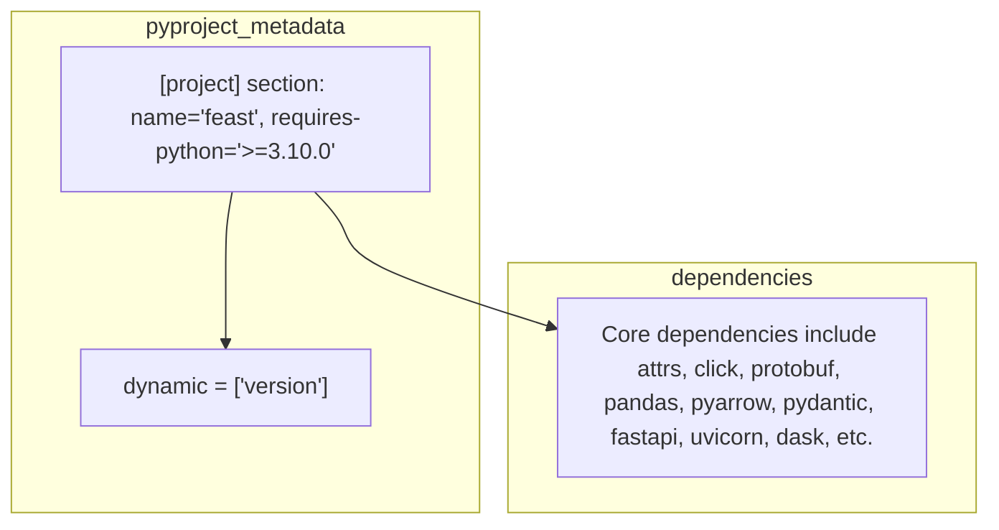
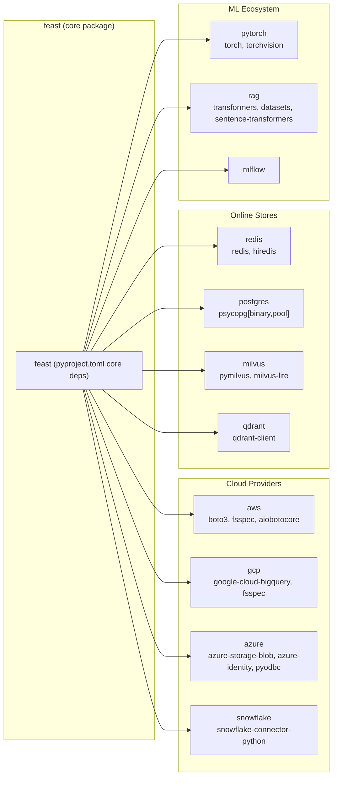
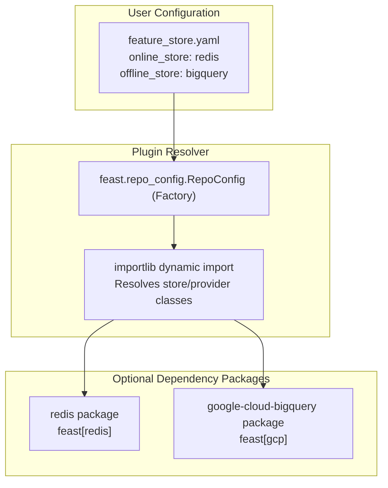
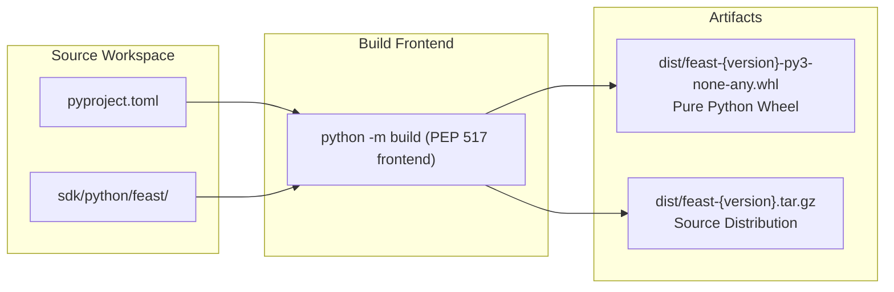
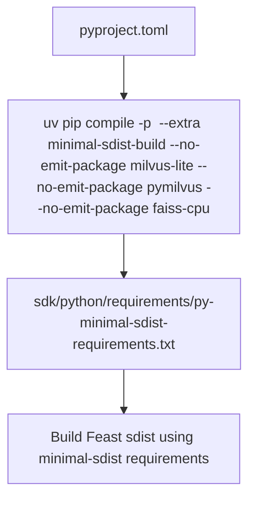
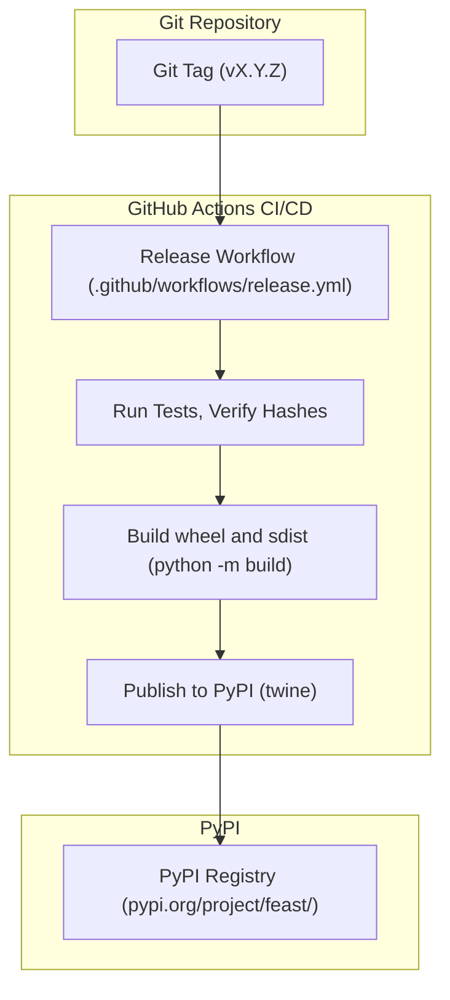
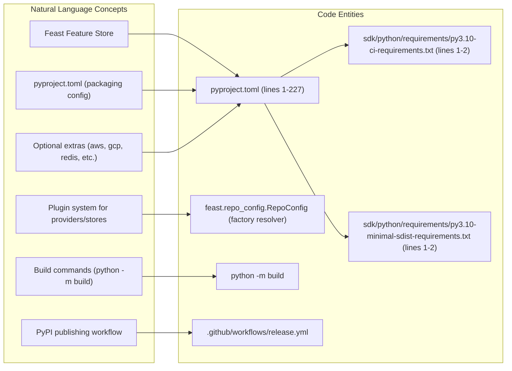

<!-- source: DeepWiki mcp.deepwiki.com · repo feast-dev/feast · page 6.2 Python SDK Packaging · fetched 2026-10-21 -->

# Python SDK Packaging

<details>
<summary>Relevant source files</summary>

The following files were used as context for generating this wiki page:

- [.readthedocs.yml](.readthedocs.yml)
- [docs/reference/offline-stores/dask.md](docs/reference/offline-stores/dask.md)
- [pixi.lock](pixi.lock)
- [pyproject.toml](pyproject.toml)
- [sdk/python/docs/Makefile](sdk/python/docs/Makefile)
- [sdk/python/docs/index.rst](sdk/python/docs/index.rst)
- [sdk/python/docs/requirements.txt](sdk/python/docs/requirements.txt)
- [sdk/python/docs/source/feast.infra.contrib.rst](sdk/python/docs/source/feast.infra.contrib.rst)
- [sdk/python/docs/source/feast.infra.feature_servers.rst](sdk/python/docs/source/feast.infra.feature_servers.rst)
- [sdk/python/docs/source/feast.infra.materialization.rst](sdk/python/docs/source/feast.infra.materialization.rst)
- [sdk/python/docs/source/feast.infra.offline_stores.rst](sdk/python/docs/source/feast.infra.offline_stores.rst)
- [sdk/python/docs/source/feast.infra.online_stores.rst](sdk/python/docs/source/feast.infra.online_stores.rst)
- [sdk/python/docs/source/feast.infra.registry.contrib.rst](sdk/python/docs/source/feast.infra.registry.contrib.rst)
- [sdk/python/docs/source/feast.infra.rst](sdk/python/docs/source/feast.infra.rst)
- [sdk/python/docs/source/feast.infra.transformation_servers.rst](sdk/python/docs/source/feast.infra.transformation_servers.rst)
- [sdk/python/docs/source/feast.protos.feast.core.rst](sdk/python/docs/source/feast.protos.feast.core.rst)
- [sdk/python/docs/source/feast.rst](sdk/python/docs/source/feast.rst)
- [sdk/python/docs/source/index.rst](sdk/python/docs/source/index.rst)
- [sdk/python/feast/__init__.py](sdk/python/feast/__init__.py)
- [sdk/python/feast/version.py](sdk/python/feast/version.py)
- [sdk/python/requirements/py3.10-ci-requirements.txt](sdk/python/requirements/py3.10-ci-requirements.txt)
- [sdk/python/requirements/py3.10-minimal-requirements.txt](sdk/python/requirements/py3.10-minimal-requirements.txt)
- [sdk/python/requirements/py3.10-minimal-sdist-requirements-build.txt](sdk/python/requirements/py3.10-minimal-sdist-requirements-build.txt)
- [sdk/python/requirements/py3.10-minimal-sdist-requirements.txt](sdk/python/requirements/py3.10-minimal-sdist-requirements.txt)
- [sdk/python/requirements/py3.10-requirements.txt](sdk/python/requirements/py3.10-requirements.txt)
- [sdk/python/requirements/py3.11-ci-requirements.txt](sdk/python/requirements/py3.11-ci-requirements.txt)
- [sdk/python/requirements/py3.11-minimal-requirements.txt](sdk/python/requirements/py3.11-minimal-requirements.txt)
- [sdk/python/requirements/py3.11-minimal-sdist-requirements-build.txt](sdk/python/requirements/py3.11-minimal-sdist-requirements-build.txt)
- [sdk/python/requirements/py3.11-minimal-sdist-requirements.txt](sdk/python/requirements/py3.11-minimal-sdist-requirements.txt)
- [sdk/python/requirements/py3.11-requirements.txt](sdk/python/requirements/py3.11-requirements.txt)
- [sdk/python/requirements/py3.12-ci-requirements.txt](sdk/python/requirements/py3.12-ci-requirements.txt)
- [sdk/python/requirements/py3.12-minimal-requirements.txt](sdk/python/requirements/py3.12-minimal-requirements.txt)
- [sdk/python/requirements/py3.12-minimal-sdist-requirements-build.txt](sdk/python/requirements/py3.12-minimal-sdist-requirements-build.txt)
- [sdk/python/requirements/py3.12-minimal-sdist-requirements.txt](sdk/python/requirements/py3.12-minimal-sdist-requirements.txt)

</details>


## Overview and Scope

This page details the packaging configuration, dependency management, build processes, and distribution pipeline for the Feast Python SDK (`feast`). Feast is distributed as a standard Python package supporting Python 3.10 and above [pyproject.toml:5](). It leverages modern PEP 517/518 build standards [pyproject.toml:1-15](), a modular extras architecture [pyproject.toml:51-148](), and cryptographically verified lock files [sdk/python/requirements/py3.10-ci-requirements.txt:1-2]() to support everything from minimal edge feature servers to full cloud-native data platforms.

Sources: [pyproject.toml:5](), [pyproject.toml:51-148](), [pyproject.toml:1-15](), [sdk/python/requirements/py3.10-ci-requirements.txt:1-2]()

---

## pyproject.toml Configuration

The primary packaging and build specification for Feast resides in `pyproject.toml`. It provides metadata about the project, core dependencies, optional dependency groups (extras), and dynamic versioning configuration.

### Metadata and Core Dependencies

The `[project]` section specifies the name ("feast"), description, minimum supported Python version (>=3.10), license info, and core dependencies required for installing Feast in its base form [pyproject.toml:1-49]().

```toml
[project]
name = "feast"
description = "Python SDK for Feast"
readme = "README.md"
requires-python = ">=3.10.0"
license = "Apache-2.0"
license-files = ["LICENSE"]
dynamic = ["version"]

dependencies = [
    "attrs",
    "click>=7.0.0,<9.0.0",
    "colorama>=0.3.9,<1",
    "dill>=0.3.0,<0.5",
    "protobuf>=4.24.0",
    "Jinja2>=2,<4",
    "mmh3",
    "numpy>=2.0.0,<3",
    "pandas>=1.4.3,<3",
    "pyarrow>=16.1.0",
    "pydantic>=2.10.6",
    "pygments>=2.12.0,<3",
    "PyYAML>=5.4.0,<7",
    "requests",
    "SQLAlchemy[mypy]>1",
    "tabulate>=0.8.0,<1",
    "tenacity>=7,<9",
    "toml>=0.10.0,<1",
    "tqdm>=4,<5",
    "typeguard>=4.0.0",
    "fastapi>=0.68.0",
    "starlette>=1.0.1",
    "uvicorn[standard]>=0.30.6",
    "uvicorn-worker",
    "gunicorn; platform_system != 'Windows'",
    "dask[dataframe]>=2024.2.1",
    "prometheus_client>=0.20.0,<0.25.0",
    "psutil",
    "bigtree>=0.19.2",
    "pyjwt>=2.13.0"
]
```

This collection covers typical runtime libraries for config parsing, HTTP serving, serialization, data frames, async I/O, monitoring, and job scheduling, among others.



Sources: [pyproject.toml:1-49]()

---

## Optional Dependency Extras

Feast defines multiple optional dependency groups under `[project.optional-dependencies]`. These "extras" isolate heavier or optional features such as cloud SDKs, database drivers, ML libraries, and integration tooling. This modular design allows users to install only the dependencies relevant to their use case.

### Key Extras and Their Dependencies

| Extra Name          | Representative Dependencies                                                                                                            | Typical Use Case                                           |
|---------------------|---------------------------------------------------------------------------------------------------------------------------------------|------------------------------------------------------------|
| `aws`               | `boto3>=1.38.27`, `fsspec>=2024.1.0`, `aiobotocore>=2`                                                                              | AWS cloud storage and compute integration                  |
| `gcp`               | `google-cloud-bigquery[pandas]>=2`, `google-cloud-storage>=1.34.0`, `fsspec`                                                         | Google Cloud Platform support                              |
| `azure`             | `azure-storage-blob>=0.37.0`, `azure-identity>=1.6.1`, `pyodbc>=4.0.30`                                                              | Azure Blob storage and database integration                |
| `redis`             | `redis>=4.2.2,<8`, `hiredis>=2.0.0,<4`                                                                                              | Redis online store                                         |
| `postgres`          | `psycopg[binary,pool]>=3.2.5`                                                                                                       | Postgres online store                                     |
| `milvus`            | `pymilvus>=2.5`, `milvus-lite>=2.4.12`, `feast[setuptools]`                                                                           | Milvus vector database integration                        |
| `pytorch`           | `torch>=2.7.0`, `torchvision>=0.22.1`                                                                                               | PyTorch ML model support                                  |
| `rag`               | `transformers>=4.36.0`, `datasets>=3.6.0`, `sentence-transformers>=3.0.0`                                                             | Retrieval augmented generation workflows                   |
| `mlflow`            | `mlflow>=2.10.0`                                                                                                                    | MLflow integration for model tracking                     |
| `test`              | `pytest>=6.0.0,<8`, `pytest-xdist>=3.8.0`, `pytest-cov>=5.0.0`, `pytest-timeout==1.4.2`, plus other testing tools                     | Testing and CI/CD dependencies                            |
| `ci`                | Aggregates `test` plus all major extras for full environment in CI workflows                                                         | Complete CI environments for integration testing          |
| `minimal`           | Core cloud and online/offline store minimal support for lightweight deployments                                                       | Minimal feature server deployment                          |
| `minimal-sdist-build` | Build-time dependencies for creating a minimal source distribution, excluding some large native packages                             | Sdist build in Docker and CI                               |

### Extras Dependency Graph



By selectively installing, for example, `pip install feast[aws,redis]`, users add only the AWS and Redis dependencies in addition to core Feast.

Sources: [pyproject.toml:51-148]()

---

## Plugin System Distribution and Loading

Feast implements a plugin system allowing extensibility for backend storage, providers, and registries. Plugins are distributed as optional dependencies and dynamically loaded at runtime through Python's `importlib` and configuration.

### Plugin Resolution Flow

When a user configures Feast via `feature_store.yaml` (e.g., specifying `"online_store": "redis"`, `"offline_store": "bigquery"`), the Python SDK dynamically resolves the corresponding classes for these stores/providers using path definitions registered in the package metadata or discovered dynamically.



If a required plugin dependency (e.g., `redis` or `google-cloud-bigquery`) is not installed, the dynamic import fails, guiding users to install the proper extra.

This system avoids bundling all heavy cloud and database dependencies into the core, reducing footprint and complexity.

Sources: [pyproject.toml:51-148]()

---

## Wheel and Source Distribution (sdist) Builds

Feast uses PEP 517-compatible backend tooling to build and package the Python SDK as both wheel and source distribution artifacts.

### Build Process

The standard Python build frontend is used to convert the source workspace and metadata into binary wheel and source tarball artifacts.



Typical commands:

```bash
pip install build
python -m build
```

This produces `dist/` directory artifacts that can be locally tested or uploaded to PyPI.

Sources: [pyproject.toml:1-49]()

---

## Minimal Sdist Build Profiles

Feast defines two key minimal profile extras: `minimal` and `minimal-sdist-build` for optimizing packaging size and runtime dependencies for constrained environments or container images.

### `minimal` Extra

This extra includes a streamlined group of cloud providers, backend stores, and telemetry needed for a light feature server deployment. For example, AWS, GCP, Snowflake, Redis, Go, MySQL, Postgres, OpenTelemetry, gRPC, Kubernetes, DuckDB, and MCP dependencies are included [pyproject.toml:205]().

### `minimal-sdist-build` Extra

This extends `minimal` by adding build-time dependencies required for building the source distribution (sdist), excluding large packages such as `milvus-lite`, `pymilvus`, and `faiss-cpu` which are complicated native extensions [pyproject.toml:206-227]().

### Minimal Sdist Build Flow



Separate minimal sdist requirements files are generated and maintained per Python minor version: e.g.,

- `py3.10-minimal-sdist-requirements.txt` [sdk/python/requirements/py3.10-minimal-sdist-requirements.txt:1-2]()
- `py3.11-minimal-sdist-requirements.txt` [sdk/python/requirements/py3.11-minimal-sdist-requirements.txt:1-2]()
- `py3.12-minimal-sdist-requirements.txt` [sdk/python/requirements/py3.12-minimal-sdist-requirements.txt:1-2]()

This strategy improves packaging portability and reduces image sizes for feature server containers.

Sources: [pyproject.toml:205-227](), [sdk/python/requirements/py3.10-minimal-sdist-requirements.txt:1-2](), [sdk/python/requirements/py3.11-minimal-sdist-requirements.txt:1-2](), [sdk/python/requirements/py3.12-minimal-sdist-requirements.txt:1-2]()

---

## PyPI Publishing and Release Workflow

Releases to PyPI are automated using GitHub Actions workflows which trigger on Git tags. The build process compiles trusted binary and source artifacts which are verified and published securely.

### Publishing Workflow



### Reproducible and Audited Builds

For reproducibility, digital hashes for all dependencies are maintained in lockfiles per Python version and profile:

- CI lockfiles for 3.10, 3.11, 3.12: `py3.10-ci-requirements.txt` [sdk/python/requirements/py3.10-ci-requirements.txt:1-2](), `py3.11-ci-requirements.txt` [sdk/python/requirements/py3.11-ci-requirements.txt:1-2](), `py3.12-ci-requirements.txt` [sdk/python/requirements/py3.12-ci-requirements.txt:1-2]()
- Standard lockfiles without CI extras: `py3.10-requirements.txt` [sdk/python/requirements/py3.10-requirements.txt:1-2](), `py3.11-requirements.txt` [sdk/python/requirements/py3.11-requirements.txt:1-2]()

The minimal sdist build lockfiles ensure source distribution builds exclude large native dependencies and stay consistent.

Sources: [pyproject.toml:206-227](), [sdk/python/requirements/py3.10-ci-requirements.txt:1-2](), [sdk/python/requirements/py3.11-ci-requirements.txt:1-2](), [sdk/python/requirements/py3.12-ci-requirements.txt:1-2](), [sdk/python/requirements/py3.10-requirements.txt:1-2](), [sdk/python/requirements/py3.11-requirements.txt:1-2](), [sdk/python/requirements/py3.10-minimal-sdist-requirements.txt:1-2]()

---

# Summary Diagram: Natural Language to Code Entity Mapping



This mapping shows how the conceptual packaging and distribution processes correspond to specific code configuration files and classes in the Feast codebase.

Sources: All above listed files and line ranges.

---

# References

- `pyproject.toml`: primary packaging and dependencies configuration.
- Lock files in `sdk/python/requirements/`: verified dependency versions & hashes for CI, runtime, and minimal builds.
- Dynamic plugin system classes in `feast.repo_config`.
- Standard Python build frontend usage (`python -m build`).
- GitHub Actions workflows for automated releases (.github/workflows/release.yml).

Sources: All above citations.

---

