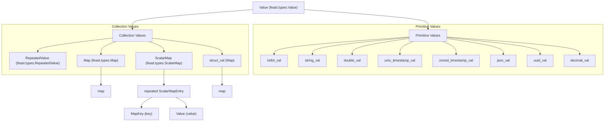
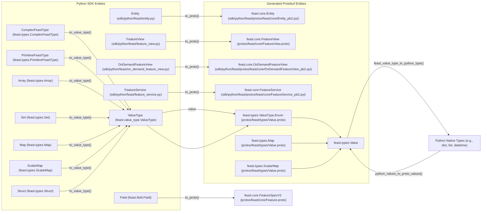
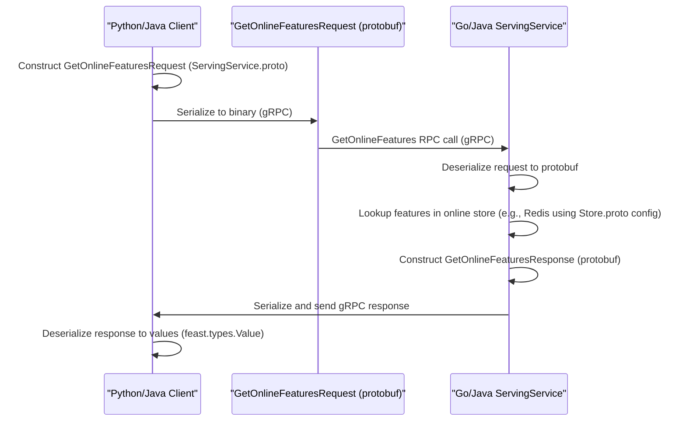

<!-- source: DeepWiki mcp.deepwiki.com · repo feast-dev/feast · page 6.3 Multi-Language Support and Protocol Buffers · fetched 2026-10-21 -->

# Multi-Language Support and Protocol Buffers

Relevant source files

The following files were used as context for generating this wiki page:

- [infra/terraform/aws/README.md](infra/terraform/aws/README.md)
- [infra/terraform/aws/eks.tf](infra/terraform/aws/eks.tf)
- [infra/terraform/aws/emr.tf](infra/terraform/aws/emr.tf)
- [infra/terraform/aws/helm.tf](infra/terraform/aws/helm.tf)
- [infra/terraform/aws/iam.tf](infra/terraform/aws/iam.tf)
- [infra/terraform/aws/msk.tf](infra/terraform/aws/msk.tf)
- [infra/terraform/aws/online_store.tf](infra/terraform/aws/online_store.tf)
- [infra/terraform/aws/outputs.tf](infra/terraform/aws/outputs.tf)
- [infra/terraform/aws/rds.tf](infra/terraform/aws/rds.tf)
- [infra/terraform/aws/s3.tf](infra/terraform/aws/s3.tf)
- [infra/terraform/aws/variables.tf](infra/terraform/aws/variables.tf)
- [protos/feast/core/FeatureView.proto](protos/feast/core/FeatureView.proto)
- [protos/feast/core/Store.proto](protos/feast/core/Store.proto)
- [protos/feast/serving/ServingService.proto](protos/feast/serving/ServingService.proto)
- [sdk/python/feast/infra/compute_engines/kubernetes/main.py](sdk/python/feast/infra/compute_engines/kubernetes/main.py)
- [sdk/python/feast/infra/compute_engines/local/feature_builder.py](sdk/python/feast/infra/compute_engines/local/feature_builder.py)
- [sdk/python/feast/protos/feast/core/DataFormat_pb2.pyi](sdk/python/feast/protos/feast/core/DataFormat_pb2.pyi)
- [sdk/python/feast/protos/feast/core/DataSource_pb2.py](sdk/python/feast/protos/feast/core/DataSource_pb2.py)
- [sdk/python/feast/protos/feast/core/DataSource_pb2.pyi](sdk/python/feast/protos/feast/core/DataSource_pb2.pyi)
- [sdk/python/feast/protos/feast/core/DatastoreTable_pb2.pyi](sdk/python/feast/protos/feast/core/DatastoreTable_pb2.pyi)
- [sdk/python/feast/protos/feast/core/Entity_pb2.pyi](sdk/python/feast/protos/feast/core/Entity_pb2.pyi)
- [sdk/python/feast/protos/feast/core/FeatureService_pb2.py](sdk/python/feast/protos/feast/core/FeatureService_pb2.py)
- [sdk/python/feast/protos/feast/core/FeatureService_pb2.pyi](sdk/python/feast/protos/feast/core/FeatureService_pb2.pyi)
- [sdk/python/feast/protos/feast/core/FeatureViewProjection_pb2.py](sdk/python/feast/protos/feast/core/FeatureViewProjection_pb2.py)
- [sdk/python/feast/protos/feast/core/FeatureViewProjection_pb2.pyi](sdk/python/feast/protos/feast/core/FeatureViewProjection_pb2.pyi)
- [sdk/python/feast/protos/feast/core/FeatureView_pb2.py](sdk/python/feast/protos/feast/core/FeatureView_pb2.py)
- [sdk/python/feast/protos/feast/core/FeatureView_pb2.pyi](sdk/python/feast/protos/feast/core/FeatureView_pb2.pyi)
- [sdk/python/feast/protos/feast/core/OnDemandFeatureView_pb2.py](sdk/python/feast/protos/feast/core/OnDemandFeatureView_pb2.py)
- [sdk/python/feast/protos/feast/core/OnDemandFeatureView_pb2.pyi](sdk/python/feast/protos/feast/core/OnDemandFeatureView_pb2.pyi)
- [sdk/python/feast/protos/feast/core/Project_pb2.pyi](sdk/python/feast/protos/feast/core/Project_pb2.pyi)
- [sdk/python/feast/protos/feast/core/Registry_pb2.py](sdk/python/feast/protos/feast/core/Registry_pb2.py)
- [sdk/python/feast/protos/feast/core/Registry_pb2.pyi](sdk/python/feast/protos/feast/core/Registry_pb2.pyi)
- [sdk/python/feast/protos/feast/core/Transformation_pb2.pyi](sdk/python/feast/protos/feast/core/Transformation_pb2.pyi)
- [sdk/python/feast/protos/feast/serving/ServingService_pb2.py](sdk/python/feast/protos/feast/serving/ServingService_pb2.py)
- [sdk/python/tests/benchmarks/test_bigquery_partition_pruning_benchmark.py](sdk/python/tests/benchmarks/test_bigquery_partition_pruning_benchmark.py)
- [sdk/python/tests/unit/infra/offline_stores/contrib/spark_offline_store/test_spark_bfv_compute_on_read.py](sdk/python/tests/unit/infra/offline_stores/contrib/spark_offline_store/test_spark_bfv_compute_on_read.py)
- [sdk/python/tests/unit/infra/offline_stores/test_bigquery.py](sdk/python/tests/unit/infra/offline_stores/test_bigquery.py)

## Purpose and Scope

This document explains how Feast uses Protocol Buffers (protobufs) as a foundational technology to enable seamless multi-language support among Python, Java, and Go components. It covers protobuf schema design, cross-language code generation, and the Feast type system that provides consistent serialization and deserialization of feature data and metadata across these languages.

Feast leverages protobuf definitions as the canonical source of truth to enable language-agnostic data exchange—for instance, enabling a Python client to define feature views that a Go feature server can serve and a Java client can consume.

---

## Protocol Buffers as the Interoperability Layer

Feast's architecture relies heavily on Protocol Buffers to establish a consistent, language-neutral format for:

- **Feature values and types:** Feature values stored and transmitted are protobuf `Value` messages, encapsulating primitive and complex types like integers, strings, JSON, lists, maps, and timestamps in a unified schema. This guarantees that every runtime can encode and decode features identically. `[protos/feast/serving/ServingService.proto:22]`

- **Metadata and registry objects:** Feast metadata such as entities, feature views, and feature services are persistently stored and communicated as protobuf messages. This ensures registry portability and enables different language SDKs to consume and update the same definitions. `[sdk/python/feast/protos/feast/core/Entity_pb2.pyi:35-55]`, `[protos/feast/core/FeatureView.proto:51-128]`

- **RPC interfaces:** Serving APIs are defined with protobuf service definitions, supporting synchronous gRPC calls to retrieve online features. All client/server implementations across languages use these protobuf contracts. `[protos/feast/serving/ServingService.proto:28-33]`

- **Type safety:** Enums and well-defined message fields ensure consistent validation and type mapping.

The protobuf files declare language-specific code generation options to produce idiomatic code for each target language:

| Language | Package Options (Defined in .proto files)                      |
|----------|----------------------------------------------------------------|
| Go       | `option go_package = ".../github.com/feast-dev/feast/go/protos/feast/serving"` etc. |
| Java     | `option java_package = "feast.proto.serving"` and `java_outer_classname`               |
| Python   | Standard protobuf python generation with generated `_pb2.py` and typing stubs `_pb2.pyi` |

This standardization enables Feast to synchronize feature definitions and serving protocols across all language ecosystems.

Sources: `[protos/feast/serving/ServingService.proto:17-33]`, `[protos/feast/core/FeatureView.proto:21-23]`, `[sdk/python/feast/protos/feast/core/Entity_pb2.pyi:35-55]`

---

## Core Protocol Buffer Schemas

### Value and ValueType

The fundamental message across Feast's systems is the `Value` message (defined in `feast/types/Value.proto` and imported by serving and core protos). It encodes feature data as discriminated unions of common data types, including:

- Primitive types: int64, double, string, JSON, UUID, decimal
- Timestamps with timezone awareness (`zoned_timestamp_val`)
- Complex structures: lists (`RepeatedValue`), maps (`Map` and `ScalarMap`), and structs (maps of string to `Value`)

In the ServingService requests, entity data uses a columnar format with entities encoded as maps from entity names to repeated `Value`s (`RepeatedValue`), enabling efficient batch querying of data for multiple entities at once. `[protos/feast/serving/ServingService.proto:87]`

Sources: `[protos/feast/serving/ServingService.proto:22, 80-87]`, `[protos/feast/types/Value.proto:76-125]`

---

### Serving Service Definitions

The `ServingService` protobuf defines the gRPC service interface for feature retrieval:

- `GetOnlineFeaturesRequest` allows clients to request online features by specifying either a feature service name or a list of features, along with entities in columnar form, optional request context for on-demand features, and flags like `full_feature_names`. `[protos/feast/serving/ServingService.proto:80-97]`

- `GetOnlineFeaturesResponse` returns a collection of `FeatureVector` messages including the feature values, their field statuses indicating availability or staleness, and event timestamps. `[protos/feast/serving/ServingService.proto:99-113]`

- `FieldStatus` enum encodes feature value health (e.g., `PRESENT`, `NOT_FOUND`, `OUTSIDE_MAX_AGE`) to allow clients to handle missing or expired data appropriately. `[protos/feast/serving/ServingService.proto:125-144]`

Sources: `[protos/feast/serving/ServingService.proto:28-144]`

---

### Registry and Metadata Objects

Feast's Registry uses protobuf messages to store metadata about features, entities, and feature views, guaranteeing consistent sharing and updates across language SDKs.

Key protobuf constructs include:

- **Entity**: Defines entities with fields like `name`, `project`, `value_type`, and the join key column. Metadata includes timestamps for creation and last update. `[sdk/python/feast/protos/feast/core/Entity_pb2.pyi:35-55]`

- **FeatureView**: Each feature view holds a `FeatureViewSpec` containing entity associations, feature specs, TTL, data sources, and lifecycle states. Metadata tracks creation time and materialization intervals. `[protos/feast/core/FeatureView.proto:51-128], [protos/feast/core/FeatureView.proto:130-148]`

- **OnDemandFeatureView**: Represents feature views computed on-demand with UDFs, sources, and transformation definitions. `[sdk/python/feast/protos/feast/core/OnDemandFeatureView_pb2.pyi:61-158]`

- **FeatureService**: Aggregates multiple feature views, includes optional logging configuration and versioning info. `[sdk/python/feast/protos/feast/core/FeatureService_pb2.pyi:43-107]`

- **Store**: Defines an online store configuration, including types like Redis, cluster config, and subscriptions to feature sets. This allows dynamic service routing. `[protos/feast/core/Store.proto:29-130]`

Sources: `[sdk/python/feast/protos/feast/core/Entity_pb2.pyi:35-110]`, `[protos/feast/core/FeatureView.proto:51-148]`, `[sdk/python/feast/protos/feast/core/OnDemandFeatureView_pb2.pyi:61-158]`, `[sdk/python/feast/protos/feast/core/FeatureService_pb2.pyi:43-107]`, `[protos/feast/core/Store.proto:29-130]`

---

## The Type System Bridge

Feast maintains a sophisticated internal type system that maps native language types (Python, Java, Go) to the protobuf schemas and vice versa. This bridge enables seamless conversions and data integrity across language boundaries.

### 1. Specification Mapping

- The Python SDK entities such as `Entity`, `FeatureView`, `OnDemandFeatureView`, and `FeatureService` implement `to_proto()` methods that serialize Python objects into their corresponding protobuf `Spec` messages (e.g., `EntitySpecV2`, `FeatureViewSpec`). This ensures fidelity in representation when passing data to the registry or online stores. `[sdk/python/feast/protos/feast/core/Entity_pb2.pyi:82-96]`, `[protos/feast/core/FeatureView.proto:61-128]`, `[sdk/python/feast/protos/feast/core/OnDemandFeatureView_pb2.pyi:117-158]`

- The Feast type system is implemented in Python classes like `PrimitiveFeastType` and `ComplexFeastType` (including `Array`, `Set`, `Map`, `ScalarMap`, `Struct`), each able to convert themselves into protobuf `ValueType` enums via `to_value_type()`. This maps Python native types to protobuf enums used in serialized metadata. `[sdk/python/feast/types.py:207-216]`

- The `feast.type_map` module provides utility functions to convert Python values (for example, `dict`, `list`, `datetime`) to lists of `feast.types.Value` protobufs for storage and transmission, and to convert protobuf `Value`s back to native Python types. These functions are critical for payload encoding and decoding in serving and registry operations. `[sdk/python/feast/type_map.py:138-140]`, `[sdk/python/feast/type_map.py:157-198]`, `[sdk/python/feast/type_map.py:300-300]`

### 2. Cross-Language Consistency

- **Timestamps:** Feast protobufs use `google.protobuf.Timestamp` consistently in metadata fields such as created and last updated timestamps. For feature values, Feast distinguishes between `UNIX_TIMESTAMP` (epoch seconds, no timezone) and `ZONED_TIMESTAMP` which carries an epoch and the original timezone string to preserve timezone info across conversion. This design prevents data loss when exchanging between languages that might otherwise drop timezone info. `[sdk/python/feast/protos/feast/core/Entity_pb2.pyi:115-121]`, `[protos/feast/types/Value.proto:132-141]`

- **Feature View Projections:** Protobuf message `FeatureViewProjection` is used to specify feature subsets or aliases during retrieval and is part of the multi-language registry specification for on-demand features. `[sdk/python/feast/protos/feast/core/FeatureViewProjection_pb2.pyi:21-78]`

- **Field Status Enum:** The enum `FieldStatus` in serving protos is used uniformly to communicate the status/reliability of each returned feature value. This enum is shared across client and server implementations in all languages, ensuring consistent feature health semantics. `[protos/feast/serving/ServingService.proto:125-144]`

Sources: `[sdk/python/feast/protos/feast/core/Entity_pb2.pyi:82-121]`, `[sdk/python/feast/types.py:207-216]`, `[sdk/python/feast/value_type.py:35-87]`, `[sdk/python/feast/type_map.py:138-140]`, `[protos/feast/types/Value.proto:132-141]`, `[protos/feast/serving/ServingService.proto:125-144]`

---

## Data Retrieval and Serialization

### Columnar Entity Data Format

Feast optimizes network serialization for batch retrieval by using a columnar representation of entity data in `GetOnlineFeaturesRequest`. Instead of sending a list of entity rows, it sends a map from entity names to lists of values (`map<string, feast.types.RepeatedValue>`). This layout reduces serialization overhead and allows synchronous batch feature retrieval for multiple entities. `[protos/feast/serving/ServingService.proto:87]`

### JSON Serialization Customizations

Feast patches the default protobuf JSON serialization and deserialization mechanisms in Python to optimize the structure and representation of `Value` and `RepeatedValue` messages. This avoids redundant wrappers (like the dummy 'val' field) and supports special rendering, e.g., rendering `ZonedTimestamp` as ISO 8601 strings during JSON serialization for improved readability. These patches are implemented in `proto_json.py` by overriding `json_format.MessageToJson` and `json_format.Parse`. `[sdk/python/feast/proto_json.py:36-58]`, `[sdk/python/feast/proto_json.py:72-77]`

Sources: `[protos/feast/serving/ServingService.proto:80-87]`, `[sdk/python/feast/proto_json.py:36-150]`

---

## Cross-Language Implementation Details

### Build System and Code Generation

Feast's build system uses `protoc` with language-specific options embedded in the `.proto` files:

- **Go code generation** produces strongly typed Go packages under `github.com/feast-dev/feast/go/protos/feast/...`. This is set by `option go_package` within each proto file (e.g., ServingService and FeatureView). `[protos/feast/serving/ServingService.proto:26]`, `[protos/feast/core/FeatureView.proto:21]`

- **Java code generation** generates classes under specified Java packages like `feast.proto.serving` and outer class names such as `ServingAPIProto` or `FeatureViewProto`. This organizes generated Java protobuf classes respecting Feast module boundaries. `[protos/feast/serving/ServingService.proto:24-25]`, `[protos/feast/core/FeatureView.proto:22-23]`

- **Python code generation** occurs during the Feast SDK build, producing `_pb2.py` files and accompanying typing stubs (`_pb2.pyi`) with precise annotations for static typing and IDE support. These generated files serve as the serialization and parsing layer in the Python runtime. `[sdk/python/feast/protos/feast/core/FeatureView_pb2.pyi:1-80]`

### Serving Data Flow

This flow ensures that clients and servers implemented in any language speaking the protobuf contract can interoperate fluidly. `[protos/feast/serving/ServingService.proto:28-33]`

### Registry Metadata Consistency

The registry lifecycle is managed consistently across languages through protobuf:

- `FeatureViewState` enum governs feature view lifecycle status such as `CREATED`, `MATERIALIZING`, and `AVAILABLE_ONLINE`. All implementations respect these states ensuring coordinated feature management. `[protos/feast/core/FeatureView.proto:32-49]`

- `FeatureViewMeta` captures metadata including materialization time intervals, enabling coordination between SDKs and serving components about data availability and freshness. `[protos/feast/core/FeatureView.proto:130-148]`

Sources: `[protos/feast/core/FeatureView.proto:21-49]`, `[protos/feast/core/FeatureView.proto:130-148]`, `[sdk/python/feast/protos/feast/core/FeatureView_pb2.pyi:1-80]`

---

# Summary

Feast's robust multi-language support and serialization strategy hinge on carefully designed protobuf definitions with language-specific bindings. The universal protobuf schemas act as both the transport and storage medium for feature data and metadata, enabling Python, Java, and Go components to operate interoperably with consistent type systems and RPC protocols. This coordination fosters a seamless ML feature lifecycle from definition through serving in heterogeneous technology stacks.

---

## Sources

- `[protos/feast/serving/ServingService.proto:17-33, 42-48, 80-144]`
- `[protos/feast/core/FeatureView.proto:21-49, 51-128, 130-148]`
- `[protos/feast/core/Store.proto:29-130]`
- `[sdk/python/feast/protos/feast/core/Entity_pb2.pyi:35-55, 57-110]`
- `[sdk/python/feast/protos/feast/core/OnDemandFeatureView_pb2.pyi:61-158]`
- `[sdk/python/feast/protos/feast/core/FeatureService_pb2.pyi:43-107]`
- `[sdk/python/feast/types.py:207-216]`
- `[sdk/python/feast/type_map.py:138-140, 157-198, 300-300]`
- `[sdk/python/feast/proto_json.py:36-77]`
- `[sdk/python/feast/protos/feast/core/FeatureView_pb2.pyi:1-80]`
- `[protos/feast/types/Value.proto:76-125, 132-141]`

---

