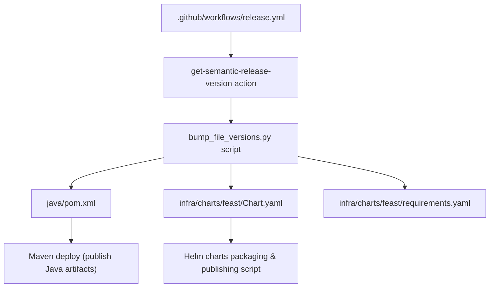
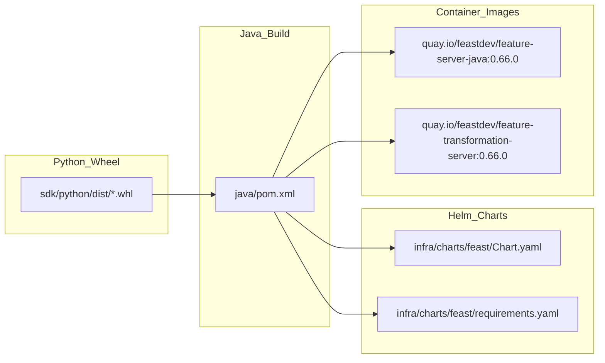

<!-- source: DeepWiki mcp.deepwiki.com · repo feast-dev/feast · page 6.4 Release Process and Versioning · fetched 2026-10-21 -->

# Release Process and Versioning

Relevant source files

The following files were used as context for generating this wiki page:

- [.github/actions/get-semantic-release-version/action.yml](.github/actions/get-semantic-release-version/action.yml)
- [.github/workflows/deploy-website.yml](.github/workflows/deploy-website.yml)
- [.github/workflows/nightly_python_sdk_release.yml](.github/workflows/nightly_python_sdk_release.yml)
- [.github/workflows/publish_helm_charts.yml](.github/workflows/publish_helm_charts.yml)
- [.github/workflows/publish_images.yml](.github/workflows/publish_images.yml)
- [.github/workflows/publish_python_sdk.yml](.github/workflows/publish_python_sdk.yml)
- [.github/workflows/publish_web_ui.yml](.github/workflows/publish_web_ui.yml)
- [CHANGELOG.md](CHANGELOG.md)
- [infra/charts/feast/Chart.yaml](infra/charts/feast/Chart.yaml)
- [infra/charts/feast/README.md](infra/charts/feast/README.md)
- [infra/charts/feast/charts/feature-server/Chart.yaml](infra/charts/feast/charts/feature-server/Chart.yaml)
- [infra/charts/feast/charts/feature-server/README.md](infra/charts/feast/charts/feature-server/README.md)
- [infra/charts/feast/charts/feature-server/values.yaml](infra/charts/feast/charts/feature-server/values.yaml)
- [infra/charts/feast/charts/transformation-service/Chart.yaml](infra/charts/feast/charts/transformation-service/Chart.yaml)
- [infra/charts/feast/charts/transformation-service/README.md](infra/charts/feast/charts/transformation-service/README.md)
- [infra/charts/feast/charts/transformation-service/values.yaml](infra/charts/feast/charts/transformation-service/values.yaml)
- [infra/charts/feast/requirements.yaml](infra/charts/feast/requirements.yaml)
- [infra/scripts/helm/push-helm-charts.sh](infra/scripts/helm/push-helm-charts.sh)
- [infra/scripts/helm/validate-helm-chart-versions.sh](infra/scripts/helm/validate-helm-chart-versions.sh)
- [infra/website/docs/blog/rag-with-feast.md](infra/website/docs/blog/rag-with-feast.md)
- [infra/website/public/images/blog/milvus-rag.png](infra/website/public/images/blog/milvus-rag.png)
- [infra/website/public/images/blog/space.jpg](infra/website/public/images/blog/space.jpg)
- [infra/website/public/images/logos/castai.png](infra/website/public/images/logos/castai.png)
- [infra/website/src/components/Navigation.astro](infra/website/src/components/Navigation.astro)
- [infra/website/src/layouts/BaseLayout.astro](infra/website/src/layouts/BaseLayout.astro)
- [infra/website/src/layouts/BlogLayout.astro](infra/website/src/layouts/BlogLayout.astro)
- [infra/website/src/pages/blog/[slug].astro](infra/website/src/pages/blog/[slug].astro)
- [infra/website/src/pages/blog/index.astro](infra/website/src/pages/blog/index.astro)
- [infra/website/src/pages/index.astro](infra/website/src/pages/index.astro)
- [infra/website/src/styles/global.css](infra/website/src/styles/global.css)
- [java/pom.xml](java/pom.xml)

This page documents the versioning conventions, release automation, and artifact publishing pipeline for the Feast project. It covers semantic-release configuration, `CHANGELOG.md` management, version synchronization across polyglot components (Python SDK, Java libraries, Helm charts, React Web UI, and Kubernetes operator), and the underlying artifact publishing workflows.

Sources: [docs/project/release-process.md:1-4]()

---

## Versioning Conventions

Feast uses semantic versioning in the form `0.MINOR.PATCH`. The major version is kept at `0` as the project evolves; breaking changes typically trigger a minor version increment rather than a major one.

| Change type      | Example commit message                                | Version bump          |
|------------------|------------------------------------------------------|----------------------|
| Bug fix          | `fix: correct Redis TTL handling`                     | Patch (`0.65.0` → `0.65.1`)   |
| New feature      | `feat: add ScyllaDB online store`                     | Minor (`0.65.0` → `0.66.0`)   |
| Breaking change  | `feat!: rename total_timeout_ms to batch_total_timeout_ms` | Minor (`0.65.0` → `0.66.0`)   |

Feast follows the Angular commit message convention. Automated release tools parse these prefixes to determine the next version and categorize entries in `CHANGELOG.md`.

Sources: [CHANGELOG.md:3-37](), [CHANGELOG.md:45-51]()

---

## Files Updated on Each Release

When a release is triggered, the project version is propagated across multiple language-specific and infrastructure-specific files. This synchronization ensures that the Python SDK, Java serving components, and Helm charts all reference the same target release version.

| File Path                                      | Entity / Key               | Purpose                                             |
|-----------------------------------------------|----------------------------|-----------------------------------------------------|
| `CHANGELOG.md`                                | Version Headers             | Historical record of project changes.                |
| `java/pom.xml`                                | `<revision>`                | Centralized version property for all Java modules.   |
| `infra/charts/feast/Chart.yaml`               | `version`                   | Root Helm chart version.                              |
| `infra/charts/feast/requirements.yaml`        | `version`                   | Subchart versions (`feature-server`, `transformation-service`). |
| `infra/charts/feast/README.md`                 | Version Text                | Documentation and metadata for the Helm release.     |
| `infra/charts/feast/charts/feature-server/Chart.yaml`         | `version`                   | Version for the standalone feature server chart.     |
| `infra/charts/feast/charts/transformation-service/Chart.yaml` | `version`                   | Version for the transformation service chart.         |

The release process utilizes the Python script `infra/scripts/release/bump_file_versions.py` to automate these version updates across the repository.

Sources: [java/pom.xml:38](), [infra/charts/feast/Chart.yaml:4](), [infra/charts/feast/requirements.yaml:4-9](), [infra/charts/feast/README.md:11](), [infra/charts/feast/charts/feature-server/Chart.yaml:4](), [infra/charts/feast/charts/transformation-service/Chart.yaml:4](), [docs/project/release-process.md:52-53]()

---

## Release Workflow and Version Bumping

The release pipeline is driven by GitHub Actions workflows and the `semantic-release` tool. The automation calculates the next version from commit messages, runs validations, and executes the version bumping script to synchronize version declarations before creating Git tags and publishing packages.

*Figure 1: Workflow execution mapping from release automation files (`release.yml`, `bump_file_versions.py`) to repository version files and artifact publishing targets.*

Sources: [java/pom.xml:38](), [infra/charts/feast/Chart.yaml:4](), [infra/charts/feast/requirements.yaml:4-9](), [.github/actions/get-semantic-release-version/action.yml:4-5](), [docs/project/release-process.md:3-11]()

---

## Artifact Publishing Pipeline

Once a release tag (e.g., `v0.66.0`) is pushed to the repository, multiple downstream workflows handle distributing different artifact categories to their respective registries.

| Artifact Category | Destination           | Workflow / Tool                        |
|-------------------|-----------------------|-------------------------------------|
| Python SDK        | PyPI                  | `.github/workflows/publish_python_sdk.yml`  |
| Java Libraries    | Sonatype OSSRH (Maven Central) | Configured via `java/pom.xml` distributionManagement |
| Docker Images     | Quay.io (`quay.io/feastdev`) | `.github/workflows/publish_images.yml` |
| Helm Charts       | Google Cloud Storage Helm repo | `.github/workflows/publish_helm_charts.yml` |
| Web UI            | NPM                   | Step in `release.yml` using `publish-web-ui-npm` |

### Java Artifact Distribution

Java components including `datatypes`, `serving`, `serving-client`, and `coverage` are surfaced through the Maven Central repository hosted by Sonatype OSSRH. The root `pom.xml` file centralizes the managed version via its `<revision>` property and defines snapshot and staging target repositories.

- Submodules defined in `java/pom.xml`: `datatypes`, `serving`, `serving-client`, `coverage`.
- Version property `${revision}` in `java/pom.xml` ensures uniform versioning of Java artifacts during release.

Sources: [java/pom.xml:27-38](), [java/pom.xml:136-145](), [docs/project/release-process.md:101-103]()

### Helm Chart Distribution

Feast maintains a primary Helm chart and two main subcharts for `feature-server` and `transformation-service`. These charts are versioned consistently and published to a Google Cloud Storage bucket at `https://feast-helm-charts.storage.googleapis.com`.

- Root chart: `infra/charts/feast/Chart.yaml`
- Subcharts: `infra/charts/feast/charts/feature-server/Chart.yaml` and `infra/charts/feast/charts/transformation-service/Chart.yaml`
- `requirements.yaml` manages subchart dependencies and versions.
- The packaging and push scripts handle uploading charts to the GCS Helm charts repository.

Sources: [infra/charts/feast/Chart.yaml:1-5](), [infra/charts/feast/requirements.yaml:1-11](), [infra/charts/feast/README.md:15-22](), [infra/charts/feast/charts/feature-server/Chart.yaml:3-5](), [infra/charts/feast/charts/transformation-service/Chart.yaml:3-5](), [docs/project/release-process.md:35-38]()

### Docker Image Publishing

Docker images for core runtime components are built and pushed to `quay.io/feastdev`. The main images include:

- Feature Server Java: `quay.io/feastdev/feature-server-java`
- Feature Transformation Server: `quay.io/feastdev/feature-transformation-server`

Image tags correspond to the release version (e.g., `0.66.0`). The images support multi-platform builds with Linux AMD64 and ARM64.

Sources: [infra/charts/feast/charts/feature-server/values.yaml:6-8](), [infra/charts/feast/charts/transformation-service/values.yaml:6-8](), [docs/project/release-process.md:30-33]()

---

## Component Version Mapping

To ensure consistent versioning across the multi-language and multi-artifact ecosystem, Feast maps produced binaries and configuration files to the unified release version.

*Figure 2: Code artifact version binding showing the Java POM version as the central coordinator to Helm charts and container images, and the Python wheel versioning linked.*

Sources: [java/pom.xml:38](), [infra/charts/feast/Chart.yaml:4](), [infra/charts/feast/requirements.yaml:4-9](), [infra/charts/feast/charts/feature-server/values.yaml:6-8](), [infra/charts/feast/charts/transformation-service/values.yaml:6-8](), [docs/project/release-process.md:52-53]()

---

## Changelog Management

The `CHANGELOG.md` file is a critical artifact that documents user-facing changelog entries for each released version. It is automatically generated and updated by `semantic-release` based on the commit history following conventional commit guidelines.

Typical categorized sections include:

- **Bug Fixes** — Corrections to runtime behavior or fixes to regressions (e.g., connection pre-warming for DynamoDB client) [CHANGELOG.md:6-8]().
- **Component Enhancements** — Feature additions and improvements scoped by subsystems (e.g., Kubernetes operator, Python SDK) [CHANGELOG.md:30-30]().
- **Dependency Upgrades** — Updates to underlying packages and third-party dependencies for security or compatibility [CHANGELOG.md:13-13]().

The changelog uses markdown linking to GitHub compare views for each released version, enabling convenient navigation through release history.

Sources: [CHANGELOG.md:1-52]()

---

# Summary

Feast's release process is a comprehensive coordinated automation involving:

- **Semantic versioning** with strictly defined commit message conventions.
- **Automated version bumping** across Python, Java, Helm, and container image specifications.
- **Artifact publishing** pipelines dispatching build outputs to PyPI, Maven Central, Docker repositories, Helm chart repositories, and NPM.
- **Changelog management** via automatic parsing of commit history with human-readable release notes.

This robust cross-language, multi-artifact orchestration ensures consistent, reliable, and user-transparent Feast version releases.

Sources: [CHANGELOG.md](), [java/pom.xml](), [infra/charts/feast/Chart.yaml](), [infra/charts/feast/requirements.yaml](), [infra/charts/feast/README.md](), [infra/charts/feast/charts/feature-server/values.yaml](), [infra/charts/feast/charts/transformation-service/values.yaml](), [.github/workflows/publish_images.yml]()

---

