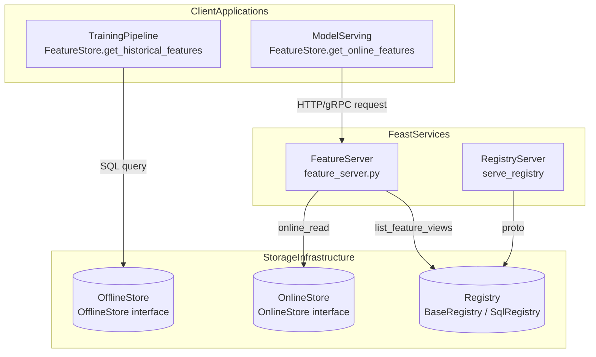

<!-- source: DeepWiki mcp.deepwiki.com · repo feast-dev/feast · page 7 Deployment · fetched 2026-10-21 -->

# Deployment

<details>
<summary>Relevant source files</summary>

The following files were used as context for generating this wiki page:

- [.secrets.baseline](.secrets.baseline)
- [docs/how-to-guides/feast-on-kubernetes.md](docs/how-to-guides/feast-on-kubernetes.md)
- [docs/how-to-guides/running-feast-in-production.md](docs/how-to-guides/running-feast-in-production.md)
- [docs/how-to-guides/scaling-feast.md](docs/how-to-guides/scaling-feast.md)
- [docs/reference/feature-servers/offline-feature-server.md](docs/reference/feature-servers/offline-feature-server.md)
- [infra/charts/feast-feature-server/README.md.gotmpl](infra/charts/feast-feature-server/README.md.gotmpl)
- [infra/charts/feast/README.md.gotmpl](infra/charts/feast/README.md.gotmpl)
- [infra/feast-operator/README.md](infra/feast-operator/README.md)
- [infra/feast-operator/api/v1/featurestore_types.go](infra/feast-operator/api/v1/featurestore_types.go)
- [infra/feast-operator/api/v1/zz_generated.deepcopy.go](infra/feast-operator/api/v1/zz_generated.deepcopy.go)
- [infra/feast-operator/api/v1alpha1/featurestore_types.go](infra/feast-operator/api/v1alpha1/featurestore_types.go)
- [infra/feast-operator/api/v1alpha1/zz_generated.deepcopy.go](infra/feast-operator/api/v1alpha1/zz_generated.deepcopy.go)
- [infra/feast-operator/bundle/manifests/feast-operator-controller-manager-metrics-service_v1_service.yaml](infra/feast-operator/bundle/manifests/feast-operator-controller-manager-metrics-service_v1_service.yaml)
- [infra/feast-operator/bundle/manifests/feast-operator.clusterserviceversion.yaml](infra/feast-operator/bundle/manifests/feast-operator.clusterserviceversion.yaml)
- [infra/feast-operator/bundle/manifests/feast.dev_featurestores.yaml](infra/feast-operator/bundle/manifests/feast.dev_featurestores.yaml)
- [infra/feast-operator/config/crd/bases/feast.dev_featurestores.yaml](infra/feast-operator/config/crd/bases/feast.dev_featurestores.yaml)
- [infra/feast-operator/config/default/kustomization.yaml](infra/feast-operator/config/default/kustomization.yaml)
- [infra/feast-operator/config/default/metrics_service.yaml](infra/feast-operator/config/default/metrics_service.yaml)
- [infra/feast-operator/config/manager/manager.yaml](infra/feast-operator/config/manager/manager.yaml)
- [infra/feast-operator/config/prometheus/monitor.yaml](infra/feast-operator/config/prometheus/monitor.yaml)
- [infra/feast-operator/config/samples/kustomization.yaml](infra/feast-operator/config/samples/kustomization.yaml)
- [infra/feast-operator/config/samples/v1_featurestore_scaling_hpa.yaml](infra/feast-operator/config/samples/v1_featurestore_scaling_hpa.yaml)
- [infra/feast-operator/config/samples/v1_featurestore_scaling_static.yaml](infra/feast-operator/config/samples/v1_featurestore_scaling_static.yaml)
- [infra/feast-operator/dist/install.yaml](infra/feast-operator/dist/install.yaml)
- [infra/feast-operator/dist/operator-e2e-tests](infra/feast-operator/dist/operator-e2e-tests)
- [infra/feast-operator/docs/api/markdown/ref.md](infra/feast-operator/docs/api/markdown/ref.md)
- [infra/feast-operator/internal/controller/featurestore_controller_test.go](infra/feast-operator/internal/controller/featurestore_controller_test.go)
- [infra/feast-operator/internal/controller/services/repo_config.go](infra/feast-operator/internal/controller/services/repo_config.go)
- [infra/feast-operator/internal/controller/services/repo_config_test.go](infra/feast-operator/internal/controller/services/repo_config_test.go)
- [infra/feast-operator/internal/controller/services/services.go](infra/feast-operator/internal/controller/services/services.go)
- [infra/feast-operator/internal/controller/services/services_test.go](infra/feast-operator/internal/controller/services/services_test.go)
- [infra/feast-operator/internal/controller/services/services_types.go](infra/feast-operator/internal/controller/services/services_types.go)
- [infra/feast-operator/internal/controller/services/util.go](infra/feast-operator/internal/controller/services/util.go)

</details>


## Purpose and Scope

This page provides a high-level overview of deployment options for Feast, covering Docker container images, Kubernetes deployments via Helm charts, declarative management using the Kubernetes operator, and production best practices. Feast components can be deployed independently depending on the target infrastructure, ranging from single-node local environments to production-scale cloud clusters.

For detailed technical instructions, see the respective child pages:
- [Docker Images](#7.1) — Documenting the Docker build process, multi-architecture variants, and multicloud Dockerfiles.
- [Helm Charts](#7.2) — Explaining the root Feast Helm chart structure, subcharts, and global configuration values.
- [Kubernetes Operator](#7.3) — Detailing the `FeatureStore` CRD (`infra/feast-operator/api/v1/featurestore_types.go`), reconciliation loops (`infra/feast-operator/internal/controller/services/services.go`), and configuration injection.
- [Production Deployment Patterns](#7.4) — Guidance on scaling, high availability, monitoring, and GitOps workflows.

Sources: [infra/feast-operator/api/v1/featurestore_types.go:1-157](), [infra/feast-operator/internal/controller/services/services.go:99-165]()

---

## Deployment Architecture

Feast deployments separate the control plane (feature metadata and definitions) from the data plane (offline historical stores and low-latency online stores). Services communicate through well-defined Python and Go APIs orchestrated by the `FeatureStore` class and managed controllers.

### System Component Interaction



**Feast Deployment Architecture with Code Entities**

The core abstractions that structure runtime deployments include:
- `FeatureStore` — The primary Python and Go client SDK entry point.
- `BaseRegistry` / `SqlRegistry` — Metadata persistence layers [docs/how-to-guides/running-feast-in-production.md:37-41]().
- `OfflineStore` — Historical feature extraction interface.
- `OnlineStore` — Low-latency point lookup interface (`online_read` / `online_write_batch`) [docs/reference/feature-servers/offline-feature-server.md:50-51]().

Sources: [infra/feast-operator/internal/controller/services/services.go:167-215](), [docs/how-to-guides/running-feast-in-production.md:37-41](), [docs/reference/feature-servers/offline-feature-server.md:50-51]()

---

## Deployment Options

### Docker Container Deployment

Feast provides container images for its serving engines, transformation services, and the Kubernetes operator. These images utilize multi-architecture builds and are published to container registries such as `quay.io/feastdev/feature-server-java` and `quay.io/feastdev/feature-transformation-server`. They support multi-cloud deployment scenarios with carefully structured Dockerfiles to handle different cloud providers and architectures.

Refer to the child page [Docker Images](#7.1) for detailed explanations on image variants, multi-arch builds, and the publishing process.

Sources: [infra/charts/feast/charts/feature-server/values.yaml:6-6](), [infra/charts/feast/charts/transformation-service/values.yaml:6-6]()

---

### Kubernetes Deployment via Helm

Feast offers comprehensive Helm charts to deploy features stores and related services on Kubernetes. The root `feast` chart aggregates subcharts like `feature-server` and `transformation-service`, allowing centralized configuration through a global `values.yaml`. 

The `feature-server` subchart deploys the Java feature server image, with customization points provided via `application-override.yaml` and other value files. These charts abstract the complexity of Kubernetes manifests and facilitate easy upgrades, rollbacks, and integration into existing Kubernetes environments.

For the detailed structure, configurations, and usage patterns, see the child page [Helm Charts](#7.2).

Sources: [infra/charts/feast/README.md.gotmpl:29-37]()

---

### Kubernetes Operator

Feast's Kubernetes Operator enables declarative and automated management of Feast deployments through custom resources of kind `FeatureStore` (CRD defined in `infra/feast-operator/api/v1/featurestore_types.go`). The operator continuously reconciles the desired state with the cluster state using a controller implemented in `infra/feast-operator/internal/controller/services/services.go`.

The operator provisions and manages Kubernetes resources such as Deployments, Services, ConfigMaps, Secrets, and CronJobs to run Feast services including the feature server, registry, offline and online stores, UI, and lineage services.

Features include:
- Configuration injection into pods via environment variables and ConfigMaps.
- Authorization support including Kubernetes RBAC roles and OpenID Connect (OIDC).
- TLS support and integration with platform-specific overrides (e.g., OpenShift).
- Automated lifecycle handling: applying defaults, creating/updating/deleting deployments and service accounts, horizontal autoscaling support.

See the child page [Kubernetes Operator](#7.3) for full details on CRD specs, reconciliation cycles, authorization configurations, TLS support, and operator deployment.

Sources: [infra/feast-operator/api/v1/featurestore_types.go:1-157](), [infra/feast-operator/internal/controller/services/services.go:44-165](), [infra/feast-operator/dist/install.yaml:1-160]()

---

### Production Deployment Patterns

Deploying Feast in production environments requires thoughtful architecture to ensure scalability, fault tolerance, and operability. Important considerations include:
- Using scalable SQL-based registries instead of file-based ones for feature metadata.
- Separating staging and production environments for safe feature definition testing and rollout.
- Autoscaling and high availability configurations, either through Kubernetes Horizontal Pod Autoscalers or static pod replicas.
- Monitoring Feast's materialization jobs and service health with systems like Prometheus.
- Managing secure communication via TLS and authorization via RBAC or OIDC.
- Integrating with GitOps workflows and infrastructure provisioning templates such as Terraform for consistent deployments.
- Choosing between different offline/online stores and compute engines to suit workload size and throughput requirements.

Materialization batch sizes can be tuned via the `online_write_batch_size` parameter in `feature_store.yaml` to optimize memory usage during data ingestion.

For a comprehensive production deployment guide including topology examples, scaling approaches, and CI/CD integration, refer to the child page [Production Deployment Patterns](#7.4).

Sources: [docs/how-to-guides/running-feast-in-production.md:1-109](), [docs/how-to-guides/scaling-feast.md:9-35]()

---

## Deployment Options and Their Relationship

```mermaid
graph LR

  subgraph "Deployment Units"
    DockerImages["Docker Images\n(feature-server, transform-service, operator)"]
    HelmCharts["Helm Charts\n(packaging for k8s)"]
    K8sOperator["Kubernetes Operator\n(FeatureStore CRD and reconciliation)"]
  end

  subgraph "Production Practices"
    ProdPatterns["Production Deployment Patterns\n(Scaling, HA, Monitoring, GitOps)"]
  end

  DockerImages --> HelmCharts
  HelmCharts --> K8sOperator
  K8sOperator --> ProdPatterns

  subgraph "Code Entities"
    FS_API["FeatureStore API\n(Python & Go SDK)"]
    CRD["FeatureStore CustomResourceDefinition\n(in infra/feast-operator/api/v1)"]
    RECONCILER["Operator Reconciliation Loop\n(services.go Deploy method)"]
  end

  K8sOperator --> CRD
  K8sOperator --> RECONCILER
  FS_API -->|Uses| DockerImages

  classDef natural fill:#fff,stroke:#000,stroke-width:1px;
  class Deployment Units natural;
  class "Production Practices" natural;
  class "Code Entities" natural;
```

This diagram illustrates how container images serve as the base deployable units, which Helm charts package for Kubernetes deployments. The Kubernetes Operator builds on these to provide a higher-level declarative interface, deploying and managing Feast services while implementing reconciliation logic. Finally, production deployment patterns guide how these technologies and components are used in real-world scalable and secure systems.

Sources: [infra/feast-operator/internal/controller/services/services.go:99-165](), [infra/feast-operator/api/v1/featurestore_types.go:1-157](), [infra/charts/feast/README.md.gotmpl:29-37](), [docs/how-to-guides/running-feast-in-production.md:1-109]()

---

# Child Pages

- **[Docker Images](#7.1)**  
  Detailed documentation on how Feast Docker images are built, image variants targeting different platforms, multi-architecture support, and publishing strategy to container registries like quay.io. Includes explanation of the multicloud-aware Dockerfile directory layout.

- **[Helm Charts](#7.2)**  
  Explains the Helm chart repository structure, including the parent Feast chart and its subcharts such as feature-server and transformation-service. Covers key configuration options in `values.yaml`, chart dependencies, and the standalone Feast feature server chart for simple deployments.

- **[Kubernetes Operator](#7.3)**  
  Covers the operator's internals: the `FeatureStore` CRD definition, reconciliation loop process, how Feast services are deployed as native k8s resources, config injection techniques, and authorization strategies including Kubernetes RBAC and OIDC. Also details handling of TLS certificates and overlays for OpenShift/ODH platforms.

- **[Production Deployment Patterns](#7.4)**  
  Provides best practices and reference architectures for running Feast in production. Topics include scaling Feast components, high availability, choosing registry backends, monitoring and alerting strategies, TLS and security management, and GitOps-based workflows using tools like Terraform. Includes sample deployment topologies and configuration examples.

---

This overview introduces key deployment strategies and their relationships, enabling technical users to select and implement deployment approaches suited to their environment, from local testing to enterprise cloud infrastructure.

Sources:  
[infra/feast-operator/api/v1/featurestore_types.go:1-157](), [infra/feast-operator/internal/controller/services/services.go:44-165](), [infra/charts/feast/README.md.gotmpl:29-37](), [docs/how-to-guides/running-feast-in-production.md:1-109](), [infra/feast-operator/dist/install.yaml:1-160]()

---

