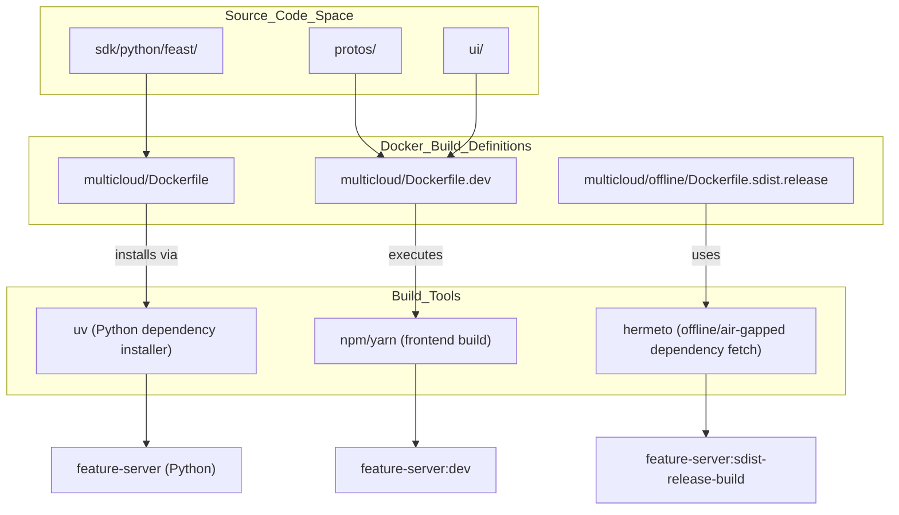
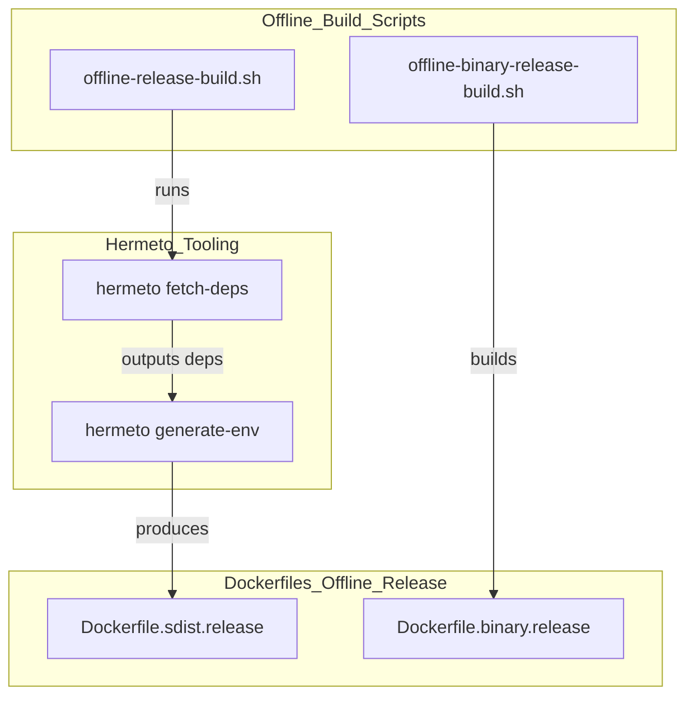
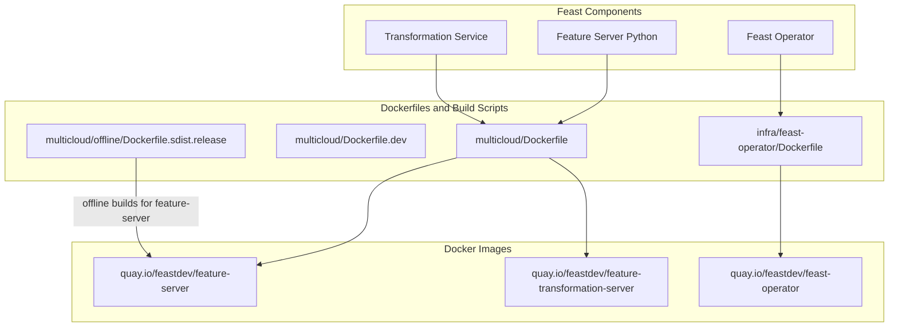

<!-- source: DeepWiki mcp.deepwiki.com · repo feast-dev/feast · page 7.1 Docker Images · fetched 2026-10-21 -->

# Docker Images

Relevant source files

The following files were used as context for generating this wiki page:

- [infra/feast-operator/Dockerfile](infra/feast-operator/Dockerfile)
- [infra/feast-operator/cmd/main.go](infra/feast-operator/cmd/main.go)
- [infra/feast-operator/cmd/tls_bootstrap.go](infra/feast-operator/cmd/tls_bootstrap.go)
- [infra/feast-operator/cmd/tls_bootstrap_test.go](infra/feast-operator/cmd/tls_bootstrap_test.go)
- [infra/feast-operator/go.mod](infra/feast-operator/go.mod)
- [infra/feast-operator/go.sum](infra/feast-operator/go.sum)
- [infra/scripts/release/bump_file_versions.py](infra/scripts/release/bump_file_versions.py)
- [infra/scripts/release/files_to_bump.txt](infra/scripts/release/files_to_bump.txt)
- [infra/scripts/release/unset_prerelease.py](infra/scripts/release/unset_prerelease.py)
- [sdk/python/feast/infra/feature_servers/multicloud/Dockerfile](sdk/python/feast/infra/feature_servers/multicloud/Dockerfile)
- [sdk/python/feast/infra/feature_servers/multicloud/Dockerfile.dev](sdk/python/feast/infra/feature_servers/multicloud/Dockerfile.dev)
- [sdk/python/feast/infra/feature_servers/multicloud/offline/.gitignore](sdk/python/feast/infra/feature_servers/multicloud/offline/.gitignore)
- [sdk/python/feast/infra/feature_servers/multicloud/offline/Dockerfile.binary](sdk/python/feast/infra/feature_servers/multicloud/offline/Dockerfile.binary)
- [sdk/python/feast/infra/feature_servers/multicloud/offline/Dockerfile.binary.release](sdk/python/feast/infra/feature_servers/multicloud/offline/Dockerfile.binary.release)
- [sdk/python/feast/infra/feature_servers/multicloud/offline/Dockerfile.builder.yarn](sdk/python/feast/infra/feature_servers/multicloud/offline/Dockerfile.builder.yarn)
- [sdk/python/feast/infra/feature_servers/multicloud/offline/Dockerfile.builder.yum](sdk/python/feast/infra/feature_servers/multicloud/offline/Dockerfile.builder.yum)
- [sdk/python/feast/infra/feature_servers/multicloud/offline/Dockerfile.sdist](sdk/python/feast/infra/feature_servers/multicloud/offline/Dockerfile.sdist)
- [sdk/python/feast/infra/feature_servers/multicloud/offline/Dockerfile.sdist.release](sdk/python/feast/infra/feature_servers/multicloud/offline/Dockerfile.sdist.release)
- [sdk/python/feast/infra/feature_servers/multicloud/offline/artifacts.lock.yaml](sdk/python/feast/infra/feature_servers/multicloud/offline/artifacts.lock.yaml)
- [sdk/python/feast/infra/feature_servers/multicloud/offline/hermeto-generic-artifacts.sh](sdk/python/feast/infra/feature_servers/multicloud/offline/hermeto-generic-artifacts.sh)
- [sdk/python/feast/infra/feature_servers/multicloud/offline/offline-binary-build.sh](sdk/python/feast/infra/feature_servers/multicloud/offline/offline-binary-build.sh)
- [sdk/python/feast/infra/feature_servers/multicloud/offline/offline-binary-release-build.sh](sdk/python/feast/infra/feature_servers/multicloud/offline/offline-binary-release-build.sh)
- [sdk/python/feast/infra/feature_servers/multicloud/offline/offline-build.sh](sdk/python/feast/infra/feature_servers/multicloud/offline/offline-build.sh)
- [sdk/python/feast/infra/feature_servers/multicloud/offline/offline-release-build.sh](sdk/python/feast/infra/feature_servers/multicloud/offline/offline-release-build.sh)
- [sdk/python/feast/infra/feature_servers/multicloud/offline/rpms.lock.yaml](sdk/python/feast/infra/feature_servers/multicloud/offline/rpms.lock.yaml)
- [sdk/python/feast/infra/feature_servers/multicloud/requirements.txt](sdk/python/feast/infra/feature_servers/multicloud/requirements.txt)

## Purpose and Scope

This page details the Docker image build process in the Feast codebase. It covers the design and structure of multi-cloud Dockerfiles, different image variants (feature server, operator, transformation service), multi-platform (multi-arch) image builds, and the publishing pipeline targeting `quay.io`. These container images facilitate deployment of Feast components in container orchestrators such as Kubernetes, ensuring consistent runtimes and dependency management.

---

## Available Docker Images

Feast provides several Docker image variants, primarily built upon Red Hat Universal Base Image 9 (UBI9), to support Python and Go runtimes for different Feast components. Official images are hosted on `quay.io/feastdev`.

| Image Name                    | Component             | Purpose                                | Base Image / Runtime                                  |
|-------------------------------|----------------------|--------------------------------------|------------------------------------------------------|
| `feature-server`               | Python Feature Server | High performance online feature serving in Python | UBI9 with Python 3.12 Minimal [[Dockerfile:1]]()     |
| `feature-transformation-server` | Transformation Service| On-demand feature transformation service in Python    | Same as feature-server, UBI9 Python 3.12 [[Dockerfile:1]]() |
| `feast-operator`              | Kubernetes Operator  | Controller to manage Feast CRDs and deploy services     | UBI9 with Go toolset [[infra/feast-operator/Dockerfile:2-29]]() |

Sources: [[sdk/python/feast/infra/feature_servers/multicloud/Dockerfile:1-13]](), [[infra/feast-operator/Dockerfile:1-32]]()

---

## Build System Architecture

The build architecture orchestrates polyglot artifact generation and dependency resolution to convert Feast sources and binaries into container images. The pipeline incorporates source code, protobuf files, UI assets, pip dependencies, and external binaries with specialized tooling including `uv` for Python dependency installs and `hermeto` for air-gapped offline builds.

### Natural Language to Code Entity Mapping: Build Pipeline

Sources: [[sdk/python/feast/infra/feature_servers/multicloud/Dockerfile:7-10]](), [[sdk/python/feast/infra/feature_servers/multicloud/Dockerfile.dev:15-27]](), [[sdk/python/feast/infra/feature_servers/multicloud/offline/Dockerfile.sdist.release:1-20]]()

---

## Image Variants and Implementation Details

### Multicloud Python Feature Server Image (`Dockerfile`)

This Dockerfile produces the primary Python feature server and transformation service images optimized for multicloud usage and OpenShift environments.

- **Base Image**: `registry.access.redhat.com/ubi9/python-312-minimal:latest` — a minimal UBI9 image with Python 3.12 [[sdk/python/feast/infra/feature_servers/multicloud/Dockerfile:1]]().
- **System Packages**: Installs essential build and runtime libs (`git`, `gcc`, `libpq-devel`, `python3.12-devel`) via `microdnf` [[sdk/python/feast/infra/feature_servers/multicloud/Dockerfile:4]]().
- **Dependency Installation**: Uses `uv` (copied from an external registry `ghcr.io/astral-sh/uv:latest`) to install Python dependencies listed in `requirements.txt` [[sdk/python/feast/infra/feature_servers/multicloud/Dockerfile:7-10]]().
- **Permission Fixes**: Applies group write permissions to a UI build artifact JSON to accommodate deployment with arbitrary UIDs (e.g., OpenShift security context constraints) [[sdk/python/feast/infra/feature_servers/multicloud/Dockerfile:13]]().

### Development Image (`Dockerfile.dev`)

- Extends the minimal base with additional tools (`npm`, `yarn`, `git`, `gcc`, `libpq-devel`) enabling full Feast development inside the container [[sdk/python/feast/infra/feature_servers/multicloud/Dockerfile.dev:1-6]]().
- Copies the full Feast source including `.git`, Python SDK, proto files, UI web app source [[sdk/python/feast/infra/feature_servers/multicloud/Dockerfile.dev:8-12]]().
- Builds the UI packages using `npm` and `yarn` and cleans caches to keep final image size smaller [[sdk/python/feast/infra/feature_servers/multicloud/Dockerfile.dev:14-27]]().
- Installs Feast in editable minimal mode using `uv pip install -e .[minimal]` for live development [[sdk/python/feast/infra/feature_servers/multicloud/Dockerfile.dev:33]]().
- Same permissions fix as production image for OpenShift compliance [[sdk/python/feast/infra/feature_servers/multicloud/Dockerfile.dev:36]]().

Sources: [[sdk/python/feast/infra/feature_servers/multicloud/Dockerfile.dev:1-36]](), [[sdk/python/feast/infra/feature_servers/multicloud/Dockerfile:1-13]]()

---

## Offline Release Infrastructure and Hermeto Builds

Feast provides a robust offline build process for air-gapped or enterprise compliance scenarios through specialized scripts and Dockerfiles. They package complex dependencies like Apache Arrow, Milvus Lite, and Ibis with reproducible builds.

### Offline Build Workflow: Natural Language to Code Mapping

### `Dockerfile.sdist.release`

- Builds Apache Arrow (v17.0.0) with extended features: compute, parquet, flight, GCS, S3, and substrait support.
- Installs pinned versions of Milvus Lite and Ibis framework.
- Uses a set of offline RPM packages fetched and installed with the help of `hermeto` tooling.
- Configured with environment variables and extensive CMake options to fully build Arrow from source [[sdk/python/feast/infra/feature_servers/multicloud/offline/Dockerfile.sdist.release:3-138]]().

### `Dockerfile.binary.release`

- A binary release image that installs Python dependencies using a pre-generated `hermeto.env` file.
- Simplifies deployment by avoiding recompilation of big dependencies in constrained CI/CD systems [[sdk/python/feast/infra/feature_servers/multicloud/offline/Dockerfile.binary.release:1-9]]().

Sources: [[sdk/python/feast/infra/feature_servers/multicloud/offline/Dockerfile.sdist.release:1-138]](), [[sdk/python/feast/infra/feature_servers/multicloud/offline/Dockerfile.binary.release:1-9]](), [sdk/python/feast/infra/feature_servers/multicloud/offline/offline-release-build.sh:12-40](), [sdk/python/feast/infra/feature_servers/multicloud/offline/offline-binary-release-build.sh:13-37]()

---

## Multi-Architecture Builds and Publishing to Quay.io

Feast leverages GitHub Actions workflows to automate Docker image building and publishing, targeting multiple CPU architectures such as `amd64` and `arm64`.

### Publishing Workflow Overview

- The CI/CD workflow `publish_images.yml` supports manual or triggered execution [[.github/workflows/publish_images.yml:4-29]]().
- Uses a custom step to determine semantic version tags or accept a custom version input [[.github/workflows/publish_images.yml:45-49]]().
- Sets up QEMU emulators and Docker Buildx builder for cross-platform builds [[.github/workflows/publish_images.yml:50-55]]().
- Authenticates to `quay.io` and Google Cloud as necessary [[.github/workflows/publish_images.yml:56-72]]().
- Images for `feature-server` and `feast-operator` are built and pushed together across platforms directly in one step with `DOCKER_PUSH=true` [[.github/workflows/publish_images.yml:77-78]]().
- Other components like `feature-transformation-server` and `go-feature-server` use separate build and push steps [[.github/workflows/publish_images.yml:79-80]](), [[.github/workflows/publish_images.yml:89-90]]().
- Lastly, the workflow tags the highest semantic version image as `latest`:
  - For multi-arch images, `docker buildx imagetools create` creates a multi-platform `latest` tag.
  - For single-arch images, the image is tagged and pushed with `latest` [[.github/workflows/publish_images.yml:93-101]]().

### SemVer Version Bumping

During release bumps, multiple files are updated to reflect the new version, including Helm chart metadata, operator API versions, requirements, and POM files.

| File Type       | Examples                                           | Lines Containing Versions                |
|-----------------|---------------------------------------------------|-----------------------------------------|
| Helm Charts     | `infra/charts/feast/Chart.yaml`                    | lines 4, 9                              |
| Helm Subcharts  | `infra/charts/feast/charts/feature-server/Chart.yaml` | lines 4, 5                              |
| Python SDK      | `sdk/python/feast/infra/feature_servers/multicloud/requirements.txt` | line 2                                   |
| Java Module     | `java/pom.xml`                                     | line 38                                |
| Feast Operator  | `infra/feast-operator/api/feastversion/version.go` | line 20                                |

Sources: [[.github/workflows/publish_images.yml:1-103]](), [[infra/scripts/release/files_to_bump.txt:1-22]]()

---

## Diagram: Mapping Feast Components to Docker Images and Builds

This diagram connects primary Feast system components to their corresponding Docker images and the source code files that define their Docker builds.

Sources: [[sdk/python/feast/infra/feature_servers/multicloud/Dockerfile:1-13]](), [[infra/feast-operator/Dockerfile:1-32]](), [[sdk/python/feast/infra/feature_servers/multicloud/offline/Dockerfile.sdist.release:1-138]]()

---

## Summary

- Feast Docker images are multi-architecture, multi-cloud compatible, and built primarily from Red Hat UBI9 base images.
- The Python `feature-server` and `transformation-service` images employ `uv` for reliable dependency installs and OpenShift-aware permissions.
- Development images contain the full source, NodeJS tooling, and support live development with editable installs.
- Offline and air-gapped production releases use the `hermeto` toolchain to bundle complex C++ and Python dependencies, Apache Arrow and Milvus Lite builds into images.
- Images are published automatically by GitHub Workflows to `quay.io/feastdev` with `latest` tags applied to the highest semantic versions.
- The Kubernetes operator is built as a Go binary in a separate image, also multi-arch and published alongside.

This modular and automated Docker build and publish process ensures Feast remains deployable in diverse environments while maintaining reproducibility and consistency.

---

Sources:  
- sdk/python/feast/infra/feature_servers/multicloud/Dockerfile:1-13  
- sdk/python/feast/infra/feature_servers/multicloud/Dockerfile.dev:1-36  
- sdk/python/feast/infra/feature_servers/multicloud/offline/Dockerfile.sdist.release:1-138  
- sdk/python/feast/infra/feature_servers/multicloud/offline/Dockerfile.binary.release:1-9  
- infra/feast-operator/Dockerfile:1-32  
- .github/workflows/publish_images.yml:1-103  
- infra/scripts/release/files_to_bump.txt:1-22  
- sdk/python/feast/infra/feature_servers/multicloud/offline/offline-release-build.sh:12-40  
- sdk/python/feast/infra/feature_servers/multicloud/offline/offline-binary-release-build.sh:13-37

---

