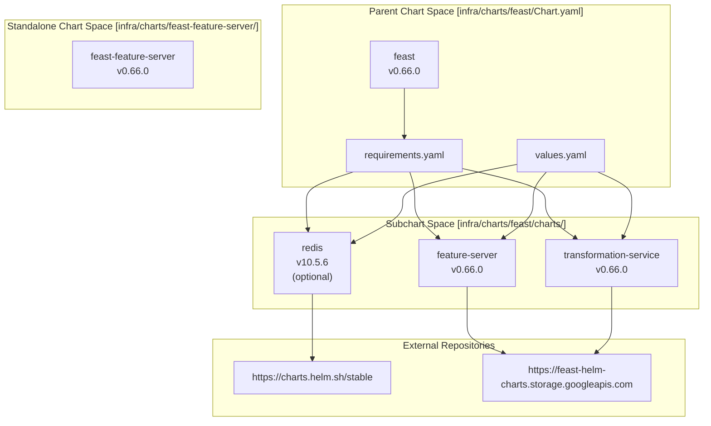
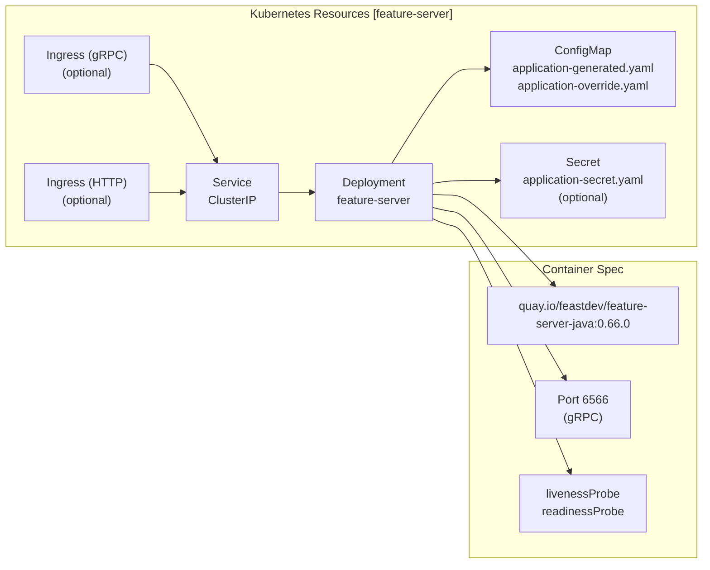
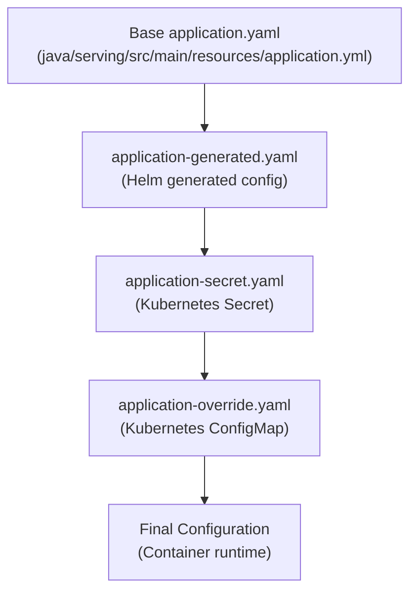
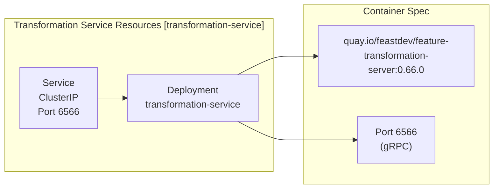
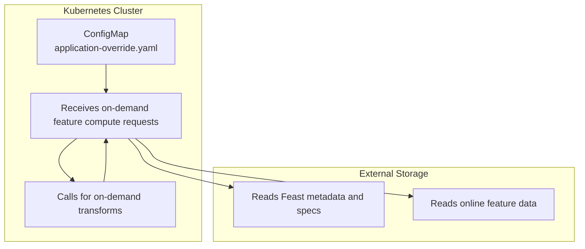

<!-- source: DeepWiki mcp.deepwiki.com · repo feast-dev/feast · page 7.2 Helm Charts · fetched 2026-10-21 -->

# Helm Charts

<details>
<summary>Relevant source files</summary>

The following files were used as context for generating this wiki page:

- [CHANGELOG.md](CHANGELOG.md)
- [docs/reference/auth/kubernetes_auth_setup.md](docs/reference/auth/kubernetes_auth_setup.md)
- [infra/charts/feast-feature-server/Chart.yaml](infra/charts/feast-feature-server/Chart.yaml)
- [infra/charts/feast-feature-server/README.md](infra/charts/feast-feature-server/README.md)
- [infra/charts/feast-feature-server/templates/deployment.yaml](infra/charts/feast-feature-server/templates/deployment.yaml)
- [infra/charts/feast-feature-server/values.yaml](infra/charts/feast-feature-server/values.yaml)
- [infra/charts/feast/Chart.yaml](infra/charts/feast/Chart.yaml)
- [infra/charts/feast/README.md](infra/charts/feast/README.md)
- [infra/charts/feast/charts/feature-server/Chart.yaml](infra/charts/feast/charts/feature-server/Chart.yaml)
- [infra/charts/feast/charts/feature-server/README.md](infra/charts/feast/charts/feature-server/README.md)
- [infra/charts/feast/charts/feature-server/values.yaml](infra/charts/feast/charts/feature-server/values.yaml)
- [infra/charts/feast/charts/transformation-service/Chart.yaml](infra/charts/feast/charts/transformation-service/Chart.yaml)
- [infra/charts/feast/charts/transformation-service/README.md](infra/charts/feast/charts/transformation-service/README.md)
- [infra/charts/feast/charts/transformation-service/values.yaml](infra/charts/feast/charts/transformation-service/values.yaml)
- [infra/charts/feast/requirements.yaml](infra/charts/feast/requirements.yaml)
- [java/pom.xml](java/pom.xml)
- [sdk/python/feast/permissions/auth/kubernetes_token_parser.py](sdk/python/feast/permissions/auth/kubernetes_token_parser.py)
- [sdk/python/feast/permissions/enforcer.py](sdk/python/feast/permissions/enforcer.py)
- [sdk/python/feast/permissions/security_manager.py](sdk/python/feast/permissions/security_manager.py)
- [sdk/python/feast/permissions/server/grpc.py](sdk/python/feast/permissions/server/grpc.py)
- [sdk/python/feast/permissions/server/rest.py](sdk/python/feast/permissions/server/rest.py)
- [sdk/python/feast/permissions/server/utils.py](sdk/python/feast/permissions/server/utils.py)
- [sdk/python/tests/unit/openlineage/test_teardown.py](sdk/python/tests/unit/openlineage/test_teardown.py)
- [sdk/python/tests/unit/permissions/test_decorator.py](sdk/python/tests/unit/permissions/test_decorator.py)
- [sdk/python/tests/unit/permissions/test_security_manager.py](sdk/python/tests/unit/permissions/test_security_manager.py)

</details>


This document provides an in-depth technical description of Feast Helm charts used for deploying Feast components to Kubernetes. It explains their hierarchical structure, values configuration, subcharts for Feature Server and Transformation Service, and the standalone `feast-feature-server` chart mostly used for Python/Go-based servers. These Helm charts enable production-grade, configurable Feast deployments with Kubernetes best practices.

---

## Chart Structure

Feast Helm charts follow a parent-child dependency model, published in the repository `https://feast-helm-charts.storage.googleapis.com`. The current version of charts is in sync with Feast releases (`0.66.0`).

### Chart Hierarchy and Dependencies

The parent chart `feast` is the main entrypoint. It houses and manages dependencies on the two key subcharts:

- `feature-server`: JVM-based Feature Server for online feature serving
- `transformation-service`: On-demand feature computation
  
An optional `redis` subchart may be included to deploy Redis, used commonly as an online store.

Separately, the standalone `feast-feature-server` chart supports Python and Go feature servers with multiple operational modes.



**Notes**:  
- The parent chart (`infra/charts/feast/Chart.yaml`) manages conditional enabling of subcharts via `requirements.yaml`.  
- The subcharts pull images and Helm charts from their respective repositories.  

Sources: [infra/charts/feast/Chart.yaml:1-11](), [infra/charts/feast/requirements.yaml:1-15](), [infra/charts/feast/README.md:1-8]()

---

## Chart Metadata Summary

| Chart Name          | Version | Repository                        | Condition Flag                 |
|---------------------|---------|---------------------------------|-------------------------------|
| `feast`             | 0.66.0  | feast-helm-charts               | N/A (parent chart)             |
| `feature-server`     | 0.66.0  | feast-helm-charts               | `feature-server.enabled`       |
| `transformation-service` | 0.66.0  | feast-helm-charts           | `transformation-service.enabled` |
| `redis`             | 10.5.6  | stable Helm charts (deprecated) | `redis.enabled`                |
| `feast-feature-server` | 0.66.0  | feast-helm-charts               | Standalone chart               |

Sources: [infra/charts/feast/Chart.yaml:4](), [infra/charts/feast/requirements.yaml:1-15](), [infra/charts/feast/charts/feature-server/Chart.yaml:1-10](), [infra/charts/feast/charts/transformation-service/Chart.yaml:1-10](), [infra/charts/feast-feature-server/README.md:1-45]()

---

## Installation and Repository Setup

To install the full Feast platform, users first add the official Helm repository, update it, and then install the parent chart which conditionally brings in subcharts:

```bash
helm repo add feast-charts https://feast-helm-charts.storage.googleapis.com
helm repo update
helm install feast-release feast-charts/feast
```

By default, the parent chart enables:

- `feature-server.enabled: true`
- `transformation-service.enabled: true`
- `redis.enabled: false`

This setup can be customized via the `values.yaml` file.

Sources: [infra/charts/feast/README.md:15-27](), [infra/charts/feast/README.md:75-82]()

---

## Feature Server Subchart

The `feature-server` subchart deploys Feast's Java-based Feature Server, a critical online serving component for low-latency feature retrieval supporting gRPC and HTTP APIs.

### Kubernetes Resource Layout



This includes:

- **Deployment** managing the pods with the defined container image and probes.
- **Service** for internal cluster IP routing on port 6566 (gRPC).
- Optional **Ingress** resources for external gRPC/HTTP exposure.
- Config data supplied via `ConfigMap` and optionally sensitive data in `Secret`.

Sources: [infra/charts/feast/charts/feature-server/values.yaml:1-140](), [infra/charts/feast/charts/feature-server/Chart.yaml:1-10]()

---

### Feature Server Configuration Layers

The Feature Server supports a layered configuration precedence system:



- **Base config**: The default YAML baked into the Java server image.  
- **application-generated.yaml**: Helm dynamically generates this file with environment-specific values like project, registry path, transformation service addresses.  
- **application-secret.yaml**: Optional secret overrides for sensitive values, deployed as Kubernetes Secret.  
- **application-override.yaml**: Highest precedence ConfigMap providing user overrides for explicit config customization.

This flexible layering allows operators to inject or tweak configs without rebuilding images.

Sources: [infra/charts/feast/charts/feature-server/values.yaml:18-32](), [infra/charts/feast/README.md:29-56]()

---

### Feature Server Key Values in `values.yaml`

| Key Path                                 | Type   | Default                                 | Description                                               |
|------------------------------------------|--------|-----------------------------------------|-----------------------------------------------------------|
| `replicaCount`                           | int    | 1                                       | Number of pods                                           |
| `image.repository`                       | string | `quay.io/feastdev/feature-server-java` | Container image URL                                     |
| `image.tag`                             | string | `0.66.0`                               | Image tag/version                                       |
| `service.type`                          | string | `ClusterIP`                            | K8s service type (e.g., ClusterIP, LoadBalancer)       |
| `service.grpc.port`                     | int    | 6566                                   | gRPC service listening port                            |
| `javaOpts`                             | string | nil                                    | JVM options (heap size, GC tuning)                      |
| `logLevel`                             | string | WARN                                   | Logging verbosity                                       |
| `transformationService.host`            | string | empty                                 | Host address of the transformation-service              |
| `transformationService.port`            | int    | 6566                                   | Port of the transformation-service                      |
| `application-override.yaml.enabled`    | bool   | true                                   | Enable user override ConfigMap                           |
| `application-secret.yaml.enabled`      | bool   | false                                  | Enable secret override ConfigMap                         |
| `livenessProbe.*`                      | various| Probe configs with defaults             | Configurable pod health checks                          |
| `readinessProbe.*`                     | various| Probe configs with defaults             | Pod readiness checks                                    |

Sources: [infra/charts/feast/charts/feature-server/values.yaml:1-140]()

---

## Transformation Service Subchart

This subchart deploys Feast’s Transformation Service, which computes on-demand features dynamically during feature retrieval queries.

### Kubernetes Resource Mapping



- Single Deployment for transformation-service image  
- Exposes gRPC on port 6566 behind a ClusterIP Service  
- Supports resource customization and environment overrides  

Sources: [infra/charts/feast/charts/transformation-service/values.yaml:1-37](), [infra/charts/feast/charts/transformation-service/Chart.yaml:1-10]()

---

## Standalone `feast-feature-server` Chart

The `feast-feature-server` chart is a standalone Helm chart that supports running Feast Python or Go feature servers. It is independent of the `feast` parent chart.

### Supported Deployment Modes

This chart uses the property `feast_mode` to determine which service to run:

- `online` (default): Online feature server for feature retrieval.  
- `offline`: Serves features for batch/point-in-time retrieval via Arrow Flight.  
- `ui`: Web UI server for interactive browsing.  
- `registry`: Remote registry REST API server.

This provides flexible deployments for modular Feast use cases.

### Configuration and Usage

This chart requires a base64-encoded `feature_store.yaml` configuration passed as `feature_store_yaml_base64`. This YAML config governs connections to registries, stores, and other system-level info loaded by the Python `FeatureStore`.

Example installation command:

```bash
helm install feast-feature-server feast-charts/feast-feature-server \
  --set feature_store_yaml_base64=$(base64 -w 0 feature_store.yaml)
```

Operators can override default CLI arguments by specifying `commandArgs` for fully custom invocation:

```yaml
commandArgs:
  - "feast"
  - "--log-level"
  - "INFO"
  - "ui"
  - "--root_path"
  - "/feast"
  - "--registry_ttl_sec"
  - "300"
  - "-h"
  - "0.0.0.0"
  - "-p"
  - "8888"
```

This chart supports configuring pod specs, liveness/readiness probes, resource requests, etc.

Sources: [infra/charts/feast-feature-server/README.md:16-62](), [infra/charts/feast-feature-server/values.yaml]()

---

## Global Configuration via Parent Chart

The parent `feast` chart defines global configuration keys that propagate configuration such as registry location and project name to all enabled subcharts.

Example snippet from `values.yaml`:

```yaml
global:
  project: default
  registry:
    path: gs://path/to/registry.db
    cache_ttl_seconds: 0
```

This is essential to keep the Feature Server, Transformation Service, and other components harmonized to the same Feast project and metadata registry.

Sources: [infra/charts/feast/README.md:48-54]()

---

## Configuration Flow and Data Interaction

The Helm charts function together to configure and deploy Feast infrastructure. The configuration values propagate to subcharts which program Feature Server and Transformation Service behavior. The deployment then enables Feast components to access external storage and registry systems.



- Feature Server reads the Feast registry file for metadata and feature specs.  
- Feature Server queries an online store as configured for low-latency feature data.  
- On-demand features are computed by the Transformation Service, called by Feature Server during requests.  
- Configuration for these connections flow from Helm values via Kubernetes ConfigMaps and Secrets.

Sources: [infra/charts/feast/README.md:33-58](), [infra/charts/feast/charts/feature-server/values.yaml:13-15]()

---

## Advanced Configuration Options

### Kubernetes Resource Controls

Both Feature Server and Transformation Service charts support common Kubernetes directives:

- **resources:** Support specifying CPU and memory requests and limits via `resources: {}`.  
- **nodeSelector:** Kubernetes node affinity with `nodeSelector: {}` to control pod scheduling.  
- **secrets:** Kubernetes Secrets can be mounted into pods under `/etc/secrets/<name>`.  
- **podAnnotations/podLabels:** For adding metadata annotations and labels on the pod spec, useful for monitoring, tracing, or admission controllers.

### Probes

Health check probes are configurable:

- **Liveness probe:** Defaults to 60 seconds initial delay, 10s period for feature-server pods.  
- **Readiness probe:** Defaults to 15 seconds initial delay, 10s period.

These probes help Kubernetes detect pod health and availability for rolling updates.

Sources: [infra/charts/feast/charts/feature-server/values.yaml:43-69]()

---

## Chart Versioning

The Helm charts versions match Feast release versions:

| Component               | Version |
|------------------------|---------|
| Feast parent chart       | 0.66.0  |
| Feature-server subchart  | 0.66.0  |
| Transformation-service  | 0.66.0  |
| Standalone feast-feature-server | 0.66.0 |

This consistency ensures compatibility between Kubernetes manifests and container images.

Sources: [infra/charts/feast/Chart.yaml:1-11](), [CHANGELOG.md:3-34](), [java/pom.xml:38]()

---

# Summary

Feast Helm charts provide a modular Kubernetes deployment framework for Feast components. The parent `feast` chart orchestrates subcharts for the JVM feature server and transformation service, with Redis optional. The `feast-feature-server` chart offers a standalone deployment primarily for Python or Go feature servers with multiple operational modes. The charts utilize declarative values layering, fine-grained overrides, and Kubernetes best practices for probes, secrets, and resource management, enabling robust and customizable Feast production deployments.

---

# References

- `infra/charts/feast/Chart.yaml:1-11`  
- `infra/charts/feast/requirements.yaml:1-15`  
- `infra/charts/feast/README.md:1-62`  
- `infra/charts/feast/charts/feature-server/values.yaml:1-140`  
- `infra/charts/feast/charts/feature-server/Chart.yaml:1-10`  
- `infra/charts/feast/charts/transformation-service/values.yaml:1-37`  
- `infra/charts/feast/charts/transformation-service/Chart.yaml:1-10`  
- `infra/charts/feast-feature-server/README.md:1-62`  
- `infra/charts/feast-feature-server/values.yaml`  
- `CHANGELOG.md:3-34`  
- `java/pom.xml:38`

---

