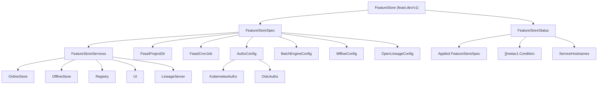
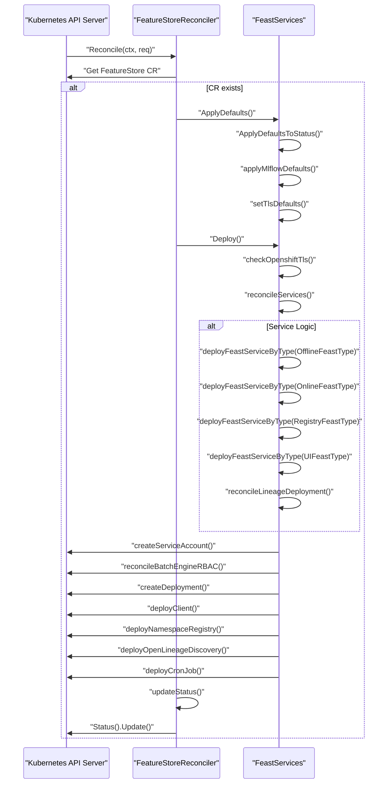
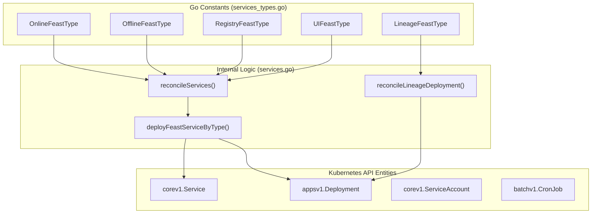

<!-- source: DeepWiki mcp.deepwiki.com · repo feast-dev/feast · page 7.3 Kubernetes Operator · fetched 2026-10-21 -->

# Kubernetes Operator

<details>
<summary>Relevant source files</summary>

The following files were used as context for generating this wiki page:

- [.secrets.baseline](.secrets.baseline)
- [infra/feast-operator/Makefile](infra/feast-operator/Makefile)
- [infra/feast-operator/api/v1/featurestore_types.go](infra/feast-operator/api/v1/featurestore_types.go)
- [infra/feast-operator/api/v1/zz_generated.deepcopy.go](infra/feast-operator/api/v1/zz_generated.deepcopy.go)
- [infra/feast-operator/api/v1alpha1/featurestore_types.go](infra/feast-operator/api/v1alpha1/featurestore_types.go)
- [infra/feast-operator/api/v1alpha1/zz_generated.deepcopy.go](infra/feast-operator/api/v1alpha1/zz_generated.deepcopy.go)
- [infra/feast-operator/bundle/manifests/feast-operator.clusterserviceversion.yaml](infra/feast-operator/bundle/manifests/feast-operator.clusterserviceversion.yaml)
- [infra/feast-operator/bundle/manifests/feast.dev_featurestores.yaml](infra/feast-operator/bundle/manifests/feast.dev_featurestores.yaml)
- [infra/feast-operator/config/crd/bases/feast.dev_featurestores.yaml](infra/feast-operator/config/crd/bases/feast.dev_featurestores.yaml)
- [infra/feast-operator/config/default/related_image_fs_patch.yaml](infra/feast-operator/config/default/related_image_fs_patch.yaml)
- [infra/feast-operator/config/manager/kustomization.yaml](infra/feast-operator/config/manager/kustomization.yaml)
- [infra/feast-operator/config/overlays/odh/delete-namespace.yaml](infra/feast-operator/config/overlays/odh/delete-namespace.yaml)
- [infra/feast-operator/config/overlays/odh/kustomization.yaml](infra/feast-operator/config/overlays/odh/kustomization.yaml)
- [infra/feast-operator/config/overlays/odh/params.env](infra/feast-operator/config/overlays/odh/params.env)
- [infra/feast-operator/config/overlays/odh/params.yaml](infra/feast-operator/config/overlays/odh/params.yaml)
- [infra/feast-operator/config/overlays/rhoai/delete-namespace.yaml](infra/feast-operator/config/overlays/rhoai/delete-namespace.yaml)
- [infra/feast-operator/config/overlays/rhoai/kustomization.yaml](infra/feast-operator/config/overlays/rhoai/kustomization.yaml)
- [infra/feast-operator/config/overlays/rhoai/params.yaml](infra/feast-operator/config/overlays/rhoai/params.yaml)
- [infra/feast-operator/config/rbac/role.yaml](infra/feast-operator/config/rbac/role.yaml)
- [infra/feast-operator/dist/install.yaml](infra/feast-operator/dist/install.yaml)
- [infra/feast-operator/dist/operator-e2e-tests](infra/feast-operator/dist/operator-e2e-tests)
- [infra/feast-operator/docs/api/markdown/ref.md](infra/feast-operator/docs/api/markdown/ref.md)
- [infra/feast-operator/internal/controller/featurestore_controller.go](infra/feast-operator/internal/controller/featurestore_controller.go)
- [infra/feast-operator/internal/controller/featurestore_controller_loglevel_test.go](infra/feast-operator/internal/controller/featurestore_controller_loglevel_test.go)
- [infra/feast-operator/internal/controller/featurestore_controller_test.go](infra/feast-operator/internal/controller/featurestore_controller_test.go)
- [infra/feast-operator/internal/controller/featurestore_controller_tls_test.go](infra/feast-operator/internal/controller/featurestore_controller_tls_test.go)
- [infra/feast-operator/internal/controller/services/repo_config.go](infra/feast-operator/internal/controller/services/repo_config.go)
- [infra/feast-operator/internal/controller/services/repo_config_test.go](infra/feast-operator/internal/controller/services/repo_config_test.go)
- [infra/feast-operator/internal/controller/services/services.go](infra/feast-operator/internal/controller/services/services.go)
- [infra/feast-operator/internal/controller/services/services_test.go](infra/feast-operator/internal/controller/services/services_test.go)
- [infra/feast-operator/internal/controller/services/services_types.go](infra/feast-operator/internal/controller/services/services_types.go)
- [infra/feast-operator/internal/controller/services/tls.go](infra/feast-operator/internal/controller/services/tls.go)
- [infra/feast-operator/internal/controller/services/tls_test.go](infra/feast-operator/internal/controller/services/tls_test.go)
- [infra/feast-operator/internal/controller/services/util.go](infra/feast-operator/internal/controller/services/util.go)
- [infra/feast-operator/test/e2e/e2e_test.go](infra/feast-operator/test/e2e/e2e_test.go)
- [infra/feast-operator/test/previous-version/previous_version_test.go](infra/feast-operator/test/previous-version/previous_version_test.go)
- [infra/feast-operator/test/testdata/feast_integration_test_crs/feast.yaml](infra/feast-operator/test/testdata/feast_integration_test_crs/feast.yaml)
- [infra/feast-operator/test/testdata/feast_integration_test_crs/postgres.yaml](infra/feast-operator/test/testdata/feast_integration_test_crs/postgres.yaml)
- [infra/feast-operator/test/testdata/feast_integration_test_crs/redis.yaml](infra/feast-operator/test/testdata/feast_integration_test_crs/redis.yaml)
- [infra/feast-operator/test/testdata/feast_integration_test_crs/v1alpha1_default_featurestore.yaml](infra/feast-operator/test/testdata/feast_integration_test_crs/v1alpha1_default_featurestore.yaml)
- [infra/feast-operator/test/testdata/feast_integration_test_crs/v1alpha1_remote_registry_featurestore.yaml](infra/feast-operator/test/testdata/feast_integration_test_crs/v1alpha1_remote_registry_featurestore.yaml)
- [infra/feast-operator/test/upgrade/upgrade_test.go](infra/feast-operator/test/upgrade/upgrade_test.go)
- [infra/feast-operator/test/utils/test_util.go](infra/feast-operator/test/utils/test_util.go)
- [sdk/python/tests/integration/rest_api/resource/postgres.yaml](sdk/python/tests/integration/rest_api/resource/postgres.yaml)
- [sdk/python/tests/integration/rest_api/resource/redis.yaml](sdk/python/tests/integration/rest_api/resource/redis.yaml)

</details>


The Feast Kubernetes Operator is a Kubernetes controller that manages `FeatureStore` custom resources (`group: feast.dev`, `version: v1`). It automates provisioning, scaling, configuration injection, and lifecycle management of Feast components by continuously reconciling the desired state specified in the `FeatureStoreSpec` with the actual state running on the Kubernetes cluster.

The operator follows the standard Kubernetes controller pattern, implemented using `controller-runtime`. The main reconciliation logic is encapsulated in the `FeatureStoreReconciler` [infra/feast-operator/internal/controller/featurestore_controller.go:56-59](), which watches custom resource (CR) instances and manages Kubernetes resources like Deployments, Services, ConfigMaps, PersistentVolumeClaims, CronJobs, HorizontalPodAutoscalers, and ServiceMonitors accordingly.

---

## 1. FeatureStore CRD and Architecture

The core abstraction the operator manages is the `FeatureStore` Custom Resource (CR), defined by the FeatureStore CustomResourceDefinition (CRD). This CRD specifies the schema and desired state of a Feast deployment. The `FeatureStore` CR corresponds to a complete feature store installation, configured and managed declaratively.

The architecture within the CRD involves several key layered objects representing specification and status:

| Go Type            | Description                                  | Key Fields / References                                                   |
|--------------------|----------------------------------------------|--------------------------------------------------------------------------|
| `FeatureStore`       | Top-level CR schema                          | Has `Spec` and `Status` fields [infra/feast-operator/api/v1/featurestore_types.go:29-43]() |
| `FeatureStoreSpec`   | Desired state configuration                  | `FeastProject`, `Services`, `AuthzConfig`, `CronJob`, etc.              |
| `FeatureStoreServices` | Defines microservice topologies            | `OnlineStore`, `OfflineStore`, `Registry`, `UI`, `Lineage`               |
| `FeatureStoreStatus` | Current observed runtime state and applied spec | `Applied`, `Conditions`, `ServiceHostnames`, `Phase`                      |
| `AuthzConfig`        | Authorization configuration                  | Defines Kubernetes RBAC, OIDC or NoAuth settings                         |
| `CronJob`            | CronJob configuration for scheduled tasks   | Schedule, Job spec, container configs                                   |

The CRD schema enforces that only one authorization method can be used at a time (`kubernetes`, `oidc`, or `noAuth`). Additionally, curation of MLflow, OpenLineage integration, and batch compute engine config is supported as part of the spec.

### FeatureStore CRD Type Hierarchy


Sources:  
[infra/feast-operator/api/v1/featurestore_types.go:29-43](),  
[infra/feast-operator/api/v1/featurestore_types.go:17-43](),  
[infra/feast-operator/docs/api/markdown/ref.md:20-31](),  
[infra/feast-operator/docs/api/markdown/ref.md:56-66]()

---

## 2. Operator Reconciliation Loop

The reconciliation loop is the core control loop of the operator that continuously attempts to converge the actual cluster state to the user-declared desired state specified in the `FeatureStore` custom resource.

The main entrypoint for reconciliation is the `FeatureStoreReconciler.Reconcile()` method, which is triggered upon `FeatureStore` CR events and periodic resyncs [infra/feast-operator/internal/controller/featurestore_controller.go:80-150](). The reconciliation steps conceptually are:

1. **Fetch and Inspect CR** - Retrieve the `FeatureStore` CR instance from Kubernetes API.
2. **Apply Defaults** - Defaults and auto-discoveries are applied, including MLflow endpoint discovery and TLS flag settings.
3. **Deploy Feast Services** - High-level orchestration of creating/updating Kubernetes objects for all constituent Feast components.
4. **Update CR Status** - Write status subresources reflecting the current observed deployment state with conditions and phases.

Internally, reconciliation delegates core responsibility to the `FeastServices` structure, which encapsulates methods like `ApplyDefaults()` and `Deploy()`.

### Reconciliation Loop Flow


Sources:  
[infra/feast-operator/internal/controller/featurestore_controller.go:84-150](),  
[infra/feast-operator/internal/controller/services/services.go:44-54](),  
[infra/feast-operator/internal/controller/services/services.go:61-96](),  
[infra/feast-operator/internal/controller/services/services.go:99-165](),  
[infra/feast-operator/internal/controller/services/services.go:169-239]()

---

## 3. Service Deployment Patterns

The operator deploys Feast components according to `FeastServiceType` constants representing service categories (online store, offline store, registry, UI, lineage, client). Each service type has specific port assignments, persistent volume claims, and resource requirements [infra/feast-operator/internal/controller/services/services_types.go:84-92]().

| FeastServiceType | Spec Path in CR                            | Default Target Port | Default Storage Request |
|------------------|-------------------------------------------|---------------------|-------------------------|
| `OnlineFeastType` | `Spec.Services.OnlineStore`                | 6566                | 5Gi                    |
| `OfflineFeastType`| `Spec.Services.OfflineStore`               | 8815                | 20Gi                   |
| `RegistryFeastType`| `Spec.Services.Registry.Local`            | 6570                | 5Gi                    |
| `UIFeastType`     | `Spec.Services.UI`                         | 8888                | None                   |
| `LineageFeastType`| `Spec.Services.Lineage`                    | 6580                | None                   |

The reconciliation of these services happens in the `reconcileServices()` method, which validates persistence configurations, creates or deletes services and deployments accordingly [infra/feast-operator/internal/controller/services/services.go:169-239]().

### Service Type to Operator Internal Logic Mapping


Sources:  
[infra/feast-operator/internal/controller/services/services_types.go:59-92](),  
[infra/feast-operator/internal/controller/services/services.go:169-239]()

---

## 4. Configuration Injection via `TMP_FEATURE_STORE_YAML_BASE64`

A distinctive feature of the operator is dynamic configuration injection into Feast service pods. Rather than mounting static ConfigMaps or volumes containing `feature_store.yaml` files, the operator serializes the repository config into a base64-encoded string and injects it as an environment variable inside containers.

This mechanism is realized as:

1. **Config Creation:** Using `getServiceRepoConfig()` [infra/feast-operator/internal/controller/services/repo_config.go:49-52](), the operator constructs the effective `feature_store.yaml` config from the reconciled `FeatureStore` status.
2. **Serialization:** The config object is marshaled into YAML and then encoded with base64 [infra/feast-operator/internal/controller/services/repo_config.go:33-39]().
3. **Injection:** The base64 string is injected into service container environments under the `TMP_FEATURE_STORE_YAML_BASE64` variable [infra/feast-operator/internal/controller/services/services_types.go:28]().
4. **Runtime Handling:** The Feast feature server startup scripts read this env var, decode the YAML, and configure the feature store accordingly without requiring cluster disk volume mounts.

This approach simplifies config management, reduces external dependencies, and supports seamless repository initializations from sources like git, packaged repos, or inline initialization.

Sources:  
[infra/feast-operator/internal/controller/services/services_types.go:28](),  
[infra/feast-operator/internal/controller/services/repo_config.go:33-52]()

---

## 5. Authorization (OIDC / Kubernetes RBAC / NoAuth)

The operator supports flexible authorization configurations via the `AuthzConfig` field in the `FeatureStoreSpec`. The CRD schema enforces that exactly one authorization method be selected among:

- **Kubernetes RBAC Authorization:** Integrates with Kubernetes native Role-Based Access Control by deploying specified RBAC `roles` in the `FeatureStore` namespace [infra/feast-operator/dist/install.yaml:52-137](). The operator manages these roles and binds them appropriately.
- **OIDC (OpenID Connect) Authorization:** Supports external identity providers with OIDC protocols. Configuration includes `issuerUrl`, secret references containing client credentials, and optional self-signed CA certificates mounted from ConfigMaps [infra/feast-operator/dist/install.yaml:71-132]().
- **NoAuth:** Explicitly disables authentication and authorization for development/testing environments where security is relaxed [infra/feast-operator/dist/install.yaml:68-70]().

A CEL validation rule on the CR enforces mutual exclusivity:

```
[has(self.kubernetes), has(self.oidc), has(self.noAuth)].exists_one(c, c)
```

Sources:  
[infra/feast-operator/dist/install.yaml:52-137](),  
[infra/feast-operator/internal/controller/services/services_types.go:111-113]()

---

## 6. TLS Support

TLS termination and secure transport are managed transparently by the operator through the following features:

- **Port Switching:** When TLS is enabled, service ports are automatically switched from HTTP (port 80) to HTTPS (port 443) [infra/feast-operator/internal/controller/services/services.go:47-49](), [infra/feast-operator/internal/controller/services/services_types.go:59-60]().
- **Certificate Mounting:** For services requiring TLS certificates, custom OIDC CA certificates can be injected into containers by mounting ConfigMaps to predefined paths like `/etc/pki/tls/oidc-ca/ca.crt` [infra/feast-operator/internal/controller/services/services_types.go:71-72]().
- **Platform Integration:** The operator leverages OpenShift serving-cert annotations to support auto-provisioning of trusted serving certificates in OpenShift clusters [infra/feast-operator/internal/controller/services/services_types.go:74]().

Internally, the operator sets proper volume mounts, annotations, and environment variables to interface with Kubernetes or OpenShift TLS infrastructure.

Sources:  
[infra/feast-operator/internal/controller/services/services.go:47-49](),  
[infra/feast-operator/internal/controller/services/services_types.go:59-74]()

---

## 7. OpenShift and ODH Overlays

The Feast Operator is optimized for Red Hat OpenShift and Open Data Hub (ODH) environments, supporting specialized overlays and platform-specific integrations:

- **OpenShift Routes:** The operator reconciles OpenShift `Route` resources to expose Feast UIs and services externally with custom hostnames [infra/feast-operator/internal/controller/services/services.go:215-217]().
- **Trusted CA Bundles:** It supports injection of trusted platform CA bundles using the `config.openshift.io/inject-trusted-cabundle` annotation and mounts under specific paths to ensure TLS validation compatibility [infra/feast-operator/internal/controller/services/services_types.go:67-69]().
- **MLflow Auto-Discovery:** In OpenShift-based platforms like RHOAI and ODH, the operator attempts to discover MLflow tracking and UI URIs dynamically, enabling seamless integration without explicit user configuration [infra/feast-operator/internal/controller/services/services.go:61-96]().
- **Dedicated Kustomize Overlays:** Sample overlays under `config/overlays/odh` and `config/overlays/rhoai` provide curated manifests and environment parameters for these platforms.

These platform-specific enhancements ensure Feast is fit for enterprise-grade deployment while maintaining Kubernetes-native operability.

Sources:  
[infra/feast-operator/internal/controller/services/services.go:61-96](),  
[infra/feast-operator/internal/controller/services/services.go:215-217](),  
[infra/feast-operator/internal/controller/services/services_types.go:67-69]()

---

# Summary

The Feast Kubernetes Operator bridges the declarative specification of a feature store via the `FeatureStore` CRD to the underlying Kubernetes infrastructure by executing a reconciliation loop that deploys microservices, manages secrets, configures authorization and TLS, and supports platform-specific overlays for OpenShift and ODH. Its design leverages dynamic configuration injection, modular service deployment, and flexible security configurations to provide a robust and operator-driven ML feature store platform.

---

**End of Section 7.3 Kubernetes Operator**

Sources Summary:  
- [infra/feast-operator/api/v1/featurestore_types.go:29-43]()  
- [infra/feast-operator/internal/controller/featurestore_controller.go:56-150]()  
- [infra/feast-operator/internal/controller/services/services.go:44-239]()  
- [infra/feast-operator/internal/controller/services/services_types.go:28-92]()  
- [infra/feast-operator/internal/controller/services/repo_config.go:33-52]()  
- [infra/feast-operator/dist/install.yaml:52-137]()  
- [infra/feast-operator/internal/controller/services/services_types.go:59-74]()

---

