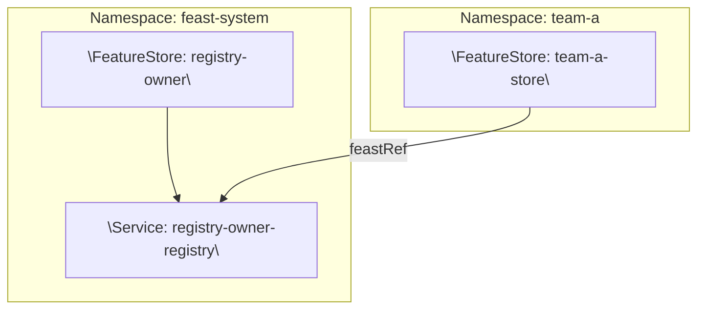
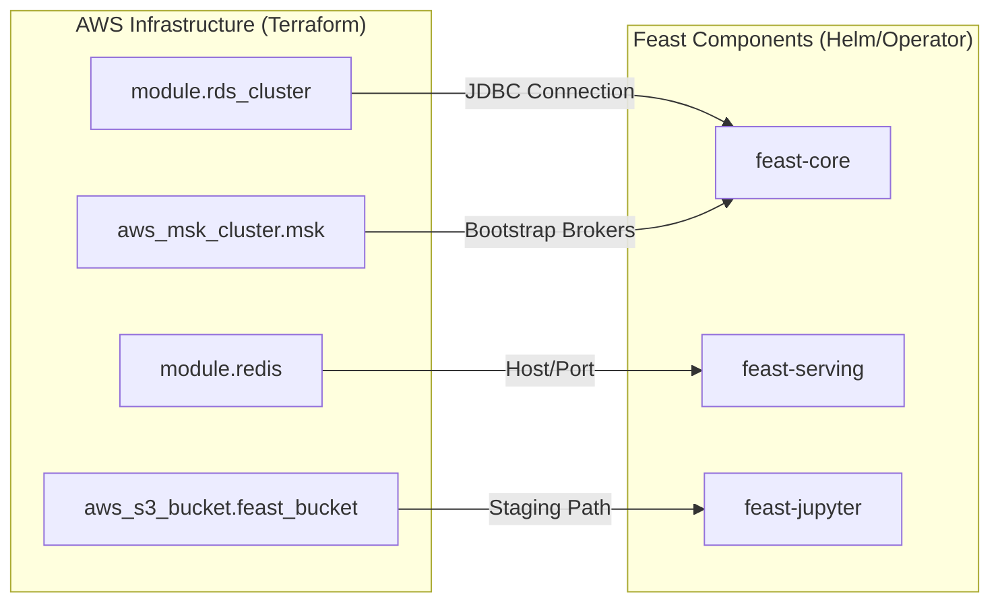

<!-- source: DeepWiki mcp.deepwiki.com · repo feast-dev/feast · page 7.4 Production Deployment Patterns · fetched 2026-10-21 -->

# Production Deployment Patterns

<details>
<summary>Relevant source files</summary>

The following files were used as context for generating this wiki page:

- [docs/how-to-guides/feast-on-kubernetes.md](docs/how-to-guides/feast-on-kubernetes.md)
- [docs/how-to-guides/running-feast-in-production.md](docs/how-to-guides/running-feast-in-production.md)
- [docs/how-to-guides/scaling-feast.md](docs/how-to-guides/scaling-feast.md)
- [docs/how-to-guides/starting-feast-servers-tls-mode.md](docs/how-to-guides/starting-feast-servers-tls-mode.md)
- [docs/reference/feature-servers/README.md](docs/reference/feature-servers/README.md)
- [docs/reference/feature-servers/offline-feature-server.md](docs/reference/feature-servers/offline-feature-server.md)
- [docs/reference/registries/remote.md](docs/reference/registries/remote.md)
- [infra/charts/feast-feature-server/README.md.gotmpl](infra/charts/feast-feature-server/README.md.gotmpl)
- [infra/charts/feast/README.md.gotmpl](infra/charts/feast/README.md.gotmpl)
- [infra/feast-operator/README.md](infra/feast-operator/README.md)
- [infra/feast-operator/bundle/manifests/feast-operator-controller-manager-metrics-service_v1_service.yaml](infra/feast-operator/bundle/manifests/feast-operator-controller-manager-metrics-service_v1_service.yaml)
- [infra/feast-operator/config/default/kustomization.yaml](infra/feast-operator/config/default/kustomization.yaml)
- [infra/feast-operator/config/default/metrics_service.yaml](infra/feast-operator/config/default/metrics_service.yaml)
- [infra/feast-operator/config/manager/manager.yaml](infra/feast-operator/config/manager/manager.yaml)
- [infra/feast-operator/config/prometheus/monitor.yaml](infra/feast-operator/config/prometheus/monitor.yaml)
- [infra/feast-operator/config/samples/kustomization.yaml](infra/feast-operator/config/samples/kustomization.yaml)
- [infra/feast-operator/config/samples/v1_featurestore_scaling_hpa.yaml](infra/feast-operator/config/samples/v1_featurestore_scaling_hpa.yaml)
- [infra/feast-operator/config/samples/v1_featurestore_scaling_static.yaml](infra/feast-operator/config/samples/v1_featurestore_scaling_static.yaml)
- [infra/terraform/aws/README.md](infra/terraform/aws/README.md)
- [infra/terraform/aws/eks.tf](infra/terraform/aws/eks.tf)
- [infra/terraform/aws/emr.tf](infra/terraform/aws/emr.tf)
- [infra/terraform/aws/helm.tf](infra/terraform/aws/helm.tf)
- [infra/terraform/aws/iam.tf](infra/terraform/aws/iam.tf)
- [infra/terraform/aws/msk.tf](infra/terraform/aws/msk.tf)
- [infra/terraform/aws/online_store.tf](infra/terraform/aws/online_store.tf)
- [infra/terraform/aws/outputs.tf](infra/terraform/aws/outputs.tf)
- [infra/terraform/aws/rds.tf](infra/terraform/aws/rds.tf)
- [infra/terraform/aws/s3.tf](infra/terraform/aws/s3.tf)
- [infra/terraform/aws/variables.tf](infra/terraform/aws/variables.tf)
- [protos/feast/core/Store.proto](protos/feast/core/Store.proto)
- [sdk/python/tests/unit/infra/registry/test_remote_registry_mtls.py](sdk/python/tests/unit/infra/registry/test_remote_registry_mtls.py)
- [sdk/python/tests/utils/ssl_certifcates_util.py](sdk/python/tests/utils/ssl_certifcates_util.py)

</details>


## Purpose and Scope
This page provides comprehensive technical guidance on running Feast in production environments. It covers scaling architectures, high-availability (HA) configurations, database-backed registry backends, production monitoring, TLS/mTLS setup, and GitOps workflows for feature definitions. It details how to transition from local sandboxes to production-grade deployments using the Kubernetes operator, Terraform templates, and enterprise storage backends.

Sources: [docs/how-to-guides/running-feast-in-production.md:1-7]()

---

## 1. Overview of Production Topologies
A typical production architecture separates Feast's modular components into independently scalable services. While local development runs everything in-process, production deployments decouple the registry, offline compute, and online serving tiers.

| Topology             | Target Audience                 | Key Traits                                                        |
|----------------------|--------------------------------|------------------------------------------------------------------|
| **Minimal Production**   | Small teams, POCs moving to production | Single namespace, PVC persistence, simple setup.                 |
| **Standard Production**  | Most production workloads            | HA registry, autoscaling, TLS termination, RBAC.                 |
| **Enterprise Production**| Large organizations, multi-tenant   | Namespace isolation, managed DB/Redis stores, full observability.|

**Diagram: Production Service Architecture and Code Entity Mapping**

```mermaid
graph TB
  subgraph "Management & Control Plane"
    CICD["\"feast apply\" CLI"]
    OP["\"feast-operator-controller-manager\" (Manager)"]
  end

  subgraph "Registry Tier"
    REGSVR["\"RemoteRegistry\" (gRPC :6570)"]
    SQLREG["\"SqlRegistry\" (PostgreSQL / MySQL)"]
    REGSVR --> SQLREG
  end

  subgraph "Offline Tier"
    OFFSVR["\"offline_feature_server\" (Arrow Flight :8815)"]
    OFFSTORE["\"OfflineStore\" (BigQuery / Snowflake)"]
    OFFSVR --> OFFSTORE
  end

  subgraph "Online Tier"
    PYSVR["\"FeatureStore\" Server (:6566)"]
    ONLINESTORE["\"OnlineStore\" (Redis / DynamoDB)"]
    PYSVR --> ONLINESTORE
  end

  subgraph "Clients"
    TRAIN["Training Pipeline FeatureStore SDK"]
    INFER["Inference Service HTTP Client"]
  end

  OP -->|"manages CRD"| PYSVR
  CICD --> REGSVR
  TRAIN --> REGSVR
  TRAIN --> OFFSVR
  INFER --> PYSVR
  PYSVR --> REGSVR
```

Sources: [docs/how-to-guides/running-feast-in-production.md:7-19](), [docs/how-to-guides/feast-on-kubernetes.md:48-70](), [sdk/python/feast/feature_server.py:26-45]()

---

## 2. Registry Configuration and Backends

### SQL Registry (`SqlRegistry`)
For production workloads, a SQL-backed registry (`SqlRegistry` backed by PostgreSQL or MySQL) is recommended to support concurrent feature updates and transactional safety across distributed training and inference pods. This avoids concurrency bottlenecks of the default file-based registry.  
Sources: [docs/how-to-guides/running-feast-in-production.md:37-41]()

### Remote Registry (`RemoteRegistry`)
The `RemoteRegistry` class acts as a gRPC client implementing the `BaseRegistry` interface. It allows Feast clients (e.g., feature servers, training pipelines) to fetch feature metadata from a centralized registry server over the network without direct DB credentials.  
Sources: [docs/reference/registries/remote.md:1-28]()

### Caching and TTL
Feature servers cache registry definitions locally with a configurable `registry_ttl_sec` (default 60 seconds) to reduce latency for feature metadata lookups. This parameter is set in `feature_store.yaml`.  
Sources: [sdk/python/feast/feature_server.py:51](), [docs/reference/feature-servers/python-feature-server.md:27-32]()

**Diagram: Registry Backend Selection Logic and Code Entities**

```mermaid
flowchart TD
  CONFIG["\"RepoConfig\" (feature_store.yaml)"]
  FILE["\"FileRegistry\" (local/s3/gs path)"]
  SQL["\"SqlRegistry\" (registry_type: sql)"]
  REMOTE["\"RemoteRegistry\" (registry_type: remote)"]

  CONFIG -->|"path: s3://..."| FILE
  CONFIG -->|"registry_type: sql"| SQL
  CONFIG -->|"registry_type: remote"| REMOTE
```

Sources: [docs/how-to-guides/running-feast-in-production.md:37-41](), [docs/reference/registries/remote.md:1-28](), [sdk/python/feast/feature_server.py:51]()

---

## 3. Scaling and High Availability (HA)

### Horizontal Scaling with the Feast Operator
The Feast Operator manages `FeatureStore` Custom Resources (CRs) on Kubernetes, enabling horizontal scaling with static replica counts (`spec.replicas`) or Horizontal Pod Autoscalers (HPA).  
Key constraints:  
- Requires **DB-backed persistence** for online stores, offline stores, and registry to prevent data corruption and leverage concurrent access.  
- File-based persistence (e.g., SQLite, local file registries) is incompatible with multiple replicas due to lack of concurrency support.  
Sources: [docs/how-to-guides/scaling-feast.md:28-40,36]()

### Feature Server Performance Optimization
To efficiently serve online requests, tune the Python feature server’s Uvicorn/Gunicorn workers:  
- `--workers -1`: Automatically calculates optimal workers based on CPU cores ($2 \times \text{CPU cores} + 1$).  
- `--worker-connections`: Controls max simultaneous client connections per worker (default 1000).  
- `--max-requests`: Restarts workers after a set number of requests to control memory leaks.  
Sources: [docs/reference/feature-servers/python-feature-server.md:27-37]()

### Online Store HA
Redis can be deployed in clustered mode using `Store.StoreType.REDIS_CLUSTER`, enabling partitioning and replica read preferences (e.g., MASTER, REPLICA_PREFERRED) to enhance availability and throughput.  
The `RedisClusterConfig` proto contains options for connection strings, retry policies, flush frequencies, key prefixes, and fallback prefixes for seamless cluster management.  
Sources: [protos/feast/core/Store.proto:29-89]()

---

## 4. Kubernetes Operator and Persistence Patterns

### Persistence Options
- **PersistentVolumeClaim (PVC):** Provides durable file storage for registries or online/offline stores using a file-based persistence backend, suitable for single-node or simple state persistence.  
- **Managed Databases:** External stores like PostgreSQL, MySQL, or Redis, with credentials injected via Kubernetes Secrets (`secretRef`), supporting concurrent and HA workloads.  
Sources: [infra/feast-operator/README.md:11](), [docs/how-to-guides/scaling-feast.md:51-64]()

### Registry Topology with Operator
The operator supports different registry topologies including local registry pods, remote registry services, and cross-namespace references using `feastRef` for multi-tenant isolation.  

**Diagram: Registry Topology in Operator**



Sources: [infra/feast-operator/README.md:128-162](), [infra/feast-operator/README.md:13-21]()

---

## 5. GitOps Workflow and CI/CD for Feature Definitions

To maintain a clean and auditable production environment, version feature definitions in Git repositories and automate registry updates via CI/CD:  

1. **Store feature definitions (.py files) and `feature_store.yaml` in Git.**  
2. **CI pipeline:** Run `feast plan` during PRs to validate feature schema changes and catch conflicts early.  
3. **CD pipeline:** Run `feast apply` on merge to update the SQL registry backend and propagate changes to online/offline stores.  

This workflow ensures the registry is always in sync with code commits, enabling promotion from staging to production environments reliably.  

**Diagram: GitOps Deployment Flow**

```mermaid
graph TD
  subgraph "GitOps Repository"
    DEFS["Feature Definitions (.py)"]
    STORE_YAML["feature_store.yaml"]
  end

  subgraph "CI/CD Pipeline"
    PLAN["\"feast plan\" (Validation)"]
    APPLY["\"feast apply\" (Registration)"]
  end

  subgraph "Production Environment"
    REG["\"SqlRegistry\" (Database)"]
    ON["\"OnlineStore\" (Redis/DynamoDB)"]
    OFF["\"OfflineStore\" (Snowflake/BigQuery)"]
  end

  DEFS --> PLAN
  DEFS --> APPLY
  APPLY --> REG
  APPLY --> ON
  APPLY --> OFF
```

Sources: [docs/how-to-guides/running-feast-in-production.md:31-46]()

---

## 6. Materialization and Compute Engines

### Scaling Materialization Computation
The default in-process materialization engine loads datasets into memory, limiting scalability. Production deployments should use pluggable compute engines that scale out materialization jobs:  

- **Ray Compute Engine:** Distributes point-in-time joins and parallelizes writes to online stores using `RayComputeEngine`.  
- **Snowflake Compute Engine:** Scales materialization on Snowflake via SQL workflows.  
- **Custom Engines:** Users can build specialized compute engines compatible with Feast’s compute engine plugin interface for their infrastructure.  

Sources: [sdk/python/feast/infra/compute_engines/ray/compute.py:39-45](), [docs/how-to-guides/running-feast-in-production.md:55-114]()

### Online Write Batch Size Configuration
To reduce peak memory usage during materialization, set the `online_write_batch_size` parameter in `feature_store.yaml`. This batches proto conversions and writes to online stores in chunks rather than a full dataset load. Example:  
```yaml
materialization:
  online_write_batch_size: 10000  # rows per write batch; reduces peak memory proportionally
```
Sources: [docs/how-to-guides/running-feast-in-production.md:78-85]()

### Scheduled Materialization with Airflow
Materialization can be orchestrated with Airflow’s `PythonOperator` to run incremental materialization jobs periodically. Example snippet:  
```python
@task()
def materialize(data_interval_start=None, data_interval_end=None):
    store = FeatureStore(config=repo_config)
    store.materialize_incremental(data_interval_start, data_interval_end, feature_views=["my_fv_name"])
```
Sources: [docs/how-to-guides/running-feast-in-production.md:87-114]()

---

## 7. Monitoring, Observability, and TLS Setup

### Prometheus Metrics
Feast emits rich Prometheus metrics for CPU, memory usage, request latency, online features served, materialization jobs, and feature freshness. Metrics are implemented via `prometheus_client` with support for multi-process server architectures (Gunicorn/Uvicorn). Metrics categories are grouped under resources like `resource`, `request`, `online_features`, `materialization`, `freshness`.  

Examples of key metrics:  
- `feast_feature_server_cpu_usage`  
- `feast_feature_server_memory_usage`  
- `feast_feature_server_request_latency_seconds`  
- `feature_freshness_seconds`  

Sources: [sdk/python/feast/metrics.py:15-232](), [sdk/python/tests/unit/test_metrics.py:78-185]()

### TLS and Mutual TLS (mTLS) Setup
Secure communication with remote registry servers and feature servers is supported via TLS/mTLS. Configure `feature_store.yaml` with parameters pointing to TLS cert and key files:  
- `cert`: CA certificate bundle for verifying server certs.  
- `client_cert` and `client_key`: Client certificate and private key for mTLS.  
- `authority`: Overrides gRPC `:authority` header for proxy hostname validation.  

This enables running Feast components in secure production environments with encrypted RPC communication.  
Sources: [docs/reference/registries/remote.md:30-49]()

---

## 8. Terraform Infrastructure Templates and Example Deployments

Feast provides example Terraform modules, especially for AWS, to provision cloud infrastructure ideal for production Feast deployments:  

| AWS Component          | Feast Role                | Code Reference |
|-----------------------|---------------------------|---------------|
| **RDS (PostgreSQL)**  | SQL Registry Backend       | [infra/terraform/aws/helm.tf:33-37]() |
| **ElastiCache (Redis)**| Online Store               | [infra/terraform/aws/helm.tf:60-66]() |
| **MSK (Kafka)**       | Stream Source              | [infra/terraform/aws/helm.tf:40-47]() |
| **S3 Bucket**         | Artifact Staging           | [infra/terraform/aws/helm.tf:91-94]() |

**Diagram: Infrastructure Mapping & Data Flow**



Sources: [infra/terraform/aws/helm.tf:10-101]()

---

# Summary

This page has covered the key technical patterns for robust, scalable, and secure production deployments of Feast. With modular components, multiple registry backend options, Kubernetes operator support, scalable materialization engines, and observability integrations, Feast can meet demanding ML feature serving workloads across diverse enterprise environments.

For further detailed deployment examples and architecture diagrams, consult the related guides:  
- [Feast Production Deployment Topologies](./production-deployment-topologies.md)  
- [Scaling Feast](./scaling-feast.md)  
- [Feast Operator Configuration](../infra/feast-operator/README.md)  
- [TLS Setup for Remote Registries](./starting-feast-servers-tls-mode.md)

---

