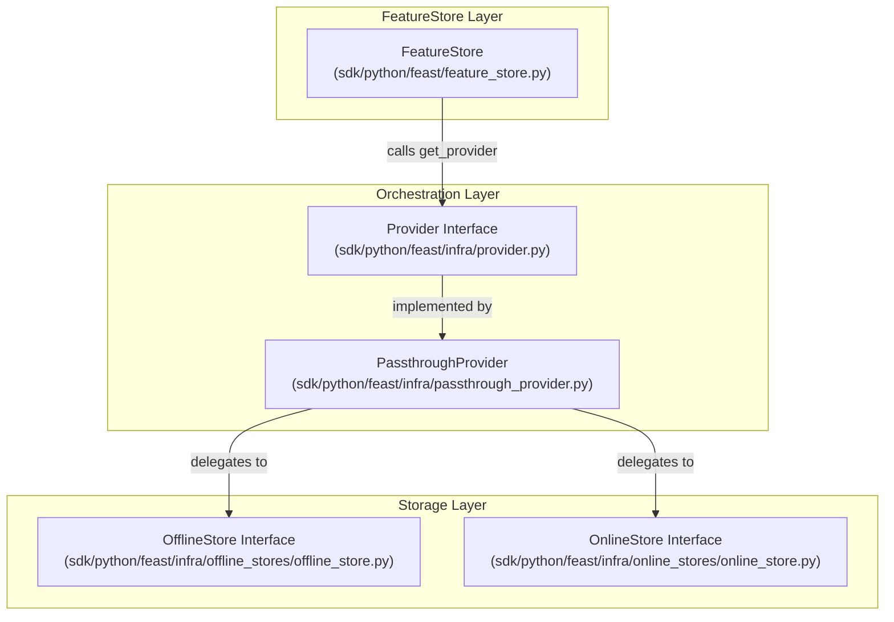
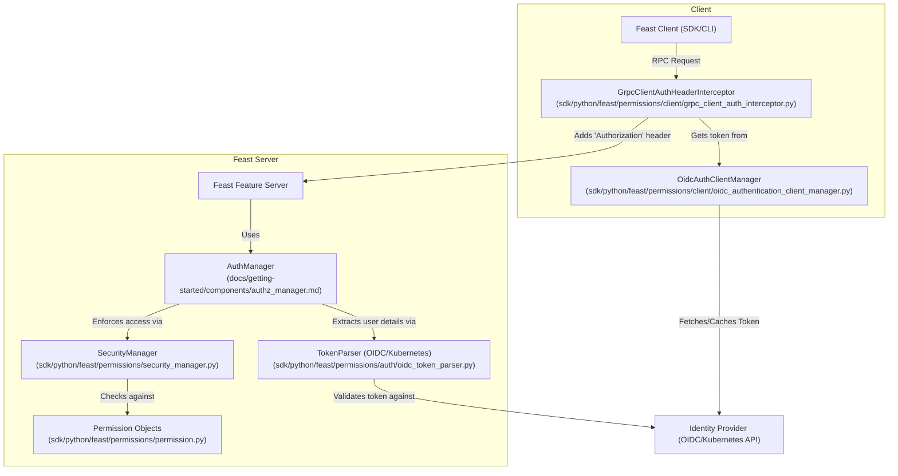

<!-- source: DeepWiki mcp.deepwiki.com · repo feast-dev/feast · page 8 Advanced Topics · fetched 2026-10-21 -->

# Advanced Topics

Relevant source files

The following files were used as context for generating this wiki page:

- [docs/getting-started/genai.md](docs/getting-started/genai.md)
- [docs/how-to-guides/customizing-feast/adding-a-new-offline-store.md](docs/how-to-guides/customizing-feast/adding-a-new-offline-store.md)
- [docs/how-to-guides/customizing-feast/adding-support-for-a-new-online-store.md](docs/how-to-guides/customizing-feast/adding-support-for-a-new-online-store.md)
- [docs/reference/alpha-vector-database.md](docs/reference/alpha-vector-database.md)
- [docs/reference/online-stores/cassandra.md](docs/reference/online-stores/cassandra.md)
- [docs/reference/online-stores/overview.md](docs/reference/online-stores/overview.md)
- [docs/reference/online-stores/scylladb.md](docs/reference/online-stores/scylladb.md)
- [sdk/python/docs/source/feast.infra.online_stores.cassandra_online_store.rst](sdk/python/docs/source/feast.infra.online_stores.cassandra_online_store.rst)
- [sdk/python/docs/source/feast.infra.online_stores.couchbase_online_store.rst](sdk/python/docs/source/feast.infra.online_stores.couchbase_online_store.rst)
- [sdk/python/docs/source/feast.infra.online_stores.elasticsearch_online_store.rst](sdk/python/docs/source/feast.infra.online_stores.elasticsearch_online_store.rst)
- [sdk/python/docs/source/feast.infra.online_stores.hazelcast_online_store.rst](sdk/python/docs/source/feast.infra.online_stores.hazelcast_online_store.rst)
- [sdk/python/docs/source/feast.infra.online_stores.hbase_online_store.rst](sdk/python/docs/source/feast.infra.online_stores.hbase_online_store.rst)
- [sdk/python/docs/source/feast.infra.online_stores.milvus_online_store.rst](sdk/python/docs/source/feast.infra.online_stores.milvus_online_store.rst)
- [sdk/python/docs/source/feast.infra.online_stores.mysql_online_store.rst](sdk/python/docs/source/feast.infra.online_stores.mysql_online_store.rst)
- [sdk/python/docs/source/feast.infra.online_stores.postgres_online_store.rst](sdk/python/docs/source/feast.infra.online_stores.postgres_online_store.rst)
- [sdk/python/docs/source/feast.infra.online_stores.qdrant_online_store.rst](sdk/python/docs/source/feast.infra.online_stores.qdrant_online_store.rst)
- [sdk/python/feast/infra/online_stores/cassandra_online_store/cassandra_online_store.py](sdk/python/feast/infra/online_stores/cassandra_online_store/cassandra_online_store.py)
- [sdk/python/feast/infra/online_stores/scylladb_online_store/__init__.py](sdk/python/feast/infra/online_stores/scylladb_online_store/__init__.py)
- [sdk/python/feast/infra/online_stores/scylladb_online_store/scylladb.py](sdk/python/feast/infra/online_stores/scylladb_online_store/scylladb.py)
- [sdk/python/tests/integration/online_store/test_scylladb_online_store.py](sdk/python/tests/integration/online_store/test_scylladb_online_store.py)
- [sdk/python/tests/unit/infra/online_store/test_cassandra_online_store.py](sdk/python/tests/unit/infra/online_store/test_cassandra_online_store.py)
- [sdk/python/tests/universal/feature_repos/universal/online_store/scylladb.py](sdk/python/tests/universal/feature_repos/universal/online_store/scylladb.py)

This page covers advanced use cases for extending and customizing Feast beyond standard feature store operations. It introduces custom extensions, streaming support, logging and monitoring, security and permissions, Generative AI (GenAI) and Retrieval Augmented Generation (RAG) workflows, and various integrations. These topics build upon the core feature store concepts and deployment patterns.

For foundational concepts, see [Core Concepts](#2). For deployment guidance, see [Deployment](#7). For testing custom implementations, see [Testing and Quality Assurance](#5).

---

## Building Custom Extensions

Feast supports extensibility for providers, offline stores, online stores, and registries via well-defined plugin interfaces. Developers can implement interfaces such as:

- `Provider` for orchestrating storage and compute operations [sdk/python/feast/infra/provider.py:51-56]().
- `OfflineStore` and `OnlineStore` interfaces to add or customize storage backends [sdk/python/feast/infra/offline_stores/offline_store.py:41-95](), [sdk/python/feast/infra/online_stores/online_store.py:26-60]().
- Registry backends for metadata persistence.

Custom extensions register via `feature_store.yaml` using mappings like `ONLINE_STORE_CLASS_FOR_TYPE` and `OFFLINE_STORE_CLASS_FOR_TYPE` that resolve full class paths dynamically [sdk/python/feast/repo_config.py:39-44](), [sdk/python/feast/repo_config.py:69-92]().

Developers typically build infrastructure lifecycle management (creating tables, indexes) in `update` and `teardown` methods alongside read and write methods for batch and online data operations [docs/how-to-guides/customizing-feast/adding-support-for-a-new-online-store.md:22-168](), [docs/how-to-guides/customizing-feast/adding-a-new-offline-store.md:48-114]().

**Provider Extension Flow**

For details, see [Building Custom Extensions](#8.1).

Sources: [sdk/python/feast/infra/provider.py:51-56](), [sdk/python/feast/infra/passthrough_provider.py:59-84](), [sdk/python/feast/repo_config.py:39-44](), [docs/how-to-guides/customizing-feast/adding-support-for-a-new-online-store.md:1-168](), [docs/how-to-guides/customizing-feast/adding-a-new-offline-store.md:1-114]()

---

## Streaming Features and Push API

Feast supports ingestion of real-time feature updates via streaming sources and a Push API.

`StreamFeatureView` objects define features with both streaming and batch sources, enabling low-latency serving alongside historical data retrieval [sdk/python/feast/stream_feature_view.py:46-51](). Supported stream sources include Kafka and `PushSource` allowing client-driven feature ingestion [sdk/python/feast/data_source.py:55-58](). The SDK method `FeatureStore.push()` performs Push mode ingestion with control over sync/async and online/offline write targets [sdk/python/feast/feature_store.py:2200-2210]().

Typical streaming ingestion flows involve:

- Defining a `StreamFeatureView` with an associated stream source (e.g., Kafka topic).
- Features pushed into the stream are processed in real-time by Feast materialization pipelines or the Spark Kafka processor.
- Materialization writes batch views for offline analysis and updates the online store for low latency serving.

For details, see [Streaming Features and Push API](#8.2).

Sources: [sdk/python/feast/stream_feature_view.py:46-51](), [sdk/python/feast/data_source.py:55-58](), [sdk/python/feast/feature_store.py:2200-2210]()

---

## Feature Logging and Monitoring

Feast offers rich observability for feature data and serving pipelines.

- Metrics: Prometheus metrics capture request volumes, latencies, and feature freshness.
- Tracing: OpenTelemetry integration supports distributed tracing for requests across services [docs/getting-started/components/open-telemetry.md:1-15]().
- Feature Logging: The system captures feature request and response pairs, enabling auditing and debugging [sdk/python/feast/feature_store.py:108-108]().
- Freshness Tracking: Built-in freshness monitors detect data staleness across online and offline stores.
- Data Quality Monitoring (DQM): Supports saved datasets and monitoring workflows with alerting.
- UI: The Feast Web UI provides dashboards for monitoring feature store health, freshness, and data quality.

For details, see [Feature Logging and Monitoring](#8.3).

Sources: [docs/getting-started/components/open-telemetry.md:1-15](), [sdk/python/feast/feature_store.py:108-108]()

---

## GenAI and RAG Integration

Feast has substantial support for Generative AI (GenAI) workflows, especially Retrieval Augmented Generation (RAG).

### Vector Database Integrations

Feast supports multiple vector database backends to store embeddings and efficiently perform similarity search:

| Vector Database   | Retrieval | Indexing | V2 API Support* | Online Read |
|-------------------|-----------|----------|-----------------|-------------|
| Milvus            | ✓         | ✓        | ✓               | ✓           |
| SQLite            | ✓         |          | ✓               | ✓           |
| Elasticsearch     | ✓         | ✓        |                 |             |
| Pgvector (Postgres)| ✓         |          |                 |             |
| Qdrant            | ✓         | ✓        |                 |             |
| ScyllaDB          | ✓         | ✓        | ✓               | ✓           |
| Faiss             |           |          |                 |             |

\* V2 API enables retrieving features alongside vector embeddings in a unified call.

These backends expose advanced features such as HNSW approximate nearest neighbor indexes, metadata filtering compatible with OpenAI-style APIs, and direct vector embedding storage [docs/reference/alpha-vector-database.md:10-18]().

### RAG Workflows

Feast enables building production RAG pipelines by:

- Storing and versioning document embeddings as features.
- Performing vector similarity search with filterable metadata.
- Retrieving both vector embeddings and structured features in a single API call.
- Providing versioning, governance, and lineage on document features.

The `DocEmbedder` class orchestrates chunking documents, generating embeddings, transforming schemas, and ingesting them into online vector stores [docs/getting-started/genai.md:60-85]().

Additionally, Feast exposes OpenAI-compatible vector store endpoints that serve discovery, metadata fetching, and search through plain-text queries with server-side embedding, enabling integration with AI agents and tooling [docs/reference/alpha-vector-database.md:47-54]().

**GenAI Retrieval Integration**

```mermaid
graph TD
    subgraph "Client Space"
        LLM["LLM / AI Agent"]
        REQ["retrieve_online_documents_v2()"]
        OPENAI_API["OpenAI-Compatible API<br/>(/v1/vector_stores/{id}/search)"]
    end

    subgraph "Feast Core"
        PROV["Provider<br/>(sdk/python/feast/infra/provider.py)"]
        FV["FeatureView<br/>(sdk/python/feast/feature_view.py)"]
        EMBEDDER["DocEmbedder<br/>(feast.DocEmbedder)"]
    end

    subgraph "Vector Storage"
        SQ["SqliteOnlineStore<br/>(sdk/python/feast/infra/online_stores/sqlite.py)"]
        MIL["MilvusOnlineStore<br/>(sdk/python/feast/infra/online_stores/milvus_online_store/milvus.py)"]
        QDRANT["QdrantOnlineStore<br/>(feast.infra.online_stores.qdrant.QdrantOnlineStore)"]
        ES["ElasticsearchOnlineStore<br/>(feast.infra.online_stores.elasticsearch.ElasticsearchOnlineStore)"]
        PGVECTOR["PostgresOnlineStore<br/>(sdk/python/feast/infra/online_stores/postgres.py)"]
        SCYLLADB["ScyllaDBOnlineStore<br/>(sdk/python/feast/infra/online_stores/scylladb_online_store/scylladb.py)"]
    end

    LLM --> REQ
    LLM --> OPENAI_API
    REQ -->|"orchestrated by"| PROV
    OPENAI_API -->|"orchestrated by"| PROV
    PROV -->|"queries metadata from"| FV
    PROV -->|"queries embeddings from"| SQ
    PROV -->|"queries embeddings from"| MIL
    PROV -->|"queries embeddings from"| QDRANT
    PROV -->|"queries embeddings from"| ES
    PROV -->|"queries embeddings from"| PGVECTOR
    PROV -->|"queries embeddings from"| SCYLLADB
    EMBEDDER -->|"writes embeddings to"| SQ
    EMBEDDER -->|"writes embeddings to"| MIL
    EMBEDDER -->|"writes embeddings to"| QDRANT
    EMBEDDER -->|"writes embeddings to"| ES
    EMBEDDER -->|"writes embeddings to"| PGVECTOR
    EMBEDDER -->|"writes embeddings to"| SCYLLADB
```

For details, see [GenAI and RAG Integration](#8.4).

Sources: [docs/reference/alpha-vector-database.md:10-18](), [docs/reference/alpha-vector-database.md:29-31](), [sdk/python/feast/repo_config.py:116-117](), [docs/getting-started/genai.md:60-85](), [docs/reference/alpha-vector-database.md:47-54](), [sdk/python/feast/infra/online_stores/scylladb_online_store/scylladb.py:1-1]()

---

## Permissions and Authorization

Feast enforces fine-grained access controls on features and metadata via a pluggable authorization model.

Authentication modes supported include:

- OpenID Connect (OIDC)
- Kubernetes (via bearer tokens)
- No authentication (for local or unsecured use)

The `AuthConfig` object holds base authentication settings [sdk/python/feast/permissions/auth_model.py:33-34](). Access permissions are defined as `Permission` objects specifying allowed operations [sdk/python/feast/permissions/permission.py:20-25](). Enforcement is done via a central `SecurityManager` used by interceptors on gRPC, Arrow Flight, and REST APIs.

For OIDC, the `OidcTokenParser` extracts user claims and roles from JWT tokens [sdk/python/feast/permissions/auth/oidc_token_parser.py:24-25](). The SDK client side uses `OidcAuthClientManager` to manage token fetching and caching [sdk/python/feast/permissions/client/oidc_authentication_client_manager.py:30-31](). Kubernetes auth is enabled by default when the Feast operator is deployed, working with Kubernetes API-issued tokens [docs/getting-started/components/authz_manager.md:27-28]().

**Authentication and Authorization Flow**

For details, see [Permissions and Authorization](#8.5).

Sources: [sdk/python/feast/permissions/auth_model.py:33-34](), [sdk/python/feast/permissions/permission.py:20-25](), [sdk/python/feast/permissions/auth/oidc_token_parser.py:24-25](), [sdk/python/feast/permissions/client/oidc_authentication_client_manager.py:30-31](), [docs/getting-started/components/authz_manager.md:27-28](), [sdk/python/feast/permissions/client/grpc_client_auth_interceptor.py:16-20]()

---

## dbt Integration

Feast integrates with dbt to enable the use of dbt models directly as feature sources, reducing duplication and manual maintenance.

The integration provides a CLI command `feast dbt-import` plus the `DbtMapper` utility to convert dbt metadata into Feast feature repository constructs like entities and feature views, automatically generating feature definitions from dbt models [docs/getting-started/components/README.md:1-37]().

For details, see [dbt Integration](#8.6).

Sources: [docs/getting-started/components/README.md:1-37]()

---

## MLflow Integration

Feast's MLflow integration provides automatic feature lineage tracking tightly coupled with ML experiments.

Features include:

- Auto-logging of feature definitions and metadata
- Storing entity DataFrames as `SavedDataset` objects for training lineage tracking [sdk/python/feast/feature_store.py:108-108]()
- Model registration that captures feature dependencies
- The `store.mlflow` API exposes these capabilities in the SDK

For details, see [MLflow Integration](#8.7).

Sources: [sdk/python/feast/feature_store.py:108-108]()

---

## OpenLineage Integration

Feast integrates with OpenLineage for standardized lineage metadata capture.

The OpenLineage module manages client configuration, event emission during `apply` and materialization, and event consumption that feeds lineage visualizations. It integrates with external lineage tools like Marquez and exposes lineage information via the Feast Web UI [sdk/python/feast/feature_store.py:180-180]().

Lineage events are emitted by a singleton `openlineage_emitter` attached to the `FeatureStore` class instance throughout SDK operations.

For details, see [OpenLineage Integration](#8.8).

Sources: [sdk/python/feast/feature_store.py:180-180]()

---

This page provides a high-level overview of advanced Feast topics and how they interconnect within the system. Each section links to a detailed child page for implementation specifics and usage guidance.

---

