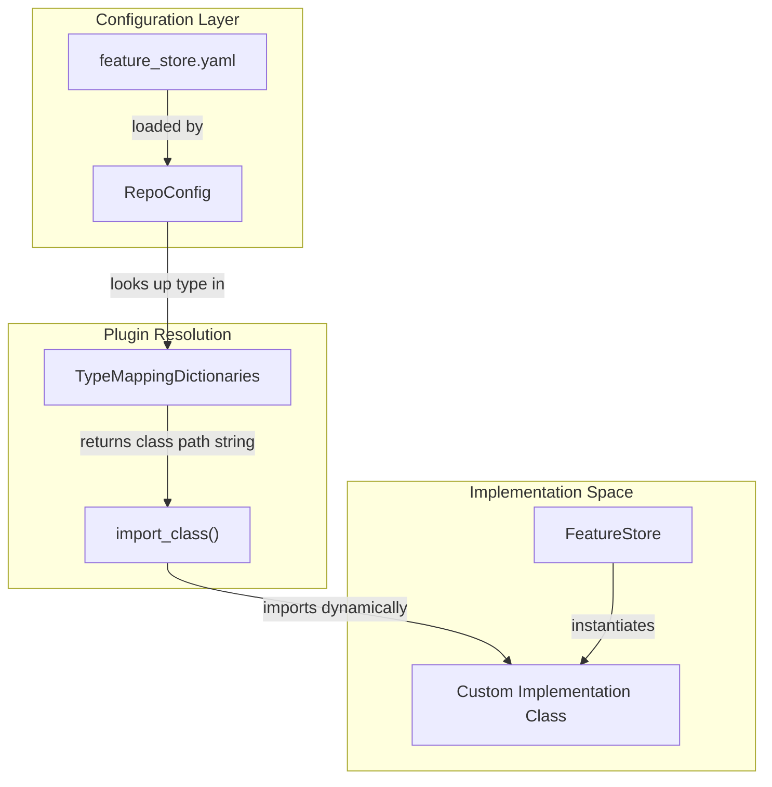
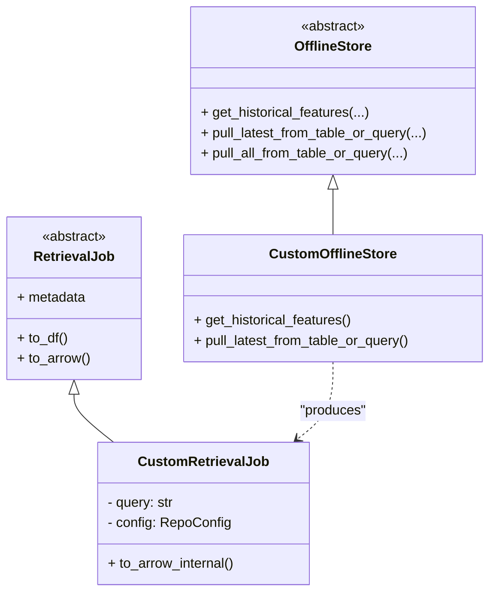
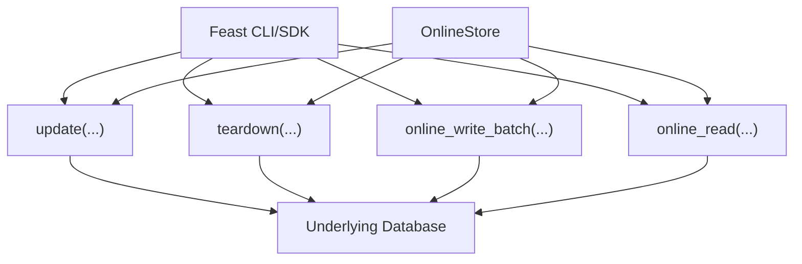
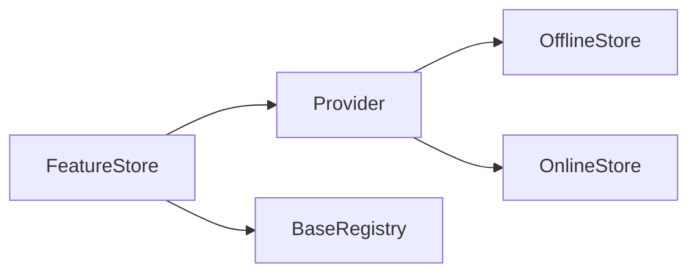

<!-- source: DeepWiki mcp.deepwiki.com · repo feast-dev/feast · page 8.1 Building Custom Extensions · fetched 2026-10-21 -->

# Building Custom Extensions

<details>
<summary>Relevant source files</summary>

The following files were used as context for generating this wiki page:

- [docs/how-to-guides/customizing-feast/adding-a-new-offline-store.md](docs/how-to-guides/customizing-feast/adding-a-new-offline-store.md)
- [docs/how-to-guides/customizing-feast/adding-support-for-a-new-online-store.md](docs/how-to-guides/customizing-feast/adding-support-for-a-new-online-store.md)
- [docs/reference/offline-stores/postgres.md](docs/reference/offline-stores/postgres.md)
- [docs/reference/online-stores/postgres.md](docs/reference/online-stores/postgres.md)
- [go/internal/feast/onlinestore/postgresonlinestore.go](go/internal/feast/onlinestore/postgresonlinestore.go)
- [go/internal/feast/onlinestore/postgresonlinestore_test.go](go/internal/feast/onlinestore/postgresonlinestore_test.go)
- [sdk/python/docs/source/feast.infra.online_stores.cassandra_online_store.rst](sdk/python/docs/source/feast.infra.online_stores.cassandra_online_store.rst)
- [sdk/python/docs/source/feast.infra.online_stores.couchbase_online_store.rst](sdk/python/docs/source/feast.infra.online_stores.couchbase_online_store.rst)
- [sdk/python/docs/source/feast.infra.online_stores.elasticsearch_online_store.rst](sdk/python/docs/source/feast.infra.online_stores.elasticsearch_online_store.rst)
- [sdk/python/docs/source/feast.infra.online_stores.hazelcast_online_store.rst](sdk/python/docs/source/feast.infra.online_stores.hazelcast_online_store.rst)
- [sdk/python/docs/source/feast.infra.online_stores.hbase_online_store.rst](sdk/python/docs/source/feast.infra.online_stores.hbase_online_store.rst)
- [sdk/python/docs/source/feast.infra.online_stores.milvus_online_store.rst](sdk/python/docs/source/feast.infra.online_stores.milvus_online_store.rst)
- [sdk/python/docs/source/feast.infra.online_stores.mysql_online_store.rst](sdk/python/docs/source/feast.infra.online_stores.mysql_online_store.rst)
- [sdk/python/docs/source/feast.infra.online_stores.postgres_online_store.rst](sdk/python/docs/source/feast.infra.online_stores.postgres_online_store.rst)
- [sdk/python/docs/source/feast.infra.online_stores.qdrant_online_store.rst](sdk/python/docs/source/feast.infra.online_stores.qdrant_online_store.rst)
- [sdk/python/feast/errors.py](sdk/python/feast/errors.py)
- [sdk/python/feast/feature_store.py](sdk/python/feast/feature_store.py)
- [sdk/python/feast/infra/online_stores/online_store.py](sdk/python/feast/infra/online_stores/online_store.py)
- [sdk/python/feast/infra/online_stores/sqlite.py](sdk/python/feast/infra/online_stores/sqlite.py)
- [sdk/python/feast/infra/passthrough_provider.py](sdk/python/feast/infra/passthrough_provider.py)
- [sdk/python/feast/infra/provider.py](sdk/python/feast/infra/provider.py)
- [sdk/python/feast/infra/utils/postgres/connection_utils.py](sdk/python/feast/infra/utils/postgres/connection_utils.py)
- [sdk/python/feast/infra/utils/postgres/postgres_config.py](sdk/python/feast/infra/utils/postgres/postgres_config.py)
- [sdk/python/feast/repo_config.py](sdk/python/feast/repo_config.py)
- [sdk/python/feast/repo_operations.py](sdk/python/feast/repo_operations.py)
- [sdk/python/feast/templates/postgres/bootstrap.py](sdk/python/feast/templates/postgres/bootstrap.py)
- [sdk/python/feast/templates/postgres/feature_repo/feature_store.yaml](sdk/python/feast/templates/postgres/feature_repo/feature_store.yaml)
- [sdk/python/tests/foo_provider.py](sdk/python/tests/foo_provider.py)
- [sdk/python/tests/integration/offline_store/test_push_features_to_offline_store.py](sdk/python/tests/integration/offline_store/test_push_features_to_offline_store.py)
- [sdk/python/tests/unit/cli/test_cli_chdir.py](sdk/python/tests/unit/cli/test_cli_chdir.py)
- [sdk/python/tests/unit/local_feast_tests/test_init.py](sdk/python/tests/unit/local_feast_tests/test_init.py)

</details>


This document explains how to extend Feast by creating custom offline stores, online stores, providers, registries, and transformation engines. These extensions enable integration with existing operational infrastructures, custom data platforms, and specialized processing frameworks.

For information on using existing Feast extensions, see the reference documentation on **Offline Stores (3.2)**, **Online Stores (3.3)**, **Provider and Store Abstractions (2.2)**, and **Registry and Metadata Storage (2.5)**.

---

## 1. Extension System Overview

Feast employs a plugin architecture that allows dynamically swapping storage and compute components via configuration. Custom implementations are resolved at runtime by inspecting string-based class paths or registered type names specified in `feature_store.yaml`.

### Component Types

| Component     | Purpose                                        | Base Class                                    | Config Base Class         |
|---------------|------------------------------------------------|-----------------------------------------------|---------------------------|
| Offline Store | Historical feature retrieval, point-in-time joins | `OfflineStore` [sdk/python/feast/infra/offline_stores/offline_store.py:43-44]() | `FeastConfigBaseModel`    |
| Online Store  | Low-latency feature serving                     | `OnlineStore` [sdk/python/feast/infra/online_stores/online_store.py:26-27]() | `FeastConfigBaseModel`    |
| Provider      | Orchestrates offline/online stores and metadata | `Provider` [sdk/python/feast/infra/provider.py:51-161]() | N/A                       |
| Registry      | Stores feature definitions and metadata         | `BaseRegistry` [sdk/python/feast/infra/registry/base_registry.py:35-36]() | `RegistryConfig`          |

### Plugin Loading Mechanism

Feast resolves plugins by:
- Checking the `type` field in the configuration (`feature_store.yaml`).
- Mapping this to a fully qualified class path using internal dictionaries defined in `repo_config.py`.
- Dynamically importing the class using `import_class()`.

The instantiated class is then used by the `FeatureStore` for the requested feature operations.



Sources: [sdk/python/feast/repo_config.py:36-115](), [sdk/python/feast/feature_store.py:164-196]()

---

## 2. Custom Offline Stores

Offline stores handle historical feature retrieval, point-in-time joins, and batch data extraction for materialization.

### Implementation Requirements

- Implement a subclass of `OfflineStore` interface [sdk/python/feast/infra/offline_stores/offline_store.py:43-44]().
- Define a Pydantic config class with a `type` identifier extending `FeastConfigBaseModel`.
- Implement querying methods returning a `RetrievalJob` abstraction.

### Core Classes and Data Flow



Sources: [sdk/python/feast/infra/offline_stores/offline_store.py:43-93](), [sdk/python/feast/infra/offline_stores/contrib/clickhouse_offline_store/clickhouse.py:41-154]()

### Important Methods

- `get_historical_features(...)` returns a `RetrievalJob` with a query incorporating time-travel and point-in-time correctness. For entityless data sources, it infers event timestamp ranges [sdk/python/feast/infra/offline_stores/contrib/clickhouse_offline_store/clickhouse.py:45-130]().

- `pull_latest_from_table_or_query(...)` retrieves the most recent feature data by join keys for materialization [sdk/python/feast/infra/offline_stores/contrib/clickhouse_offline_store/clickhouse.py:157-177]().

- `pull_all_from_table_or_query(...)` supports full data retrieval over a date range used in validation and quality monitoring [sdk/python/feast/infra/offline_stores/offline_store.py:75-90](), [docs/how-to-guides/customizing-feast/adding-a-new-offline-store.md:98-106]().

### Contrib Offline Stores

Contrib offline stores live under `feast/infra/offline_stores/contrib/` and often hold experimental or user-maintained plugins, such as Clickhouse or PostgreSQL offline stores.

Sources: [sdk/python/feast/infra/offline_stores/contrib/clickhouse_offline_store/clickhouse.py:41-41](), [docs/how-to-guides/customizing-feast/adding-a-new-offline-store.md:28-31]()

---

## 3. Custom Online Stores

Online stores provide low-latency feature retrieval for serving in production.

### Implementation Requirements

- Subclass the `OnlineStore` [sdk/python/feast/infra/online_stores/online_store.py:26-27]() abstract class.
- Implement infrastructure management methods:
  - `update(...)` - invoked in `feast apply` to create necessary tables, indices, or collections.
  - `teardown(...)` - invoked in `feast teardown` for clean-up.
- Implement data operations:
  - `online_write_batch(...)` - invoked during materialization to batch write features.
  - `online_read(...)` - serve features for entity keys requested at runtime.



Sources: [sdk/python/feast/infra/online_stores/online_store.py:44-129](), [docs/how-to-guides/customizing-feast/adding-support-for-a-new-online-store.md:48-131]()

### Lifecycle Summary

- `update(...)`: Creates or updates necessary infrastructure (tables, indexes).
- `teardown(...)`: Removes all infrastructure associated with feature views.
- `online_write_batch(...)`: Writes a batch of feature rows in materialize pipelines.
- `online_read(...)`: Reads feature data with low latency by entity keys.
  
### Contrib Online Stores

New online stores often start in `feast/infra/online_stores/contrib/` with a warning that they are experimental or community-maintained.

Sources: [docs/how-to-guides/customizing-feast/adding-support-for-a-new-online-store.md:28-45]()

---

## 4. Custom Providers and Registries

### Providers

A provider coordinates offline and online stores, feature servers, and registries. It orchestrates infrastructure and feature lifecycle, exposing methods for:

- `update_infra(...)` - sync infrastructure with the current feature definitions.
- `plan_infra(...)` - produce a plan describing infrastructure to create or update.
- `teardown_infra(...)` - remove feature store resources.
- `online_write_batch(...)` - write online feature data.

The provider interface is defined by the base abstract class `Provider` [sdk/python/feast/infra/provider.py:51-161]().

### Registries

The Registry is the metadata store for feature definitions, entities, and other metadata.

- Extend `BaseRegistry` [sdk/python/feast/infra/registry/base_registry.py:35-36]().
- Implement storage and retrieval of Feast objects.
- Registries are pluggable, supporting file-based, relational, or remote storage.



Sources: [sdk/python/feast/infra/provider.py:51-161](), [sdk/python/feast/infra/registry/base_registry.py:35-36]()

---

## 5. Connection Management, Thread Safety, and Configuration

When implementing custom backends, carefully manage:

- **Connection pooling**: Leverage thread-safe or async-safe database clients. Some clients require single-thread or per-thread instances.
- **Configuration parsing**: Use Pydantic-based config models extending `FeastConfigBaseModel` to parse user configuration.
- **Thread safety**: Some database drivers (like ClickHouse) are not thread-safe. Use thread-local storage patterns.

Example pattern to use thread-local for client connections:

```python
import threading

thread_local = threading.local()

def get_client(config: ClickhouseConfig):
    if not hasattr(thread_local, "clickhouse_client"):
        # instantiate and store client for thread
        thread_local.clickhouse_client = create_client_from_config(config)
    return thread_local.clickhouse_client
```

Sources: [sdk/python/feast/infra/utils/clickhouse/connection_utils.py:1-34]()

---

# Summary

This page outlines Feast's extension architecture focusing on building:

- Custom offline stores implementing historical retrieval and batch processing.
- Custom online stores providing low-latency feature serving.
- Providers that orchestrate offline/online interactions and metadata registries.
- Registries managing object metadata storage.
- The plugin system enabling pluggable backends via config-based class paths.

By extending Feast using these interfaces and patterns, you can integrate Feast flexibly with diverse storage and compute environments.

# End of Page

Sources:  
- [sdk/python/feast/repo_config.py:1-115]()  
- [sdk/python/feast/infra/provider.py:1-182]()  
- [sdk/python/feast/infra/offline_stores/offline_store.py:30-93]()  
- [sdk/python/feast/infra/offline_stores/contrib/clickhouse_offline_store/clickhouse.py:40-180]()  
- [sdk/python/feast/infra/online_stores/online_store.py:20-167]()  
- [docs/how-to-guides/customizing-feast/adding-support-for-a-new-online-store.md:1-131]()  
- [sdk/python/feast/infra/utils/clickhouse/connection_utils.py:1-34]()  
- [sdk/python/feast/infra/registry/base_registry.py:1-80]()  
- [sdk/python/feast/feature_store.py:160-196]()

---

