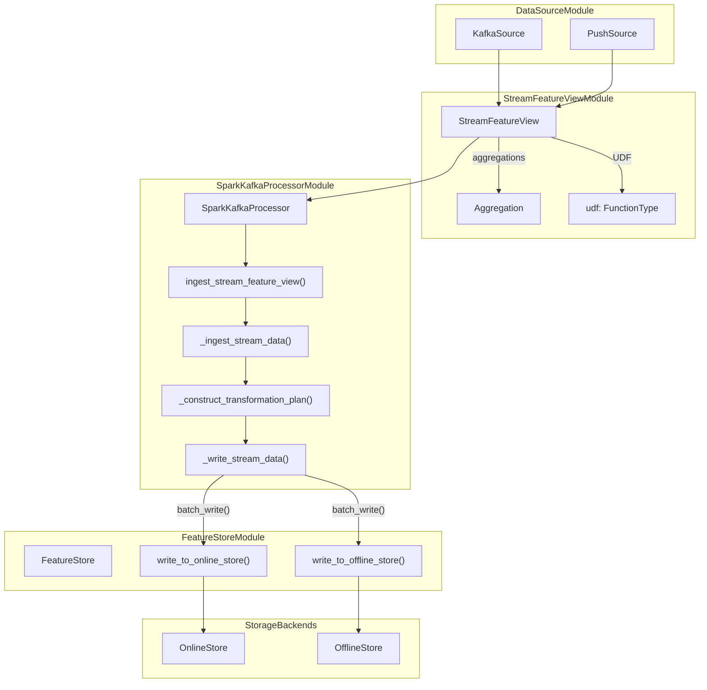
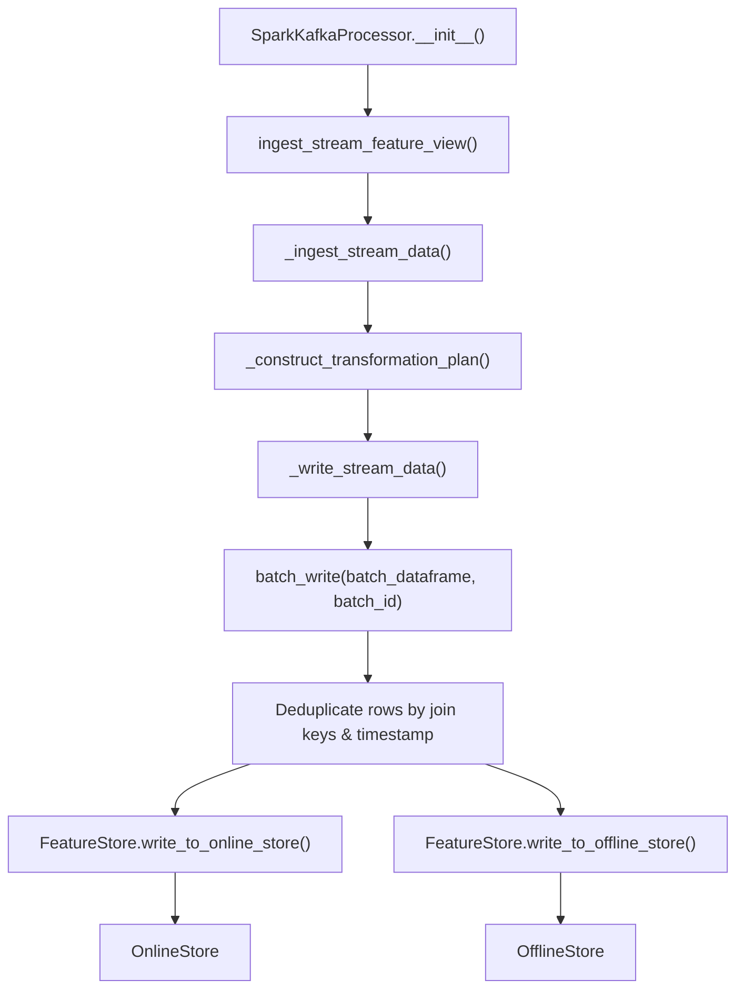

<!-- source: DeepWiki mcp.deepwiki.com · repo feast-dev/feast · page 8.2 Streaming Features and Push API · fetched 2026-10-21 -->

# Streaming Features and Push API

Relevant source files

The following files were used as context for generating this wiki page:

- [docs/getting-started/concepts/batch-feature-view.md](docs/getting-started/concepts/batch-feature-view.md)
- [docs/getting-started/concepts/tiling.md](docs/getting-started/concepts/tiling.md)
- [protos/feast/core/Aggregation.proto](protos/feast/core/Aggregation.proto)
- [protos/feast/core/StreamFeatureView.proto](protos/feast/core/StreamFeatureView.proto)
- [sdk/python/feast/aggregation/__init__.py](sdk/python/feast/aggregation/__init__.py)
- [sdk/python/feast/aggregation/tiling/base.py](sdk/python/feast/aggregation/tiling/base.py)
- [sdk/python/feast/aggregation/tiling/orchestrator.py](sdk/python/feast/aggregation/tiling/orchestrator.py)
- [sdk/python/feast/aggregation/tiling/tile_subtraction.py](sdk/python/feast/aggregation/tiling/tile_subtraction.py)
- [sdk/python/feast/batch_feature_view.py](sdk/python/feast/batch_feature_view.py)
- [sdk/python/feast/infra/compute_engines/__init__.py](sdk/python/feast/infra/compute_engines/__init__.py)
- [sdk/python/feast/infra/compute_engines/dag/context.py](sdk/python/feast/infra/compute_engines/dag/context.py)
- [sdk/python/feast/infra/compute_engines/local/nodes.py](sdk/python/feast/infra/compute_engines/local/nodes.py)
- [sdk/python/feast/infra/compute_engines/spark/__init__.py](sdk/python/feast/infra/compute_engines/spark/__init__.py)
- [sdk/python/feast/infra/compute_engines/spark/compute.py](sdk/python/feast/infra/compute_engines/spark/compute.py)
- [sdk/python/feast/infra/compute_engines/spark/utils.py](sdk/python/feast/infra/compute_engines/spark/utils.py)
- [sdk/python/feast/infra/contrib/spark_kafka_processor.py](sdk/python/feast/infra/contrib/spark_kafka_processor.py)
- [sdk/python/feast/infra/contrib/stream_processor.py](sdk/python/feast/infra/contrib/stream_processor.py)
- [sdk/python/feast/infra/offline_stores/contrib/athena_offline_store/tests/data_source.py](sdk/python/feast/infra/offline_stores/contrib/athena_offline_store/tests/data_source.py)
- [sdk/python/feast/infra/offline_stores/contrib/mssql_offline_store/tests/data_source.py](sdk/python/feast/infra/offline_stores/contrib/mssql_offline_store/tests/data_source.py)
- [sdk/python/feast/infra/offline_stores/contrib/postgres_offline_store/tests/data_source.py](sdk/python/feast/infra/offline_stores/contrib/postgres_offline_store/tests/data_source.py)
- [sdk/python/feast/infra/offline_stores/contrib/spark_offline_store/tests/data_source.py](sdk/python/feast/infra/offline_stores/contrib/spark_offline_store/tests/data_source.py)
- [sdk/python/feast/infra/offline_stores/contrib/trino_offline_store/tests/data_source.py](sdk/python/feast/infra/offline_stores/contrib/trino_offline_store/tests/data_source.py)
- [sdk/python/feast/protos/feast/core/Aggregation_pb2.py](sdk/python/feast/protos/feast/core/Aggregation_pb2.py)
- [sdk/python/feast/protos/feast/core/StreamFeatureView_pb2.py](sdk/python/feast/protos/feast/core/StreamFeatureView_pb2.py)
- [sdk/python/feast/protos/feast/core/StreamFeatureView_pb2.pyi](sdk/python/feast/protos/feast/core/StreamFeatureView_pb2.pyi)
- [sdk/python/feast/stream_feature_view.py](sdk/python/feast/stream_feature_view.py)
- [sdk/python/feast/transformation/base.py](sdk/python/feast/transformation/base.py)
- [sdk/python/feast/transformation/factory.py](sdk/python/feast/transformation/factory.py)
- [sdk/python/feast/transformation/mode.py](sdk/python/feast/transformation/mode.py)
- [sdk/python/feast/transformation/spark_transformation.py](sdk/python/feast/transformation/spark_transformation.py)
- [sdk/python/tests/component/spark/test_spark_utils.py](sdk/python/tests/component/spark/test_spark_utils.py)
- [sdk/python/tests/unit/infra/compute_engines/local/test_nodes.py](sdk/python/tests/unit/infra/compute_engines/local/test_nodes.py)
- [sdk/python/tests/unit/test_aggregation_ops.py](sdk/python/tests/unit/test_aggregation_ops.py)
- [sdk/python/tests/unit/test_feature_views.py](sdk/python/tests/unit/test_feature_views.py)
- [sdk/python/tests/unit/test_on_demand_feature_view_aggregation.py](sdk/python/tests/unit/test_on_demand_feature_view_aggregation.py)

## Purpose and Scope

This page documents Feast's support for real-time feature ingestion using streaming data sources and the Push API. It covers key components enabling low-latency feature updates with persistent historical storage, including:

- **StreamFeatureView**: Defines streaming feature views combining real-time and batch data sources, supports windowed aggregations, tiling optimizations, and user-defined transformations.
- **Push Sources**: Abstractions enabling direct feature pushing through the SDK (e.g., `PushSource`).
- **Streaming Data Sources**: Kafka-based streaming ingestion via `KafkaSource`.
- **Spark Kafka Processor**: An example streaming ingestion processor leveraging Spark Structured Streaming to process Kafka streams and write features online/offline.
- **Aggregation and Tiling**: Mechanisms for efficient windowed aggregations via pre-aggregated tiles, significantly optimizing query performance.

This page details each of these areas with implementation notes, data flow, key classes/methods, and diagrams.

Sources: `[sdk/python/feast/stream_feature_view.py:42-148]`, `[sdk/python/feast/infra/contrib/spark_kafka_processor.py:27-175]`

---

## Architecture Overview

The following diagram connects the streaming ingestion subsystems in Feast, mapping between conceptual entities and precise code classes and methods.

Sources: `[sdk/python/feast/stream_feature_view.py:46-101]`, `[sdk/python/feast/infra/contrib/spark_kafka_processor.py:27-81]`, `[sdk/python/feast/infra/contrib/spark_kafka_processor.py:161-164]`

---

## Streaming Data Sources

### KafkaSource

`KafkaSource` represents an Apache Kafka streaming data source. It requires configuration like Kafka bootstrap servers and topic name. For ingestion via Spark, supported message formats are JSON and Avro (`JsonFormat`, `AvroFormat`) as validated by `SparkKafkaProcessor` `[sdk/python/feast/infra/contrib/spark_kafka_processor.py:43-58]`.

KafkaSource also requires a `batch_source` to back historical retrieval of streaming data.

### PushSource

`PushSource` enables direct ingestion of streaming features via SDK push operations without requiring a stream engine. It is a key enabler of Feast's Push API, facilitating manual or external system feature ingestion.

Validation of supported streaming sources ensures that `PushSource` is an acceptable source for `StreamFeatureView` `[sdk/python/feast/stream_feature_view.py:42]`.

---

## StreamFeatureView

`StreamFeatureView` is a subclass of `FeatureView` designed for streaming feature ingestion combining both a streaming and a batch data source. It enables real-time feature materialization with support for time-windowed aggregations and tiling optimizations.

### Definition Summary

- **Name:** Unique identifier of the stream feature view.
- **Source:** Streaming data source (must be `KafkaSource`, `PushSource`, or `CUSTOM_SOURCE`).
- **Aggregations:** List of `Aggregation` objects defining windowed aggregate features.
- **Timestamp Field:** Required if aggregations are specified; indicates the event-time column for windowing.
- **Tiling:** Optional optimization controlled via `enable_tiling` (boolean) and `tiling_hop_size` (timedelta). Tiling splits aggregation windows into smaller, reusable tiles to efficiently compute sliding-window aggregates.
- **Transformations:** UDF functions or `feature_transformation` objects for user-defined feature computation applied on streaming data.
- **Online/Offline Flags:** Controls whether data writes happen to online and/or offline stores.
- **Stream Engine Config:** Overrides default repo-level stream engine settings, e.g., for Spark processing config.

### Source Restrictions & Validation

The constructor rigorously validates that the streaming source is one of the supported types, throwing errors if unsupported sources are passed. Aggregations require a timestamp field for correct evaluation.

### Aggregations

Features in a `StreamFeatureView` can be defined as aggregations (e.g., `sum`, `mean`, `count`, `count_distinct`, `max`, `min`) applied over sliding time windows. Feast uses `Aggregation` objects to specify these and supports serialization for communication with store components.

### Tiling Optimization

Tiling is a key feature that reduces the computation complexity of windowed aggregations. By breaking down a large aggregation window into smaller, fixed-size "tiles," Feast can precompute tiles and compute final aggregates via incremental operations on these tiles at serving time rather than processing raw streams for the full window repeatedly.

This feature requires enabling via the `enable_tiling` flag and configuring the `tiling_hop_size` interval which defines tiling granularity.

### Example Attributes from `StreamFeatureView`

| Attribute           | Type                       | Description                                      |
|---------------------|----------------------------|------------------------------------------------|
| `source`            | `DataSource`               | The streaming data source.                       |
| `aggregations`       | `List[Aggregation]`        | List of aggregations defining windowed features.|
| `timestamp_field`   | `str`                      | Event-time column on which to apply windowing. |
| `enable_tiling`      | `bool`                     | Enable tiling optimization for aggregations.   |
| `tiling_hop_size`    | `Optional[timedelta]`      | Interval between tiles, defaults to 5 minutes. |
| `udf`                | `Optional[FunctionType]`  | User-defined feature transformation function.  |
| `online`             | `bool`                     | Enable online store writes/retrieval.           |
| `offline`            | `bool`                     | Enable offline store writes/retrieval.          |

Sources: `[sdk/python/feast/stream_feature_view.py:46-103]`

---

## Push API Overview

Feast supports a Push API as a way to ingest streaming feature data directly to the feature store online store without requiring an external streaming engine. This is primarily exposed via `PushSource` and the `FeatureStore.push()` method.

When using `PushSource`, feature data is pushed to the online store for immediate serving, and optionally to offline stores for historical analytics and training dataset materialization.

---

## Spark Kafka Processor

The `SparkKafkaProcessor` is an example streaming processor implementing ingestion of feature streams from Kafka into Feast using Spark Structured Streaming.

### Overview

- Takes a `StreamFeatureView` with a `KafkaSource` stream source.
- Uses Spark Structured Streaming to read from the Kafka topic, decoding messages as JSON or Avro.
- Optionally applies a user-defined preprocessing function.
- Deduplicates feature rows by joining keys and timestamp, selects the latest per entity.
- Writes the batch to online and/or offline stores based on configuration in `PushMode`.

### Important Methods

| Method                   | Purpose                                                        |
|--------------------------|----------------------------------------------------------------|
| `__init__()`             | Initializes processor; validates source, extracts keys.       |
| `_ingest_stream_data()`  | Creates the streaming dataframe from Kafka source.             |
| `_construct_transformation_plan()` | Applies optional user-defined transformation (`udf`) on stream data. |
| `_write_stream_data()`   | Defines the streaming sink using `foreachBatch` to write data to stores. |

### Deduplication Logic

In the `batch_write` function inside `_write_stream_data`, deduplication is done by sorting the batch by join keys and timestamp descending and selecting the latest rows per entity key before writing.

### Data Flow Diagram - SparkKafkaProcessor

### Key Validations and Constraints

- The source must be `KafkaSource`.
- Supported Kafka message formats: JSON, Avro.
- Processing time can be configured.
- `preprocess_fn` optional for batch data transformation.

Sources: `[sdk/python/feast/infra/contrib/spark_kafka_processor.py:27-175]`

---

## Aggregations and Tiling Optimization

### Aggregations

Feast uses the `Aggregation` class to specify windowed aggregations on streaming features. It supports functions like:

- `sum`
- `count`
- `mean`
- `count_distinct` (mapped internally to e.g., pandas' `nunique`)
- `max`
- `min`

Each aggregation can specify a time window and slide interval.

### Tiling Optimization

To optimize large window lookups in streaming features, Feast employs tiling:

- **Tiling** breaks windows into smaller fixed-size time chunks ("tiles").
- Tiles are pre-aggregated and stored.
- Windowed results are computed by combining tiles at query time rather than re-aggregating base data.

The `enable_tiling` flag in `StreamFeatureView` activates this, and the tiling interval is controlled by `tiling_hop_size`.

This design improves efficiency and reduces computational cost for serving features with long time windows.

### Tiling Implementation Notes

- Tiling occurs in the streaming processing pipeline (e.g., Spark).
- The system maintains intermediate state tiles keyed by entity and tile time.
- Aggregate computations for holistic functions (e.g., average, stddev) use tiled intermediate representations that allow incremental computation.
- Tiles are stored with metadata specifying tile start/end times.

Sources: `[sdk/python/feast/stream_feature_view.py:100-103]`, `[sdk/python/feast/aggregation/__init__.py:15-119]`

---

## Summary of Key Components and Data Flow

| Concept / Role       | Code Entity                          | Description                                                |
|---------------------|------------------------------------|------------------------------------------------------------|
| Stream Data Source  | `KafkaSource`, `PushSource`        | Streaming inputs; KafkaSource ingests from Kafka topics; PushSource supports manual streaming pushes. |
| Streaming View      | `StreamFeatureView`                 | Defines feature schema, streaming source, aggregations, udf, tiling parameters. |
| Aggregation Spec    | `Aggregation`                      | Describes time windowed aggregate features (sum, count, mean, etc.) with optional tiling. |
| Stream Processor    | `SparkKafkaProcessor`               | Reads Kafka streams via Spark Structured Streaming, applies transformations, writes features. |
| Online Store Writer | `FeatureStore.write_to_online_store()` | Persists latest features for low-latency serving.          |
| Offline Store Writer| `FeatureStore.write_to_offline_store()` | Stores feature data and aggregated tiles for training/historical analysis. |

---

# References and Further Reading
- `sdk/python/feast/stream_feature_view.py`
- `sdk/python/feast/aggregation/__init__.py`
- `sdk/python/feast/infra/contrib/spark_kafka_processor.py`
- Protobufs: `StreamFeatureView.proto` (aggregation and tiling flags)

---

This page completes the documentation for Feast's streaming ingestion and Push API features, providing technical details on implementation and integration within Feast’s feature store architecture.

---

