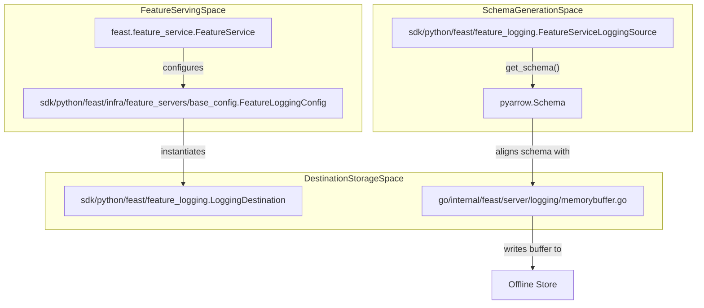
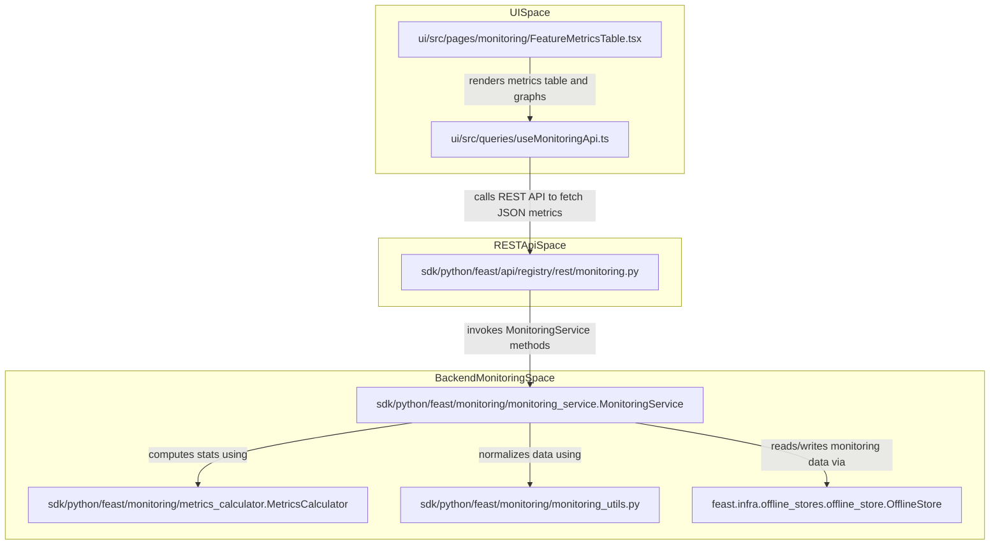

<!-- source: DeepWiki mcp.deepwiki.com · repo feast-dev/feast · page 8.3 Feature Logging and Monitoring · fetched 2026-10-21 -->

# Feature Logging and Monitoring

<details>
<summary>Relevant source files</summary>

The following files were used as context for generating this wiki page:

- [.cursor/rules/feast-ui.mdc](.cursor/rules/feast-ui.mdc)
- [docs/how-to-guides/feature-monitoring.md](docs/how-to-guides/feature-monitoring.md)
- [go/internal/feast/errors.go](go/internal/feast/errors.go)
- [go/internal/feast/featurestore_test.go](go/internal/feast/featurestore_test.go)
- [go/internal/test/feature_repo/example.py](go/internal/test/feature_repo/example.py)
- [go/types/typeconversion.go](go/types/typeconversion.go)
- [go/types/typeconversion_test.go](go/types/typeconversion_test.go)
- [sdk/python/feast/api/registry/rest/monitoring.py](sdk/python/feast/api/registry/rest/monitoring.py)
- [sdk/python/feast/dqm/profilers/ge_profiler.py](sdk/python/feast/dqm/profilers/ge_profiler.py)
- [sdk/python/feast/dqm/profilers/profiler.py](sdk/python/feast/dqm/profilers/profiler.py)
- [sdk/python/feast/feature_logging.py](sdk/python/feast/feature_logging.py)
- [sdk/python/feast/feature_view_utils.py](sdk/python/feast/feature_view_utils.py)
- [sdk/python/feast/infra/offline_stores/contrib/oracle_offline_store/oracle.py](sdk/python/feast/infra/offline_stores/contrib/oracle_offline_store/oracle.py)
- [sdk/python/feast/infra/offline_stores/contrib/trino_offline_store/connectors/upload.py](sdk/python/feast/infra/offline_stores/contrib/trino_offline_store/connectors/upload.py)
- [sdk/python/feast/infra/offline_stores/contrib/trino_offline_store/tests/test_trino_monitoring.py](sdk/python/feast/infra/offline_stores/contrib/trino_offline_store/tests/test_trino_monitoring.py)
- [sdk/python/feast/infra/offline_stores/dask.py](sdk/python/feast/infra/offline_stores/dask.py)
- [sdk/python/feast/infra/offline_stores/duckdb.py](sdk/python/feast/infra/offline_stores/duckdb.py)
- [sdk/python/feast/infra/offline_stores/ibis.py](sdk/python/feast/infra/offline_stores/ibis.py)
- [sdk/python/feast/monitoring/monitoring_service.py](sdk/python/feast/monitoring/monitoring_service.py)
- [sdk/python/feast/monitoring/monitoring_utils.py](sdk/python/feast/monitoring/monitoring_utils.py)
- [sdk/python/tests/data/data_creator.py](sdk/python/tests/data/data_creator.py)
- [sdk/python/tests/integration/materialization/test_lambda.py](sdk/python/tests/integration/materialization/test_lambda.py)
- [sdk/python/tests/integration/offline_store/test_feature_logging.py](sdk/python/tests/integration/offline_store/test_feature_logging.py)
- [sdk/python/tests/unit/infra/offline_stores/test_ibis.py](sdk/python/tests/unit/infra/offline_stores/test_ibis.py)
- [sdk/python/tests/unit/infra/test_provider.py](sdk/python/tests/unit/infra/test_provider.py)
- [sdk/python/tests/unit/monitoring/test_compute_correctness.py](sdk/python/tests/unit/monitoring/test_compute_correctness.py)
- [sdk/python/tests/utils/online_write_benchmark.py](sdk/python/tests/utils/online_write_benchmark.py)
- [ui/src/pages/monitoring/FeatureMetricsTable.tsx](ui/src/pages/monitoring/FeatureMetricsTable.tsx)
- [ui/src/pages/monitoring/Index.tsx](ui/src/pages/monitoring/Index.tsx)
- [ui/src/queries/useMonitoringApi.ts](ui/src/queries/useMonitoringApi.ts)

</details>


This page covers the architecture and implementation details of Feast's feature logging, metrics collection, freshness tracking, Data Quality Monitoring (DQM), and monitoring service and UI components. It explains how Feast captures logs of served features, exposes Prometheus and OpenTelemetry metrics, computes and persists statistical metrics for data quality, and surfaces these metrics through a REST API and React Web UI.

---

## 1. Prometheus and OpenTelemetry Metrics

### Python Feature Server Metrics

The Python Feature Server collects a comprehensive set of Prometheus metrics detailing the feature server's resource usage, request counts, latencies, and underlying store interactions.

Instrumentation is implemented in the `sdk/python/feast/metrics.py` module, which globally initializes Prometheus metrics such as counters, gauges, and histograms. Feast supports multiprocess server setups by using `prometheus_client`'s multiprocess mode, configured through the environment variable `PROMETHEUS_MULTIPROC_DIR`. This ensures accurate aggregation across multiple server worker processes.

Key metric categories tracked:

- **Resource Usage Gauges**: CPU and memory usage reported by the process.
- **HTTP/gRPC Request Metrics**: Number and latency of requests broken down by route and status.
- **Online Feature Retrieval Metrics**: Counts of entities processed, timings of online store reads, and transformation latencies.
- **Push Ingestion Metrics**: Number of push ingestion requests and batch sizes.
- **Materialization Job Metrics**: Success, failure counts, and durations for offline-to-online materialization jobs.
- **Feature Freshness Gauges**: Monitors the lag, in seconds, of event timestamps from the current time, per feature view.
- **Offline Store Request Metrics**: Timestamps and counters for historical data retrievals.
- **Audit Logging Counts**: JSON-structured logging counters for auditing requests.

The codes governing this instrumentation are in `[sdk/python/feast/metrics.py:15-311]()` and configuration hooks happen in `[sdk/python/feast/infra/feature_servers/base_config.py:40-114]()`.

### Go Feature Server and OpenTelemetry

The Go Feature Server implements Prometheus native instrumentation and OpenTelemetry tracing. It exposes metrics such as online request latencies, cache hit/miss rates, and connection pool statistics. OpenTelemetry tracing propagates context across the gRPC and HTTP layers, tracing calls down to the data store drivers. This instrumentation supports end-to-end observability of feature serving requests.

---

## 2. Feature Logging Module (`feature_logging`)

Feature Logging captures the actual feature values served to models in production, enabling training dataset generation from serving logs.

### Architecture and Schema Generation

Logging sources describe the object producing logs; typically, a `FeatureService` acts as a `FeatureServiceLoggingSource`. This source produces an Apache Arrow schema describing the logged data structure, which includes:

- Entity key columns joined in the request.
- Logged features prefixed by feature view name (e.g., `driver_stats__conv_rate`).
- Timestamps and status columns for each feature.
- System columns for logging metadata:
  - `__request_id`: Unique identifier string per serving request.
  - `__log_timestamp`: UTC timestamp when the log was captured.
  - `__log_date`: Date32 column used for partition pruning in offline stores.

The `FeatureServiceLoggingSource.get_schema()` function generates this schema by referencing the `FeatureView` specifications from the registry and mapping Feast data types to Arrow types.

### Logging Configuration and Destinations

Logging configuration is managed via `LoggingConfig`, comprising a `LoggingDestination` subclass and a sampling rate. Feast includes implementations such as `PostgreSQLLoggingDestination` and `FileLoggingDestination`. The `LoggingDestination` encapsulates how and where logs are persisted in the offline store.

Logging configuration can be set at the `FeatureService` level via `FeatureLoggingConfig`.



*Diagram 1: Mapping from natural language concepts around feature serving and logging to core code entities responsible for schema generation and log storage.*

Sources: `[sdk/python/feast/infra/feature_servers/base_config.py:21-39]`, `[sdk/python/feast/feature_logging.py:28-106]`, `[docs/how-to-guides/feature-monitoring.md:145-160]`

---

## 3. Data Quality Monitoring (DQM)

Feast's DQM system automatically computes, stores, and serves statistical metrics describing feature data quality and distribution, including distribution shape, null rates, and percentile statistics.

### Auto-baseline and Scheduling

- **Auto-baseline**: On running `feast apply`, Feast optionally queues background metric computation jobs for any newly registered feature views. These baselines read the entire source data, storing summary statistics marked as baseline references with `is_baseline=TRUE`. Baselines aid in detecting data drift in production.

- **Scheduled Monitoring Jobs**: CLI command `feast monitor run` runs auto-computation jobs over fixed granularity windows (`daily`, `weekly`, `monthly`, etc.) automatically detecting latest event timestamps and sliding these windows over recent data.

- **Serving Log Monitoring**: If feature services have `logging_config` enabled, Feast can compute metrics directly from feature serving logs, enabling batch-vs-log comparisons and drift detection.

```bash
feast monitor run --feature-view driver_stats --start-date 2025-01-01 --end-date 2025-01-07 --granularity weekly
```

### REST API Support

The monitoring backend provides REST endpoints to query raw metrics as JSON and to trigger recomputation from batch or log sources.

- `GET /monitoring/metrics/features` - Fetch per-feature metrics filtered by project, feature view, granularity, baseline flag, etc.
- `POST /monitoring/compute/log` - Compute log metrics for a specified feature service and granularity.
- `POST /monitoring/auto_compute/log` - Compute log metrics for all feature services with logging configured.

Metrics include a rich set of statistics such as null counts/rates, mean, stddev, min/max, and percentile values (`p50`, `p75`, `p90`, `p95`, `p99`). These enable comprehensive feature health monitoring.

Sources: `[docs/how-to-guides/feature-monitoring.md:1-236]`, `[sdk/python/feast/api/registry/rest/monitoring.py]`

---

## 4. Monitoring Service and UI Integration

The backend coordination of monitoring activities is handled by the `MonitoringService` class in `sdk/python/feast/monitoring/monitoring_service.py`. This class manages ensuring monitoring tables exist, computing and saving metrics using the `MetricsCalculator`, and interacting with the configured offline store provider.

It supports auto-compute workflows, date detection, aggregation over sliding windows, and management of baseline and fresh metrics.



*Diagram 2: Interaction map showcasing how UI, REST API, backend service, and offline store provider components interact for monitoring.*

### UI Data Fetching and Rendering

The React Web UI fetches monitoring metrics via `ui/src/queries/useMonitoringApi.ts`, which defines TypeScript interfaces for feature, feature view, and service metrics along with filtering parameters. It handles JSON sanitization for special float values (`NaN`, `Infinity`), caches requests with React Query, and exposes hooks for UI components to consume.

The `FeatureMetricsTable` (`ui/src/pages/monitoring/FeatureMetricsTable.tsx`) uses these hooks to display data quality indicators, null rates, feature distributions (histograms rendered as inline SVG), and freshness. It supports filtering by project, feature view, date range, granularity, and baseline.

Sources: `[sdk/python/feast/monitoring/monitoring_service.py]`, `[ui/src/queries/useMonitoringApi.ts]`, `[ui/src/pages/monitoring/FeatureMetricsTable.tsx]`

---

## 5. Feature Freshness Tracking

Feature freshness is tracked via Prometheus gauges named `feast_feature_freshness_seconds`. This metric measures the lag between the most recent event timestamp present in data and the current system time in seconds. Freshness metrics help in alerting on data staleness in serving pipelines.

Freshness gauge lifecycle and updates are handled in `sdk/python/feast/metrics.py` and computed based on offline and online store retrieval timestamps.

---

## 6. Summary of Key Code Components

| Component | Role | Location |
|-----------|------|----------|
|`MetricsCalculator`|Computes statistical metrics over feature data|`sdk/python/feast/monitoring/metrics_calculator.py`|
|`MonitoringService`|Orchestrates metric computation, persistence, baseline lifecycle|`sdk/python/feast/monitoring/monitoring_service.py`|
|`LoggingDestination` subclasses|Define specific offline store logging sink implementations|`sdk/python/feast/feature_logging.py`|
|`FeatureServiceLoggingSource`|Describes log schema derived from FeatureService specs|`sdk/python/feast/feature_logging.py`|
|Prometheus Metrics Initialization|Global Prometheus metric definitions and utilities|`sdk/python/feast/metrics.py`|
|Monitoring REST API|HTTP endpoints for metrics querying and computation requests|`sdk/python/feast/api/registry/rest/monitoring.py`|
|UI React Hooks|Fetch and cache monitoring data for UI components|`ui/src/queries/useMonitoringApi.ts`|
|UI Components|Present feature monitoring data with visualizations|`ui/src/pages/monitoring/FeatureMetricsTable.tsx`|

---

Feast's feature logging and monitoring subsystem provides comprehensive operational observability, enabling teams to track feature usage, data drift, and freshness, and to audit model inputs over time. Its modular architecture spans server instrumentation, data capture, offline metric computation, API exposure, and rich UI visualization.

---

# End of 8.3 Feature Logging and Monitoring

Sources:  
- `[sdk/python/feast/metrics.py:15-311]`  
- `[sdk/python/feast/infra/feature_servers/base_config.py:21-114]`  
- `[sdk/python/feast/feature_logging.py:28-106]`  
- `[docs/how-to-guides/feature-monitoring.md:1-236]`  
- `[sdk/python/feast/api/registry/rest/monitoring.py]`  
- `[sdk/python/feast/monitoring/monitoring_service.py]`  
- `[sdk/python/feast/monitoring/metrics_calculator.py]` (implied)  
- `[sdk/python/feast/monitoring/monitoring_utils.py]` (implied)  
- `[ui/src/queries/useMonitoringApi.ts]`  
- `[ui/src/pages/monitoring/FeatureMetricsTable.tsx]`  
- `[go/internal/feast/server/logging/memorybuffer.go]`

---

