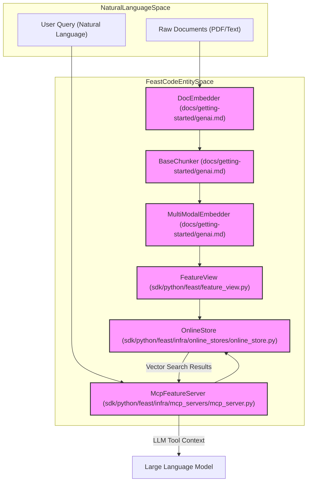
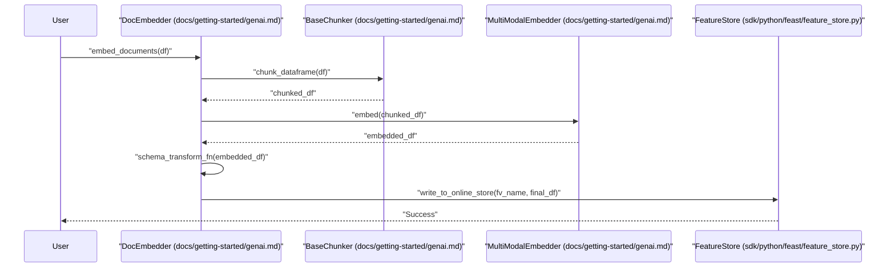
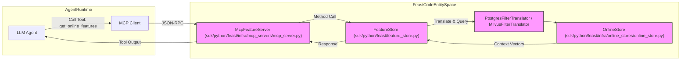

<!-- source: DeepWiki mcp.deepwiki.com · repo feast-dev/feast · page 8.4 GenAI and RAG Integration · fetched 2026-10-21 -->

# GenAI and RAG Integration

<details>
<summary>Relevant source files</summary>

The following files were used as context for generating this wiki page:

- [docs/getting-started/genai.md](docs/getting-started/genai.md)
- [docs/reference/alpha-vector-database.md](docs/reference/alpha-vector-database.md)
- [docs/reference/online-stores/cassandra.md](docs/reference/online-stores/cassandra.md)
- [docs/reference/online-stores/elasticsearch.md](docs/reference/online-stores/elasticsearch.md)
- [docs/reference/online-stores/milvus.md](docs/reference/online-stores/milvus.md)
- [docs/reference/online-stores/overview.md](docs/reference/online-stores/overview.md)
- [docs/reference/online-stores/qdrant.md](docs/reference/online-stores/qdrant.md)
- [docs/reference/online-stores/scylladb.md](docs/reference/online-stores/scylladb.md)
- [sdk/python/feast/inference.py](sdk/python/feast/inference.py)
- [sdk/python/feast/infra/online_stores/cassandra_online_store/cassandra_online_store.py](sdk/python/feast/infra/online_stores/cassandra_online_store/cassandra_online_store.py)
- [sdk/python/feast/infra/online_stores/elasticsearch_online_store/elasticsearch.py](sdk/python/feast/infra/online_stores/elasticsearch_online_store/elasticsearch.py)
- [sdk/python/feast/infra/online_stores/faiss_online_store.py](sdk/python/feast/infra/online_stores/faiss_online_store.py)
- [sdk/python/feast/infra/online_stores/milvus_online_store/milvus.py](sdk/python/feast/infra/online_stores/milvus_online_store/milvus.py)
- [sdk/python/feast/infra/online_stores/postgres_online_store/postgres.py](sdk/python/feast/infra/online_stores/postgres_online_store/postgres.py)
- [sdk/python/feast/infra/online_stores/qdrant_online_store/qdrant.py](sdk/python/feast/infra/online_stores/qdrant_online_store/qdrant.py)
- [sdk/python/feast/infra/online_stores/scylladb_online_store/__init__.py](sdk/python/feast/infra/online_stores/scylladb_online_store/__init__.py)
- [sdk/python/feast/infra/online_stores/scylladb_online_store/scylladb.py](sdk/python/feast/infra/online_stores/scylladb_online_store/scylladb.py)
- [sdk/python/feast/infra/online_stores/vector_store.py](sdk/python/feast/infra/online_stores/vector_store.py)
- [sdk/python/tests/example_repos/example_feature_repo_1.py](sdk/python/tests/example_repos/example_feature_repo_1.py)
- [sdk/python/tests/integration/online_store/test_milvus_remote.py](sdk/python/tests/integration/online_store/test_milvus_remote.py)
- [sdk/python/tests/integration/online_store/test_scylladb_online_store.py](sdk/python/tests/integration/online_store/test_scylladb_online_store.py)
- [sdk/python/tests/integration/registration/test_feature_store.py](sdk/python/tests/integration/registration/test_feature_store.py)
- [sdk/python/tests/integration/registration/test_inference.py](sdk/python/tests/integration/registration/test_inference.py)
- [sdk/python/tests/unit/infra/online_store/test_cassandra_online_store.py](sdk/python/tests/unit/infra/online_store/test_cassandra_online_store.py)
- [sdk/python/tests/unit/infra/online_store/test_faiss_versioning.py](sdk/python/tests/unit/infra/online_store/test_faiss_versioning.py)
- [sdk/python/tests/unit/infra/online_store/test_milvus_online_store.py](sdk/python/tests/unit/infra/online_store/test_milvus_online_store.py)
- [sdk/python/tests/unit/online_store/test_online_retrieval.py](sdk/python/tests/unit/online_store/test_online_retrieval.py)
- [sdk/python/tests/universal/feature_repos/universal/online_store/scylladb.py](sdk/python/tests/universal/feature_repos/universal/online_store/scylladb.py)

</details>


Feast provides robust infrastructure for Generative AI (GenAI) applications, enabling teams to manage feature data for Large Language Models (LLMs) [docs/getting-started/genai.md:3-5](). By extending its core feature store capabilities to include vector database support, document processing pipelines, specialized retrieval APIs, and Model Context Protocol (MCP) servers, Feast serves as a centralized system for building production-ready Retrieval Augmented Generation (RAG) workflows [docs/getting-started/genai.md:5-32]().

---

## System Architecture for RAG

The integration of GenAI into Feast bridges the gap between unstructured document data and structured feature retrieval. The system utilizes `OnlineStore` implementations [sdk/python/feast/infra/online_stores/online_store.py:31-31]() that support vector similarity search alongside traditional entity-keyed lookups [docs/reference/alpha-vector-database.md:5-16]().

### Data Flow: Unstructured to Structured Space

The following diagram illustrates how Feast processes raw documents into embeddings and serves them via the MCP server or standard SDKs, bridging natural language spaces with concrete code entities.

**Document Ingestion and Serving Pipeline**



---

## Vector Database Integrations

Feast supports several vector-capable online stores for storing and retrieving embeddings. These integrations enable vector similarity search, vital for finding relevant context documents in RAG applications [docs/getting-started/genai.md:9-18]().

| Vector Database         | Retrieval | Indexing | SDK V2 Support | Online Read |
| ---------------------- | :-------:| :-------:| :------------: | :---------: |
| **Milvus**             | Yes      | Yes      | Yes            | Yes [docs/reference/alpha-vector-database.md:14]() |
| **Qdrant**             | Yes      | Yes      | No             | No [docs/reference/alpha-vector-database.md:17]()  |
| **Elasticsearch**      | Yes      | Yes      | No             | No [docs/reference/alpha-vector-database.md:13]()  |
| **Pgvector (Postgres)**| Yes      | No       | No             | No [docs/reference/alpha-vector-database.md:12]()  |
| **Faiss**              | No       | No       | No             | No [docs/reference/alpha-vector-database.md:15]()  |
| **SQLite (Alpha)**     | Yes      | No       | Yes            | Yes [docs/reference/alpha-vector-database.md:16]() |
| **ScyllaDB**           | Yes      | Yes      | Yes            | Yes [docs/reference/alpha-vector-database.md:18]() |

### Detailed Integration Overview

- **Milvus Online Store**: Uses `MilvusClient` ([milvus.py:9-14]()) and maps Feast value types to Milvus data types including support for float vectors and binary vectors [sdk/python/feast/infra/online_stores/milvus_online_store/milvus.py:58-87](). It implements a `MilvusFilterTranslator` translating Feast filters to Milvus boolean expressions [sdk/python/feast/infra/online_stores/milvus_online_store/milvus.py:157-179](). Collections are managed with mandatory vector fields, adding placeholder vectors when needed [docs/reference/online-stores/milvus.md:85-90]().
  
- **PostgreSQL with pgvector**: Supports vector search using `pgvector` extension with translated metrics to Postgres operators (e.g., cosine as `<=>`) [postgres.py:51-56](). Implements numeric filtering using `value_num` column toggled by `enable_openai_compatible_store` config [postgres.py:159-162,150-157]().
  
- **Faiss Online Store**: Provides in-memory vector similarity search using Faiss indices such as `IndexIVFFlat` [faiss_online_store.py:18-57](). Mostly targeted for local deployments and evaluation.

- **Other vector stores**: Qdrant, Elasticsearch, SQLite (alpha support), and ScyllaDB are supported with varying levels of retrieval, indexing, and SDK support [docs/reference/alpha-vector-database.md:10-18]().

---

## Configuration

The vector database support in Feast is enabled primarily through the `feature_store.yaml` configuration. Key aspects include [docs/reference/alpha-vector-database.md:73-79]():

- **Embedding Model**: Defines the provider and model for generating embeddings, e.g., Sentence Transformers.

```yaml
embedding_model:
  provider: sentence_transformers
  model: all-MiniLM-L6-v2
```

- **FeatureView Schema**: Within a `FeatureView` definition, fields intended for vector search are marked with `vector_index=True` and specify parameters like `vector_length` and `vector_search_metric`.

---

## Document Processing with DocEmbedder

Feast provides a streamlined and extensible document processing pipeline encapsulated by the `DocEmbedder` class [docs/getting-started/genai.md:61-63](). It automates chunking documents, embedding text or images, transforming schemas, and writing embeddings as features.

### Key Components

- **Chunking**: Flexible chunking via `BaseChunker` and `TextChunker` that split documents into semantically meaningful fragments based on size and overlap [docs/getting-started/genai.md:68]().

- **Embedding**: `MultiModalEmbedder` handles modality-specific embedding generation, using Sentence Transformers for text or CLIP for images [docs/getting-started/genai.md:69]().

- **Schema Transformation**: User-defined schema transform functions adapt chunked & embedded data to `FeatureView` schemas [docs/getting-started/genai.md:70]().

### Pipeline Sequence



This pipeline connects user raw documents to actionable feature views that can be materialized and queried efficiently in the feature store.

---

## Retrieval APIs

Feast provides specialized APIs for extracting document context for LLMs, crucial for building RAG pipelines.

### `retrieve_online_documents_v2`

- Recommended method for RAG use cases enabling joint retrieval of vector embeddings and standard features in a single API request [docs/reference/alpha-vector-database.md:24-31]().
- Exposed in the Python feature server as a `POST /search` endpoint supporting embedding-based queries and numeric filtering [docs/reference/alpha-vector-database.md:40-40]().
- Supported by vector stores like Milvus, ScyllaDB, and SQLite [docs/reference/alpha-vector-database.md:34]().

---

## OpenAI-Compatible Vector Store API

Feast exposes OpenAI-compatible vector store endpoints to facilitate easy integration with AI agents and LLM tool-calling frameworks [docs/reference/alpha-vector-database.md:53-53]().

### Endpoints

| Method | Path                        | Description                          |
|--------|-----------------------------|------------------------------------|
| `GET`  | `/v1/vector_stores`          | List all available vector stores   |
| `GET`  | `/v1/vector_stores/{id}`     | Retrieve metadata about a vector store |
| `POST` | `/v1/vector_stores/{id}/search` | Search a vector store using plain text query |

These endpoints enable clients to discover vector stores, inspect their metadata, and search using server-side embedding generation.

---

## Model Context Protocol (MCP) Server

Feast includes an MCP server integration, allowing AI agents to use the feature store as a "tool." This interface enables LLMs to autonomously query for structured context or semantic knowledge [docs/getting-started/genai.md:141-142]().

### Capabilities

1. Retrieve structured context features (customer profiles, account data) for tool-based prompt injection [docs/getting-started/genai.md:144]().
2. Perform knowledge retrieval through vector similarity search of embeddings [docs/getting-started/genai.md:145]().
3. Maintain persistent memory by writing back agent interaction history to the online store [docs/getting-started/genai.md:146]().

### Integration and Server Setup

The MCP server is initialized via `add_mcp_support_to_app`, which mounts `FastApiMCP` to the Feast FastAPI application. It includes patches to circumvent circular OpenAPI schema references due to protobuf-generated types.

### Agent Tool Execution Workflow



---

# Summary

This page documents Feast's GenAI and Retrieval Augmented Generation (RAG) integration:

- Vector database support across Milvus, Qdrant, Elasticsearch, pgvector (Postgres), Faiss, SQLite, and ScyllaDB with corresponding retrieval and indexing capabilities.
- Document ingestion pipelines with `DocEmbedder` that automate chunking, embedding, and ingestion.
- Specialized retrieval APIs designed to combine vector-based context retrieval with feature fetches.
- OpenAI-compatible vector store endpoints enabling plug-n-play integration with LLMs and AI agents.
- The MCP server enabling Feast to act as an LLM tool, supporting autonomous agent workflows that combine retrieval, computation, and persistent memory.

Together, these components empower developers to build scalable, production-grade GenAI applications grounded in reliable feature stores.

---

### Sources

- [docs/getting-started/genai.md:1-143]()
- [docs/reference/alpha-vector-database.md:1-133]()
- [docs/reference/online-stores/milvus.md:1-117]()
- [sdk/python/feast/infra/online_stores/milvus_online_store/milvus.py:1-179]()
- [sdk/python/feast/infra/online_stores/postgres_online_store/postgres.py:51-170]()
- [sdk/python/feast/infra/online_stores/faiss_online_store.py:18-57]()
- [sdk/python/feast/infra/mcp_servers/mcp_server.py:1-200]()

---

