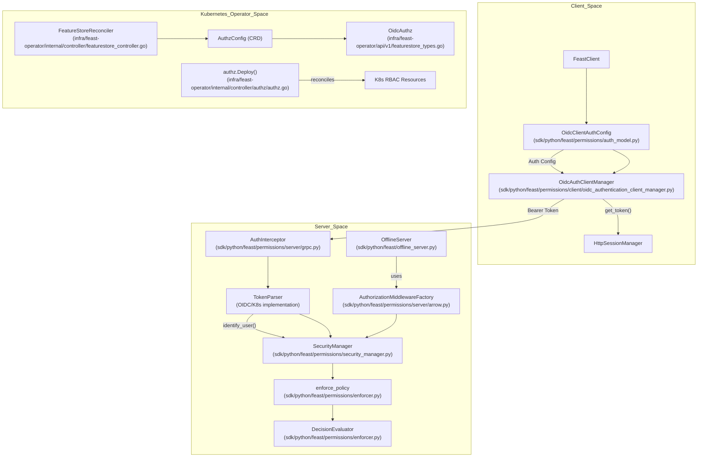
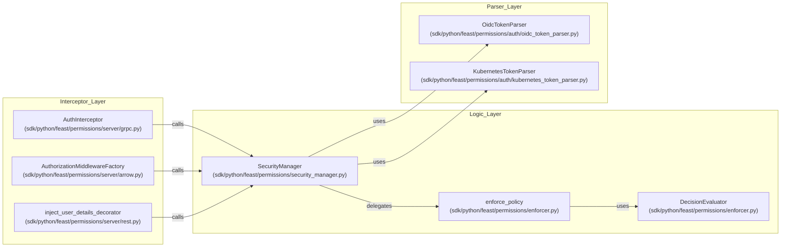

<!-- source: DeepWiki mcp.deepwiki.com · repo feast-dev/feast · page 8.5 Permissions and Authorization · fetched 2026-10-21 -->

# Permissions and Authorization

<details>
<summary>Relevant source files</summary>

The following files were used as context for generating this wiki page:

- [docs/getting-started/components/authz_manager.md](docs/getting-started/components/authz_manager.md)
- [docs/reference/auth/kubernetes_auth_setup.md](docs/reference/auth/kubernetes_auth_setup.md)
- [docs/reference/feature-store-yaml.md](docs/reference/feature-store-yaml.md)
- [examples/rbac-remote/server/k8s/server_resources.yaml](examples/rbac-remote/server/k8s/server_resources.yaml)
- [infra/charts/feast-feature-server/templates/deployment.yaml](infra/charts/feast-feature-server/templates/deployment.yaml)
- [sdk/python/feast/arrow_error_handler.py](sdk/python/feast/arrow_error_handler.py)
- [sdk/python/feast/infra/offline_stores/remote.py](sdk/python/feast/infra/offline_stores/remote.py)
- [sdk/python/feast/offline_server.py](sdk/python/feast/offline_server.py)
- [sdk/python/feast/permissions/auth/kubernetes_token_parser.py](sdk/python/feast/permissions/auth/kubernetes_token_parser.py)
- [sdk/python/feast/permissions/auth/oidc_token_parser.py](sdk/python/feast/permissions/auth/oidc_token_parser.py)
- [sdk/python/feast/permissions/auth_model.py](sdk/python/feast/permissions/auth_model.py)
- [sdk/python/feast/permissions/client/arrow_flight_auth_interceptor.py](sdk/python/feast/permissions/client/arrow_flight_auth_interceptor.py)
- [sdk/python/feast/permissions/client/client_auth_token.py](sdk/python/feast/permissions/client/client_auth_token.py)
- [sdk/python/feast/permissions/client/grpc_client_auth_interceptor.py](sdk/python/feast/permissions/client/grpc_client_auth_interceptor.py)
- [sdk/python/feast/permissions/client/intra_comm_authentication_client_manager.py](sdk/python/feast/permissions/client/intra_comm_authentication_client_manager.py)
- [sdk/python/feast/permissions/client/kubernetes_auth_client_manager.py](sdk/python/feast/permissions/client/kubernetes_auth_client_manager.py)
- [sdk/python/feast/permissions/client/oidc_authentication_client_manager.py](sdk/python/feast/permissions/client/oidc_authentication_client_manager.py)
- [sdk/python/feast/permissions/enforcer.py](sdk/python/feast/permissions/enforcer.py)
- [sdk/python/feast/permissions/oidc_service.py](sdk/python/feast/permissions/oidc_service.py)
- [sdk/python/feast/permissions/security_manager.py](sdk/python/feast/permissions/security_manager.py)
- [sdk/python/feast/permissions/server/grpc.py](sdk/python/feast/permissions/server/grpc.py)
- [sdk/python/feast/permissions/server/rest.py](sdk/python/feast/permissions/server/rest.py)
- [sdk/python/feast/permissions/server/utils.py](sdk/python/feast/permissions/server/utils.py)
- [sdk/python/tests/unit/infra/scaffolding/test_repo_config.py](sdk/python/tests/unit/infra/scaffolding/test_repo_config.py)
- [sdk/python/tests/unit/openlineage/test_teardown.py](sdk/python/tests/unit/openlineage/test_teardown.py)
- [sdk/python/tests/unit/permissions/auth/conftest.py](sdk/python/tests/unit/permissions/auth/conftest.py)
- [sdk/python/tests/unit/permissions/auth/server/mock_utils.py](sdk/python/tests/unit/permissions/auth/server/mock_utils.py)
- [sdk/python/tests/unit/permissions/auth/test_token_parser.py](sdk/python/tests/unit/permissions/auth/test_token_parser.py)
- [sdk/python/tests/unit/permissions/test_decorator.py](sdk/python/tests/unit/permissions/test_decorator.py)
- [sdk/python/tests/unit/permissions/test_oidc_auth_client.py](sdk/python/tests/unit/permissions/test_oidc_auth_client.py)
- [sdk/python/tests/unit/permissions/test_security_manager.py](sdk/python/tests/unit/permissions/test_security_manager.py)
- [sdk/python/tests/unit/test_arrow_error_decorator.py](sdk/python/tests/unit/test_arrow_error_decorator.py)
- [sdk/python/tests/unit/test_feature_view_state.py](sdk/python/tests/unit/test_feature_view_state.py)
- [sdk/python/tests/unit/test_offline_server.py](sdk/python/tests/unit/test_offline_server.py)
- [sdk/python/tests/unit/test_registry_string_config.py](sdk/python/tests/unit/test_registry_string_config.py)

</details>


## Purpose and Scope
This page details Feast's Role-Based Access Control (RBAC) and security architecture. It covers how authentication models (`oidc`, `kubernetes`, and `no_auth`), Permission objects, and the `SecurityManager` [sdk/python/feast/permissions/security_manager.py:18-36]() coordinate to enforce granular policies across gRPC, Arrow Flight, and REST serving endpoints.

Sources: [sdk/python/feast/permissions/security_manager.py:18-36]()

---

## 1. RBAC System Architecture and Core Components

The Feast security system relies on a set of core components that intercept requests, extract user credentials, parse identity tokens, and evaluate permissions against requested actions and resources.

### Core Components Summary

| Component | Role / Implementation Class | Citation |
| :--- | :--- | :--- |
| `Permission` | Maps a user policy (via roles/groups) to actions on specific resource types. | [sdk/python/feast/permissions/permission.py:8-10]() |
| `SecurityManager` | Central entry point managing per-request user context via `ContextVar`. It stores the current user, project, and request token and enforces permission checks on resource actions. | [sdk/python/feast/permissions/security_manager.py:18-36]() |
| `enforce_policy` | Core enforcement function that evaluates user permissions against requested actions on resources and decides authorization outcomes. | [sdk/python/feast/permissions/enforcer.py:15-21]() |
| `DecisionEvaluator` | Aggregates grants and denials from matching permissions to produce a final authorization decision. | [sdk/python/feast/permissions/enforcer.py:62-67]() |
| `AuthzedAction` | Enum defining specific operation types (`CREATE`, `DESCRIBE`, `UPDATE`, `DELETE`, `READ_ONLINE`, etc.) used in permission checks. | [sdk/python/feast/permissions/action.py:13-20]() |
| `TokenParser` | Abstract base class converting an access token into a `User` entity by validation and claim extraction. | [sdk/python/feast/permissions/auth/token_parser.py:15-15]() |

### Request Authorization Flow: Mapping Natural Language to Code Entities

The following diagram bridges natural language authorization concepts into the precise code classes and components used in the client, server, and operator spaces.



Sources:  
- [sdk/python/feast/permissions/security_manager.py:18-36]()  
- [sdk/python/feast/permissions/enforcer.py:15-21]()  
- [sdk/python/feast/permissions/auth_model.py:61-83]()  
- [sdk/python/feast/permissions/server/grpc.py:1-20]()  
- [sdk/python/feast/permissions/server/arrow.py:26-27]()  
- [sdk/python/feast/permissions/action.py:13-20]()  
- [infra/feast-operator/internal/controller/authz/authz.go:26-34]()

---

## 2. Authentication Models and Configuration

Feast supports three primary authentication types configured under the `auth` block in `feature_store.yaml`: `oidc`, `kubernetes`, and `no_auth` [sdk/python/feast/permissions/auth_model.py:33-97]().

### OpenID Connect (OIDC)

- **Server-Side (`OidcTokenParser`)**:  
  Validates incoming JWT bearer tokens against an OIDC discovery endpoint. It lazily creates a `PyJWKClient` for caching JWKS (JSON Web Key Sets) used to verify token signatures. Token claims are extracted to identify the user principal, their roles, groups, and namespaces [sdk/python/feast/permissions/auth/oidc_token_parser.py:23-121]().  
  Tokens containing `kubernetes.io` claim bypass OIDC verification and instead use a Kubernetes TokenReview to extract the namespace.

- **Username and Role Extraction:**  
  The server extracts the username from JWT claims in an order of precedence: `preferred_username`, `upn`, `azp`, `appid`, and `sub`. Roles are read from the `resource_access.<client_id>.roles` claim or from a top-level `roles` claim in the JWT [docs/getting-started/components/authz_manager.md:111-115]().

- **Client-Side (`OidcAuthClientManager`)**:  
  Manages token retrieval either from static tokens, environment variables (`token_env_var`), Kubernetes service account files, or direct client credential requests from the IdP (Identity Provider). Implements a thread-safe token cache with expiration and supports `token_refresh_margin_seconds` to refresh tokens proactively before expiry to reduce failed requests [sdk/python/feast/permissions/client/oidc_authentication_client_manager.py:30-164]().

- **Internal Inter-Service Authentication:**  
  For Feast internal communications, unsigned JWTs encoding the `INTRA_COMMUNICATION_BASE64` secret are used to identify service calls without authenticating externally [sdk/python/feast/permissions/client/intra_comm_authentication_client_manager.py:10-32]() (not cited fully here but described in 2).

### Kubernetes Authentication

- Designed for in-cluster workloads, `KubernetesTokenParser` uses the Kubernetes TokenReview API to validate bearer tokens and extract the namespace for the caller [sdk/python/feast/permissions/auth/kubernetes_token_parser.py:1-45]() (partial).  
- Typically enabled by default when Feast is deployed with the Feast Operator. This results in an "Authenticated by Default, Authorized Gradually" model where all requests require valid Kubernetes tokens, but permissions default to full access if no fine-grained policies are applied [docs/getting-started/components/authz_manager.md:26-35]().

### No Authentication (`no_auth`)

- Disables any authentication or authorization checks, effectively granting open access to all endpoints [sdk/python/feast/permissions/auth_model.py:90-91](). This mode is suitable only for development or test environments.

### Configuration Example in `feature_store.yaml`

```yaml
auth:
  type: oidc
  auth_discovery_url: "https://example.com/.well-known/openid-configuration"
  client_id: "feast-client"
  verify_ssl: true
```

Or disabling auth:

```yaml
auth:
  type: no_auth
```

Sources:  
- [sdk/python/feast/permissions/auth_model.py:33-97]()  
- [sdk/python/feast/permissions/auth/oidc_token_parser.py:23-121]()  
- [sdk/python/feast/permissions/client/oidc_authentication_client_manager.py:30-164]()  
- [docs/getting-started/components/authz_manager.md:26-54]()

---

## 3. Authorization Enforcement Across Endpoints

Feast enforces authorization uniformly across its serving interfaces by injecting user context into the global security layer using interceptors or decorators.

### Security Component Integration: Middleware and Core Security Engine

The following diagram depicts how request authentication and authorization flow through various layers:



### Endpoint-Specific Enforcement Details

- **gRPC Endpoints:**  
  Intercepted by `AuthInterceptor` which extracts bearer tokens, identifies the user via `TokenParser`, and stores user context in the thread-safe `SecurityManager` [sdk/python/feast/permissions/security_manager.py:31-36](). The client uses `GrpcClientAuthHeaderInterceptor` to insert tokens in outgoing calls [sdk/python/feast/permissions/client/grpc_client_auth_interceptor.py:16-21]().

- **Arrow Flight Server (Offline Server):**  
  Uses the `AuthorizationMiddlewareFactory` middleware to enforce permissions on offline feature retrieval requests [sdk/python/feast/permissions/server/arrow.py:26-27](). For example, the `OfflineServer` class uses this middleware to inject auth checks into Arrow Flight operations [sdk/python/feast/offline_server.py:109-126]().

- **REST Endpoints:**  
  Decorated with `inject_user_details_decorator`, which extracts the user identity from HTTP headers and enforces permission validation per request [sdk/python/feast/permissions/server/rest.py:20-30]().

### Enforcement Flow in Serving Servers

1. The user's bearer token is extracted from incoming requests (gRPC metadata, Arrow Flight headers, HTTP headers).
2. The token is parsed by an appropriate TokenParser (`OidcTokenParser` or `KubernetesTokenParser`).
3. A `User` object is constructed representing username, roles, groups, and namespaces.
4. The `User` context is injected into the per-request `SecurityManager`.
5. When a feature or resource request occurs, `SecurityManager.assert_permissions` calls `enforce_policy` to verify privilege for the requested actions.
6. Unauthorized requests raise permission errors, while authorized calls proceed.

Sources:  
- [sdk/python/feast/permissions/security_manager.py:31-36]()  
- [sdk/python/feast/permissions/client/grpc_client_auth_interceptor.py:16-21]()  
- [sdk/python/feast/permissions/server/arrow.py:26-27]()  
- [sdk/python/feast/offline_server.py:109-126]()  
- [sdk/python/feast/permissions/server/rest.py:20-30]()

---

## 4. Configuration Validation, Error Handling, and Token Lifecycle

### Mutual Exclusivity and Detailed Validation

The configuration models for authorization enforce strict rules ensuring mutually exclusive credential sources for OIDC client authentication to avoid ambiguous or incomplete configurations.

- The `_check_mutually_exclusive` function validates that only one credential group (e.g., static token, environment variable token, or client credentials) is specified and that all required fields in that group are complete [sdk/python/feast/permissions/auth_model.py:10-30]().

- The `OidcClientAuthConfig` pydantic model uses a `@model_validator(mode="after")` to apply this logic, raising errors early if configuration is incorrect or incomplete [sdk/python/feast/permissions/auth_model.py:60-88]().

### Token Lifecycle Management

- **Refresh Margin:**  
  The `token_refresh_margin_seconds` parameter lets clients fetch fresh tokens before expiry, avoiding transient authentication errors due to clock skew or slow calls. This margin is applied when reading cached tokens in the `OidcAuthClientManager` [sdk/python/feast/permissions/auth_model.py:70-74](), [sdk/python/feast/permissions/client/oidc_authentication_client_manager.py:98-100]().

- **Token Caching and Invalidations:**  
  Tokens fetched from the IdP are cached globally per credentials with expiration stored from token claims. When the server returns an `UNAUTHENTICATED` status, client interceptors invoke `invalidate_auth_token()` to drop the cached token, forcing a refresh on subsequent calls [sdk/python/feast/permissions/client/grpc_client_auth_interceptor.py:56-80]().

### FIPS Compliance and gRPC TLS Configuration

- Feast configures secure gRPC cipher suites compliant with FIPS standards on systems where FIPS mode is enabled. The environment variable `GRPC_SSL_CIPHER_SUITES` is set early to enforce secure connections [sdk/python/feast/offline_server.py:10-40]().

- This affects offline servers using Arrow Flight for data retrieval and ensures security best practices on hardened environments.

Sources:  
- [sdk/python/feast/permissions/auth_model.py:10-88]()  
- [sdk/python/feast/permissions/client/oidc_authentication_client_manager.py:98-139]()  
- [sdk/python/feast/permissions/client/grpc_client_auth_interceptor.py:56-80]()  
- [sdk/python/feast/offline_server.py:10-40]()

---

# Summary

Feast’s permissions and authorization framework features:

- Role-Based Access Control enforced via the `SecurityManager` and `enforce_policy`.
- Flexible authentication support via OIDC, Kubernetes TokenReview, or disabled auth.
- Strong validation of credentials and tokens using cached JWKS and token refresh logic.
- Uniform enforcement across gRPC, Arrow Flight, and REST interfaces through interceptors and middleware.
- Integration with Kubernetes RBAC when deployed in-k8s clusters, enabled by default in the Feast Operator.
- Configuration-driven design guided by the `auth` block in `feature_store.yaml` or Kubernetes CRs.

This security design ensures fine-grained access control for operational machine learning feature stores, maintaining strong controls without sacrificing flexibility or performance.

Sources:  
- [sdk/python/feast/permissions/security_manager.py:18-36]()  
- [sdk/python/feast/permissions/auth_model.py:33-97]()  
- [sdk/python/feast/permissions/auth/oidc_token_parser.py:23-121]()  
- [sdk/python/feast/permissions/client/oidc_authentication_client_manager.py:30-164]()  
- [docs/getting-started/components/authz_manager.md:26-54]()  
- [sdk/python/feast/permissions/enforcer.py:15-21]()  
- [sdk/python/feast/permissions/server/grpc.py:1-20]()  
- [sdk/python/feast/permissions/server/arrow.py:26-27]()  
- [sdk/python/feast/permissions/server/rest.py:20-30]()  
- [sdk/python/feast/offline_server.py:10-40]()

---

