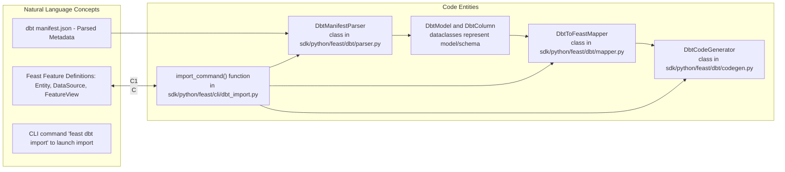

<!-- source: DeepWiki mcp.deepwiki.com · repo feast-dev/feast · page 8.6 dbt Integration · fetched 2026-10-21 -->

# dbt Integration

<details>
<summary>Relevant source files</summary>

The following files were used as context for generating this wiki page:

- [docs/how-to-guides/dbt-integration.md](docs/how-to-guides/dbt-integration.md)
- [sdk/python/feast/cli/dbt_import.py](sdk/python/feast/cli/dbt_import.py)
- [sdk/python/feast/dbt/__init__.py](sdk/python/feast/dbt/__init__.py)
- [sdk/python/feast/dbt/codegen.py](sdk/python/feast/dbt/codegen.py)
- [sdk/python/feast/dbt/mapper.py](sdk/python/feast/dbt/mapper.py)
- [sdk/python/feast/dbt/parser.py](sdk/python/feast/dbt/parser.py)
- [sdk/python/tests/integration/dbt/__init__.py](sdk/python/tests/integration/dbt/__init__.py)
- [sdk/python/tests/integration/dbt/conftest.py](sdk/python/tests/integration/dbt/conftest.py)
- [sdk/python/tests/integration/dbt/pytest.ini](sdk/python/tests/integration/dbt/pytest.ini)
- [sdk/python/tests/integration/dbt/test_dbt_integration.py](sdk/python/tests/integration/dbt/test_dbt_integration.py)
- [sdk/python/tests/integration/dbt/test_dbt_project/.gitignore](sdk/python/tests/integration/dbt/test_dbt_project/.gitignore)
- [sdk/python/tests/integration/dbt/test_dbt_project/dbt_project.yml](sdk/python/tests/integration/dbt/test_dbt_project/dbt_project.yml)
- [sdk/python/tests/integration/dbt/test_dbt_project/models/customer_features.sql](sdk/python/tests/integration/dbt/test_dbt_project/models/customer_features.sql)
- [sdk/python/tests/unit/dbt/test_mapper.py](sdk/python/tests/unit/dbt/test_mapper.py)
- [sdk/python/tests/unit/dbt/test_parser.py](sdk/python/tests/unit/dbt/test_parser.py)

</details>


The Feast dbt integration enables automatic conversion of dbt models into Feast feature store objects. By reading the compiled dbt `manifest.json` artifact, Feast extracts model metadata and generates corresponding Feast `Entity`, `DataSource`, and `FeatureView` definitions. This streamlines the maintenance of feature definitions, ensuring a single source of truth within the dbt project while enabling Feast to serve features for ML applications.

This document provides an in-depth technical overview of the integration's implementation, key classes, data flow, type mapping, CLI usage, and code generation.

## Overview and Data Flow

Feast leverages the dbt compiled manifest to import models tagged for feature engineering and convert them automatically into Feast feature store objects. The process consists of the following steps:

1. **Tagging dbt Models**: Users assign a specific tag (e.g., `feast`) to dbt models to mark them for import [docs/how-to-guides/dbt-integration.md:42-51]().

2. **Parsing Manifest**: The `DbtManifestParser` loads and parses the `manifest.json` file using the `dbt-artifacts-parser` package. This produces strongly typed `DbtModel` and `DbtColumn` objects for further processing [sdk/python/feast/dbt/parser.py:49-50](), [sdk/python/feast/dbt/parser.py:111-153]().

3. **Mapping to Feast Types**: The `DbtToFeastMapper` converts dbt/warehouse-specific data types into Feast types, and creates Feast objects such as `DataSource` and `FeatureView` with associated fields and metadata [sdk/python/feast/dbt/mapper.py:170-171](), [sdk/python/feast/dbt/mapper.py:97-168]().

4. **Code Generation or Registry Update**: The `DbtCodeGenerator` can output Python code defining the Feast objects for manual inspection or inclusion in a Feast repo, or Feast can apply changes directly to the Feature Store registry [sdk/python/feast/dbt/codegen.py:178-228](), [sdk/python/feast/cli/dbt_import.py:22-215]().

### Data Flow Diagram: dbt Model to Feast Object Creation and CLI

```mermaid
graph TD
    subgraph "dbt_Project"
        dbt_source["dbt Models (.sql files)"]
        dbt_compile["dbt compile or run"]
        manifest["target/manifest.json"]
        dbt_source -->|dbt_compile| manifest
    end

    subgraph "Feast CLI & SDK"
        import_cmd["feast dbt import (import_command)"]
        DbtManifestParser["DbtManifestParser\n(sdk/python/feast/dbt/parser.py)"]
        DbtToFeastMapper["DbtToFeastMapper\n(sdk/python/feast/dbt/mapper.py)"]
        DbtCodeGenerator["DbtCodeGenerator\n(sdk/python/feast/dbt/codegen.py)"]
        FeastApply["Feast apply to Registry"]

        manifest -->|parse()| DbtManifestParser
        import_cmd -->|calls| DbtManifestParser
        import_cmd -->|uses| DbtToFeastMapper
        import_cmd -->|calls| DbtCodeGenerator
        DbtManifestParser --> DbtToFeastMapper
        DbtToFeastMapper --> DbtCodeGenerator
        DbtCodeGenerator -->|generates| feature_code["features.py or feast objects"]
        feature_code --> FeastApply
    end

    classDef code font-family:monospace;
    class import_cmd,DbtManifestParser,DbtToFeastMapper,DbtCodeGenerator,FeastApply code;
```

### Natural Language to Code Entity Mapping of Key Components



Sources: [sdk/python/feast/cli/dbt_import.py:16-215](), [sdk/python/feast/dbt/parser.py:49-153](), [sdk/python/feast/dbt/mapper.py:97-168](), [sdk/python/feast/dbt/codegen.py:178-228](), [docs/how-to-guides/dbt-integration.md:40-130]()

---

## Key Components

### 1. DbtManifestParser

The `DbtManifestParser` is the foundational parser that reads and deserializes the dbt compiled manifest JSON file (`manifest.json`). It uses the `dbt-artifacts-parser` library for typed parsing, supporting dbt manifest versions 0.19 through 1.11+.

- **Model Extraction**: Converts manifest graph nodes into typed `DbtModel` objects with metadata such as name, schema, database, columns (as `DbtColumn`), tags, and dependencies [sdk/python/feast/dbt/parser.py:29-50]().

- **Filtering**: Supports filtering models by explicit names or dbt tags using `get_models()` [sdk/python/feast/dbt/parser.py:219-220]().

- **Sanitization**: Handles unsupported macro languages in dbt manifests (like "javascript") by sanitizing before parsing to avoid errors [sdk/python/feast/dbt/parser.py:84-109]().

- **Data Attributes**: Key dbt model attributes such as `database`, `schema`, `alias`, and `description` are extracted to help build Feast `DataSource` references and feature metadata.

Sources: [sdk/python/feast/dbt/parser.py:17-50](), [sdk/python/feast/dbt/parser.py:84-109](), [sdk/python/feast/dbt/parser.py:111-153](), [sdk/python/feast/dbt/parser.py:200-220]()

---

### 2. DbtToFeastMapper

This component translates between dbt data types and Feast types, and creates Feast object instances reflecting dbt models.

**Responsibilities:**

- **Type Conversion**: Maps database-specific type strings (e.g., `INT64`, `VARCHAR(255)`, `NUMBER(10,2)`, `ARRAY<STRING>`) to Feast types like `Int64`, `String`, `Float64`, and `Array` respectively. Includes special handling for Snowflake's `NUMBER` types based on precision and scale [sdk/python/feast/dbt/mapper.py:97-168]().

- **DataSource Creation**: Generates a Feast `DataSource` object based on the model type (BigQuery, Snowflake, File) by populating attributes such as table name, database, schema, timestamp field, description, and tags [sdk/python/feast/dbt/mapper.py:209-222]().

- **FeatureView Creation**: Constructs a Feast `FeatureView` using model columns (excluding entities and timestamp fields), and associates it with entities and the data source. TTL and online serving attributes are set [sdk/python/feast/dbt/mapper.py:255-267]().

- **Entity Type Inference**: Infers the Feast `ValueType` of entities automatically from their dbt column data types [sdk/python/feast/dbt/mapper.py:201-207]().

- **Multi-entity Support**: Supports specifying multiple entity columns for models to handle composite keys [sdk/python/feast/cli/dbt_import.py:31-37]().

Sources: [sdk/python/feast/dbt/mapper.py:97-168](), [sdk/python/feast/dbt/mapper.py:170-267](), [sdk/python/feast/cli/dbt_import.py:31-37]()

---

### 3. DbtCodeGenerator

The `DbtCodeGenerator` uses Jinja2 templating to generate Python files that contain valid Feast definitions for entities, data sources, and feature views. This is often used to generate human-readable, editable Feast code from dbt models as an alternative to applying changes directly to the registry.

**Features:**

- Generates PEP8-compliant, documented Python code files [sdk/python/feast/dbt/codegen.py:30-122]().

- Sanitizes identifiers to valid Python variable names.

- Escapes feature and entity descriptions to avoid syntax errors.

- Imports only necessary Feast types and offline store classes based on chosen source types (BigQuery, Snowflake, File).

- Outputs entities as `Entity` objects with join keys and tags.

- Outputs data sources as `BigQuerySource`, `SnowflakeSource`, or `FileSource`.

- Defines feature views with fields mapped to Feast types, TTL, tags, and online flags.

Example snippet from template:
```python
driver_id = Entity(
    name="driver_id",
    join_keys=["driver_id"],
    description="Entity key for dbt models",
    tags={'source': 'dbt'},
)

driver_features_source = BigQuerySource(
    name="driver_features_source",
    table="my_project.my_dataset.driver_features",
    timestamp_field="event_timestamp",
    description="Driver aggregated features for ML models",
    tags={'dbt.model': 'driver_features', 'dbt.tag.feast': 'true'},
)

driver_features_fv = FeatureView(
    name="driver_features",
    entities=[driver_id],
    ttl=timedelta(days=1),
    schema=[
        Field(name="avg_rating", dtype=Float64, description="Average driver rating"),
        Field(name="total_trips", dtype=Int64, description="Total completed trips"),
        Field(name="is_active", dtype=Bool, description="Whether driver is currently active"),
    ],
    online=True,
    source=driver_features_source,
    description="Driver aggregated features for ML models",
    tags={'dbt.model': 'driver_features', 'dbt.tag.feast': 'true'},
)
```

Sources: [sdk/python/feast/dbt/codegen.py:30-122](), [sdk/python/feast/dbt/codegen.py:178-228]()

---

## CLI Usage and Commands

The dbt integration exposes a `feast dbt` command group in the Feast CLI implemented in `sdk/python/feast/cli/dbt_import.py`. The key commands provided are:

| Command              | Description                                                  |
|----------------------|--------------------------------------------------------------|
| `feast dbt list`     | Lists dbt models available for Feast import based on filters |
| `feast dbt import`   | Imports dbt models as Feast feature definitions (either apply to registry or generate code) |

### `feast dbt import`

Key CLI options include:

- `--manifest-path, -m` (required): Path to the `manifest.json` dbt artifact.

- `--entity-column, -e` (required, multiple): Columns to use as Feast entities. Multiple columns enable composite keys.

- `--data-source-type, -d`: Choose data source backend among `bigquery`, `snowflake`, or `file` (default: `bigquery`).

- `--timestamp-field, -t`: Field name acting as event timestamp for point-in-time join (default: `event_timestamp`).

- `--tag`: Filter by dbt tag to select models.

- `--model`: Explicit list of dbt model names to import.

- `--ttl-days`: TTL for feature views (default: 1 day).

- `--exclude-columns`: Comma-separated list of columns to exclude from feature definitions.

- `--dry-run`: Preview generated changes without applying.

- `--output, -o`: Generate a Python file with Feast definitions instead of applying changes.

Example to import all models tagged `feast`, using `driver_id` as entity, generating output code:

```bash
feast dbt import \
    --manifest-path target/manifest.json \
    --entity-column driver_id \
    --data-source-type bigquery \
    --tag feast \
    --output features/driver_features.py
```

The command validates presence of entity columns in each model, warns and skips models missing required fields, and either applies the definitions to the Feast registry or writes Python code to a file.

Sources: [sdk/python/feast/cli/dbt_import.py:16-215](), [docs/how-to-guides/dbt-integration.md:120-185]()

---

## Type Mapping Reference

The function `map_dbt_type_to_feast_type(dbt_type: str) -> FeastType` performs comprehensive conversion of dbt/warehouse data types to Feast types:

| dbt/SQL Type                             | Feast Type                       | Notes                                |
|-----------------------------------------|---------------------------------|-------------------------------------|
| `STRING`, `TEXT`, `VARCHAR(255)`, etc. | `String`                        | Normalized to Feast's `String`       |
| `INT`, `INT64`, `BIGINT`, `INTEGER`     | `Int64`                        | For 64-bit integers                  |
| `INT32`, `SMALLINT`, `TINYINT`           | `Int32`                        |                                         |
| `FLOAT`, `FLOAT64`, `DOUBLE`              | `Float64`                     | Floating point                      |
| `FLOAT32`, `REAL`                         | `Float32`                     |                                     |
| `BOOLEAN`, `BOOL`                        | `Bool`                        | Boolean types                      |
| `TIMESTAMP`, `DATETIME`, `DATE`           | `UnixTimestamp`               | Stored as Unix timestamp             |
| `ARRAY<STRING>`, `ARRAY<INT64>`            | `Array(String)`, `Array(Int64)` | Supports Feast Array type          |
| `BYTES`, `BINARY`, `VARBINARY`, `BLOB`    | `Bytes`                       | Binary data                         |

### Snowflake NUMBER Type Handling

Snowflake's `NUMBER(p, s)` type is mapped intelligently based on precision `p` and scale `s`:

- For scale `s > 0`: mapped to `Float64` (floating point)

- For scale `s = 0` and precision `p <= 9`: mapped to `Int32`

- For scale `s = 0` and `10 <= p <= 18`: mapped to `Int64`

- For precision exceeding 18 or unknown scale: mapped to `Float64`

Unknown or unhandled types default to `String`.

Sources: [sdk/python/feast/dbt/mapper.py:49-168]()

---

## Implementation Details

### Data Source Object Creation

- Depending on `data_source_type` configuration (`bigquery`, `snowflake`, or `file`), `DbtToFeastMapper.create_data_source` constructs the corresponding Feast data source class (`BigQuerySource`, `SnowflakeSource`, or `FileSource`) [sdk/python/feast/dbt/mapper.py:209-253]().

- Table names are assembled fully qualified as `<database>.<schema>.<table>` for warehouse types like BigQuery and Snowflake.

- Timestamp field is set to a configured column (default "event_timestamp").

- Tags are applied to mark the object as originating from dbt, including model name tags.

### Multi-Entity Feature Views

- The integration supports multiple entity columns per model, allowing composite keys in feature views.

- The `import` CLI command enforces all specified entity columns are present in each model; if any are missing, the model is skipped with a warning [sdk/python/feast/cli/dbt_import.py:210-220]().

- This supports complex ML use cases with multi-entity keys (e.g., user and merchant).

### Code Generation

- Using `DbtCodeGenerator.generate()`, Feast renders a complete Python file via Jinja2 templates. This includes:

  - Entity definitions with names, join keys, descriptions, and tags.

  - DataSource definitions with relevant source classes, tables, and metadata.

  - FeatureView definitions comprising entity lists, TTL, fields (with type and description), online flag, and tags.

- Variable names for python objects are derived from Feast object names sanitized to valid identifiers (_make_var_name) [sdk/python/feast/dbt/codegen.py:160-167]().

- Descriptions are escaped to maintain Python string syntax [sdk/python/feast/dbt/codegen.py:170-176]().

### Testing and Validation

- Integration tests cover full dbt import workflow using a sample dbt project with corresponding manifest file [sdk/python/tests/integration/dbt/test_dbt_integration.py]().

- Tests validate parsing accuracy, type mapping, filtering by tag and model name, and object creation.

- If the dbt manifest is absent (e.g., before compiling dbt project), tests are skipped gracefully via a pytest hook in `conftest.py` [sdk/python/tests/integration/dbt/conftest.py:19-35]().

### Limitations and Alpha Status

- Currently supports only BigQuery, Snowflake, and File offline stores.

- Requires explicit entity column specification by the user; entity discovery from dbt metadata is not automated.

- Feature and entity definitions are generated but do not import feature transformation logic.

- The integration is experimental and may evolve significantly over future releases [docs/how-to-guides/dbt-integration.md:3-11]().

---

This integration considerably simplifies ingestion of warehouse feature tables built with dbt into Feast for operational serving while maintaining a unified transformation and feature store workflow.

Sources:  
[sdk/python/feast/cli/dbt_import.py:1-215](),  
[sdk/python/feast/dbt/parser.py:10-220](),  
[sdk/python/feast/dbt/mapper.py:40-267](),  
[sdk/python/feast/dbt/codegen.py:1-228](),  
[docs/how-to-guides/dbt-integration.md:1-247](),  
[sdk/python/tests/integration/dbt/test_dbt_integration.py:1-173](),  
[sdk/python/tests/integration/dbt/conftest.py:19-35]()

---

