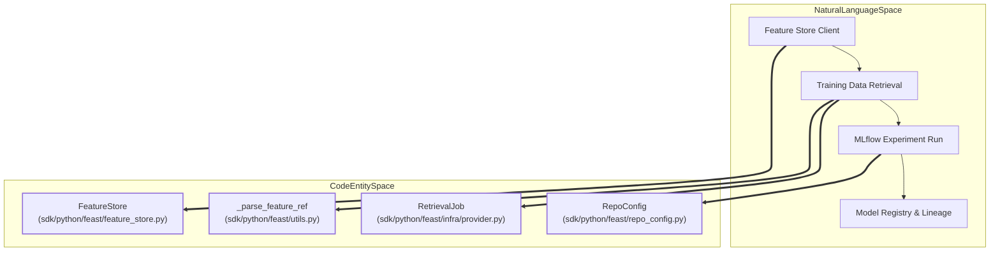
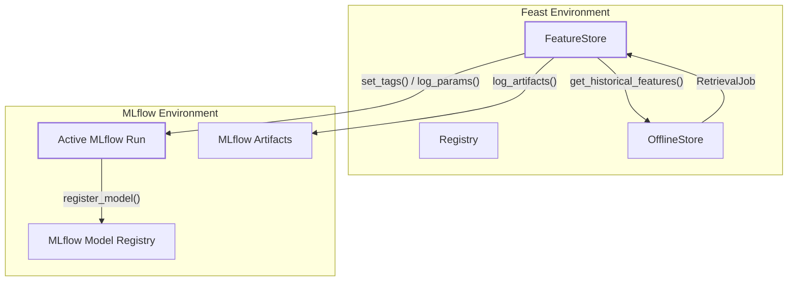
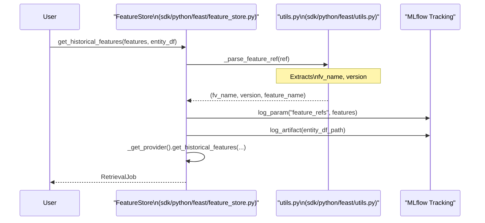

<!-- source: DeepWiki mcp.deepwiki.com · repo feast-dev/feast · page 8.7 MLflow Integration · fetched 2026-10-21 -->

# MLflow Integration

<details>
<summary>Relevant source files</summary>

The following files were used as context for generating this wiki page:

- [pixi.lock](pixi.lock)
- [protos/feast/core/SavedDataset.proto](protos/feast/core/SavedDataset.proto)
- [pyproject.toml](pyproject.toml)
- [sdk/python/feast/protos/feast/core/SavedDataset_pb2.py](sdk/python/feast/protos/feast/core/SavedDataset_pb2.py)
- [sdk/python/feast/protos/feast/core/SavedDataset_pb2.pyi](sdk/python/feast/protos/feast/core/SavedDataset_pb2.pyi)
- [sdk/python/feast/saved_dataset.py](sdk/python/feast/saved_dataset.py)
- [sdk/python/requirements/py3.10-ci-requirements.txt](sdk/python/requirements/py3.10-ci-requirements.txt)
- [sdk/python/requirements/py3.10-minimal-requirements.txt](sdk/python/requirements/py3.10-minimal-requirements.txt)
- [sdk/python/requirements/py3.10-minimal-sdist-requirements.txt](sdk/python/requirements/py3.10-minimal-sdist-requirements.txt)
- [sdk/python/requirements/py3.10-requirements.txt](sdk/python/requirements/py3.10-requirements.txt)
- [sdk/python/requirements/py3.11-ci-requirements.txt](sdk/python/requirements/py3.11-ci-requirements.txt)
- [sdk/python/requirements/py3.11-minimal-requirements.txt](sdk/python/requirements/py3.11-minimal-requirements.txt)
- [sdk/python/requirements/py3.11-minimal-sdist-requirements.txt](sdk/python/requirements/py3.11-minimal-sdist-requirements.txt)
- [sdk/python/requirements/py3.11-requirements.txt](sdk/python/requirements/py3.11-requirements.txt)
- [sdk/python/requirements/py3.12-ci-requirements.txt](sdk/python/requirements/py3.12-ci-requirements.txt)
- [sdk/python/requirements/py3.12-minimal-requirements.txt](sdk/python/requirements/py3.12-minimal-requirements.txt)
- [sdk/python/requirements/py3.12-minimal-sdist-requirements.txt](sdk/python/requirements/py3.12-minimal-sdist-requirements.txt)
- [sdk/python/tests/unit/infra/offline_stores/contrib/spark_offline_store/test_spark_persist.py](sdk/python/tests/unit/infra/offline_stores/contrib/spark_offline_store/test_spark_persist.py)

</details>


Feast provides a native integration with MLflow to enable automatic feature lineage tracking, experiment logging, and model registration with embedded feature metadata. This integration ensures that the exact versions and references of features used during model training are recorded and can be audited through the MLflow UI and Feast UI.

## Overview and Architecture

The integration bridges the gap between feature engineering in Feast and experiment tracking in MLflow. When a user retrieves historical features for training, Feast can automatically log the feature definitions, entity dataframes, and retrieval metadata to the active MLflow run.

### System Architecture to Code Entity Mapping

The following diagram bridges the high-level MLflow integration architecture to concrete code entities within the Feast codebase. It shows how the `FeatureStore` orchestrates logging through `RepoConfig` and uses provider jobs for feature retrieval, with utilities supporting reference parsing.



Sources: [sdk/python/feast/feature_store.py:164-196](), [sdk/python/feast/infra/provider.py:51-60](), [sdk/python/feast/repo_config.py:1-115](), [sdk/python/feast/utils.py:66-74]()

### Data Flow for Lineage Tracking

This sequence diagram illustrates the flow of feature lineage metadata from Feast’s `FeatureStore` to MLflow during a typical training pipeline.



Sources: [sdk/python/feast/feature_store.py:164-196](), [sdk/python/feast/infra/provider.py:51-60]()

## Configuration via `feature_store.yaml`

The MLflow integration is enabled and configured through the Feast repository configuration, primarily `feature_store.yaml`, which is parsed into a `RepoConfig` instance.

The configuration can be loaded automatically by default file path resolution via `get_default_yaml_file_path` utility.

### Configuration Parameters

| Parameter      | Description                                   |
| -------------- | --------------------------------------------- |
| `enabled`      | Boolean flag to toggle the MLflow integration. |
| `trackingUri`  | URI of the MLflow tracking server.           |
| `uiUrl`        | URL to the MLflow user interface.             |

Sources: [sdk/python/feast/repo_config.py:1-115](), [sdk/python/feast/utils.py:181-187]()

## The `mlflow_integration` Module and `store.mlflow` API

Feast’s `mlflow_integration` module encapsulates the connection points and helper functions used to link Feast operations with MLflow tracking runs.

Within the Python SDK, this functionality is accessed through the `store.mlflow` API interface on the `FeatureStore` client. This extension exposes:

- **Entity DataFrame Archival**: Automatically archives and logs the exact entity dataframe used for historical feature retrieval as an MLflow artifact. This guarantees reproducibility for training data splits.

- **Model Registration with Lineage**: When registering machine learning models in MLflow, Feast can attach the associated feature definitions (feature views or feature services) to the model metadata, enabling end-to-end lineage visualization for audited deployments.

This integration tightly couples Feast feature store entities with MLflow model lifecycle events and artifact management, supporting comprehensive model lineage traceability.

Sources: [sdk/python/feast/feature_store.py:164-196](), [sdk/python/feast/infra/provider.py:1-182]()

## Auto-logging of Feature Metadata & Entity DataFrame Archival

Feast enhances the `get_historical_features` call by automatically extracting and logging rich feature lineage metadata to the current MLflow run context.

During feature retrieval:

1. The feature references requested (e.g., `driver_stats:trips_today`) are parsed using the private utility `_parse_feature_ref` to extract feature view name, version, and specific feature name.

2. The precise feature view versions actively used in the join are captured.

3. The entity dataframe passed in for feature retrieval is serialized and saved as an MLflow artifact.

This capture of feature references and entity dataframe enables complete auditability of the features comprising training datasets.

### Metadata Extraction to MLflow Logging Execution

The following sequence diagram shows the call flow from user invocation to MLflow logging and feature retrieval job creation.



Sources: [sdk/python/feast/utils.py:66-89](), [sdk/python/feast/feature_store.py:164-196](), [sdk/python/feast/infra/provider.py:29-29]()

## Kubernetes Operator Integration for MLflow

In Kubernetes deployments managed by the Feast Operator, MLflow integration is configured declaratively and automated by the controller.

The `FeatureStore` Custom Resource definition (CRD) supports an `mlflow` configuration block specifying:

- `enabled`: boolean toggle
- `trackingUri`: MLflow tracking server URI
- `uiUrl`: MLflow UI URL

This is defined in the CRD schema:

```yaml
# infra/feast-operator/config/crd/bases/feast.dev_featurestores.yaml
apiVersion: apiextensions.k8s.io/v1
kind: CustomResourceDefinition
metadata:
  name: featurestores.feast.dev
spec:
  group: feast.dev
  names:
    kind: FeatureStore
  versions:
  - name: v1
    schema:
      openAPIV3Schema:
        properties:
          spec:
            properties:
              mlflow:
                description: MlflowConfig enables MLflow integration for feature lineage tracking.
                properties:
                  enabled:
                    description: Enable MLflow integration.
                    type: boolean
                  trackingUri:
                    description: MLflow tracking server URI.
                    type: string
                  uiUrl:
                    description: MLflow UI URL.
                    type: string
                type: object
```

The operator’s reconciliation loop includes `applyMlflowDefaults()` method which:

1. Removes MLflow config from status if `enabled` is explicitly `false`.
2. If `enabled` is `true` or unset with missing `trackingUri` or `uiUrl`, attempts to auto-discover MLflow endpoints in the Kubernetes cluster.
3. Applies discovered values to the `Status.Applied` section of the `FeatureStore` CR.

This automation ensures Feast clusters with MLflow installed can seamlessly integrate without manual configuration.

Sources:
- [infra/feast-operator/internal/controller/services/services.go:61-96]()
- [infra/feast-operator/api/v1/featurestore_types.go:1-151]()
- [infra/feast-operator/config/crd/bases/feast.dev_featurestores.yaml:1-157]()

---

This page documents the technical design and implementation details of Feast's MLflow integration crucial for enabling feature lineage and model metadata logging, supporting reproducibility and operational traceability in ML development workflows.

---

