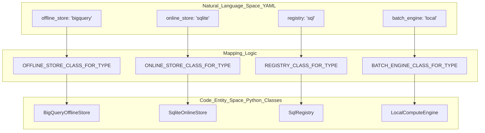
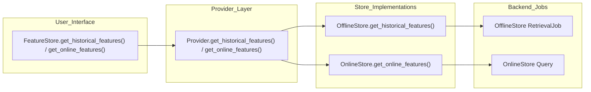

<!-- source: DeepWiki mcp.deepwiki.com · repo feast-dev/feast · page 9 Glossary · fetched 2026-10-21 -->

# Glossary

Relevant source files

The following files were used as context for generating this wiki page:

- [CONTRIBUTING.md](CONTRIBUTING.md)
- [README.md](README.md)
- [docs/README.md](docs/README.md)
- [docs/SUMMARY.md](docs/SUMMARY.md)
- [docs/adr/ADR-0011-data-quality-monitoring.md](docs/adr/ADR-0011-data-quality-monitoring.md)
- [docs/blog/feast-0-18-adds-snowflake-support-and-data-quality-monitoring.md](docs/blog/feast-0-18-adds-snowflake-support-and-data-quality-monitoring.md)
- [docs/community.md](docs/community.md)
- [docs/getting-started/concepts/dataset.md](docs/getting-started/concepts/dataset.md)
- [docs/getting-started/concepts/feast-types.md](docs/getting-started/concepts/feast-types.md)
- [docs/getting-started/third-party-integrations.md](docs/getting-started/third-party-integrations.md)
- [docs/reference/codebase-structure.md](docs/reference/codebase-structure.md)
- [docs/reference/data-sources/README.md](docs/reference/data-sources/README.md)
- [docs/reference/dqm.md](docs/reference/dqm.md)
- [docs/reference/offline-stores/README.md](docs/reference/offline-stores/README.md)
- [docs/reference/online-stores/README.md](docs/reference/online-stores/README.md)
- [docs/reference/providers/README.md](docs/reference/providers/README.md)
- [docs/reference/type-system.md](docs/reference/type-system.md)
- [docs/roadmap.md](docs/roadmap.md)
- [infra/templates/README.md.jinja2](infra/templates/README.md.jinja2)
- [infra/website/docs/blog/feast-mlflow-kubeflow.md](infra/website/docs/blog/feast-mlflow-kubeflow.md)
- [protos/feast/types/Value.proto](protos/feast/types/Value.proto)
- [sdk/python/feast/constants.py](sdk/python/feast/constants.py)
- [sdk/python/feast/errors.py](sdk/python/feast/errors.py)
- [sdk/python/feast/feature_store.py](sdk/python/feast/feature_store.py)
- [sdk/python/feast/infra/online_stores/online_store.py](sdk/python/feast/infra/online_stores/online_store.py)
- [sdk/python/feast/infra/online_stores/sqlite.py](sdk/python/feast/infra/online_stores/sqlite.py)
- [sdk/python/feast/infra/passthrough_provider.py](sdk/python/feast/infra/passthrough_provider.py)
- [sdk/python/feast/infra/provider.py](sdk/python/feast/infra/provider.py)
- [sdk/python/feast/proto_json.py](sdk/python/feast/proto_json.py)
- [sdk/python/feast/protos/feast/types/Value_pb2.py](sdk/python/feast/protos/feast/types/Value_pb2.py)
- [sdk/python/feast/protos/feast/types/Value_pb2.pyi](sdk/python/feast/protos/feast/types/Value_pb2.pyi)
- [sdk/python/feast/repo_config.py](sdk/python/feast/repo_config.py)
- [sdk/python/feast/repo_operations.py](sdk/python/feast/repo_operations.py)
- [sdk/python/feast/type_map.py](sdk/python/feast/type_map.py)
- [sdk/python/feast/types.py](sdk/python/feast/types.py)
- [sdk/python/feast/value_type.py](sdk/python/feast/value_type.py)
- [sdk/python/tests/foo_provider.py](sdk/python/tests/foo_provider.py)
- [sdk/python/tests/integration/offline_store/test_offline_write.py](sdk/python/tests/integration/offline_store/test_offline_write.py)
- [sdk/python/tests/unit/test_type_map.py](sdk/python/tests/unit/test_type_map.py)
- [sdk/python/tests/unit/test_types.py](sdk/python/tests/unit/test_types.py)

This page defines codebase-specific terms, jargon, abbreviations, and domain concepts used throughout the Feast repository. It is intended to help onboarding engineers navigate the abstractions and implementation patterns used to manage and serve machine learning features.

---

## Core Architectural Terms

### FeatureStore  
The primary entry point for the Feast Python SDK. It provides high-level methods for defining, creating, and retrieving features, acting as the orchestrator between the registry, provider, and configuration. The `FeatureStore` class encompasses logic for applying feature definitions, materializing data, fetching features online and offline, and managing feature services.

- **Implementation:** `FeatureStore` class is defined in [sdk/python/feast/feature_store.py:164-183]()  
- **Key Methods:**
  - `apply()`: Synchronizes local feature definitions with the persisted registry and underlying infrastructure ([sdk/python/feast/feature_store.py:614-686]())  
  - `get_historical_features()`: Executes point-in-time joins to retrieve historical feature data from the offline store ([sdk/python/feast/feature_store.py:898-963]())  
  - `get_online_features()`: Efficiently retrieves latest feature values from the online store ([sdk/python/feast/feature_store.py:1330-1375]())  
  - `materialize()`: Loads feature data into the online store for serving ([sdk/python/feast/feature_store.py:1418-1478]())  
  - `write_to_online_store()`: Direct ingestion of feature data to the online store outside of normal materialization ([sdk/python/feast/feature_store.py:1839-1845]())

---

### Registry  
The authoritative catalog of all feature store metadata: entities, feature views, feature services, and label views. The registry persists the definitions and versions of features deployed.

- **Base Interface:** `BaseRegistry` [sdk/python/feast/infra/registry/base_registry.py:23-23]()  
- **Implementations include:**
  - File-based `Registry` [sdk/python/feast/infra/registry/registry.py:29-29]()  
  - SQL-backed `SqlRegistry` [sdk/python/feast/infra/registry/sql.py:88-88]()  
  - Snowflake-specific `SnowflakeRegistry` [sdk/python/feast/infra/registry/snowflake.py:20-20]()  
  - Remote `RemoteRegistry` for distributed or centralized systems [sdk/python/feast/infra/registry/remote.py:17-17]()  

- **Data Flow:**  
  `feast apply` calls `parse_repo` to load local Python-defined objects ([sdk/python/feast/repo_operations.py:115-133]()), computes diffs with the current registry state (`RegistryDiff`) ([sdk/python/feast/diff/registry_diff.py:28-28]()), then updates the registry and infrastructure accordingly.

---

### Provider  
Abstracts infrastructure and backend services orchestration: offline store, online store, and compute engine. Each cloud or on-premise environment can implement its own `Provider` subclass.

- **Definition:** `Provider` is an abstract base class defining methods for managing infrastructure and reading/writing features ([sdk/python/feast/infra/provider.py:51-62]()).  
- **PassthroughProvider:** The default provider implementation that delegates API calls directly to configured stores, without orchestration ([sdk/python/feast/infra/passthrough_provider.py:20-20]()).

---

### RepoConfig  
Represents the configuration loaded from `feature_store.yaml`. Controls which registry, offline store, online store, and compute engine classes are used.

- **Class:** `RepoConfig` implements validation and class mappings ([sdk/python/feast/repo_config.py:130-140]()).  
- **Plugin mappings:**  
  - `REGISTRY_CLASS_FOR_TYPE` maps `registry` string to registry classes  
  - `ONLINE_STORE_CLASS_FOR_TYPE` maps `online_store` string to online store classes  
  - `OFFLINE_STORE_CLASS_FOR_TYPE` maps `offline_store` string to offline store classes  
  - `BATCH_ENGINE_CLASS_FOR_TYPE` maps batch engine strings to compute engine classes  
  ([sdk/python/feast/repo_config.py:39-112]()).

---

### Diagram: Configuration and Plugin Resolution  
This diagram shows how the natural language configuration in `feature_store.yaml` maps to specific Python classes instantiated by Feast:

---

## Data Modeling Concepts

### Entity  
The primary key or keys for objects whose features are tracked, such as a `driver_id` or `user_id`. Entities enable joins between feature data and business events.

- **Class:** `Entity` defined in [sdk/python/feast/entity.py:35-60]()  
- **Role:** Used as join keys in historical feature retrieval and online feature requests.

---

### FeatureView  
Logical groupings of features sourced from specific data sources, defining their schema, entity relationships, and data update frequency. Enables consistent retrieval of feature data.

- **Class:** `FeatureView` ([sdk/python/feast/feature_view.py:111-141]())  
- **Subtypes:**  
  - `BatchFeatureView` for batch-only sources ([sdk/python/feast/batch_feature_view.py:19-19]())  
  - `StreamFeatureView` for streaming sources ([sdk/python/feast/stream_feature_view.py:104-115]())  
  - `OnDemandFeatureView` for compute-on-read transformations ([sdk/python/feast/on_demand_feature_view.py:116-161]())

---

### LabelView  
A specialized view for mutable, changing labels associated with features—useful in multi-labeler workflows and managing gold labels separately from immutable feature data.

- **Class:** `LabelView` in [sdk/python/feast/labeling/label_view.py:24-24]()  

---

### FeatureService  
A grouping of multiple feature views defined as a reusable feature set versioned together, often aligned with a particular ML model version.

- **Class:** `FeatureService` in [sdk/python/feast/feature_service.py:70-70]()  

---

## System Interaction and Retrieval Flow

Feature retrieval, both historical and online, involves complex interactions among SDK layers, providers, and underlying infrastructure.

### Historical Feature Retrieval  
The user-level `get_historical_features()` call translates feature references and an entity dataframe into a point-in-time correct join query executed by the offline store backend.

- **Flow:**
  - `FeatureStore.get_historical_features()` ([sdk/python/feast/feature_store.py:898-963]())  
  - Calls `Provider.get_historical_features()` ([sdk/python/feast/infra/provider.py:29-29]())  
  - Delegates to the configured `OfflineStore.get_historical_features()` (Interface in [sdk/python/feast/infra/offline_stores/offline_store.py:28-29]())  
  - OfflineStore returns a `RetrievalJob`, representing the asynchronous retrieval operation.

### Online Feature Retrieval  
Real-time low-latency feature lookup from the online store.

- **Flow:**
  - `FeatureStore.get_online_features()` ([sdk/python/feast/feature_store.py:1330-1375]())  
  - Calls `Provider.get_online_features()`  
  - Online stores queried to return the latest feature values instantly.

---

### Diagram: Retrieval Logic Flow

---

## Technical Terms & Abbreviations  

| Term                      | Definition                                                                                                                           | Code Pointer                                                        |
|---------------------------|--------------------------------------------------------------------------------------------------------------------------------------|--------------------------------------------------------------------|
| **PIT Join**              | Point-in-time join that joins features to entity rows ensuring no data leakage by including only data available before the event timestamp. | [sdk/python/feast/infra/offline_stores/offline_utils.py:83-84]()   |
| **Materialization**       | Process of moving feature data from offline store to online store for serving in production.                                         | Method `materialize()` in [sdk/python/feast/feature_store.py:1418-1478]() |
| **RetrievalJob**          | Abstract representation of a long-running or asynchronous feature retrieval operation, typically returning a dataframe or Arrow table. | Interface in [sdk/python/feast/infra/offline_stores/offline_store.py:29-29]() |
| **ValueType**             | Enum of data types supported by Feast, e.g., INT64, STRING, BYTES, complex collections like lists and maps.                         | [sdk/python/feast/value_type.py:66-66]()                           |
| **Type Map**              | Logic converting between Python native types, Feast `ValueType`s, and backend-specific data types.                                   | Main logic in [sdk/python/feast/type_map.py:137-228]()             |
| **Infra Object**          | Representation of physical infrastructure, includes cloud tables and indexes required by Feast feature definitions.                  | [sdk/python/feast/infra/infra_object.py:86-86]()                   |
| **PushSource**            | Data source that supports pushing data directly into Feast online or offline stores.                                                  | `PushSource` class in [sdk/python/feast/data_source.py:58-58]()     |
| **TTL (Time-to-Live)**    | Setting for online store feature entries specifying how long entries remain valid before expiring.                                   | Tested in [sdk/python/tests/integration/online_store/test_universal_online.py:99-100]() |

---

## Infrastructure Operations

### Apply Lifecycle  
The `feast apply` command reconciles local feature definitions with the persisted registry and underlying infrastructure:

1. **Parse Repo:** Uses `parse_repo()` to scan Python files for Feast objects like FeatureViews, Entities, and FeatureServices ([sdk/python/feast/repo_operations.py:115-133]()).  
2. **Registry Diff:** Computes differences with existing state using `RegistryDiff` ([sdk/python/feast/diff/registry_diff.py:28-28]()).  
3. **Provider Update:** Calls `provider.update_infra()` to update cloud infrastructure for these features and entities ([sdk/python/feast/infra/provider.py:71-94]()).

---

### Compute Engines  
Batch job abstractions that run materializations or offline retrievals on local or distributed compute backends.

- **LocalComputeEngine:** Runs batch logic in-process ([sdk/python/feast/repo_config.py:47-47]())  
- **Distributed Engines:** Spark, Ray, Flink ([sdk/python/feast/repo_config.py:51-54]())  
- **Kubernetes-native Spark Application Engine:** ([sdk/python/feast/repo_config.py:54-54]())

---

### MCP (Model Context Protocol)  
An advanced integration enabling external AI agents and LLMs to interact programmatically with Feast feature stores for GenAI and Retrieval Augmented Generation (RAG) workflows.

- **Implemented:** Configuration and extension exist via `McpFeatureServerConfig` ([sdk/python/feast/repo_config.py:116-116]())

---

### Feature Server (Python)  
A standalone service exposing HTTP/gRPC APIs to query the online feature store or mutate feature data, often used by non-Python clients or for low-latency serving.

- **Implementation:** FastAPI-based server invoked with `feast serve` CLI command ([sdk/python/feast/feature_store.py:2366-2384]())  
- **Role:** Provides endpoints that utilize `FeatureStore.get_online_features()` internally for low-latency feature serving.

---

### Kubernetes Operator  
Manages Feast deployments in Kubernetes clusters via a Custom Resource Definition (CRD) for FeatureStore, automating reconciliation of infrastructure and services.

- **Configuration:** Managed through `RepoConfig` specifying cluster and infra options ([sdk/python/feast/repo_config.py:50-50]())  
- **Integration:** Operates over the provider abstraction to manage infra resources.

---

## Additional Notes

- Feast uses a **push-based model** for online feature serving; feature values are pushed to online stores, minimizing latency at retrieval time.
- The system strongly emphasizes **point-in-time correctness** to prevent data leakage in training datasets, handled primarily through the offline store's time-aware joins.
- Feast integrates with many external systems as offline/online stores, compute engines, and registries via a plugin-based provider model enhancing extensibility.

---

Sources:  
[sdk/python/feast/feature_store.py:164-183, 614-686, 898-963, 1330-1375, 1418-1478, 1839-1845, 2366-2384](),  
[sdk/python/feast/repo_config.py:39-112, 47-54, 116-116](),  
[sdk/python/feast/infra/provider.py:51-62, 71-94](),  
[sdk/python/feast/infra/passthrough_provider.py:20-20](),  
[sdk/python/feast/infra/registry/base_registry.py:23-23](),  
[sdk/python/feast/infra/registry/registry.py:29-29](),  
[sdk/python/feast/infra/registry/sql.py:88-88](),  
[sdk/python/feast/infra/registry/snowflake.py:20-20](),  
[sdk/python/feast/infra/registry/remote.py:17-17](),  
[sdk/python/feast/repo_operations.py:115-133](),  
[sdk/python/feast/diff/registry_diff.py:28-28](),  
[sdk/python/feast/feature_view.py:111-141](),  
[sdk/python/feast/on_demand_feature_view.py:116-161](),  
[sdk/python/feast/entity.py:35-60](),  
[sdk/python/feast/batch_feature_view.py:19-19](),  
[sdk/python/feast/stream_feature_view.py:104-115](),  
[sdk/python/feast/feature_service.py:70-70](),  
[sdk/python/feast/labeling/label_view.py:24-24](),  
[sdk/python/feast/infra/offline_stores/offline_store.py:28-29](),  
[sdk/python/feast/infra/offline_stores/offline_utils.py:83-84](),  
[sdk/python/feast/value_type.py:66-66](),  
[sdk/python/feast/type_map.py:137-228](),  
[sdk/python/feast/infra/infra_object.py:86-86](),  
[sdk/python/feast/data_source.py:58-58](),  
[sdk/python/tests/integration/online_store/test_universal_online.py:99-100]()