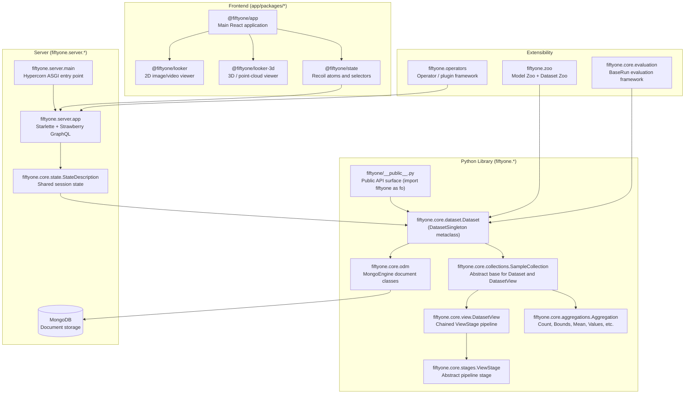
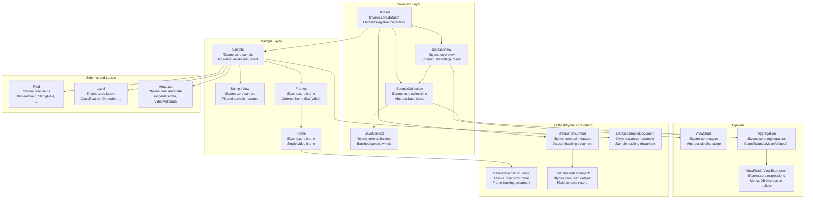
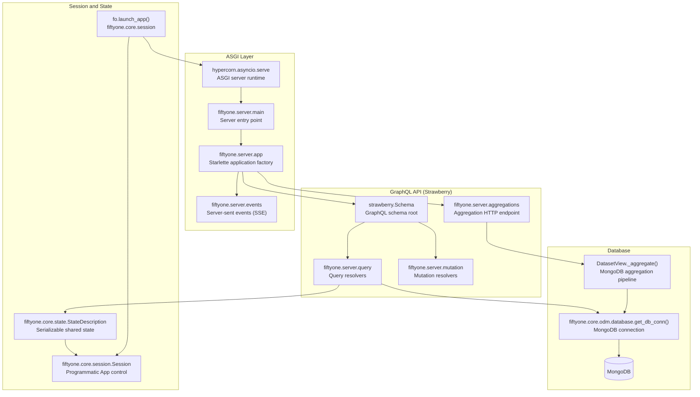
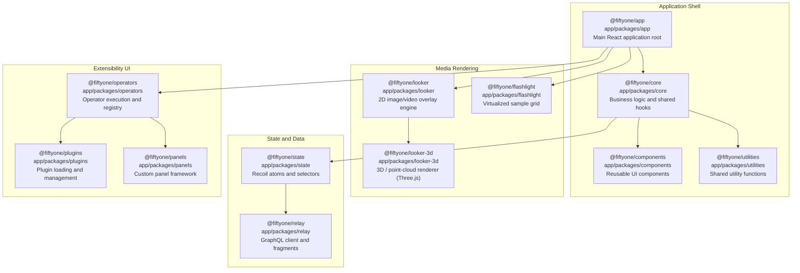
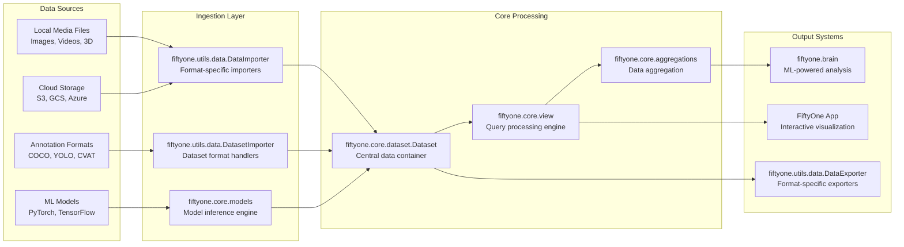
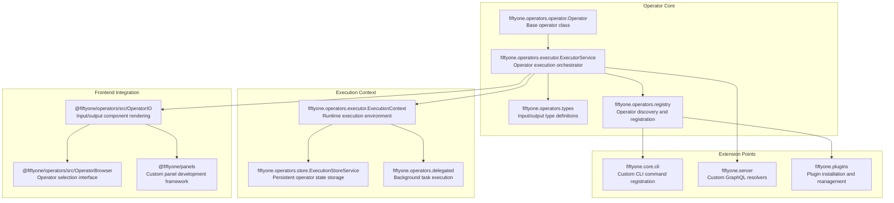

<!-- source: DeepWiki mcp.deepwiki.com · repo voxel51/fiftyone · page 1 Overview · fetched 2026-10-21 -->

# Overview

Relevant source files

The following files were used as context for generating this wiki page:

- [README.md](README.md)
- [app/README.md](app/README.md)
- [docs/source/_includes/substitutions.rst](docs/source/_includes/substitutions.rst)
- [docs/source/_static/images/tutorials/pandas_tutorial.png](docs/source/_static/images/tutorials/pandas_tutorial.png)
- [docs/source/_static/images/tutorials/small_object_detection.jpg](docs/source/_static/images/tutorials/small_object_detection.jpg)
- [docs/source/cheat_sheets/fiftyone_terminology.rst](docs/source/cheat_sheets/fiftyone_terminology.rst)
- [docs/source/cheat_sheets/filtering_cheat_sheet.rst](docs/source/cheat_sheets/filtering_cheat_sheet.rst)
- [docs/source/cheat_sheets/index.rst](docs/source/cheat_sheets/index.rst)
- [docs/source/cheat_sheets/pandas_vs_fiftyone.rst](docs/source/cheat_sheets/pandas_vs_fiftyone.rst)
- [docs/source/cheat_sheets/views_cheat_sheet.rst](docs/source/cheat_sheets/views_cheat_sheet.rst)
- [docs/source/faq/index.rst](docs/source/faq/index.rst)
- [docs/source/index.rst](docs/source/index.rst)
- [docs/source/integrations/index.rst](docs/source/integrations/index.rst)
- [docs/source/recipes/index.rst](docs/source/recipes/index.rst)
- [docs/source/recipes/remove_duplicate_annos.ipynb](docs/source/recipes/remove_duplicate_annos.ipynb)
- [docs/source/release-notes.rst](docs/source/release-notes.rst)
- [docs/source/tutorials/cosmos-transfer-integration.ipynb](docs/source/tutorials/cosmos-transfer-integration.ipynb)
- [docs/source/tutorials/gemini_vision.ipynb](docs/source/tutorials/gemini_vision.ipynb)
- [docs/source/tutorials/image_embeddings.ipynb](docs/source/tutorials/image_embeddings.ipynb)
- [docs/source/tutorials/images/sahi_base_model.gif](docs/source/tutorials/images/sahi_base_model.gif)
- [docs/source/tutorials/images/sahi_base_model_predictions_filtered.jpg](docs/source/tutorials/images/sahi_base_model_predictions_filtered.jpg)
- [docs/source/tutorials/images/sahi_dataset.jpg](docs/source/tutorials/images/sahi_dataset.jpg)
- [docs/source/tutorials/images/sahi_high_conf_fp_view.jpg](docs/source/tutorials/images/sahi_high_conf_fp_view.jpg)
- [docs/source/tutorials/images/sahi_slices.gif](docs/source/tutorials/images/sahi_slices.gif)
- [docs/source/tutorials/images/sahi_small_boxes_view.gif](docs/source/tutorials/images/sahi_small_boxes_view.gif)
- [docs/source/tutorials/index.rst](docs/source/tutorials/index.rst)
- [docs/source/tutorials/open_images.ipynb](docs/source/tutorials/open_images.ipynb)
- [docs/source/tutorials/pandas_comparison.ipynb](docs/source/tutorials/pandas_comparison.ipynb)
- [docs/source/tutorials/small_object_detection.ipynb](docs/source/tutorials/small_object_detection.ipynb)
- [docs/source/user_guide/app.rst](docs/source/user_guide/app.rst)
- [docs/source/user_guide/basics.rst](docs/source/user_guide/basics.rst)
- [docs/source/user_guide/config.rst](docs/source/user_guide/config.rst)
- [docs/source/user_guide/evaluation.rst](docs/source/user_guide/evaluation.rst)
- [docs/source/user_guide/index.rst](docs/source/user_guide/index.rst)
- [docs/source/user_guide/plots.rst](docs/source/user_guide/plots.rst)
- [docs/source/user_guide/using_aggregations.rst](docs/source/user_guide/using_aggregations.rst)
- [docs/source/user_guide/using_datasets.rst](docs/source/user_guide/using_datasets.rst)
- [docs/source/user_guide/using_views.rst](docs/source/user_guide/using_views.rst)
- [fiftyone/__public__.py](fiftyone/__public__.py)
- [fiftyone/core/aggregations.py](fiftyone/core/aggregations.py)
- [fiftyone/core/clips.py](fiftyone/core/clips.py)
- [fiftyone/core/collections.py](fiftyone/core/collections.py)
- [fiftyone/core/config.py](fiftyone/core/config.py)
- [fiftyone/core/dataset.py](fiftyone/core/dataset.py)
- [fiftyone/core/document.py](fiftyone/core/document.py)
- [fiftyone/core/expressions.py](fiftyone/core/expressions.py)
- [fiftyone/core/fields.py](fiftyone/core/fields.py)
- [fiftyone/core/frame.py](fiftyone/core/frame.py)
- [fiftyone/core/labels.py](fiftyone/core/labels.py)
- [fiftyone/core/odm/dataset.py](fiftyone/core/odm/dataset.py)
- [fiftyone/core/odm/document.py](fiftyone/core/odm/document.py)
- [fiftyone/core/odm/embedded_document.py](fiftyone/core/odm/embedded_document.py)
- [fiftyone/core/odm/mixins.py](fiftyone/core/odm/mixins.py)
- [fiftyone/core/odm/sample.py](fiftyone/core/odm/sample.py)
- [fiftyone/core/odm/utils.py](fiftyone/core/odm/utils.py)
- [fiftyone/core/patches.py](fiftyone/core/patches.py)
- [fiftyone/core/sample.py](fiftyone/core/sample.py)
- [fiftyone/core/stages.py](fiftyone/core/stages.py)
- [fiftyone/core/video.py](fiftyone/core/video.py)
- [fiftyone/core/view.py](fiftyone/core/view.py)
- [install.bat](install.bat)
- [tests/unittests/aggregation_tests.py](tests/unittests/aggregation_tests.py)
- [tests/unittests/dataset_tests.py](tests/unittests/dataset_tests.py)
- [tests/unittests/odm_tests.py](tests/unittests/odm_tests.py)
- [tests/unittests/patches_tests.py](tests/unittests/patches_tests.py)
- [tests/unittests/video_tests.py](tests/unittests/video_tests.py)
- [tests/unittests/view_tests.py](tests/unittests/view_tests.py)

FiftyOne is an open-source tool for building high-quality datasets and computer vision models. It provides a platform for dataset management, model evaluation, and data visualization through a Python library and an interactive web application.

The public Python API is defined in [fiftyone/__public__.py](), which is re-exported as the `fiftyone` top-level package (`import fiftyone as fo`). The system architecture centers around the `Dataset` class in `fiftyone.core.dataset`, backed by MongoDB via a mongoengine ODM layer. A Starlette/Strawberry GraphQL server (`fiftyone.server`) provides APIs for a React frontend. The platform supports multiple media types (`image`, `video`, `3d`, `point-cloud`, `group`), a wide range of annotation formats, and integrates with ML frameworks via the Model Zoo and `apply_model`.

This overview covers the high-level architecture, core components, and data flow patterns. For detailed information about specific subsystems, see:

| Section | Topic |
|---------|-------|
| [Core Data Model](#2) | Dataset, Sample, View, Labels, ODM layer |
| [Server Architecture](#3) | Starlette server, GraphQL API, session management |
| [Frontend Architecture](#4) | React app, Looker viewer, 3D visualization, state management |
| [Data Processing and I/O](#5) | Import/export formats, Dataset Zoo |
| [Model Integration and Evaluation](#6) | Model Zoo, `apply_model`, evaluation framework |
| [Extensibility Framework](#9) | Operators, delegated ops, plugin system |
| [Command Line Interface](#10) | `fiftyone` CLI commands |

## System Architecture

FiftyOne's architecture is organized around several key subsystems that work together to provide comprehensive dataset management capabilities:

## FiftyOne System Architecture

Sources: [fiftyone/__public__.py:1-50](), [fiftyone/core/dataset.py:271-310](), [fiftyone/core/collections.py:329-340](), [fiftyone/core/view.py:33-61](), [fiftyone/core/stages.py:48-58](), [fiftyone/core/aggregations.py:35-58]()

## Core Data Model

The foundation of FiftyOne is built around the `Dataset` class and its associated data structures. `Dataset` uses the `DatasetSingleton` metaclass so that all calls with the same dataset name in a process return the same Python object.

## Core Data Model Architecture

Sources: [fiftyone/core/dataset.py:271-310](), [fiftyone/core/collections.py:329-340](), [fiftyone/core/sample.py:44-100](), [fiftyone/core/view.py:33-61](), [fiftyone/core/stages.py:48-58](), [fiftyone/core/aggregations.py:35-58](), [fiftyone/core/labels.py:50-60](), [fiftyone/core/odm/sample.py:73-127](), [fiftyone/core/odm/dataset.py:58-80]()

## Server and API Architecture

The server layer provides GraphQL endpoints for frontend communication and state management. It is started via `fo.launch_app()`, which launches a `hypercorn` ASGI process hosting a Starlette application with a Strawberry GraphQL schema.

## Server and GraphQL Architecture

Sources: [fiftyone/core/collections.py:329-340](), [fiftyone/core/view.py:33-61](), [fiftyone/core/odm/mixins.py:56-80]()

## Frontend Application Structure

The frontend is a Yarn workspace monorepo under `app/packages/`. The main application is `@fiftyone/app`, which coordinates media viewing, state management, and the plugin/operator UI.

## Frontend Package Architecture

Sources: [docs/source/user_guide/app.rst:1-60]()

## Data Flow Architecture

The system processes data through several key pathways from ingestion to visualization:

Sources: [docs/source/user_guide/using_datasets.rst:1-200](), [docs/source/user_guide/import_datasets.rst:1-100]()

## Key Technologies and Dependencies

| Layer | Technology | Role in FiftyOne |
|-------|------------|-----------------|
| Python library | Python 3.9–3.12 | Core application logic |
| Database | MongoDB + `mongoengine` | Document storage and ODM (`fiftyone.core.odm`) |
| DB distribution | `fiftyone-db` package | Bundled MongoDB for local use |
| ASGI server | `hypercorn` + `starlette` | Hosts `fiftyone.server` |
| API schema | `strawberry-graphql` | GraphQL schema for `fiftyone.server.query/mutation` |
| Frontend | React 18 + TypeScript | `@fiftyone/app` and related packages |
| Frontend state | Recoil | `@fiftyone/state` atoms and selectors |
| GraphQL client | Relay | `@fiftyone/relay` fragments |
| Build tooling | Vite + Yarn Workspaces | `app/` monorepo build pipeline |
| Image/video | `opencv-python`, `Pillow`, `eta` | Media processing in `fiftyone.utils` |
| 3D rendering | Three.js + WebGL | `@fiftyone/looker-3d` |
| ML frameworks | PyTorch, HuggingFace Transformers | Model Zoo wrappers in `fiftyone.utils.torch_utils` |
| Numeric | NumPy, SciPy, scikit-learn | Label utilities, evaluation, brain |
| Config | `fiftyone.core.config.FiftyOneConfig` | Loaded from `~/.fiftyone/config.json` or env vars |

Sources: [fiftyone/core/config.py:1-30](), [fiftyone/core/odm/mixins.py:1-35](), [docs/source/user_guide/config.rst:1-50]()

## Plugin and Extension System

FiftyOne provides a comprehensive plugin framework for extending functionality:

## Plugin and Operator Framework

Sources: [fiftyone/operators/executor.py:1-50](), [fiftyone/operators/operator.py:1-100](), [fiftyone/operators/store.py:1-50](), [fiftyone/operators/registry.py:1-50]()

The FiftyOne system provides a unified platform for dataset management, model evaluation, and data visualization through its modular architecture and extensible plugin system. The core Python library handles data storage and processing, while the React frontend provides interactive visualization capabilities, all connected through a GraphQL API layer that enables real-time collaboration and analysis.

---

