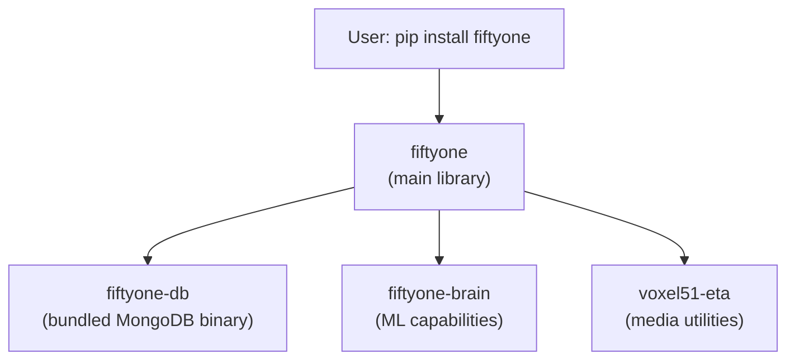
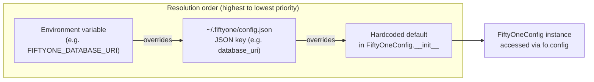
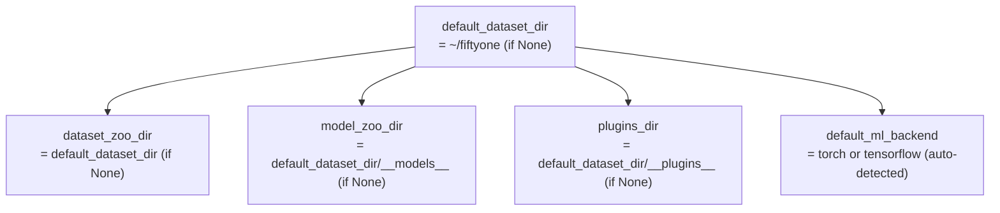
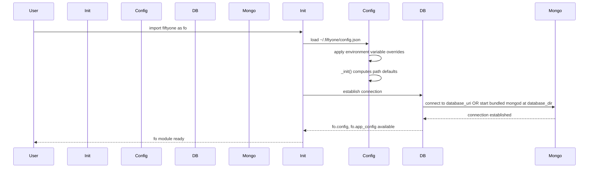

<!-- source: DeepWiki mcp.deepwiki.com · repo voxel51/fiftyone · page 1.1 Installation and Setup · fetched 2026-10-21 -->

# Installation and Setup

<details>
<summary>Relevant source files</summary>

The following files were used as context for generating this wiki page:

- [.pre-commit-config.yaml](.pre-commit-config.yaml)
- [README.md](README.md)
- [app/README.md](app/README.md)
- [app/packages/app/index.html](app/packages/app/index.html)
- [app/packages/app/vite.config.ts](app/packages/app/vite.config.ts)
- [docs/source/_includes/substitutions.rst](docs/source/_includes/substitutions.rst)
- [docs/source/faq/index.rst](docs/source/faq/index.rst)
- [docs/source/index.rst](docs/source/index.rst)
- [docs/source/integrations/index.rst](docs/source/integrations/index.rst)
- [docs/source/release-notes.rst](docs/source/release-notes.rst)
- [docs/source/user_guide/app.rst](docs/source/user_guide/app.rst)
- [docs/source/user_guide/basics.rst](docs/source/user_guide/basics.rst)
- [docs/source/user_guide/config.rst](docs/source/user_guide/config.rst)
- [docs/source/user_guide/evaluation.rst](docs/source/user_guide/evaluation.rst)
- [docs/source/user_guide/index.rst](docs/source/user_guide/index.rst)
- [docs/source/user_guide/plots.rst](docs/source/user_guide/plots.rst)
- [docs/source/user_guide/using_aggregations.rst](docs/source/user_guide/using_aggregations.rst)
- [docs/source/user_guide/using_datasets.rst](docs/source/user_guide/using_datasets.rst)
- [docs/source/user_guide/using_views.rst](docs/source/user_guide/using_views.rst)
- [fiftyone/core/config.py](fiftyone/core/config.py)
- [fiftyone/utils/csv.py](fiftyone/utils/csv.py)
- [fiftyone/utils/dicom.py](fiftyone/utils/dicom.py)
- [install.bat](install.bat)
- [package/db/setup.py](package/db/setup.py)
- [package/desktop/setup.py](package/desktop/setup.py)
- [requirements/dev.txt](requirements/dev.txt)
- [requirements/extras.txt](requirements/extras.txt)
- [requirements/github.txt](requirements/github.txt)
- [requirements/test.txt](requirements/test.txt)
- [setup.py](setup.py)

</details>


This page covers how to install FiftyOne, its Python and system dependencies, how configuration is structured via `FiftyOneConfig` and `FiftyOneAppConfig`, and environment-specific setup notes. For details about how the server starts and manages its MongoDB connection after installation, see [Server Architecture](#3). For dataset and sample concepts, see [Core Data Model](#2).

---

## System Requirements

FiftyOne officially supports:

| OS | Notes |
|---|---|
| macOS (latest) | Intel and Apple Silicon |
| Ubuntu 18.04+ | x86\_64 and aarch64 |
| Amazon Linux 2 / 2023 | x86\_64 and aarch64 |
| Debian 9+ | x86\_64 only |
| RHEL / CentOS 7+ | x86\_64 and aarch64 |
| Windows (latest) | 64-bit |

**Python versions supported:** 3.9 through 3.12

[setup.py:159-163]()

**Optional system packages:**
- `libcurl` + `openssl` — required on Linux for network operations
- `ffmpeg` — required for video dataset processing
- On Linux (Debian/Ubuntu): `libgl1-mesa-dev` for OpenCV headless rendering

Sources: [README.md:228-265](), [setup.py:159-163]()

---

## Installation

### Standard Install

```shell
pip install fiftyone
```

This is the recommended approach for most users. It installs the `fiftyone` Python package along with `fiftyone-db` (bundled MongoDB), `fiftyone-brain`, and `voxel51-eta` as dependencies.

### Virtual Environments

FiftyOne should be installed into a virtual environment to avoid dependency conflicts:

```shell
python3 -m venv fiftyone_env
source fiftyone_env/bin/activate   # Linux / macOS
# or
fiftyone_env\Scripts\activate      # Windows
pip install fiftyone
```

### Source Install

Source installation builds both the Python library and the React frontend App. Prerequisites: Python 3.9–3.12, Node.js, Yarn.

```shell
git clone https://github.com/voxel51/fiftyone
cd fiftyone

bash install.sh      # macOS / Linux
.\install.bat        # Windows
```

The install script runs `yarn install` and `yarn build` in the `./app` directory, then installs the Python package in editable mode. For developer installs, pass the `-d` flag: `bash install.sh -d`.

To rebuild the frontend after pulling changes:

```shell
cd app && yarn build
```

Sources: [README.md:82-210]()

---

## Package Architecture

FiftyOne is composed of three Python distribution packages that install together.

**Package component diagram**



Sources: [setup.py:79-83]()

| Package | Version constraint | Role |
|---|---|---|
| `fiftyone` | — | Core library, server, CLI |
| `fiftyone-db` | `>=0.4, <2.0` | Platform-specific MongoDB binary |
| `fiftyone-brain` | `>=0.21.5, <0.22` | Uniqueness, similarity, embeddings |
| `voxel51-eta` | `>=0.15.3, <0.16` | Image/video I/O, config primitives |

[setup.py:79-83]()

---

## Python Dependencies

The following third-party packages are declared as required in `INSTALL_REQUIRES` in [setup.py:32-83]():

| Category | Key packages |
|---|---|
| Web server | `hypercorn>=0.13.2`, `starlette>=0.24.0`, `strawberry-graphql>=0.262.4,<0.292.0`, `sse-starlette`, `sseclient-py` |
| Database | `mongoengine~=0.29.1`, `motor~=3.6.0`, `pymongo~=4.9.2` |
| Data / ML | `numpy`, `pandas`, `scikit-learn`, `scikit-image`, `scipy` |
| Image | `Pillow>=6.2,!=11.2.*`, `opencv-python-headless` (fallback) |
| Plotting | `plotly>=6.1.1`, `matplotlib` |
| Serialization | `PyYAML`, `xmltodict`, `dill`, `jsonpatch` |
| Utilities | `boto3`, `psutil`, `tqdm`, `tabulate`, `humanize`, `cachetools`, `retrying` |
| Async | `aiofiles`, `async_lru>=2` |

**OpenCV selection logic** ([setup.py:86-115]()): At install time, `setup.py` checks whether `opencv-python`, `opencv-contrib-python`, or `opencv-contrib-python-headless` is already installed. If one of these is found, it is used; otherwise `opencv-python-headless` is installed as the default.

Sources: [setup.py:32-95]()

---

## Bundled MongoDB: `fiftyone-db`

FiftyOne ships its own MongoDB binary via the `fiftyone-db` package. The `package/db/setup.py` download table shows the supported platforms and the MongoDB version bundled for each:

| Platform | Version |
|---|---|
| macOS (arm64, x86\_64) | MongoDB 7.0.28 |
| Ubuntu 20.04, 22.04, 24.04 | MongoDB 7.0.28 |
| Amazon Linux 2 / 2023 | MongoDB 7.0.28 |
| RHEL/CentOS 8, 9 | MongoDB 7.0.28 |
| Debian 10 | MongoDB 6.0.27 |
| Ubuntu 18.04 | MongoDB 6.0.27 |

[package/db/setup.py:23-200]()

The bundled MongoDB stores its data files under `~/.fiftyone/var/lib/mongo` by default. This location is controlled by the `database_dir` config field. To use an external MongoDB instance instead, set `database_uri`.

Sources: [package/db/setup.py:23-200]()

---

## Configuration: `FiftyOneConfig`

`FiftyOneConfig` ([fiftyone/core/config.py:59-386]()) is the top-level configuration class. It extends `EnvConfig` (which itself extends `etac.EnvConfig`), enabling each field to be set from a JSON config file, an environment variable, or a programmatic default — in that priority order.

### Config file location

The config file is loaded from `~/.fiftyone/config.json`. It can be viewed and updated at runtime:

```python
import fiftyone as fo

# View current config
print(fo.config)

# Change a value at runtime
fo.config.show_progress_bars = False
```

### Configuration loading flow

**FiftyOneConfig resolution diagram**



Sources: [fiftyone/core/config.py:59-386]()

### Key configuration fields

| Config field | Environment variable | Default | Description |
|---|---|---|---|
| `database_uri` | `FIFTYONE_DATABASE_URI` | `None` | MongoDB connection URI. If set, the bundled MongoDB is not used. |
| `database_dir` | `FIFTYONE_DATABASE_DIR` | `~/.fiftyone/var/lib/mongo` | Data directory for the bundled MongoDB. |
| `database_name` | `FIFTYONE_DATABASE_NAME` | `fiftyone` | Name of the MongoDB database. |
| `database_admin` | `FIFTYONE_DATABASE_ADMIN` | `True` | Whether the client may trigger database migrations. |
| `database_validation` | `FIFTYONE_DATABASE_VALIDATION` | `True` | Whether to validate DB compatibility on connect. |
| `database_compressor` | `FIFTYONE_DATABASE_COMPRESSOR` | `None` | MongoDB network compression (`zstd`, `zlib`, `snappy`). |
| `default_dataset_dir` | `FIFTYONE_DEFAULT_DATASET_DIR` | `~/fiftyone` | Default directory for dataset I/O operations. |
| `dataset_zoo_dir` | `FIFTYONE_DATASET_ZOO_DIR` | `~/fiftyone` | Directory for Dataset Zoo downloads. |
| `model_zoo_dir` | `FIFTYONE_MODEL_ZOO_DIR` | `~/fiftyone/__models__` | Directory for Model Zoo downloads. |
| `plugins_dir` | `FIFTYONE_PLUGINS_DIR` | `~/fiftyone/__plugins__` | Directory scanned for plugins. |
| `default_ml_backend` | `FIFTYONE_DEFAULT_ML_BACKEND` | auto-detected | `torch` or `tensorflow`. |
| `default_app_port` | `FIFTYONE_DEFAULT_APP_PORT` | `5151` | TCP port for the FiftyOne App server. |
| `default_app_address` | `FIFTYONE_DEFAULT_APP_ADDRESS` | `localhost` | Bind address for the App server. |
| `show_progress_bars` | `FIFTYONE_SHOW_PROGRESS_BARS` | `True` | Whether to display tqdm progress bars. |
| `do_not_track` | `FIFTYONE_DO_NOT_TRACK` | `False` | Disables anonymous usage telemetry. |
| `logging_level` | `FIFTYONE_LOGGING_LEVEL` | `INFO` | Python logging level (`DEBUG`, `INFO`, `WARNING`, `ERROR`, `CRITICAL`). |
| `logging_format` | `FIFTYONE_LOGGING_FORMAT` | `text` | `text` or `json`. |
| `logging_destination` | `FIFTYONE_LOGGING_DESTINATION` | `stdout` | `stdout` or `stdout,stderr`. |
| `timezone` | `FIFTYONE_TIMEZONE` | `None` | pytz timezone for datetime display. |
| `default_batcher` | `FIFTYONE_DEFAULT_BATCHER` | `latency` | Batching strategy for bulk DB writes: `latency`, `size`, or `static`. |
| `plugins_cache_enabled` | `FIFTYONE_PLUGINS_CACHE_ENABLED` | `False` | Whether to cache plugin discovery results. |
| `singleton_cache` | `FIFTYONE_SINGLETON_CACHE` | `True` | Whether dataset objects are singletons (auto-disabled on the App server). |

[fiftyone/core/config.py:62-315](), [docs/source/user_guide/config.rst:17-200]()

### Default path resolution (`_init`)

The `_init` method in `FiftyOneConfig` ([fiftyone/core/config.py:334-386]()) computes derived path defaults:



Sources: [fiftyone/core/config.py:334-386]()

---

## App Configuration: `FiftyOneAppConfig`

The App configuration is a separate object accessible via `fo.app_config`. Its JSON file lives at `~/.fiftyone/app_config.json`.

Key fields from [docs/source/user_guide/config.rst]():

| Config field | Environment variable | Default | Description |
|---|---|---|---|
| `color_scheme` | — | `None` | Default color scheme for the App. |
| `grid_media_field` | — | `filepath` | Default field shown in grid view. |
| `media_fields` | — | `['filepath']` | Declared media fields. |
| `notebook_height` | `FIFTYONE_APP_NOTEBOOK_HEIGHT` | `800` | Height (px) when embedded in notebooks. |
| `proxy_url` | `FIFTYONE_APP_PROXY_URL` | `None` | Proxy URL for cloud notebook environments. |
| `show_tooltip` | `FIFTYONE_APP_SHOW_TOOLTIP` | `True` | Whether to show label tooltips. |
| `disable_frame_filtering` | — | `False` | Disables frame-level filtering in grid view for video datasets. |

Sources: [docs/source/user_guide/config.rst:200-400]()

---

## Environment-Specific Considerations

### Docker

FiftyOne auto-detects when running inside a Docker container. If the App is not accessible in the browser, explicitly set the address to `0.0.0.0`:

```python
session = fo.launch_app(..., address="0.0.0.0")
```

Sources: [docs/source/user_guide/app.rst:93-103]()

### Windows

Multiprocessing on Windows requires the `if __name__ == "__main__":` guard when launching the App from a script, because the App is served via a subprocess:

```python
import fiftyone as fo

dataset = fo.load_dataset(...)

if __name__ == "__main__":
    session = fo.launch_app(dataset)
    session.wait()
```

Sources: [docs/source/user_guide/app.rst:107-122](), [docs/source/faq/index.rst:64-83]()

### Jupyter / Colab Notebooks

All standard FiftyOne commands work in notebooks. The App renders inline in cell output. For cloud notebooks (SageMaker, custom Jupyter), set a `proxy_url` in the App config.

Supported notebook environments:
- Jupyter Notebook / JupyterLab
- Google Colab
- Databricks Notebooks
- SageMaker Notebooks

Sources: [docs/source/faq/index.rst:85-100]()

### Remote Machines

To run the App on a remote machine and view it locally:

1. On the remote machine: `fo.launch_app(dataset, remote=True)` or `fiftyone app launch <name> --remote`
2. On the local machine: set up SSH port forwarding `ssh -N -L 5151:127.0.0.1:5151 user@host`, or use `fiftyone app connect --destination user@host`

The default port (`5151`) is controlled by `default_app_port` in `FiftyOneConfig`. The bind address is controlled by `default_app_address`.

Sources: [docs/source/user_guide/app.rst:233-347]()

### Connecting to an External MongoDB Instance

To use a self-managed MongoDB instead of the bundled one, set either the config field or environment variable before importing `fiftyone`:

```shell
export FIFTYONE_DATABASE_URI="mongodb://localhost:27017"
```

Or in `~/.fiftyone/config.json`:

```json
{
    "database_uri": "mongodb://localhost:27017"
}
```

When `database_uri` is set, the `database_dir` field is ignored. The `database_admin` flag controls whether the connecting client is allowed to trigger schema migrations.

Sources: [fiftyone/core/config.py:72-98](), [docs/source/user_guide/config.rst:20-40]()

---

## Startup Sequence

The following diagram shows what happens when `import fiftyone as fo` is executed.

**Import and initialization flow**



Sources: [fiftyone/core/config.py:59-386](), [package/db/setup.py:1-200]()

---

