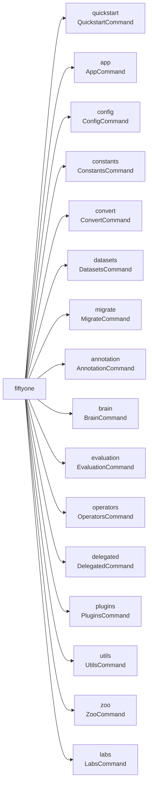
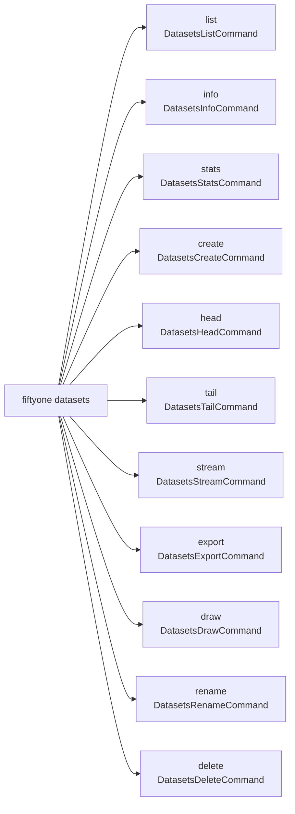
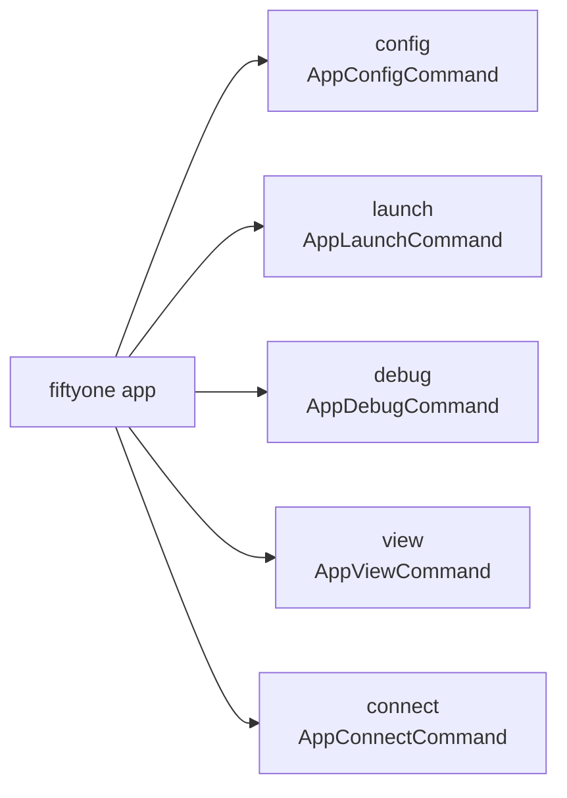
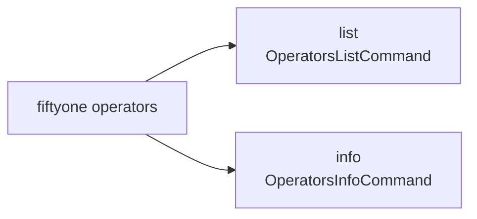
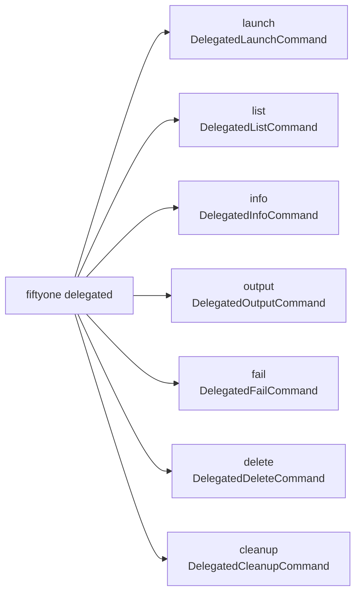
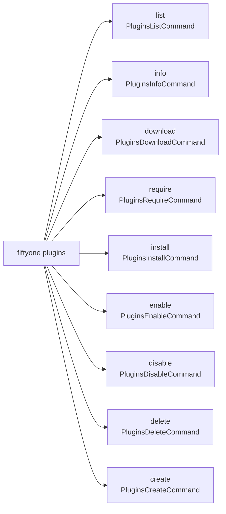
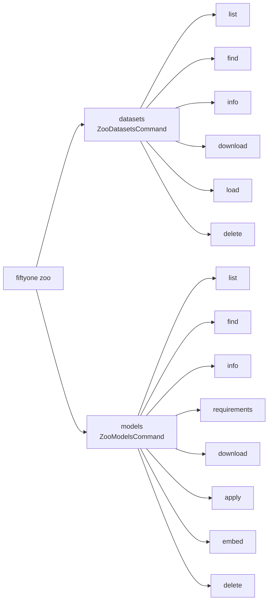
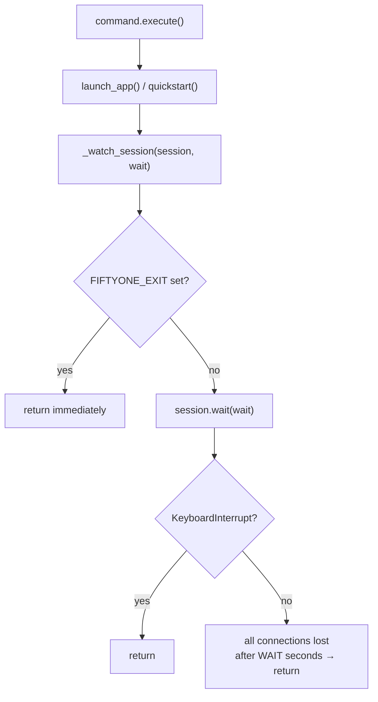

<!-- source: DeepWiki mcp.deepwiki.com · repo voxel51/fiftyone · page 10 Command Line Interface · fetched 2026-10-21 -->

# Command Line Interface

<details>
<summary>Relevant source files</summary>

The following files were used as context for generating this wiki page:

- [docs/source/cli/index.rst](docs/source/cli/index.rst)
- [fiftyone/core/cli.py](fiftyone/core/cli.py)
- [fiftyone/internal/__init__.py](fiftyone/internal/__init__.py)
- [fiftyone/internal/secrets/__init__.py](fiftyone/internal/secrets/__init__.py)
- [fiftyone/internal/secrets/providers/__init__.py](fiftyone/internal/secrets/providers/__init__.py)
- [fiftyone/internal/secrets/providers/iprovider.py](fiftyone/internal/secrets/providers/iprovider.py)
- [fiftyone/internal/secrets/providers/local.py](fiftyone/internal/secrets/providers/local.py)
- [fiftyone/internal/util.py](fiftyone/internal/util.py)
- [fiftyone/plugins/__init__.py](fiftyone/plugins/__init__.py)
- [fiftyone/plugins/context.py](fiftyone/plugins/context.py)
- [fiftyone/plugins/core.py](fiftyone/plugins/core.py)
- [fiftyone/plugins/definitions.py](fiftyone/plugins/definitions.py)
- [fiftyone/plugins/secrets.py](fiftyone/plugins/secrets.py)
- [fiftyone/plugins/utils.py](fiftyone/plugins/utils.py)
- [fiftyone/utils/github.py](fiftyone/utils/github.py)
- [fiftyone/utils/quickstart.py](fiftyone/utils/quickstart.py)
- [tests/unittests/plugins/context_tests.py](tests/unittests/plugins/context_tests.py)
- [tests/unittests/plugins/core_tests.py](tests/unittests/plugins/core_tests.py)
- [tests/unittests/plugins/secrets_tests.py](tests/unittests/plugins/secrets_tests.py)
- [tests/unittests/secrets/provider_tests.py](tests/unittests/secrets/provider_tests.py)

</details>


This page documents the `fiftyone` CLI — its command hierarchy, arguments, and how the implementation is structured in `fiftyone/core/cli.py`. The CLI exposes dataset management, App control, format conversion, plugin management, operator inspection, delegated operation management, and zoo interaction as terminal commands.

For the Python API equivalents that the CLI delegates to, see the Core Data Model ([2]()), Extensibility Framework ([9]()), Data Processing and I/O ([5]()), and Model Integration ([6]()) pages.

---

## Overview

Installing FiftyOne installs the `fiftyone` executable, which is backed by a standard `argparse`/`argcomplete` CLI. Tab completion is available in `bash`, `zsh`, and `tcsh` via `argcomplete`.

**Tab completion setup:**

```shell
# bash (~/.bashrc)
eval "$(register-python-argcomplete fiftyone)"

# zsh (~/.zshrc)
autoload bashcompinit
bashcompinit
eval "$(register-python-argcomplete fiftyone)"

# tcsh (~/.tcshrc)
eval `register-python-argcomplete --shell tcsh fiftyone`
```

Sources: [docs/source/cli/index.rst:36-55]()

---

## Command Architecture

Every command is a class that inherits from `Command` and implements two static methods:

| Method | Purpose |
|---|---|
| `setup(parser)` | Declares arguments and subparsers for this command |
| `execute(parser, args)` | Runs the command logic given parsed arguments |

`FiftyOneCommand` is the root class. Its `setup()` registers all top-level subcommands via `_register_command()`.

**Class hierarchy diagram:**

```mermaid
classDiagram
    class Command {
        +setup(parser)$
        +execute(parser, args)$
    }
    class FiftyOneCommand
    class QuickstartCommand
    class AppCommand
    class ConfigCommand
    class ConstantsCommand
    class ConvertCommand
    class DatasetsCommand
    class MigrateCommand
    class AnnotationCommand
    class BrainCommand
    class EvaluationCommand
    class OperatorsCommand
    class DelegatedCommand
    class PluginsCommand
    class UtilsCommand
    class ZooCommand
    class LabsCommand

    Command <|-- FiftyOneCommand
    Command <|-- QuickstartCommand
    Command <|-- AppCommand
    Command <|-- ConfigCommand
    Command <|-- ConstantsCommand
    Command <|-- ConvertCommand
    Command <|-- DatasetsCommand
    Command <|-- MigrateCommand
    Command <|-- AnnotationCommand
    Command <|-- BrainCommand
    Command <|-- EvaluationCommand
    Command <|-- OperatorsCommand
    Command <|-- DelegatedCommand
    Command <|-- PluginsCommand
    Command <|-- UtilsCommand
    Command <|-- ZooCommand
    Command <|-- LabsCommand
```



Sources: [fiftyone/core/cli.py:56-106]()

**Top-level command map:**



Sources: [fiftyone/core/cli.py:85-106]()

---

## `fiftyone quickstart`

Loads a zoo dataset and opens the App. Delegates to `fouq.quickstart()` in `fiftyone/utils/quickstart.py`.

```
fiftyone quickstart [-v] [-p PORT] [-A ADDRESS] [-r] [-w WAIT]
```

| Flag | Description |
|---|---|
| `-v`, `--video` | Load a video dataset instead of an image dataset |
| `-p PORT`, `--port PORT` | Port number for the App server |
| `-A ADDRESS`, `--address ADDRESS` | Server address/hostname |
| `-r`, `--remote` | Launch in remote mode (no automatic browser open) |
| `-w WAIT`, `--wait WAIT` | Seconds to wait after last connection before exiting (negative = wait forever) |

**Examples:**
```shell
fiftyone quickstart
fiftyone quickstart --video
fiftyone quickstart --remote
```

Sources: [fiftyone/core/cli.py:113-181](), [fiftyone/utils/quickstart.py:14-62]()

---

## `fiftyone config`

Inspect the FiftyOne configuration. Delegates to `focg.locate_config()` and `fo.config`.

```
fiftyone config [-l] [FIELD]
```

| Argument | Description |
|---|---|
| `FIELD` | (optional) Print only this config field |
| `-l`, `--locate` | Print the path to the config file on disk |

**Examples:**
```shell
fiftyone config
fiftyone config default_app_port
fiftyone config --locate
```

Sources: [fiftyone/core/cli.py:183-224]()

---

## `fiftyone constants`

Print values from `fiftyone.constants`. Delegates to `foc` module attributes.

```
fiftyone constants [CONSTANT]
```

**Examples:**
```shell
fiftyone constants
fiftyone constants VERSION
```

Sources: [fiftyone/core/cli.py:227-283]()

---

## `fiftyone convert`

Convert datasets between supported formats on disk. Delegates to `foud.convert_dataset()`.

```
fiftyone convert --input-type INPUT_TYPE --output-type OUTPUT_TYPE
                 [--input-dir INPUT_DIR]
                 [--input-kwargs KEY=VAL ...]
                 [--output-dir OUTPUT_DIR]
                 [--output-kwargs KEY=VAL ...]
                 [-o]
```

| Argument | Required | Description |
|---|---|---|
| `--input-type` | ✓ | `fiftyone.types.Dataset` subclass for input |
| `--output-type` | ✓ | `fiftyone.types.Dataset` subclass for output |
| `--input-dir` | | Directory containing the input dataset |
| `--input-kwargs KEY=VAL` | | Extra keyword args forwarded to the importer |
| `--output-dir` | | Directory for the converted output |
| `--output-kwargs KEY=VAL` | | Extra keyword args forwarded to the exporter |
| `-o`, `--overwrite` | | Overwrite an existing output directory |

**Examples:**
```shell
fiftyone convert \
    --input-dir /path/to/coco \
    --input-type fiftyone.types.COCODetectionDataset \
    --output-dir /path/to/cvat \
    --output-type fiftyone.types.CVATImageDataset

fiftyone convert \
    --input-dir /path/to/coco \
    --input-type fiftyone.types.COCODetectionDataset \
    --input-kwargs max_samples=100 shuffle=True \
    --output-dir /path/to/tfrecords \
    --output-type fiftyone.types.TFObjectDetectionDataset \
    --output-kwargs force_rgb=True \
    --overwrite
```

Sources: [fiftyone/core/cli.py:286-379]()

---

## `fiftyone datasets`

The `datasets` group provides eleven subcommands for managing persisted datasets.



Sources: [fiftyone/core/cli.py:382-403]()

### `datasets list`

```
fiftyone datasets list [-p PATT] [-t TAG ...]
```

| Flag | Description |
|---|---|
| `-p PATT`, `--glob-patt PATT` | Glob pattern filter on dataset names |
| `-t TAG ...`, `--tags TAG ...` | Only show datasets with all given tags |

```shell
fiftyone datasets list
fiftyone datasets list --glob-patt 'quickstart-*'
fiftyone datasets list --tags automotive healthcare
```

Sources: [fiftyone/core/cli.py:405-444]()

### `datasets info`

Prints a table of dataset metadata. Accepts the same filter flags as `list`, plus sort options.

```
fiftyone datasets info [-p PATT] [-t TAG ...] [-s FIELD] [-r] [NAME]
```

| Flag | Description |
|---|---|
| `NAME` | (optional) Print detailed info for a specific dataset |
| `-s FIELD`, `--sort-by FIELD` | Sort by column: `name`, `created_at`, `last_loaded_at`, `version`, `persistent`, `media_type`, `tags` |
| `-r`, `--reverse` | Reverse sort order |

```shell
fiftyone datasets info
fiftyone datasets info --sort-by created_at --reverse
fiftyone datasets info quickstart
```

Sources: [fiftyone/core/cli.py:447-535]()

### `datasets stats`

```
fiftyone datasets stats NAME [-m] [-c]
```

| Flag | Description |
|---|---|
| `-m`, `--include-media` | Include raw media file size totals |
| `-c`, `--compressed` | Report compressed on-disk collection sizes |

Sources: [fiftyone/core/cli.py:565-606]()

### `datasets create`

Creates a persistent dataset from files on disk or a JSON samples file. Delegates to `fod.Dataset.from_dir()` or `fod.Dataset.from_json()`.

```
fiftyone datasets create [-n NAME] [-d DATASET_DIR] [-j JSON_PATH]
                         [-t TYPE] [-k KEY=VAL ...]
```

```shell
fiftyone datasets create \
    --name my-dataset --dataset-dir /data --type fiftyone.types.COCODetectionDataset

fiftyone datasets create --json-path samples.json
```

Sources: [fiftyone/core/cli.py:609-685]()

### `datasets head` / `datasets tail`

Print the first or last N samples of a dataset.

```
fiftyone datasets head NAME [-n NUM_SAMPLES]
fiftyone datasets tail NAME [-n NUM_SAMPLES]
```

Default: 3 samples.

Sources: [fiftyone/core/cli.py:688-757]()

### `datasets stream`

Stream all samples to the terminal. Delegates to `fou.stream_objects()`.

```
fiftyone datasets stream NAME
```

Sources: [fiftyone/core/cli.py:760-778]()

### `datasets export`

Export a dataset to disk. Supports tag/label filtering before export.

```
fiftyone datasets export NAME [-d EXPORT_DIR] [-j JSON_PATH]
                              [-f LABEL_FIELD] [-t TYPE]
                              [--filters KEY=VAL ...] [-k KEY=VAL ...]
```

| Flag | Description |
|---|---|
| `-d`, `--export-dir` | Output directory |
| `-j`, `--json-path` | Export as FiftyOne JSON to this path |
| `-f`, `--label-field` | Label field to export |
| `-t`, `--type` | Dataset type for export |
| `--filters KEY=VAL` | Pre-filter: `tags=train,val` or `ground_truth=car,dog` |
| `-k`, `--kwargs` | Additional exporter kwargs |

```shell
fiftyone datasets export quickstart \
    --export-dir /tmp/out --type fiftyone.types.COCODetectionDataset \
    --label-field ground_truth

fiftyone datasets export quickstart \
    --filters tags=validation ground_truth=cat,dog \
    --export-dir /tmp/filtered --type fiftyone.types.COCODetectionDataset \
    --label-field ground_truth
```

Sources: [fiftyone/core/cli.py:781-894]()

### `datasets draw`

Render annotated media with label overlays burned in. Delegates to `dataset.draw_labels()`.

```
fiftyone datasets draw NAME [-d OUTPUT_DIR] [-f LABEL_FIELDS]
```

```shell
fiftyone datasets draw quickstart \
    --output-dir /tmp/annotated --label-fields ground_truth,predictions
```

Sources: [fiftyone/core/cli.py:897-940]()

### `datasets rename` / `datasets delete`

```shell
fiftyone datasets rename old-name new-name

fiftyone datasets delete dataset1 dataset2
fiftyone datasets delete --glob-patt 'tmp-*'
fiftyone datasets delete --non-persistent
```

Sources: [fiftyone/core/cli.py:943-1019]()

---

## `fiftyone app`



Sources: [fiftyone/core/cli.py:1082-1097]()

### `app config`

Inspect the App configuration (`fo.app_config`).

```
fiftyone app config [-l] [FIELD]
```

### `app launch`

Start the FiftyOne App, optionally loading a named dataset.

```
fiftyone app launch [NAME] [-p PORT] [-A ADDRESS] [-r] [-b BROWSER] [-w WAIT]
```

| Flag | Description |
|---|---|
| `NAME` | Dataset to open |
| `-r`, `--remote` | Remote session (no browser open) |
| `-b BROWSER` | Browser executable to use |
| `-w WAIT` | Seconds to wait before exiting (negative = forever) |

```shell
fiftyone app launch
fiftyone app launch quickstart
fiftyone app launch quickstart --remote
fiftyone app launch --port 5152 --browser firefox
```

The session is kept alive by `_watch_session(session, wait)` which calls `session.wait(wait)` and catches `KeyboardInterrupt`.

Sources: [fiftyone/core/cli.py:1146-1242]()

### `app connect`

Connect to an already-running remote App session.

```
fiftyone app connect --destination HOST [-p PORT] [-l LOCAL_PORT]
                     [-i IDENTITY]
```

---

## `fiftyone migrate`

Manage database schema migrations.

```
fiftyone migrate [-i] [-a] [-v VERSION]
                 [-n DATASET_NAME ...] [--error-level LEVEL] [--verbose]
```

| Flag | Description |
|---|---|
| `-i`, `--info` | Print current revision info for all datasets |
| `-a`, `--all` | Migrate database and all datasets |
| `-v VERSION` | Target revision |
| `-n NAME ...` | Migrate a specific dataset |
| `--error-level LEVEL` | 0=error, 1=warn, 2=ignore on per-dataset failures |
| `--verbose` | Log each individual migration step |

```shell
fiftyone migrate --info
fiftyone migrate --all
fiftyone migrate --all --version 0.22.0
fiftyone migrate --dataset-name my-dataset
```

Sources: [docs/source/cli/index.rst:752-812]()

---

## `fiftyone operators`

Inspect locally installed operators and panels.



### `operators list`

```
fiftyone operators list [-g PATT] [-e] [-d] [-b] [-c] [-o] [-p] [-n] [-u]
```

| Flag | Description |
|---|---|
| `-g PATT` | Filter by URI glob pattern |
| `-e` / `-d` | Only enabled / only disabled |
| `-b` / `-c` | Only builtins / only non-builtins |
| `-o` / `-p` | Only operators / only panels |
| `-n` | Names only |
| `-u` | Include unlisted operators |

```shell
fiftyone operators list
fiftyone operators list --glob-patt '*/compute_*'
fiftyone operators list --enabled --panels-only
```

### `operators info`

```
fiftyone operators info URI
```

Sources: [docs/source/cli/index.rst:813-924]()

---

## `fiftyone delegated`

Manage delegated (asynchronous) operations. For the underlying service architecture, see Delegated Operations ([9.2]()).



### `delegated launch`

Start a local service to execute queued delegated operations.

```
fiftyone delegated launch [-t TYPE]
```

Default type is `local`.

### `delegated list`

```
fiftyone delegated list [-o OPERATOR] [-d DATASET] [-m MATCH]
                        [-s STATE] [--sort-by SORT_BY] [--reverse] [-l LIMIT]
```

| Flag | Description |
|---|---|
| `-o OPERATOR` | Filter by operator URI |
| `-d DATASET` | Filter by dataset name |
| `-m MATCH` | Substring match on operator or label |
| `-s STATE` | Filter by state: `SCHEDULED`, `QUEUED`, `RUNNING`, `COMPLETED`, `FAILED` |
| `--sort-by` | `SCHEDULED_AT`, `QUEUED_AT`, `STARTED_AT`, `COMPLETED_AT`, `FAILED_AT`, `OPERATOR`, `LABEL` |
| `-l LIMIT` | Maximum number of rows |

```shell
fiftyone delegated list \
    --dataset quickstart \
    --operator @voxel51/io/export_samples \
    --state COMPLETED \
    --sort-by COMPLETED_AT \
    --limit 10
```

### `delegated info` / `delegated output`

```shell
fiftyone delegated info <id>
fiftyone delegated output <id>
```

### `delegated fail` / `delegated delete` / `delegated cleanup`

```shell
fiftyone delegated fail <id>
fiftyone delegated delete <id1> <id2>
fiftyone delegated cleanup --state COMPLETED
```

Sources: [docs/source/cli/index.rst:925-1100]()

---

## `fiftyone plugins`

Manage locally installed plugins. For the plugin loading system, see Plugin System ([9.3]()).



### `plugins list`

```
fiftyone plugins list [-e] [-d] [-b] [-c] [-n]
```

| Flag | Description |
|---|---|
| `-e` / `-d` | Only enabled / only disabled |
| `-b` / `-c` | Only builtins / only non-builtins |
| `-n` | Names only |

### `plugins download`

Download a plugin from GitHub or a URL. Delegates to `fop.download_plugin()`.

```
fiftyone plugins download URL_OR_GH_REPO [-n NAME ...] [-o]
```

```shell
fiftyone plugins download https://github.com/voxel51/fiftyone-plugins
fiftyone plugins download voxel51/fiftyone-plugins --plugin-names @voxel51/annotation
```

### `plugins install` / `plugins require`

Install (`pip install`) or check a plugin's Python requirements.

```shell
fiftyone plugins install @voxel51/annotation
fiftyone plugins require @voxel51/annotation
```

### `plugins enable` / `plugins disable`

Toggle plugin enablement. Delegates to `fop.enable_plugin()` / `fop.disable_plugin()`.

```shell
fiftyone plugins enable @voxel51/annotation
fiftyone plugins disable @voxel51/annotation
```

### `plugins delete`

```shell
fiftyone plugins delete @voxel51/annotation
```

### `plugins create`

Scaffold a new plugin directory with a `fiftyone.yml` metadata file.

```shell
fiftyone plugins create @myorg/my-plugin --from-files /path/to/files
```

Sources: [fiftyone/plugins/core.py:53-558]()

---

## `fiftyone zoo`



### `zoo datasets`

| Subcommand | Description |
|---|---|
| `list` | List available zoo datasets, with optional tag/name filters |
| `find` | Print local path to a downloaded zoo dataset |
| `info` | Print metadata about a zoo dataset |
| `download` | Download a zoo dataset (with optional split/kwargs) |
| `load` | Download (if needed) and load a zoo dataset as a FiftyOne dataset |
| `delete` | Delete a downloaded zoo dataset from disk |

```shell
fiftyone zoo datasets list
fiftyone zoo datasets list --tags detection
fiftyone zoo datasets download coco-2017 --split validation
fiftyone zoo datasets load quickstart --dataset-name qs
```

### `zoo models`

| Subcommand | Description |
|---|---|
| `list` | List available zoo models |
| `find` | Print local path to a downloaded zoo model |
| `info` | Print metadata about a zoo model |
| `requirements` | Print or install a model's Python requirements |
| `download` | Download a zoo model |
| `apply` | Apply a zoo model to a dataset and store predictions |
| `embed` | Compute and store embeddings for a dataset |
| `delete` | Delete a downloaded zoo model |

```shell
fiftyone zoo models list
fiftyone zoo models download resnet50-imagenet-torch
fiftyone zoo models apply resnet50-imagenet-torch quickstart --label-field predictions
fiftyone zoo models embed clip-vit-base32-torch quickstart --embeddings-field embeddings
```

Sources: [docs/source/cli/index.rst:1100-end]()

---

## `fiftyone utils`

Utility operations on media files.

| Subcommand | Class | Description |
|---|---|---|
| `compute-metadata` | `UtilsComputeMetadataCommand` | Populate `metadata` field for all samples |
| `transform-images` | `UtilsTransformImagesCommand` | Resize, convert, or re-encode images |
| `transform-videos` | `UtilsTransformVideosCommand` | Re-encode or clip video files |

```shell
fiftyone utils compute-metadata quickstart
fiftyone utils transform-images quickstart --max-size 1920,1080 --output-dir /tmp/resized
fiftyone utils transform-videos quickstart --fps 30
```

---

## `fiftyone annotation`

```
fiftyone annotation config [-l] [FIELD]
```

Inspects the annotation configuration (`fo.annotation_config`). Delegates to `focg.locate_annotation_config()`.

Sources: [fiftyone/core/cli.py:1022-1079]()

---

## Implementation Details

### `_ParseKwargsAction`

A custom `argparse.Action` that converts space-separated `KEY=VAL` tokens into a Python dict. Used by `convert`, `datasets create`, `datasets export`, and others.

```shell
--input-kwargs max_samples=100 shuffle=True
# parsed as: {"max_samples": "100", "shuffle": "True"}
```

Sources: [fiftyone/core/cli.py:1-55]()

### Session Lifecycle

Commands that open the App (`quickstart`, `app launch`, `app view`) share the helper `_watch_session(session, wait)`:



Sources: [fiftyone/core/cli.py:1233-1252]()

### Delegation to Python API

Each CLI command is a thin wrapper over the Python API. The table below maps key commands to their Python equivalents:

| CLI Command | Python API |
|---|---|
| `quickstart` | `fouq.quickstart()` |
| `app launch` | `fos.launch_app()` |
| `convert` | `foud.convert_dataset()` |
| `datasets create` | `fod.Dataset.from_dir()` / `fod.Dataset.from_json()` |
| `datasets export` | `dataset.export()` / `dataset.write_json()` |
| `datasets draw` | `dataset.draw_labels()` |
| `datasets delete` | `fod.delete_dataset()` / `fod.delete_datasets()` |
| `datasets rename` | `dataset.name = new_name` |
| `migrate` | `fom.migrate_database_if_necessary()` |
| `plugins download` | `fop.download_plugin()` |
| `plugins enable/disable` | `fop.enable_plugin()` / `fop.disable_plugin()` |
| `plugins delete` | `fop.delete_plugin()` |
| `zoo datasets load` | `fozd.load_zoo_dataset()` |
| `zoo models apply` | `fozm.apply_zoo_model()` |

Sources: [fiftyone/core/cli.py:26-50](), [fiftyone/plugins/core.py:88-143](), [fiftyone/utils/quickstart.py:14-39]()

---

