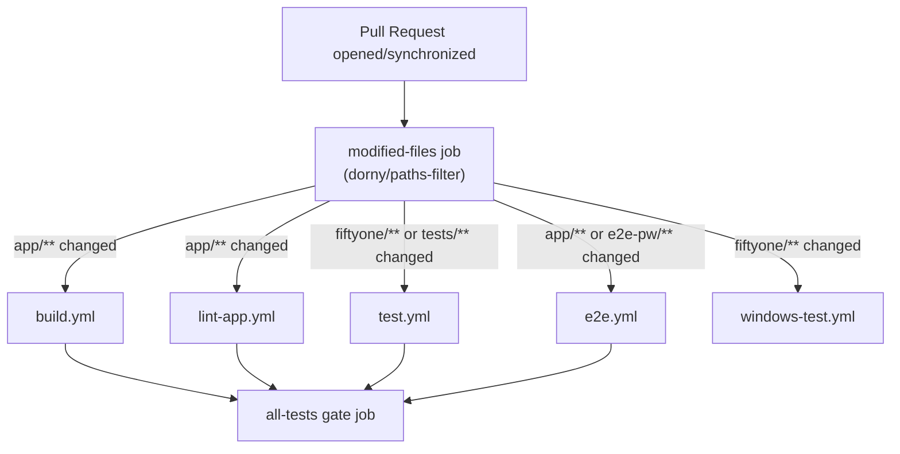
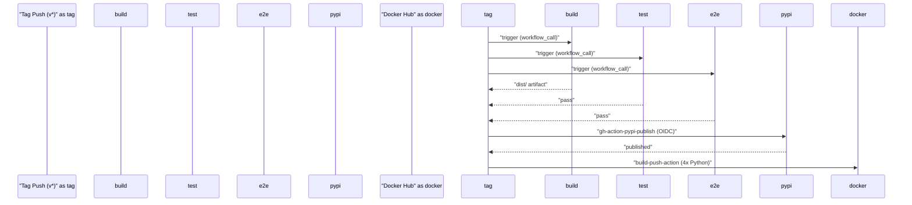
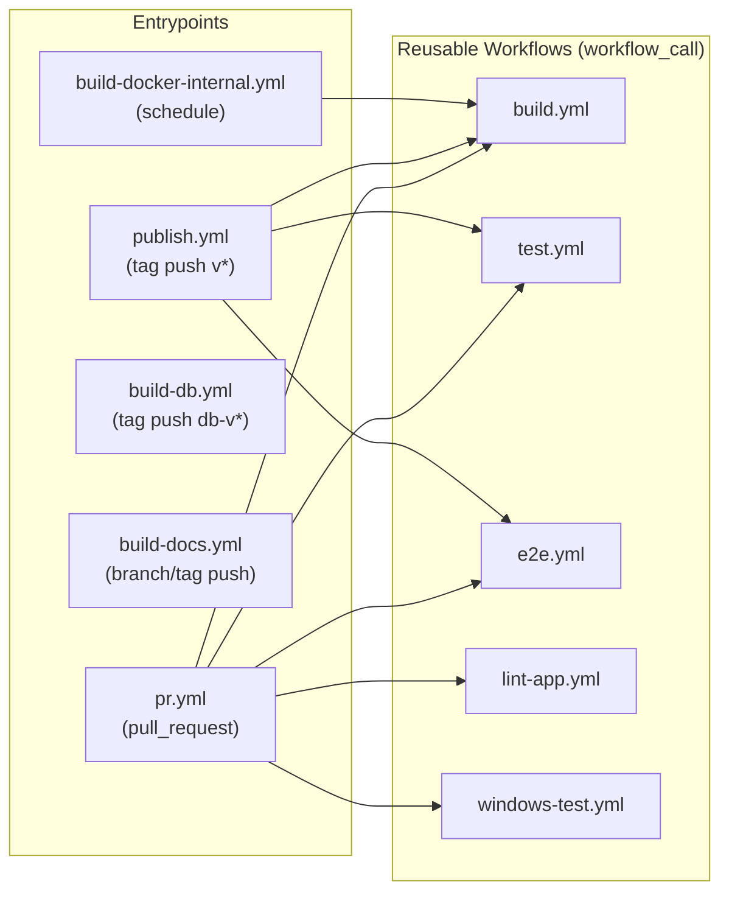

<!-- source: DeepWiki mcp.deepwiki.com · repo voxel51/fiftyone · page 11 Development Infrastructure · fetched 2026-10-21 -->

# Development Infrastructure

Relevant source files

The following files were used as context for generating this wiki page:

- [.github/workflows/build-db.yml](.github/workflows/build-db.yml)
- [.github/workflows/build-docker-internal.yml](.github/workflows/build-docker-internal.yml)
- [.github/workflows/build-docs.yml](.github/workflows/build-docs.yml)
- [.github/workflows/build-graphql.yml](.github/workflows/build-graphql.yml)
- [.github/workflows/build.yml](.github/workflows/build.yml)
- [.github/workflows/e2e.yml](.github/workflows/e2e.yml)
- [.github/workflows/lint-app.yml](.github/workflows/lint-app.yml)
- [.github/workflows/pr.yml](.github/workflows/pr.yml)
- [.github/workflows/publish.yml](.github/workflows/publish.yml)
- [.github/workflows/push-release.yml](.github/workflows/push-release.yml)
- [.github/workflows/test.yml](.github/workflows/test.yml)
- [.github/workflows/windows-test.yml](.github/workflows/windows-test.yml)
- [app/packages/app/index.html](app/packages/app/index.html)
- [app/packages/app/vite.config.ts](app/packages/app/vite.config.ts)
- [package/db/setup.py](package/db/setup.py)
- [package/desktop/setup.py](package/desktop/setup.py)
- [package/desktop/src/__init__.py](package/desktop/src/__init__.py)
- [setup.py](setup.py)

This page provides an overview of the build, testing, CI/CD, and toolchain infrastructure for the FiftyOne project. It describes how the codebase is packaged, tested, and deployed at a high level. For detailed treatment of specific subsystems, see:

- [Build System and Packaging](#11.1) — `setup.py`, `CustomBdistWheel`, Yarn workspaces, and Vite configuration
- [CI/CD Workflows](#11.2) — Individual GitHub Actions workflow files in depth
- [Documentation System](#11.3) — Sphinx, `generate_docs.bash`, and the docs build pipeline

---

## Python Package Structure

FiftyOne is distributed as three separate Python packages, each with its own `setup.py`:

| Package | Setup File | Description |
|---|---|---|
| `fiftyone` | [setup.py:1-164]() | Main library — all Python source in the `fiftyone/` namespace |
| `fiftyone-db` | [package/db/setup.py:1-354]() | Bundles platform-specific `mongod` binaries |
| `fiftyone-desktop` | [package/desktop/setup.py:1-196]() | Bundles the Electron desktop app binary |

The main package version is pinned at `VERSION = "1.14.0"` in [setup.py:16](), and both sub-packages (`fiftyone-db`, `fiftyone-desktop`) are listed as runtime dependencies. The `RELEASE_VERSION` environment variable overrides the default version string during release builds.

### Core Python Dependencies

Key runtime dependencies declared in [setup.py:32-83]():

| Category | Notable Packages |
|---|---|
| Web server | `hypercorn`, `starlette`, `strawberry-graphql` |
| Database | `pymongo`, `mongoengine`, `motor` |
| Data science | `numpy`, `pandas`, `scikit-learn`, `scipy`, `matplotlib`, `plotly` |
| Media | `Pillow`, `opencv-python-headless` |
| Internal | `fiftyone-brain`, `fiftyone-db`, `voxel51-eta` |

The OpenCV dependency is selected at install time via `choose_requirement` in [setup.py:98-109]() — it uses a full `opencv-python` or `opencv-contrib-python` variant if already present, otherwise falls back to `opencv-python-headless`.

The console entry point `fiftyone=fiftyone.core.cli:main` is registered in [setup.py:162](), wiring the `fiftyone` command to the CLI module.

---

## Binary Packaging with `CustomBdistWheel`

Both `fiftyone-db` and `fiftyone-desktop` use a custom `bdist_wheel` subclass to produce platform-specific, non-pure-Python wheels that embed binary assets.

**`fiftyone-db`** — `CustomBdistWheel` in [package/db/setup.py:209-312]() downloads the appropriate `mongod` binary from MongoDB's download servers at wheel-build time. It detects OS and architecture through `FODB_MACHINE` and `FODB_SYSTEM` environment variables (or `platform.machine()`/`platform.system()` defaults), looks up the download URL from a nested dictionary (e.g., `LINUX_DOWNLOADS`, `DARWIN_DOWNLOADS`, `WINDOWS_DOWNLOADS`), and extracts only the `mongod` binary into `fiftyone/db/bin/`.

**`fiftyone-desktop`** — `CustomBdistWheel` in [package/desktop/setup.py:61-154]() finds a built Electron app in the `app/packages/desktop/release/` directory and archives it into `fiftyone/desktop/bin/` as a `.tar.gz`. Platform tag normalization maps host platform names to manylinux/macosx wheel tags.

Both classes override `get_tag()` to emit `py3-none-<platform>` tags, making them recognized as platform-specific despite containing no compiled Python extensions.

---

## Frontend Toolchain

The frontend application lives under `app/` and uses **Yarn 4** (Berry) with workspaces. All CI jobs pin to Yarn `4.9.1` (or `4.12.0` for doc builds) via `corepack prepare`.

The main app bundle is built with **Vite**. The configuration at [app/packages/app/vite.config.ts:1-64]() defines:

- Plugins: `reactRefresh`, `relay` (GraphQL), `svgr`, `nodePolyfills`
- Dev server port defaulting to `5173`, with proxy rules forwarding `/plugins` and `/aggregate` to the FiftyOne Python server on port `5151`
- Rollup options that suppress `MODULE_LEVEL_DIRECTIVE` warnings

The built frontend assets are copied into the Python server package as part of the `make app` + `make python` build sequence.

---

## CI/CD Workflow Architecture

All automation lives in `.github/workflows/`. The PR orchestration workflow at [.github/workflows/pr.yml:1-108]() acts as the entry point for pull requests, using path-based filtering to selectively invoke child workflows.

**PR Workflow Decision Flow:**

Sources: [.github/workflows/pr.yml:1-108]()

---

### Individual Workflow Responsibilities

| Workflow File | Trigger | Purpose |
|---|---|---|
| `pr.yml` | PR opened/synced | Orchestrates all PR checks via path filters |
| `build.yml` | `workflow_call` | Builds frontend (`make app`) and Python wheel (`make python`) |
| `test.yml` | `workflow_call` | Runs Python tests (3.9–3.12) and frontend unit tests |
| `windows-test.yml` | `workflow_call` | Runs Python tests on `windows-latest` (3.9–3.12) |
| `lint-app.yml` | `workflow_call` | Runs ESLint and Biome on the `app/` packages |
| `e2e.yml` | `workflow_call` | Runs Playwright end-to-end tests against a live MongoDB |
| `publish.yml` | Tag push `v*` | Builds, tests, publishes to PyPI, and builds Docker images |
| `build-docs.yml` | Push/PR to doc branches | Builds Sphinx docs; publishes to GCS on tag |
| `build-db.yml` | Tag push `db-v*` | Builds and publishes `fiftyone-db` wheels per platform |
| `build-graphql.yml` | Tag push `graphql-v*` | Builds `fiftyone-graphql` package |
| `build-docker-internal.yml` | Schedule (Thursdays) | Builds internal Docker image for vulnerability scanning |
| `push-release.yml` | Push to `release/v*` | Creates a PR to merge release branch back into `develop` |

Sources: [.github/workflows/build.yml:1-74](), [.github/workflows/test.yml:1-137](), [.github/workflows/publish.yml:1-106](), [.github/workflows/build-docs.yml:1-201](), [.github/workflows/build-db.yml:1-130]()

---

### Build Workflow Detail

The reusable `build.yml` workflow ([.github/workflows/build.yml:1-74]()) performs:

1. Checkout with submodules
2. Python 3.9 setup + `pip install build`
3. Node 22 setup + `corepack enable` + Yarn 4 activation
4. Node module cache restore (keyed on `app/yarn.lock` hash)
5. `make app` — builds the frontend bundle
6. `make python -o app` — builds the Python wheel (skipping the app target)
7. Upload `dist/` as a GitHub Actions artifact named `dist`

Release version is determined by the `RELEASE_TAG` environment variable: if the git tag matches `refs/tags/v*rc*`, `RELEASE_VERSION` is extracted and injected into `setup.py`'s `get_version()`.

---

### Test Workflow Detail

**Python tests** ([.github/workflows/test.yml:43-137]()) run on a matrix of Python 3.9, 3.10, 3.11, 3.12 on `ubuntu-latest`. Key details:

- Dependencies installed via **`uv`** (`astral-sh/setup-uv@v7`) for speed
- Requirements come from `requirements/github.txt` and `requirements/test.txt`
- Tests are run via `tests/utils/pytest_wrapper.py` rather than calling `pytest` directly, ensuring services shut down cleanly between test runs
- Coverage reported to Codecov for Python 3.11 only
- Three test categories run separately:
  - Standard: `tests/` (excluding `benchmarking/`, `isolated/`, `intensive/`, `no_wrapper/`)
  - No-wrapper: `tests/no_wrapper/`
  - Isolated: each file in `tests/isolated/` runs in its own subprocess

**Frontend tests** run `cd app && yarn test` on `ubuntu-latest`.

**Windows tests** ([.github/workflows/windows-test.yml:1-88]()) mirror the Python test matrix on `windows-latest`.

---

### E2E Test Workflow Detail

The `e2e.yml` workflow ([.github/workflows/e2e.yml:1-171]()) uses Playwright against a real MongoDB instance:

- `supercharge/mongodb-github-action` starts MongoDB (matrix: `latest`)
- Python 3.10.16 + `uv` installs requirements from `requirements/e2e.txt`
- Disk space is freed with `jlumbroso/free-disk-space` (the standard 14 GB runner disk is insufficient)
- Playwright browsers are cached by version, keyed on `${{ runner.os }}-playwright-${{ playwright-version }}`
- FFmpeg is installed via `afoley587/setup-ffmpeg@main`
- Tests run from the `e2e-pw/` directory via `yarn e2e`
- Reports uploaded as `playwright-report-mongodb-<version>` artifacts, retained 30 days

Key environment variables used in E2E runs:

| Variable | Value |
|---|---|
| `FIFTYONE_DATABASE_URI` | `mongodb://localhost:27017` |
| `FIFTYONE_DATABASE_NAME` | `playwright` |
| `FIFTYONE_DO_NOT_TRACK` | `true` |
| `FIFTYONE_PLUGINS_DIR` | `${{ github.workspace }}/e2e-pw/src/shared/assets/plugins` |

---

### Publish Workflow Detail

The publish workflow ([.github/workflows/publish.yml:1-106]()) triggers on version tags (`v*`):

1. Calls `build.yml`, `test.yml`, and `e2e.yml` as dependencies
2. Downloads the `dist/` artifact and publishes to PyPI using **OIDC trusted publishing** (`pypa/gh-action-pypi-publish@v1.13.0`) — no explicit API token required
3. After PyPI publish, builds Docker images for Python 3.9, 3.10, 3.11, 3.12 using `docker/build-push-action@v6`:
   - Multi-platform: `linux/amd64,linux/arm64`
   - SBOM generation enabled
   - Python 3.11 also receives the `latest` and unversioned `vX.Y.Z` tags

Sources: [.github/workflows/publish.yml:1-106]()

---

## Caching Strategy

CI jobs use `actions/cache@v5` extensively to avoid redundant work:

| Cache | Key | Used In |
|---|---|---|
| `app/node_modules` + `app/.yarn/cache` | `node-modules-${{ hashFiles('app/yarn.lock') }}` | build, test, lint, e2e |
| `e2e-pw/node_modules` | `node-modules-${{ hashFiles('e2e-pw/yarn.lock') }}` | e2e |
| Playwright browsers | `${{ runner.os }}-playwright-${{ playwright-version }}` | e2e |
| `uv` pip cache | `requirements/*.txt` globs | test, e2e |

Sources: [.github/workflows/build.yml:47-57](), [.github/workflows/e2e.yml:91-155](), [.github/workflows/test.yml:75-83]()

---

## Workflow Relationships

Sources: [.github/workflows/pr.yml:47-97](), [.github/workflows/publish.yml:10-17](), [.github/workflows/build-docker-internal.yml:8-9]()

---

## Requirements Files

Test and CI dependency groups are managed as separate requirement files under `requirements/`:

| File | Purpose |
|---|---|
| `requirements/common.txt` | Shared base dependencies |
| `requirements/github.txt` | Dependencies for GitHub Actions CI runs |
| `requirements/test.txt` | pytest and test utilities |
| `requirements/e2e.txt` | Playwright and E2E-specific dependencies |
| `requirements/docs.txt` | Sphinx and documentation toolchain |

These files allow `uv pip install -r requirements/<file>.txt` calls in CI to precisely scope what is installed for each job type.

Sources: [.github/workflows/test.yml:88-95](), [.github/workflows/e2e.yml:87-89](), [.github/workflows/build-docs.yml:109-126]()

---

