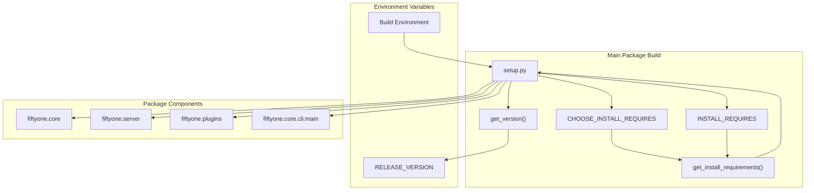
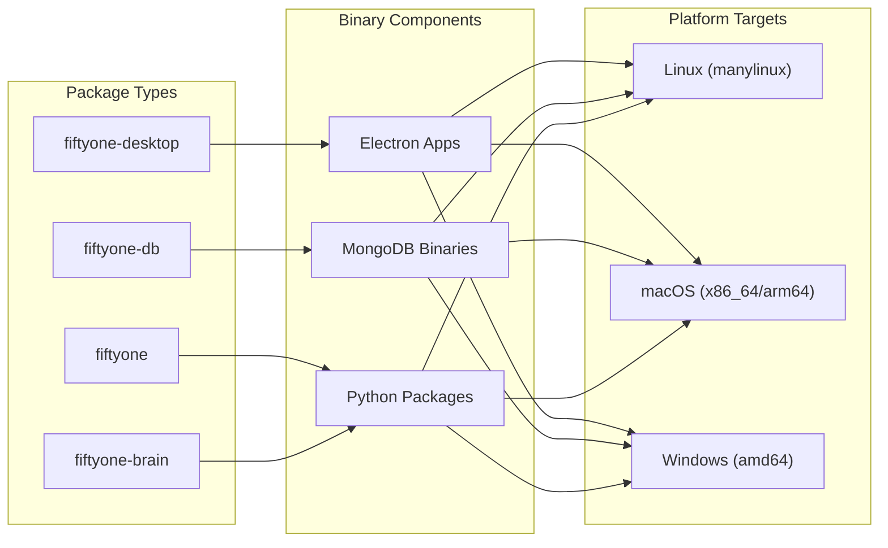
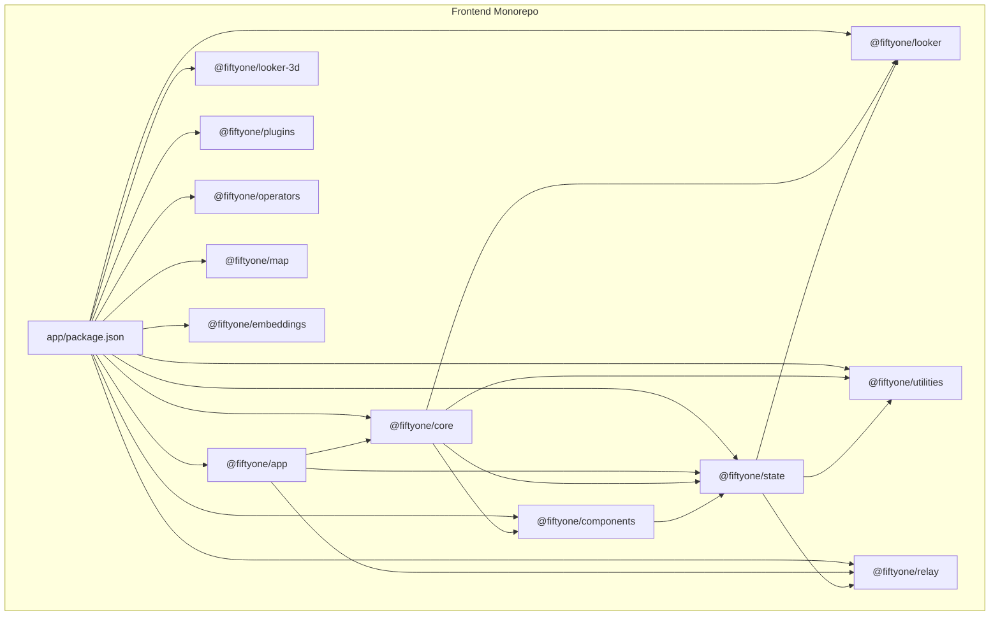
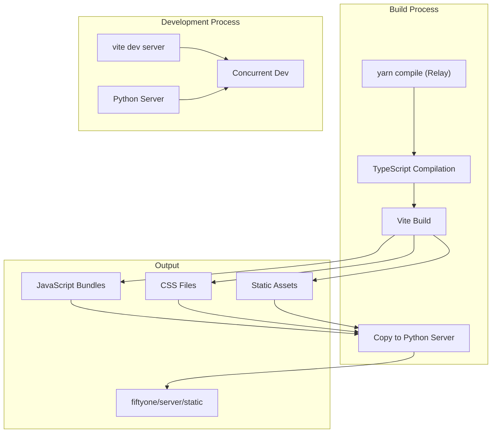
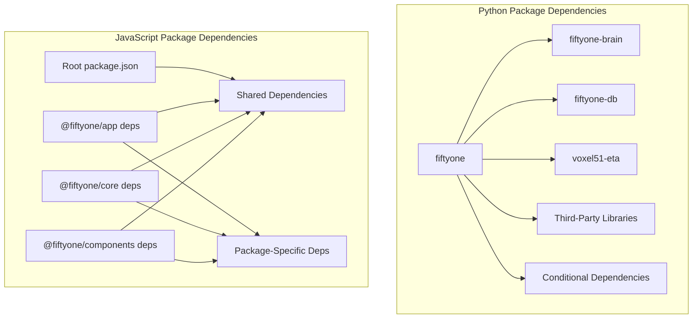
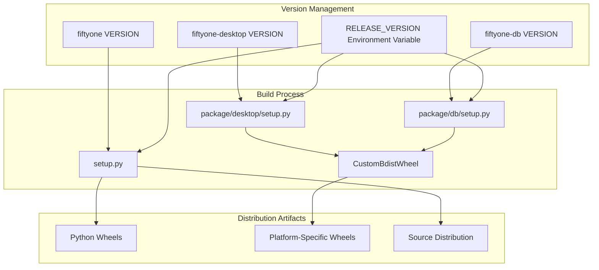
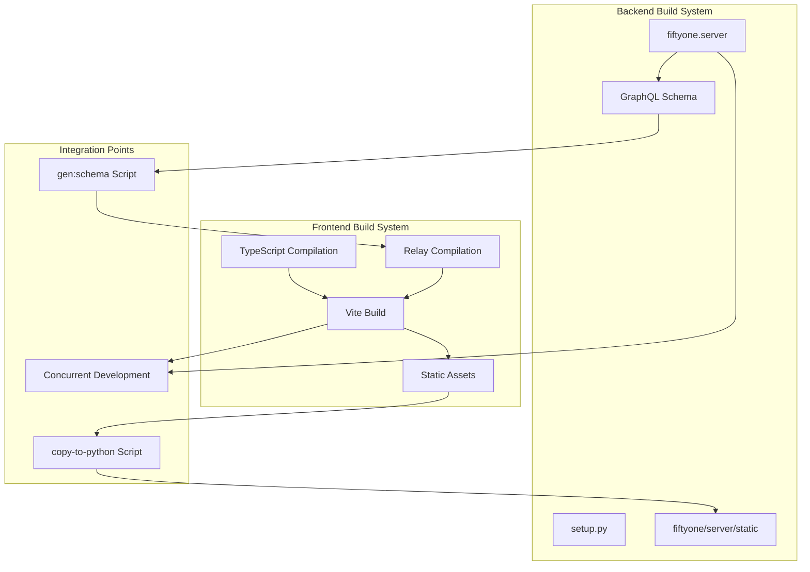
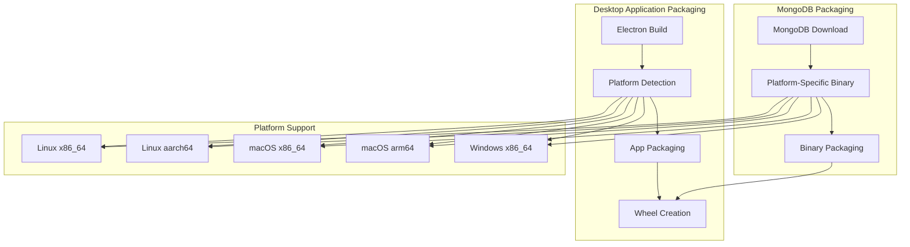

<!-- source: DeepWiki mcp.deepwiki.com · repo voxel51/fiftyone · page 11.1 Build System and Packaging · fetched 2026-10-21 -->

# Build System and Packaging

<details>
<summary>Relevant source files</summary>

The following files were used as context for generating this wiki page:

- [.pre-commit-config.yaml](.pre-commit-config.yaml)
- [app/package.json](app/package.json)
- [app/packages/aggregations/package.json](app/packages/aggregations/package.json)
- [app/packages/app/index.html](app/packages/app/index.html)
- [app/packages/app/package.json](app/packages/app/package.json)
- [app/packages/app/vite.config.ts](app/packages/app/vite.config.ts)
- [app/packages/components/package.json](app/packages/components/package.json)
- [app/packages/core/package.json](app/packages/core/package.json)
- [app/packages/embeddings/package.json](app/packages/embeddings/package.json)
- [app/packages/flashlight/package.json](app/packages/flashlight/package.json)
- [app/packages/looker-3d/package.json](app/packages/looker-3d/package.json)
- [app/packages/looker/package.json](app/packages/looker/package.json)
- [app/packages/map/package.json](app/packages/map/package.json)
- [app/packages/operators/package.json](app/packages/operators/package.json)
- [app/packages/plugins/package.json](app/packages/plugins/package.json)
- [app/packages/relay/package.json](app/packages/relay/package.json)
- [app/packages/state/package.json](app/packages/state/package.json)
- [app/packages/utilities/package.json](app/packages/utilities/package.json)
- [app/yarn.lock](app/yarn.lock)
- [fiftyone/utils/csv.py](fiftyone/utils/csv.py)
- [fiftyone/utils/dicom.py](fiftyone/utils/dicom.py)
- [package/db/setup.py](package/db/setup.py)
- [package/desktop/setup.py](package/desktop/setup.py)
- [requirements/dev.txt](requirements/dev.txt)
- [requirements/extras.txt](requirements/extras.txt)
- [requirements/github.txt](requirements/github.txt)
- [requirements/test.txt](requirements/test.txt)
- [setup.py](setup.py)

</details>


This document covers FiftyOne's build system architecture, which manages multiple packages across Python and JavaScript ecosystems. It details the package structure, dependency management, version control, and distribution processes that enable FiftyOne's cross-platform compatibility.

The build system manages several distinct packages including the main `fiftyone` Python package, the desktop application (`fiftyone-desktop`), database utilities (`fiftyone-db`), and the React-based frontend application. For information about the development environment setup, see [Installation and Setup](#1.1). For CI/CD workflows, see [CI/CD Workflows](#11.2). For documentation build processes, see [Documentation System](#11.3).

## Python Package Architecture

FiftyOne uses a multi-package architecture with separate setup configurations for different components. The main package structure includes version management, dependency resolution, and cross-platform distribution support.

### Main Package Configuration

The primary package build is managed through `setup.py` which defines the core `fiftyone` package. Version management is handled through the `get_version()` function that checks for a `RELEASE_VERSION` environment variable during CI builds:

```python
def get_version():
    if "RELEASE_VERSION" in os.environ:
        version = os.environ["RELEASE_VERSION"]
        if not version.startswith(VERSION):
            raise ValueError(
                "Release version does not match version: %s and %s"
                % (version, VERSION)
            )
        return version

    return VERSION
```

The package includes extensive dependencies defined in `INSTALL_REQUIRES` with conditional OpenCV dependency resolution through the `choose_requirement()` mechanism. This allows the build system to detect existing OpenCV installations and select the appropriate variant:

```python
def choose_requirement(mains, secondary):
    chosen = secondary
    for main in mains:
        try:
            name = re.split(r"[!<>=]", main)[0]
            metadata.version(name)
            chosen = main
            break
        except metadata.PackageNotFoundError:
            pass

    return str(chosen)
```

Key build components include:
- **Entry Points**: CLI access through `fiftyone=fiftyone.core.cli:main`
- **Package Discovery**: Automatic package discovery excluding development directories
- **Python Requirements**: Support for Python 3.9+ as specified in the classifiers

### Main Package Build Architecture



Sources: [setup.py:1-162]()

### Specialized Package Builds

FiftyOne includes several specialized packages that handle platform-specific binaries and dependencies:

#### Desktop Application Package

The `fiftyone-desktop` package handles Electron application packaging with platform-specific wheel generation. The `CustomBdistWheel` class manages cross-platform binary distribution by detecting the target platform and packaging the appropriate Electron binaries:

```python
class CustomBdistWheel(bdist_wheel):
    def finalize_options(self):
        bdist_wheel.finalize_options(self)
        # not pure Python
        self.root_is_pure = False

        platform = self.plat_name
        is_platform = lambda os, isa=None: platform.startswith(os) and (
            not isa or platform.endswith(isa)
        )

        if is_platform("linux", "aarch64"):
            self.plat_name = "manylinux2014_aarch64"
        elif is_platform("linux", "x86_64"):
            self.plat_name = "manylinux1_x86_64"
        elif is_platform("mac", "arm64"):
            self.plat_name = "macosx_11_0_arm64"
        elif is_platform("mac", "x86_64"):
            self.plat_name = "macosx_10_10_x86_64"
        elif is_platform("win"):
            self.plat_name = "win_amd64"
        else:
            raise ValueError(
                "Unsupported target platform: %r" % self.plat_name
            )
```

During wheel creation, the build process locates the appropriate Electron application binary and packages it into the wheel.

#### Database Package

The `fiftyone-db` package provides MongoDB binaries for different platforms. It includes an extensive download matrix for various Linux distributions, macOS, and Windows and automatically downloads and packages the appropriate MongoDB binaries during wheel creation:

```python
def _get_linux_download():
    path = pathlib.Path("/etc/os-release")
    with open(path) as stream:
        reader = csv.reader(stream, delimiter="=")
        # filter empty lines
        d = dict(line for line in reader if line)

    key = d["ID"].lower()
    if key not in LINUX_DOWNLOADS:
        key = d["ID_LIKE"].lower()

    for k, v in LINUX_DOWNLOADS[key].items():
        if d["VERSION_ID"].startswith(k):
            return v[MACHINE]
```

The package supports a wide range of platforms including:
- Linux distributions (Ubuntu, Debian, RHEL, CentOS, Amazon Linux)
- macOS (Intel and Apple Silicon)
- Windows

### Multi-Package Architecture



Sources: [package/desktop/setup.py:1-197](), [package/db/setup.py:1-355]()

## Frontend Build System

FiftyOne's frontend is built using a modern JavaScript/TypeScript stack with a monorepo structure managed by Yarn workspaces. This architecture allows for modular development while maintaining a cohesive application.

### Package Structure

The frontend is organized as a monorepo with multiple packages defined in the `app/packages` directory. Each package has its own `package.json` file that defines its dependencies and build scripts:



Sources: [app/package.json:1-60](), [app/packages/app/package.json:1-67](), [app/packages/core/package.json:1-88](), [app/packages/components/package.json:1-56]()

### Build Tools and Configuration

The frontend build system uses Vite as the primary build tool, with TypeScript for type checking. The main build configuration is defined in each package's `vite.config.ts` file.

Key build tools include:
- **Yarn**: Package management with workspaces for monorepo support
- **Vite**: Fast, modern build tool for development and production builds
- **TypeScript**: Static type checking for JavaScript
- **Relay**: GraphQL client for data fetching
- **Recoil**: State management library

The main app package defines build scripts that coordinate the build process:

```json
"scripts": {
    "check": "biome check --write ./src README.md tsconfig.json vite.config.ts",
    "dev": "vite",
    "build": "yarn workspace @fiftyone/fiftyone compile && yarn build-bare && yarn copy-to-python",
    "build:win32": "yarn workspace @fiftyone/fiftyone compile && yarn build-bare && yarn copy-to-python:win32",
    "build-bare": "NODE_OPTIONS=--max-old-space-size=4096 && tsc && vite build",
    "copy-to-python": "rm -rf ../../../fiftyone/server/static && cp -r ./dist ../../../fiftyone/server/static",
    "copy-to-python:win32": "robocopy './dist' '../../../fiftyone/server/static' /MIR"
}
```

### Frontend Build Process



Sources: [app/packages/app/package.json:7-14](), [app/package.json:8-21]()

## Package Dependencies and Management

FiftyOne's build system manages dependencies across both Python and JavaScript ecosystems, with careful handling of version constraints and compatibility.

### Python Dependencies

The main `fiftyone` package has extensive dependencies defined in `INSTALL_REQUIRES`, including:

```python
INSTALL_REQUIRES = [
    # third-party packages
    "aiofiles",
    "argcomplete",
    "async_lru>=2",
    "beautifulsoup4",
    "boto3",
    "cachetools",
    "dacite>=1.6.0,<2",
    "dill",
    "Deprecated",
    "ftfy",
    "humanize",
    "hypercorn>=0.13.2",
    "Jinja2>=3",
    "matplotlib",
    "mongoengine~=0.29.1",
    "motor~=3.6.0",
    "numpy",
    "packaging",
    "pandas",
    "Pillow>=6.2,!=11.2.*",
    "plotly>=6.1.1",
    # ... more dependencies ...
    # internal packages
    "fiftyone-brain>=0.21.2,<0.22",
    "fiftyone-db>=0.4,<2.0",
    "voxel51-eta>=0.14.3,<0.15",
]
```

The build system also handles conditional dependencies through the `CHOOSE_INSTALL_REQUIRES` mechanism, which allows for selecting the appropriate OpenCV variant based on what's already installed:

```python
CHOOSE_INSTALL_REQUIRES = [
    (
        (
            "opencv-python",
            "opencv-contrib-python",
            "opencv-contrib-python-headless",
        ),
        "opencv-python-headless",
    )
]
```

### JavaScript Dependencies

The frontend uses Yarn workspaces to manage dependencies across multiple packages. Each package defines its own dependencies in its `package.json` file, with shared dependencies managed at the root level.

Key dependencies include:
- **React**: UI library
- **Relay**: GraphQL client
- **Recoil**: State management
- **Material-UI**: Component library
- **Three.js**: 3D rendering (for `looker-3d`)
- **Vite**: Build tool

### Dependency Management Architecture



Sources: [setup.py:32-81](), [setup.py:84-93](), [app/package.json:23-59](), [app/packages/app/package.json:16-66]()

## Version Management and Distribution

FiftyOne employs a sophisticated version management system across its packages to ensure compatibility and streamline the release process.

### Version Control

The main `fiftyone` package defines its version in `setup.py`:

```python
VERSION = "1.8.0"

def get_version():
    if "RELEASE_VERSION" in os.environ:
        version = os.environ["RELEASE_VERSION"]
        if not version.startswith(VERSION):
            raise ValueError(
                "Release version does not match version: %s and %s"
                % (version, VERSION)
            )
        return version

    return VERSION
```

Similarly, specialized packages like `fiftyone-desktop` and `fiftyone-db` have their own version definitions:

```python
# In package/desktop/setup.py
VERSION = "0.35.0"

# In package/db/setup.py
VERSION = "1.3.0"
```

This approach allows each package to be versioned independently while maintaining compatibility constraints.

### Cross-Platform Distribution

The build system generates platform-specific wheels for different operating systems and architectures:

#### Desktop Package

The `fiftyone-desktop` package uses a custom wheel builder to create platform-specific distributions:

```python
class CustomBdistWheel(bdist_wheel):
    def get_tag(self):
        impl = "py3"
        abi_tag = "none"
        return impl, abi_tag, self.plat_name
```

It supports:
- Linux (x86_64, aarch64)
- macOS (x86_64, arm64)
- Windows (amd64)

#### Database Package

The `fiftyone-db` package includes MongoDB binaries for various platforms:

```python
DARWIN_DOWNLOADS = {
    "arm64": "https://fastdl.mongodb.org/osx/mongodb-macos-arm64-6.0.24.tgz",
    "x86_64": "https://fastdl.mongodb.org/osx/mongodb-macos-x86_64-6.0.24.tgz",
}

LINUX_DOWNLOADS = {
    "amzn": { ... },
    "centos": { ... },
    "debian": { ... },
    "fedora": { ... },
    "pop": { ... },
    "rhel": { ... },
    "ubuntu": { ... },
}

WINDOWS_DOWNLOADS = {
    "x86_64": "https://fastdl.mongodb.org/windows/mongodb-windows-x86_64-6.0.24.zip",
    "amd64": "https://fastdl.mongodb.org/windows/mongodb-windows-x86_64-6.0.24.zip",
}
```

### Distribution Architecture



Sources: [setup.py:16-29](), [package/desktop/setup.py:19-32](), [package/db/setup.py:193-206](), [package/desktop/setup.py:61-90](), [package/db/setup.py:22-152]()

## Frontend-Backend Integration

A critical aspect of FiftyOne's build system is the integration between the JavaScript frontend and Python backend. This integration ensures that the built frontend assets are properly packaged and served by the Python server.

### Build Output Integration

The frontend build process generates static assets that are copied to the Python package's server directory:

```bash
# From app/packages/app/package.json
"copy-to-python": "rm -rf ../../../fiftyone/server/static && cp -r ./dist ../../../fiftyone/server/static",
"copy-to-python:win32": "robocopy './dist' '../../../fiftyone/server/static' /MIR"
```

This ensures that when the Python package is installed, it includes the latest frontend build.

### Development Workflow

During development, the build system supports a concurrent workflow where both the frontend and backend can be developed simultaneously:

```bash
# From app/package.json
"dev": "yarn workspace @fiftyone/app dev",
"dev:py": "python ../fiftyone/server/main.py",
"dev:wpy": "concurrently -k yarn:dev yarn:dev:py",
```

This allows developers to see changes in real-time across both ecosystems.

### GraphQL Schema Integration

The frontend and backend communicate through a GraphQL API. The schema is generated from the Python code and made available to the frontend:

```bash
# From app/package.json
"gen:schema": "strawberry export-schema fiftyone.server.app:schema > schema.graphql"
```

### Frontend-Backend Integration Architecture



Sources: [app/packages/app/package.json:10-14](), [app/package.json:8-21]()

## Desktop Application Packaging

The FiftyOne desktop application is an Electron-based application that provides a native experience across platforms. The build system includes specialized handling for packaging and distributing this application.

### Electron Application Packaging

The desktop application is packaged using Electron and distributed as part of the `fiftyone-desktop` Python package. The packaging process is handled by a custom wheel builder:

```python
class CustomBdistWheel(bdist_wheel):
    def write_wheelfile(self, *args, **kwargs):
        bdist_wheel.write_wheelfile(self, *args, **kwargs)
        if os.environ.get("RELEASE_DIR"):
            release_dir = os.environ["RELEASE_DIR"]
        else:
            release_dir = os.path.join(
                os.path.dirname(os.path.abspath(__file__)),
                "..",
                "..",
                "app",
                "packages",
                "desktop",
                "release",
            )
        bin_dir = os.path.join(
            self.bdist_dir,
            self.data_dir,
            "purelib",
            "fiftyone",
            "desktop",
            "bin",
        )
        
        # Find the appropriate Electron app for the platform
        if os.environ.get("FIFTYONE_APP_EXE_PATH"):
            apps = [os.environ["FIFTYONE_APP_EXE_PATH"]]
        elif self.plat_name.startswith("manylinux"):
            apps = glob.glob(os.path.join(release_dir, "FiftyOne*.AppImage"))
        elif self.plat_name == "macosx_11_0_arm64":
            apps = glob.glob(
                os.path.join(release_dir, "mac-arm64", "FiftyOne*.app")
            )
        elif self.plat_name.startswith("mac"):
            apps = glob.glob(os.path.join(release_dir, "mac", "FiftyOne*.app"))
        elif self.plat_name.startswith("win"):
            apps = glob.glob(os.path.join(release_dir, "FiftyOne*.exe"))
        else:
            raise ValueError(
                "Unsupported target platform: %r" % self.plat_name
            )
```

The process includes:
1. Identifying the correct Electron app for the target platform
2. Creating a compressed archive of the app
3. Including the archive in the Python wheel

### MongoDB Integration

The `fiftyone-db` package provides MongoDB binaries for different platforms. The build process downloads the appropriate MongoDB binary for the target platform and packages it into the wheel:

```python
def write_wheelfile(self, *args, **kwargs):
    bdist_wheel.write_wheelfile(self, *args, **kwargs)
    bin_dir = os.path.join(
        self.bdist_dir, self.data_dir, "purelib", "fiftyone", "db", "bin"
    )
    if not os.path.isdir(bin_dir):
        os.mkdir(bin_dir)

    mongo_zip_url = _get_download()
    if mongo_zip_url is None:
        return

    mongo_zip_filename = os.path.basename(mongo_zip_url)
    mongo_zip_dest = os.path.join(
        os.path.dirname(os.path.abspath(__file__)),
        mongo_zip_filename,
    )
    
    # Download MongoDB binary
    try:
        if not os.path.exists(mongo_zip_dest):
            with urlopen(mongo_zip_url) as conn, open(
                mongo_zip_dest, "wb"
            ) as dest:
                shutil.copyfileobj(conn, dest)
    except:
        # Handle exceptions
        pass
```

### Cross-Platform Packaging Architecture



Sources: [package/desktop/setup.py:61-155](), [package/db/setup.py:209-313]()

## Code Quality and Linting

The linting infrastructure at [.github/workflows/lint-app.yml:1-53]() ensures code quality standards across the frontend codebase. It uses both ESLint and Biome for comprehensive code analysis.

The linting process includes:
- **ESLint**: Targeted linting of specific packages listed in [app/eslint-packages.txt:3]()
- **Biome**: Additional code quality checks via `yarn check`
- **Conditional Execution**: Only runs when app files are modified

**Sources**: [.github/workflows/lint-app.yml:1-53](), [app/eslint-packages.txt:1-4]()

---

