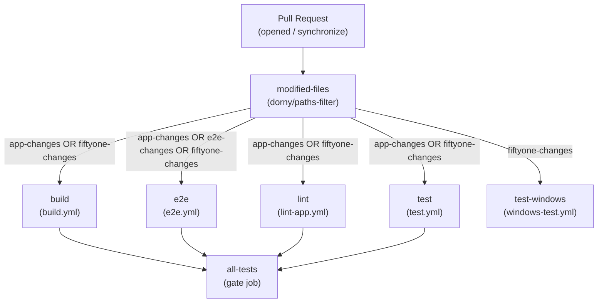
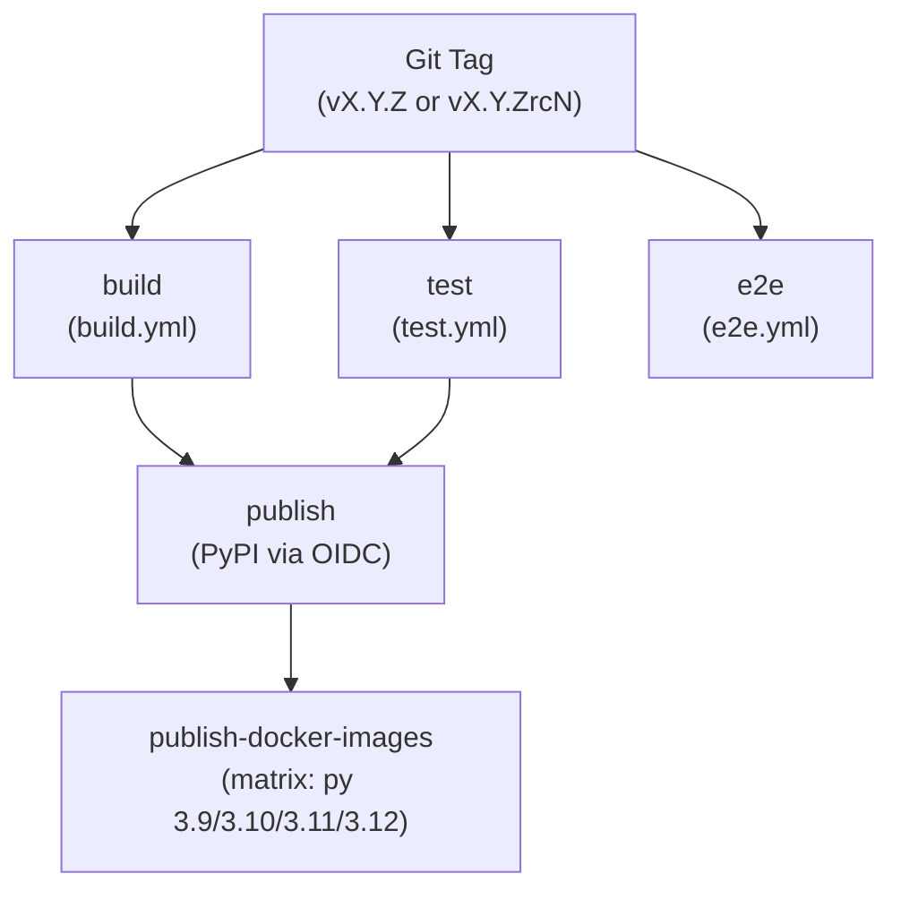
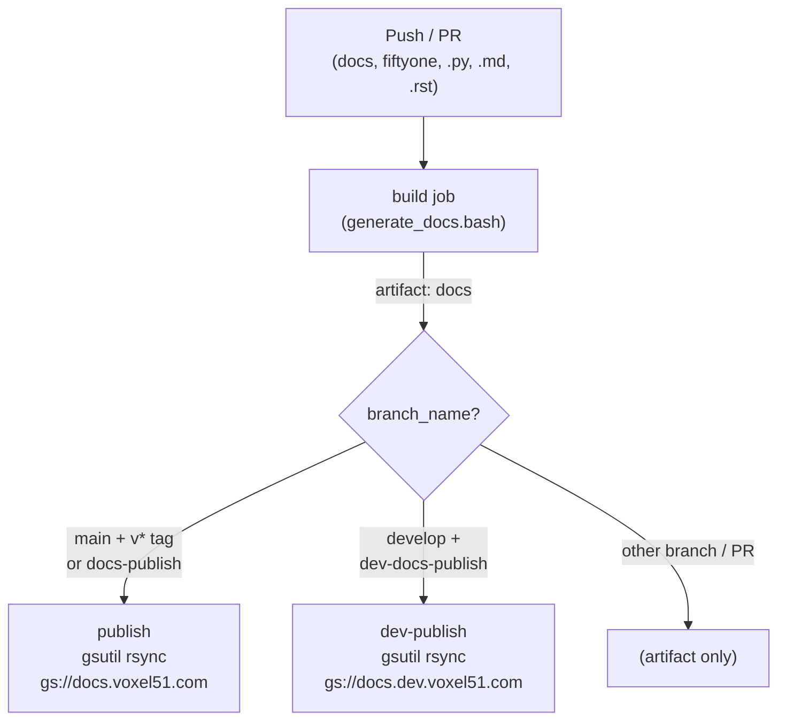
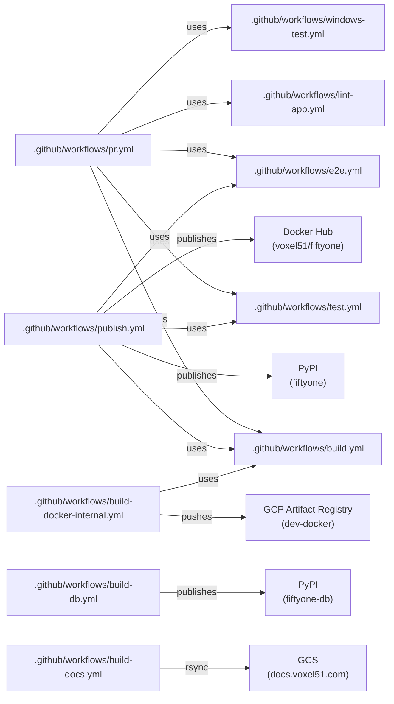

<!-- source: DeepWiki mcp.deepwiki.com · repo voxel51/fiftyone · page 11.2 CI/CD Workflows · fetched 2026-10-21 -->

# CI/CD Workflows

Relevant source files

The following files were used as context for generating this wiki page:

- [.github/workflows/build-db.yml](.github/workflows/build-db.yml)
- [.github/workflows/build-docker-internal.yml](.github/workflows/build-docker-internal.yml)
- [.github/workflows/build-docs.yml](.github/workflows/build-docs.yml)
- [.github/workflows/build-graphql.yml](.github/workflows/build-graphql.yml)
- [.github/workflows/build.yml](.github/workflows/build.yml)
- [.github/workflows/e2e.yml](.github/workflows/e2e.yml)
- [.github/workflows/lint-app.yml](.github/workflows/lint-app.yml)
- [.github/workflows/pr.yml](.github/workflows/pr.yml)
- [.github/workflows/publish.yml](.github/workflows/publish.yml)
- [.github/workflows/push-release.yml](.github/workflows/push-release.yml)
- [.github/workflows/test.yml](.github/workflows/test.yml)
- [.github/workflows/windows-test.yml](.github/workflows/windows-test.yml)
- [package/desktop/src/__init__.py](package/desktop/src/__init__.py)

This page documents the GitHub Actions workflows that automate building, testing, linting, publishing, and documentation for FiftyOne. Coverage includes the PR orchestration workflow, all reusable child workflows, the PyPI and Docker publish pipelines, the documentation build pipeline, and supporting package workflows.

For information about how the Python package and frontend assets are structured and built locally, see [Build System and Packaging](#11.1). For documentation infrastructure details, see [Documentation System](#11.3).

---

## Workflow Overview

All workflow definitions live in [.github/workflows/]() . The workflows fall into four categories:

| Category | Files | Trigger |
|---|---|---|
| PR Orchestration | `pr.yml` | Pull request open/synchronize |
| Reusable Build/Test | `build.yml`, `test.yml`, `e2e.yml`, `lint-app.yml`, `windows-test.yml` | `workflow_call` |
| Release / Publish | `publish.yml`, `build-db.yml`, `build-graphql.yml`, `push-release.yml`, `build-docker-internal.yml` | Git tags, branch push |
| Documentation | `build-docs.yml` | Branch push, tags, PR |

---

## PR Orchestration Workflow

**File:** [.github/workflows/pr.yml]()

The `Pull Request` workflow is the entry point for all PR-triggered CI. It runs on `pull_request` events of types `opened` and `synchronize` and uses a `concurrency` group keyed on `${{ github.workflow }}-${{ github.ref }}` with `cancel-in-progress: true` to prevent redundant runs.

### Change Detection

A `modified-files` job uses the `dorny/paths-filter` action to classify which parts of the repository changed. It emits three boolean outputs:

| Output | Paths Watched |
|---|---|
| `app-changes` | `app/**`, `.github/workflows/build.yml` |
| `e2e-changes` | `e2e-pw/**`, `.github/workflows/e2e.yml` |
| `fiftyone-changes` | `fiftyone/**`, `package/**`, `requirements/**`, `tests/**`, `setup.py`, `plugins/**` |

[.github/workflows/pr.yml:12-46]()

### Conditional Job Dispatch

Each child workflow is conditionally invoked based on which change flags are set:

| Job | Condition | Calls |
|---|---|---|
| `build` | `app-changes` OR `fiftyone-changes` | `build.yml` |
| `e2e` | `app-changes` OR `e2e-changes` OR `fiftyone-changes` | `e2e.yml` |
| `lint` | `app-changes` OR `fiftyone-changes` | `lint-app.yml` |
| `test` | `app-changes` OR `fiftyone-changes` | `test.yml` |
| `test-windows` | `fiftyone-changes` only | `windows-test.yml` |

[.github/workflows/pr.yml:47-96]()

### Gate Job

A final `all-tests` job declares `needs: [build, lint, test, e2e]` and uses `if: always()`. It runs a shell check that fails if any of those jobs neither succeeded nor was skipped. This provides a single status check for branch protection rules.

[.github/workflows/pr.yml:98-107]()

---

**PR Workflow Data Flow Diagram**

Sources: [.github/workflows/pr.yml]()

---

## Reusable Workflows

All reusable workflows are triggered via `on: workflow_call`. They can be called both from `pr.yml` and from release workflows.

### Build Workflow (`build.yml`)

**File:** [.github/workflows/build.yml]()

Builds the full FiftyOne Python distribution including bundled frontend assets.

**Key steps:**

1. **Path filter** – A `changes` job uses `dorny/paths-filter` to check `app/**`, `.github/**`, `fiftyone/**`, `setup.py`. The result is exposed as the `changes` output, though the main `build` job runs unconditionally.
2. **Node setup** – Node 22 with Yarn 4.9.1 via corepack. Node modules are cached by `hashFiles('app/yarn.lock')`.
3. **Frontend build** – `make app` builds the React application.
4. **Version detection** – Sets `RELEASE_VERSION` env var if the tag matches `refs/tags/vX.Y.ZrcN` (release candidates).
5. **Python build** – `make python -o app` builds the Python wheel without re-running the app target.
6. **Artifact upload** – The `dist/` directory is uploaded as the `dist` artifact.

[.github/workflows/build.yml:22-73]()

---

### Test Workflow (`test.yml`)

**File:** [.github/workflows/test.yml]()

Contains two parallel jobs.

#### `test-app`

Runs frontend unit tests on `ubuntu-latest`:
- Installs Node 22 + Yarn 4.9.1.
- Caches `app/node_modules` and `app/.yarn/cache`.
- Executes `cd app && yarn test`.

[.github/workflows/test.yml:6-41]()

#### `test-python`

Runs Python tests across a matrix of Python versions on Ubuntu:

| Dimension | Values |
|---|---|
| `os` | `ubuntu-latest` |
| `python` | `3.9`, `3.10`, `3.11`, `3.12` |

- Uses `uv` (astral-sh/setup-uv) to install `requirements/github.txt`.
- Configures the test environment via `tests/utils/setup_config.py` and `tests/utils/github_actions_flags.py`.
- Installs FFmpeg using `afoley587/setup-ffmpeg`.
- Runs tests via `tests/utils/pytest_wrapper.py` (which ensures services shut down cleanly), excluding `benchmarking/`, `isolated/`, `utils/`, `intensive/`, `no_wrapper`.
- Runs `tests/no_wrapper` tests directly via `pytest`.
- Runs each file in `tests/isolated/` individually through `pytest_wrapper.py`.
- Uploads coverage to Codecov for `python == 3.11` using `codecov/codecov-action`.

[.github/workflows/test.yml:43-136]()

---

### E2E Workflow (`e2e.yml`)

**File:** [.github/workflows/e2e.yml]()

Runs Playwright end-to-end tests against a live FiftyOne instance backed by MongoDB.

**Environment variables set:**

| Variable | Value |
|---|---|
| `FIFTYONE_DATABASE_URI` | `mongodb://localhost:27017` |
| `FIFTYONE_DATABASE_NAME` | `playwright` |
| `PLAYWRIGHT_BROWSERS_PATH` | `${{ github.workspace }}/ms-playwright` |
| `FIFTYONE_PLUGINS_DIR` | `e2e-pw/src/shared/assets/plugins` |
| `ELECTRON_EXTRA_LAUNCH_ARGS` | `--disable-gpu` |

**Matrix:** `mongodb-version: [latest]` with `fail-fast: false`, 90-minute timeout.

**Key steps:**

1. Sparse-checkout (excludes `docs/`).
2. Optional Docker Hub login (skipped on forks without secrets).
3. MongoDB startup via `supercharge/mongodb-github-action`.
4. Python 3.10.16 with `uv` and cached dependencies.
5. `jlumbroso/free-disk-space` to clear at least 22 GB needed by the test suite.
6. `make app` to build frontend assets.
7. `uv pip install --system . -r requirements/e2e.txt`.
8. FFmpeg setup.
9. E2E dependencies and Playwright browsers cached by version hash.
10. `yarn e2e` in `e2e-pw/` directory.
11. `yarn lint` on Playwright test files.
12. Report upload as `playwright-report-mongodb-<version>` artifact (retained 30 days).

[.github/workflows/e2e.yml:1-171]()

---

### Lint Workflow (`lint-app.yml`)

**File:** [.github/workflows/lint-app.yml]()

Lints frontend TypeScript/JavaScript code. Runs two tools:

- **ESLint** – Runs on packages listed in `app/eslint-packages.txt`.
- **Biome** – Runs `yarn check` (Biome handles formatting and additional linting).

Node 22 + Yarn 4.9.1 are configured and `app/node_modules` is cached before running either linter.

[.github/workflows/lint-app.yml:1-51]()

---

### Windows Test Workflow (`windows-test.yml`)

**File:** [.github/workflows/windows-test.yml]()

Mirrors the `test-python` job from `test.yml` but runs on `windows-latest` across the same Python version matrix (3.9–3.12). Uses `uv` for dependency management. FFmpeg is installed and tests are run via `pytest_wrapper.py` with the same exclusion flags.

[.github/workflows/windows-test.yml:1-89]()

---

## Publish Workflow

**File:** [.github/workflows/publish.yml]()

Triggered by pushes of tags matching `v[0-9]+.[0-9]+.[0-9]+` or `v[0-9]+.[0-9]+.[0-9]+rcN`.

**Publish Flow Diagram**

Sources: [.github/workflows/publish.yml]()

### PyPI Publish

The `publish` job:
- `needs: [build, test]`
- Uses the `release` GitHub environment (which enables OIDC trusted publishing).
- Downloads the `dist` artifact from `build.yml`.
- Publishes to PyPI using `pypa/gh-action-pypi-publish` without a token (OIDC).

[.github/workflows/publish.yml:19-38]()

### Docker Image Publish

The `publish-docker-images` job runs after `publish` succeeds, in a matrix over Python versions 3.9, 3.10, 3.11, 3.12.

**Docker tag strategy:**

| Condition | Tags Applied |
|---|---|
| `python != 3.11` | `voxel51/fiftyone:<ver>-python<py>`, `voxel51/fiftyone:<ver>-python<py>-<date>` |
| `python == 3.11` | Above plus `voxel51/fiftyone:<ver>`, `voxel51/fiftyone:latest` |

- Builds for `linux/amd64` and `linux/arm64` using Docker Buildx with QEMU.
- Passes build args: `BUILD_TYPE=released`, `FO_VERSION`, `PYTHON_VERSION`.
- Generates SBOMs (`sbom: true`).

[.github/workflows/publish.yml:40-106]()

---

## Documentation Build Workflow

**File:** [.github/workflows/build-docs.yml]()

**Triggers:**

- **Push** to `docs-*`, `github-actions-*`, `rel-*`, `release-*`, `release/*` branches; tags `dev-docs-publish`, `docs-publish`, `v*`; when paths include `.github/workflows/build-docs.yml`, `docs/**`, `fiftyone/**`, or any `.py`/`.md`/`.rst` file.
- **Pull request** to `develop`, `feat/*`, `main`, `rel-*`, `release-*`, `release/*` with the same path filters.

### Build Job

Key steps:

1. Branch resolution: determines `branch_name` as `main`, `develop`, or a fallback. For tags, validates that `docs-publish` tags align with `main` and `dev-docs-publish` tags align with `develop`.
2. Checks out `voxel51/fiftyone-teams` using `RO_FOT_FG_PAT` secret at the resolved branch.
3. Installs `pandoc` (system), then `requirements/docs.txt`, `fiftyone-brain`, `fiftyone-db`, and `fiftyone`.
4. Installs `eta` from source (cloned from `github.com/voxel51/eta`).
5. Builds Node 22 + Yarn 4.12.0, caches app node modules.
6. Runs `./docs/generate_docs.bash -t fiftyone-teams`.
7. Uploads `docs/build/html/` as the `docs` artifact.

[.github/workflows/build-docs.yml:41-158]()

### Publish Jobs

| Job | Condition | Destination |
|---|---|---|
| `publish` | `branch_name == 'main'` AND tag is `refs/tags/v*` or `docs-publish` | `gs://docs.voxel51.com` (production) |
| `dev-publish` | `branch_name == 'develop'` AND tag is `dev-docs-publish` | `gs://docs.dev.voxel51.com` (staging) |

Both use `google-github-actions/auth` and `gsutil -m rsync -dR` to sync the built HTML to GCS. Production publish excludes the `SBOMs/` prefix; staging excludes `robots.txt`.

[.github/workflows/build-docs.yml:160-200]()

---

**Documentation Pipeline Diagram**

Sources: [.github/workflows/build-docs.yml]()

---

## Supporting Package Workflows

### `fiftyone-db` Build and Publish (`build-db.yml`)

**File:** [.github/workflows/build-db.yml]()

**Triggers:** tags `db-v[0-9]+.[0-9]+.[0-9]+` or `db-v[0-9]+.[0-9]+.[0-9]+rcN`; PRs touching `package/db/**`.

**Build matrix (5 platforms):**

| Platform | Command |
|---|---|
| `sdist` | `python -Im build --sdist` |
| `darwin-arm64` | `FODB_MACHINE=arm64 FODB_SYSTEM=Darwin python -Im build` |
| `darwin-x86_64` | `FODB_MACHINE=x86_64 FODB_SYSTEM=Darwin python -Im build` |
| `windows-32` | `FODB_MACHINE=32 FODB_SYSTEM=Windows python -Im build` |
| `windows-x86_64` | `FODB_MACHINE=x86_64 FODB_SYSTEM=Windows python -Im build` |

Each build uploads its artifact as `dist-<platform>`. The `test` job downloads the `dist-sdist` artifact, installs it, then runs `pytest` in `package/db/tests/`. The `publish` job merges all `dist-*` artifacts and uses `pypa/gh-action-pypi-publish` with OIDC.

[.github/workflows/build-db.yml:1-130]()

---

### `fiftyone-graphql` Build (`build-graphql.yml`)

**File:** [.github/workflows/build-graphql.yml]()

Triggered by `graphql-v*` tags. Builds the wheel from `package/graphql/` and uploads it as the `dist` artifact. The `publish` job uses `twine` to upload to PyPI (triggered on `refs/tags/db-v` — note this appears to be a bug in the workflow condition at time of writing).

[.github/workflows/build-graphql.yml:1-65]()

---

### Push Release Workflow (`push-release.yml`)

**File:** [.github/workflows/push-release.yml]()

Triggered on pushes to `release/vX.Y.Z` branches or manually via `workflow_dispatch` (with optional `ref_name` input). Creates a merge PR from the release branch back into `develop`:

1. Checks out `develop` with full history.
2. Creates or resets the `merge/<ref_name>` branch.
3. Merges the release branch into `develop` (no rebase).
4. Uses `peter-evans/create-pull-request` to open the PR as `voxel51-bot`.

[.github/workflows/push-release.yml:1-36]()

---

### Internal Docker Build (`build-docker-internal.yml`)

**File:** [.github/workflows/build-docker-internal.yml]()

Runs on `workflow_dispatch` or on a weekly Thursday schedule (`cron: "5 4 * * 4"`). Intended for internal vulnerability scanning, not production publishing.

- Calls `build.yml` to produce the `dist` artifact.
- Builds a single-platform (`linux/amd64`) Docker image from source (`BUILD_TYPE=source`).
- Pushes to Google Artifact Registry at `us-central1-docker.pkg.dev/<project>/dev-docker/fiftyone:<ver>-<sha>-python<py>-<date>`.
- Authenticates to GCP using Workload Identity Federation.

[.github/workflows/build-docker-internal.yml:1-72]()

---

## Secrets and Environment Summary

| Secret | Used In |
|---|---|
| `CODECOV_TOKEN` | `test.yml` (coverage upload) |
| `RO_DOCKERHUB_USERNAME`, `RO_DOCKERHUB_PAT` | `pr.yml` → `e2e.yml` (Docker pull rate limit) |
| `RW_DOCKERHUB_USER`, `RW_DOCKERHUB_PAT` | `publish.yml` (Docker Hub push) |
| `DOCS_GCP_CREDENTIALS` | `build-docs.yml` (GCS sync) |
| `DOCSEARCH_API_KEY` | `build-docs.yml` (Algolia search index) |
| `FIFTYONE_GITHUB_TOKEN` | `build-docs.yml`, `push-release.yml` |
| `RO_FOT_FG_PAT` | `build-docs.yml` (checkout `fiftyone-teams`) |
| `REPO_GCP_PROJECT`, `REPO_GCP_SERVICE_ACCOUNT`, `REPO_GOOGLE_WORKLOAD_IDP` | `build-docker-internal.yml` |
| `FIFTYONE_PYPI_TOKEN` | `build-graphql.yml` (twine upload) |

PyPI publishing for `fiftyone` and `fiftyone-db` uses OIDC trusted publishers (no stored token). The `release` environment is declared on those jobs to enable OIDC.

---

## Node and Python Toolchain Versions

| Tool | Version |
|---|---|
| Node.js | 22 |
| Yarn | 4.9.1 (4.12.0 in docs build) |
| Python (build) | 3.9 |
| Python (test matrix) | 3.9, 3.10, 3.11, 3.12 |
| Python (e2e) | 3.10.16 |
| Python (docs) | 3.11 |
| uv | latest (astral-sh/setup-uv) |

---

**Workflow–File Mapping Diagram**

Sources: [.github/workflows/pr.yml](), [.github/workflows/publish.yml](), [.github/workflows/build-db.yml](), [.github/workflows/build-docs.yml](), [.github/workflows/build-docker-internal.yml]()

---

