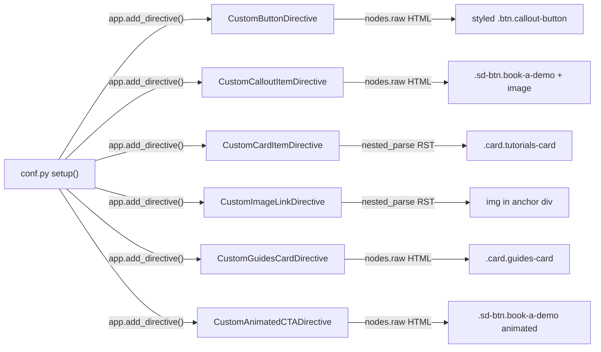
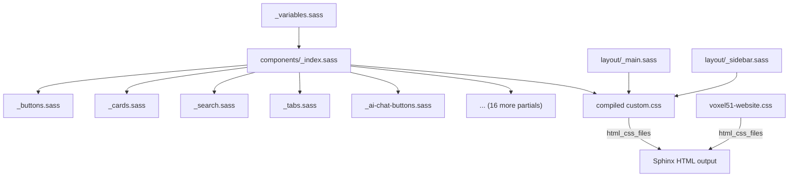
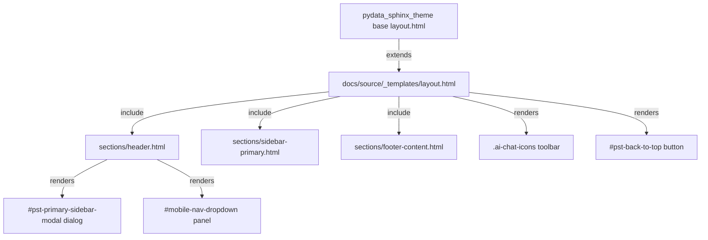
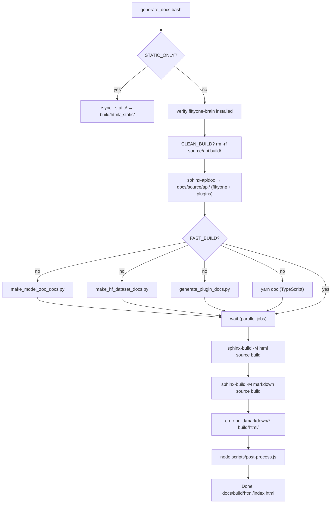

<!-- source: DeepWiki mcp.deepwiki.com · repo voxel51/fiftyone · page 11.3 Documentation System · fetched 2026-10-21 -->

# Documentation System

<details>
<summary>Relevant source files</summary>

The following files were used as context for generating this wiki page:

- [.prettierignore](.prettierignore)
- [docs/extensions/llms_txt.py](docs/extensions/llms_txt.py)
- [docs/generate_docs.bash](docs/generate_docs.bash)
- [docs/source/_static/css/custom.css](docs/source/_static/css/custom.css)
- [docs/source/_static/css/voxel51-website.css](docs/source/_static/css/voxel51-website.css)
- [docs/source/_static/js/custom.js](docs/source/_static/js/custom.js)
- [docs/source/_templates/layout.html](docs/source/_templates/layout.html)
- [docs/source/_templates/sections/header.html](docs/source/_templates/sections/header.html)
- [docs/source/assets/styles/components/_ai-chat-buttons.sass](docs/source/assets/styles/components/_ai-chat-buttons.sass)
- [docs/source/assets/styles/components/_banner.sass](docs/source/assets/styles/components/_banner.sass)
- [docs/source/assets/styles/components/_breadcrumbs.sass](docs/source/assets/styles/components/_breadcrumbs.sass)
- [docs/source/assets/styles/components/_buttons.sass](docs/source/assets/styles/components/_buttons.sass)
- [docs/source/assets/styles/components/_cards.sass](docs/source/assets/styles/components/_cards.sass)
- [docs/source/assets/styles/components/_index.sass](docs/source/assets/styles/components/_index.sass)
- [docs/source/assets/styles/components/_links.sass](docs/source/assets/styles/components/_links.sass)
- [docs/source/assets/styles/components/_search.sass](docs/source/assets/styles/components/_search.sass)
- [docs/source/assets/styles/components/_tabs.sass](docs/source/assets/styles/components/_tabs.sass)
- [docs/source/assets/styles/layout/_main.sass](docs/source/assets/styles/layout/_main.sass)
- [docs/source/assets/styles/layout/_sidebar.sass](docs/source/assets/styles/layout/_sidebar.sass)
- [docs/source/conf.py](docs/source/conf.py)
- [docs/source/custom_directives.py](docs/source/custom_directives.py)
- [requirements/docs.txt](requirements/docs.txt)

</details>


This page documents the Sphinx-based documentation build system for FiftyOne: its configuration, custom extensions, SASS/CSS asset pipeline, HTML template hierarchy, and the `generate_docs.bash` build script.

For information about the CI/CD workflows that trigger documentation builds automatically, see [11.2](#11.2). For information about the Python package build system, see [11.1](#11.1).

---

## Overview

The documentation lives in `docs/` and is built with [Sphinx](https://www.sphinx-doc.org/). Sources are written in ReStructuredText (`.rst`) and Markdown (`.md`). The build produces both an HTML site and Markdown output (used for LLM consumption). Custom Sphinx extensions, SASS-compiled CSS, and Jinja2 HTML templates customize the output beyond what the base `pydata-sphinx-theme` provides.

**Build pipeline summary:**

```
docs/generate_docs.bash
  ├── sphinx-apidoc  →  docs/source/api/         (Python API stubs)
  ├── make_model_zoo_docs.py                      (Model Zoo listing)
  ├── make_hf_dataset_docs.py                     (HF dataset listing)
  ├── generate_plugin_docs.py                     (Plugin ecosystem docs)
  ├── yarn doc  (app/)                            (TypeScript API docs)
  ├── sphinx-build -M html source build           (HTML output)
  ├── sphinx-build -M markdown source build       (Markdown output)
  └── node ./scripts/post-process.js              (Post-processing)
```

Sources:
- [docs/generate_docs.bash:1-145]()
- [docs/source/conf.py:1-302]()

---

## Sphinx Configuration (`conf.py`)

The primary configuration file is [docs/source/conf.py:1-302](). It performs version validation, registers extensions, configures the theme, and hooks custom directives into the Sphinx application.

### Version Validation

[docs/source/conf.py:32-40]() reads `setup.py` to extract the `VERSION` string and compares it against `fiftyone.constants.VERSION`. If they differ, the build fails immediately to prevent publishing mismatched docs.

### Extensions

| Extension | Role |
|---|---|
| `sphinx.ext.autodoc` | Generates API docs from Python docstrings |
| `sphinx.ext.napoleon` | Parses NumPy/Google-style docstrings |
| `sphinx.ext.intersphinx` | Cross-links to external docs (NumPy, PyTorch, etc.) |
| `autodocsumm` | Auto-generates summary tables on API pages |
| `nbsphinx` | Renders Jupyter notebooks as doc pages |
| `myst_parser` | Enables Markdown (`.md`) source files |
| `sphinx_tabs.tabs` | Tabbed code block UI component |
| `sphinx_copybutton` | Adds copy buttons to code blocks |
| `sphinx_design` | Grid/card layout components |
| `sphinx_docsearch` | Algolia DocSearch integration |
| `sphinx_pushfeedback` | Page feedback widget |
| `sphinx_markdown_builder` | Outputs Markdown alongside HTML |
| `sphinx_remove_toctrees` | Removes Zoo/plugin listing pages from the sidebar TOC |
| `llms_txt` | Custom extension; generates `llms.txt` |
| `autoapi.extension` | Optional; activated when `FIFTYONE_TEAMS_DIR` env var is set |

Sources:
- [docs/source/conf.py:64-88]()
- [requirements/docs.txt:1-44]()

### autodoc Configuration

[docs/source/conf.py:90-98]() sets `autodoc_default_options` to include `members`, `inherited-members`, and `autosummary`. Class content is drawn from the class docstring (`autoclass_content = "class"`). A global `rst_prolog` injects `/_includes/substitutions.rst` into every source file.

### Theme and Static Assets

```
html_theme = "pydata_sphinx_theme"
html_css_files = ["css/voxel51-website.css", "css/custom.css"]
html_js_files = ["js/custom.js", "js/tutorial-filters.js", "js/search.js"]
html_static_path = ["_static"]
html_extra_path = ["404.html"]
```

The theme's navbar structure is configured via `html_theme_options`:
- `navbar_start`: logo
- `navbar_center`: navigation links
- `navbar_end`: "Book a Demo" CTA

The sidebar is configured globally via `html_sidebars = {"**": ["algolia.html", "sidebar-nav"]}`.

Sources:
- [docs/source/conf.py:183-223]()

### Intersphinx Targets

[docs/source/conf.py:165-178]() configures cross-reference targets for `numpy`, `plotly`, `torch`, `torchvision`, `pymongo`, `mongoengine`, `sklearn`, `pydicom`, and `rasterio`.

### `setup()` Hook

The `setup(app)` function in [docs/source/conf.py:289-301]() connects the following to the Sphinx build lifecycle:

- `generate_redirects` on `builder-inited`
- `generate_api_redirects` on `build-finished`
- Registers all six custom directives

---

## Custom Directives

Custom directives are defined in [docs/source/custom_directives.py:1-424]() and registered in `conf.py`. Each directive is a subclass of `docutils.parsers.rst.Directive`.

**Directive summary:**

| Directive name | Class | Output |
|---|---|---|
| `.. custombutton::` | `CustomButtonDirective` | Styled CTA button |
| `.. customcalloutitem::` | `CustomCalloutItemDirective` | Two-column callout card with button |
| `.. customcarditem::` | `CustomCardItemDirective` | Tutorial card with image and tags |
| `.. customimagelink::` | `CustomImageLinkDirective` | Image wrapped in a link div |
| `.. customguidescard::` | `CustomGuidesCardDirective` | Getting-started guide card with level/time |
| `.. customanimatedcta::` | `CustomAnimatedCTADirective` | Animated CTA button with arrow hover effect |

All directives that produce clickable UI emit raw HTML via `nodes.raw("", html, format="html")` or via Sphinx's `nested_parse` of an embedded `.. raw:: html` block.

**Directive to output mapping:**



Sources:
- [docs/source/custom_directives.py:1-424]()
- [docs/source/conf.py:289-301]()

---

## SASS/CSS Asset Pipeline

Styles are authored in SASS and compiled to a single flat CSS file. The source lives in `docs/source/assets/styles/` and the compiled output is `docs/source/_static/css/custom.css`.

### Directory Structure

```
docs/source/assets/styles/
├── _variables.sass          # Shared design tokens
├── components/
│   ├── _index.sass          # Imports all component partials
│   ├── _accordions.sass
│   ├── _admonitions.sass
│   ├── _ai-chat-buttons.sass
│   ├── _api.sass
│   ├── _buttons.sass
│   ├── _cards.sass
│   ├── _code.sass
│   ├── _dropdowns.sass
│   ├── _search.sass
│   ├── _tabs.sass
│   └── ...
└── layout/
    ├── _main.sass
    └── _sidebar.sass
```

The component index at [docs/source/assets/styles/components/_index.sass:1-20]() imports all partials in order.

### Compilation

SASS is compiled via `libsass` (listed as `libsass==0.23.0` in [requirements/docs.txt:28]()). The compiled output at [docs/source/_static/css/custom.css:1-1]() is checked in and referenced directly by Sphinx. The `.prettierignore` file at [.prettierignore:7]() explicitly excludes `custom.css` from formatting to prevent overwriting compiled output.

A second stylesheet, [docs/source/_static/css/voxel51-website.css:1-738](), defines global design tokens (colors, spacing, typography) using CSS custom properties and is loaded alongside `custom.css`.

**SASS to CSS flow:**



Sources:
- [docs/source/assets/styles/components/_index.sass:1-20]()
- [docs/source/assets/styles/layout/_main.sass:1-93]()
- [docs/source/assets/styles/layout/_sidebar.sass:1-102]()
- [docs/source/assets/styles/components/_buttons.sass:1-176]()
- [requirements/docs.txt:28]()

---

## HTML Template Hierarchy

Templates extend the `pydata_sphinx_theme` base using Jinja2. Custom templates are in `docs/source/_templates/`.

### `layout.html`

[docs/source/_templates/layout.html:1-217]() extends `!layout.html` (the theme base) and overrides two blocks:

- **`extrahead`**: Injects Open Graph tags, Google Tag Manager, Font Awesome, favicons, Google Analytics, and BigPicture.io tracking scripts.
- **`content`**: Renders the full page layout including:
  - GTM noscript iframe
  - Back-to-top button
  - Announcement banner
  - Header (via `sections/header.html`)
  - Primary sidebar dialog (`#pst-primary-sidebar-modal`)
  - Main content area with AI chat icon buttons (ChatGPT, Claude, HuggingFace, Markdown export)
  - Footer with `sections/footer-content.html`

The AI chat icon buttons at [docs/source/_templates/layout.html:159-181]() render four buttons (`data-action="markdown"`, `data-ai="chatgpt"`, `data-ai="claude"`, `data-ai="huggingface"`) that are wired to handlers in `custom.js`.

### `sections/header.html`

[docs/source/_templates/sections/header.html:1-71]() renders:
- A hamburger-style primary sidebar toggle button (`.primary-sidebar-toggle`)
- The centered navbar with `navbar_start`, `navbar_center`, `navbar_end` slots
- A mobile sub-header with a `#mobile-nav-dropdown-toggle` button
- The `#mobile-nav-dropdown` collapsible panel containing the full sidebar TOC

**Template inheritance:**



Sources:
- [docs/source/_templates/layout.html:1-217]()
- [docs/source/_templates/sections/header.html:1-71]()

---

## JavaScript Customizations

`docs/source/_static/js/custom.js` ([docs/source/_static/js/custom.js:1-753]()) initializes all client-side behaviors at `DOMContentLoaded`. Each behavior is isolated in a named function:

| Function | Role |
|---|---|
| `initSidebarToggle()` | Hamburger menu, clones sidebar into `#pst-primary-sidebar-modal` dialog |
| `initSlidingNavBar()` | Sliding underline indicator on desktop navbar hover |
| `initDropdownDelay()` | Dropdown menus with 500 ms hide delay |
| `markLineNumbers()` | Adds `.first-linenos` / `.last-linenos` classes for CSS padding |
| `initTabsSlidingIndicator()` | Sliding underline on Sphinx tab lists |
| `initMobileNavDropdown()` | Mobile TOC dropdown toggle |
| `initKapaAI()` | Loads Kapa.ai widget script, floating button, and in-search "Ask AI" button |
| `addEnterpriseBanner()` | Injects enterprise CTA into the DocSearch modal footer |
| `initDynamicCTAs()` | Computes CSS `--cta-arrow-shift` and `--cta-text-shift` variables dynamically |
| `initDirectAgentAccess()` | Opens Kapa modal when `?agent=true` is in the URL |
| `initAIChatButtons()` | Wires `.ai-icon-button` elements to open ChatGPT, Claude, HuggingFace, or raw Markdown URLs |

Sources:
- [docs/source/_static/js/custom.js:741-753]()

---

## Custom Extensions

### `llms_txt` Extension

Located at [docs/extensions/llms_txt.py:1-193](), this extension generates an `llms.txt` file in the HTML output directory. It follows the [llms.txt](https://llmstxt.org/) convention for making documentation consumable by LLMs.

**Class: `LLMSTxtGenerator`**

| Method | Role |
|---|---|
| `scan_document_structure()` | Recursively walks toctree entries starting from `master_doc` |
| `collect_toctree_entries()` | Connected to `env-updated`; populates `self.collected_pages` |
| `group_pages_by_section()` | Groups pages by section, converts paths to Markdown URLs |
| `generate_llms_txt_file()` | Connected to `build-finished`; writes `llms.txt` |

Configuration values registered by the extension:

| Config key | Default |
|---|---|
| `llms_txt_title` | `"FiftyOne documentation"` |
| `llms_txt_description` | Multi-line FiftyOne description |
| `llms_txt_base_url` | `"https://docs.voxel51.com/"` |
| `llms_txt_optional` | `"- [All docs](https://docs.voxel51.com/)"` |

URLs in `llms.txt` point to `.md` files (served from the Markdown build output, copied into the HTML output directory by `generate_docs.bash`).

### `redirects` Module

Imported in `conf.py` as `from redirects import generate_redirects, generate_api_redirects`. These functions are connected to `builder-inited` and `build-finished` respectively, and read from the `redirects_file` config value (`"redirects"`) to emit HTML redirect stubs for moved pages.

Sources:
- [docs/extensions/llms_txt.py:1-193]()
- [docs/source/conf.py:27-28]()
- [docs/source/conf.py:289-293]()

---

## Build Script (`generate_docs.bash`)

[docs/generate_docs.bash:1-145]() orchestrates the full documentation build. It accepts four flags:

| Flag | Effect |
|---|---|
| `-f` | Fast build: skip model zoo, HF dataset, plugin, and TypeScript doc generation |
| `-c` | Clean build: delete `docs/source/api/` and `docs/build/` before building |
| `-s` | Static only: `rsync` `_static/` into the existing HTML build output |
| `-t <path>` | Path to `fiftyone-teams` repo; sets `FIFTYONE_TEAMS_DIR` for `autoapi` |

**Prerequisite check:** The script requires `fiftyone.brain` to be importable and its package directory to be valid. If not found, the build exits with an error.

**Step-by-step flow:**



### `sphinx-apidoc` Invocations

Two `sphinx-apidoc` calls run in parallel:

1. **Python API** — outputs to `docs/source/api/`, processing `fiftyone/` while excluding `fiftyone/brain/internal/models`, `fiftyone/constants`, `fiftyone/internal`, `fiftyone/server`, and `fiftyone/service`.
2. **Plugin API** — outputs to `docs/source/plugins/api/`, processing the `plugins/` directory.

Both use `--templatedir=docs/templates/apidoc` for custom RST stub templates.

A symlink `fiftyone/brain → $FIFTYONE_BRAIN_DIR` is created before `sphinx-apidoc` runs and removed immediately after (line 88 and 108) so `fiftyone.brain` appears as a subpackage for autodoc purposes.

Sources:
- [docs/generate_docs.bash:86-145]()

---

## Documentation Dependencies

All documentation build dependencies are pinned in [requirements/docs.txt:1-44]():

| Category | Packages |
|---|---|
| Core Sphinx | `Sphinx==8.2.3`, `docutils==0.21.2` |
| Theme | `pydata-sphinx-theme==0.16.1` |
| Extensions | `nbsphinx==0.9.8`, `myst-parser==5.0.0`, `autodocsumm==0.2.14`, `sphinx-autoapi==3.6.1` |
| UI extensions | `sphinx-tabs==3.4.7`, `sphinx-design==0.7.0`, `sphinx-copybutton==0.5.2` |
| Search | `sphinx-docsearch==0.3.0` |
| Markdown output | `sphinx-markdown-builder==0.6.9` |
| SASS | `libsass==0.23.0` |
| Notebooks | `nbsphinx==0.9.8`, `ipykernel==7.2.0` |
| HuggingFace | `huggingface_hub>=1.3.2` |

Sources:
- [requirements/docs.txt:1-44]()

---

## Notebook Integration (`nbsphinx`)

Jupyter notebooks in `docs/source/` are rendered using `nbsphinx`. Key settings in [docs/source/conf.py:125-158]():

- `nbsphinx_execute = "never"` — notebooks are never re-executed during the build.
- `nbsphinx_requirejs_path = ""` — disables `require.js` loading (which breaks the theme's scroll handling).
- `nbsphinx_prolog` — injects an HTML table with three links at the top of every notebook page: **Run in Google Colab**, **View source on GitHub**, and **Download notebook**. These links are parameterized with the `ref = "main"` variable to target the correct branch.

Sources:
- [docs/source/conf.py:125-158]()

---

## Search Integration (Algolia DocSearch)

The `sphinx_docsearch` extension connects to Algolia. Configuration values are read from environment variables with fallback defaults:

```python
docsearch_app_id = os.environ.get("DOCSEARCH_APP_ID", "8ZYQ0G7IMC")
docsearch_api_key = os.environ.get("DOCSEARCH_API_KEY", "")
docsearch_index_name = os.environ.get("DOCSEARCH_INDEX_NAME", "voxel51")
docsearch_container = "#searchbox"
```

The `#searchbox` anchor is provided by the `algolia.html` sidebar template configured in `html_sidebars`. The Kapa AI "Ask AI" button is injected into the DocSearch results panel by `initKapaAI()` in `custom.js`, intercepting the `input` event on `#docsearch-input`.

Sources:
- [docs/source/conf.py:236-239]()
- [docs/source/_static/js/custom.js:562-599]()