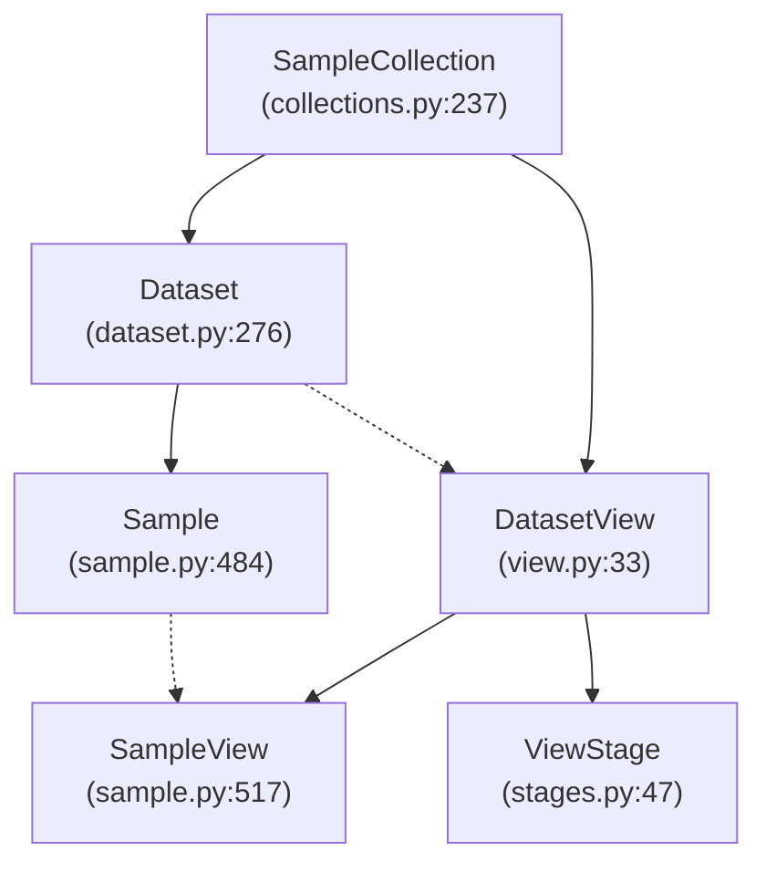
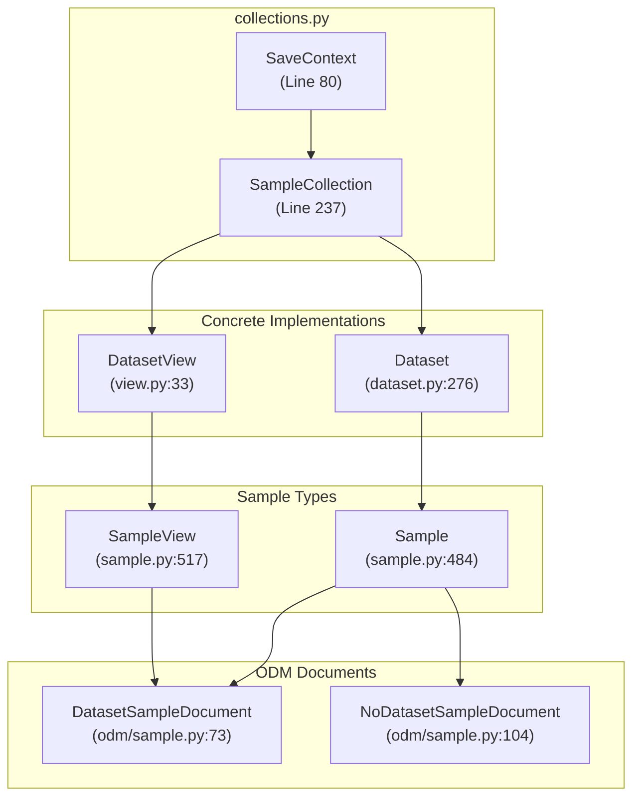
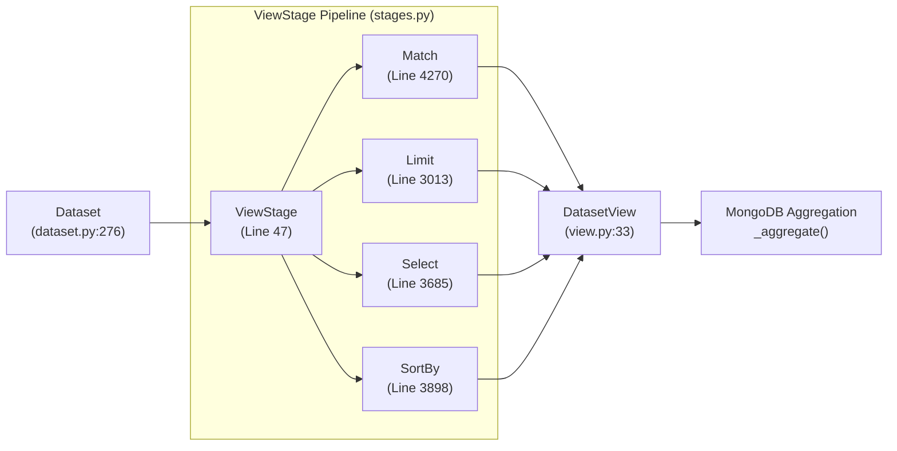
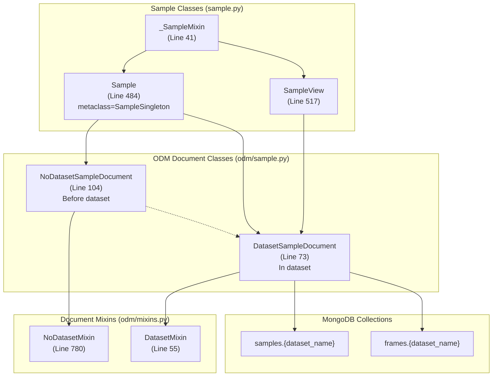
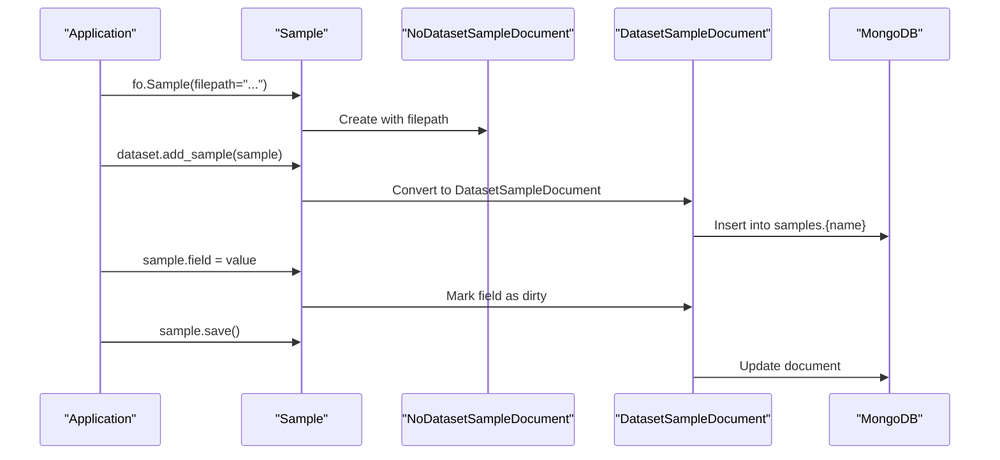
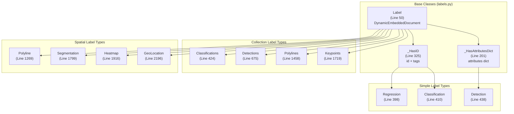
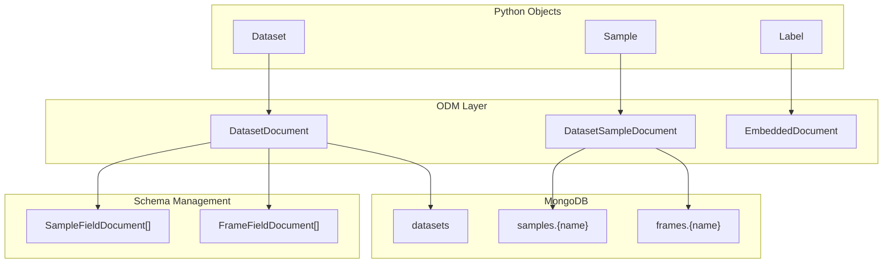
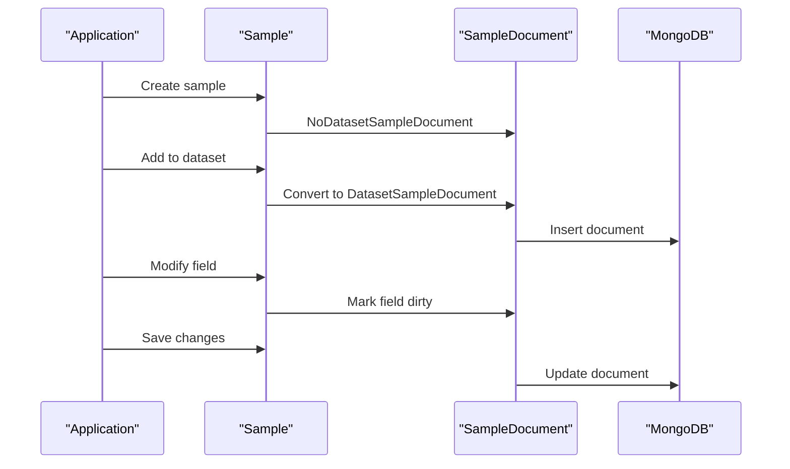

<!-- source: DeepWiki mcp.deepwiki.com · repo voxel51/fiftyone · page 2 Core Data Model · fetched 2026-10-21 -->

# Core Data Model

Relevant source files

The following files were used as context for generating this wiki page:

- [fiftyone/__public__.py](fiftyone/__public__.py)
- [fiftyone/core/aggregations.py](fiftyone/core/aggregations.py)
- [fiftyone/core/clips.py](fiftyone/core/clips.py)
- [fiftyone/core/collections.py](fiftyone/core/collections.py)
- [fiftyone/core/dataset.py](fiftyone/core/dataset.py)
- [fiftyone/core/document.py](fiftyone/core/document.py)
- [fiftyone/core/expressions.py](fiftyone/core/expressions.py)
- [fiftyone/core/fields.py](fiftyone/core/fields.py)
- [fiftyone/core/frame.py](fiftyone/core/frame.py)
- [fiftyone/core/labels.py](fiftyone/core/labels.py)
- [fiftyone/core/odm/dataset.py](fiftyone/core/odm/dataset.py)
- [fiftyone/core/odm/document.py](fiftyone/core/odm/document.py)
- [fiftyone/core/odm/embedded_document.py](fiftyone/core/odm/embedded_document.py)
- [fiftyone/core/odm/mixins.py](fiftyone/core/odm/mixins.py)
- [fiftyone/core/odm/sample.py](fiftyone/core/odm/sample.py)
- [fiftyone/core/odm/utils.py](fiftyone/core/odm/utils.py)
- [fiftyone/core/patches.py](fiftyone/core/patches.py)
- [fiftyone/core/sample.py](fiftyone/core/sample.py)
- [fiftyone/core/stages.py](fiftyone/core/stages.py)
- [fiftyone/core/video.py](fiftyone/core/video.py)
- [fiftyone/core/view.py](fiftyone/core/view.py)
- [tests/unittests/aggregation_tests.py](tests/unittests/aggregation_tests.py)
- [tests/unittests/dataset_tests.py](tests/unittests/dataset_tests.py)
- [tests/unittests/odm_tests.py](tests/unittests/odm_tests.py)
- [tests/unittests/patches_tests.py](tests/unittests/patches_tests.py)
- [tests/unittests/video_tests.py](tests/unittests/video_tests.py)
- [tests/unittests/view_tests.py](tests/unittests/view_tests.py)

This document explains the fundamental data structures that power FiftyOne: `Dataset`, `SampleCollection`, `DatasetView`, and the ODM persistence layer. These components form the foundation for storing, organizing, and querying computer vision datasets and their associated annotations.

## Overview

FiftyOne's core data model is built around a hierarchical structure where `Dataset` instances contain collections of `Sample` objects, which can be filtered and transformed through `DatasetView` instances. The entire system is backed by MongoDB through a custom Object Document Mapper (ODM).

### Core Class Hierarchy and Inheritance

Sources: [fiftyone/core/collections.py:237-258](), [fiftyone/core/dataset.py:276-310](), [fiftyone/core/view.py:33-87](), [fiftyone/core/sample.py:484-510]()

## SampleCollection Architecture

The `SampleCollection` abstract base class defines the interface for both `Dataset` and `DatasetView` instances. This design allows consistent operations across both persistent datasets and ephemeral views.

### SampleCollection Implementation Structure

Sources: [fiftyone/core/collections.py:237-276](), [fiftyone/core/dataset.py:276-348](), [fiftyone/core/view.py:33-88](), [fiftyone/core/odm/sample.py:73-147]()

### Core SampleCollection Methods and Properties

| Property/Method | Line Location | Purpose |
|-----------------|---------------|---------|
| `media_type` | collections.py:353-355 | Type of media (image, video, group) |
| `group_field` | collections.py:358-362 | Field used for grouping samples |
| `iter_samples()` | collections.py:1274-1372 | Iterator over samples with batching |
| `count()` | collections.py:1511-1547 | Efficient sample/frame counting |
| `aggregate()` | collections.py:3823-3907 | MongoDB aggregation pipeline execution |
| `bounds()` | collections.py:4094-4113 | Compute bounds of numeric fields |

Sources: [fiftyone/core/collections.py:353-430](), [fiftyone/core/collections.py:1274-1547](), [fiftyone/core/collections.py:3823-4113]()

## Dataset Implementation

The `Dataset` class represents a persistent collection of samples stored in MongoDB. It extends `SampleCollection` and implements the `DatasetSingleton` pattern to ensure only one instance exists per dataset name.

### Dataset Class Structure and Key Attributes

```mermaid
graph TB
    subgraph "dataset.py"
        Dataset["Dataset<br/>(Line 276)<br/>metaclass=DatasetSingleton"]
        DatasetSlots["__slots__:<br/>_doc, _sample_doc_cls<br/>_frame_doc_cls, _group_slice<br/>caches..."]
    end
    
    subgraph "Core Properties (Lines 686-1105)"
        name["name (688)"]
        media_type["media_type (460)"]
        persistent["persistent (755)"]
        tags["tags (767)"]
        description["description (792)"]
        info["info (812)"]
        app_config["app_config (836)"]
    end
    
    subgraph "Schema Properties"
        classes["classes (878)"]
        default_classes["default_classes (906)"]
        mask_targets["mask_targets (932)"]
        skeletons["skeletons (1037)"]
    end
    
    subgraph "Temporal Properties"
        created_at["created_at (715)"]
        last_modified_at["last_modified_at (720)"]
        last_loaded_at["last_loaded_at (750)"]
    end
    
    Dataset --> DatasetSlots
    Dataset --> name
    Dataset --> media_type
    Dataset --> persistent
    Dataset --> tags
    Dataset --> description
    Dataset --> info
    Dataset --> app_config
    Dataset --> classes
    Dataset --> default_classes
    Dataset --> mask_targets
    Dataset --> skeletons
    Dataset --> created_at
    Dataset --> last_modified_at
    Dataset --> last_loaded_at
```

Sources: [fiftyone/core/dataset.py:276-348](), [fiftyone/core/dataset.py:686-1105](), [fiftyone/core/dataset.py:460-639]()

### Dataset Creation and Singleton Management

The `DatasetSingleton` metaclass ensures dataset instances are unique per name:

| Function | Line Location | Purpose |
|----------|---------------|---------|
| `Dataset.__init__()` | dataset.py:311-351 | Initialize with name, persistent flag |
| `load_dataset()` | dataset.py:145-175 | Load existing dataset or create new one |
| `dataset_exists()` | dataset.py:95-106 | Check if dataset exists in MongoDB |
| `delete_dataset()` | dataset.py:226-237 | Delete dataset and clean up |

The singleton ensures: `Dataset("name") is load_dataset("name")`

Sources: [fiftyone/core/dataset.py:145-175](), [fiftyone/core/dataset.py:311-351](), [fiftyone/core/singletons.py:1-50]()

## View System Architecture

The view system allows non-destructive filtering and transformation of datasets through a pipeline of `ViewStage` operations. Views are ephemeral and don't modify the underlying dataset.

### DatasetView and ViewStage Pipeline

Sources: [fiftyone/core/view.py:33-87](), [fiftyone/core/stages.py:47-100](), [fiftyone/core/stages.py:4270-4310]()

### Key ViewStage Implementations

| Stage Class | Line Location | MongoDB Operation | Purpose |
|-------------|---------------|-------------------|---------|
| `Exclude` | stages.py:513 | `$match` with `$not` | Exclude samples by IDs |
| `ExcludeBy` | stages.py:591 | `$match` with `$nin` | Exclude by field values |
| `Match` | stages.py:4270 | `$match` | Filter by expressions |
| `Limit` | stages.py:3013 | `$limit` | Limit number of samples |
| `Skip` | stages.py:3851 | `$skip` | Skip N samples |
| `SortBy` | stages.py:3898 | `$sort` | Sort by field values |
| `SelectFields` | stages.py:3710 | `$project` | Project specific fields |
| `FilterLabels` | stages.py:2036 | Complex pipeline | Filter arrays of labels |

Sources: [fiftyone/core/stages.py:513-680](), [fiftyone/core/stages.py:2036-2200](), [fiftyone/core/stages.py:3013-4310]()

### View Execution and MongoDB Integration

The `DatasetView` class converts view stages into MongoDB aggregation pipelines:

| Method | Line Location | Purpose |
|--------|---------------|---------|
| `_pipeline()` | view.py:1513-1628 | Convert stages to MongoDB pipeline |
| `_aggregate()` | view.py:1736-1822 | Execute aggregation on MongoDB |
| `iter_samples()` | view.py:454-545 | Iterate over view results |

Sources: [fiftyone/core/view.py:454-545](), [fiftyone/core/view.py:1513-1822]()

## Sample and Document Architecture

Samples represent individual data points (images, videos, etc.) and their associated metadata and annotations. The system uses a dual document approach for samples in and out of datasets.

### Sample Class Hierarchy and ODM Integration

Sources: [fiftyone/core/sample.py:41-68](), [fiftyone/core/sample.py:484-517](), [fiftyone/core/odm/sample.py:73-147](), [fiftyone/core/odm/mixins.py:55-780]()

### Sample Field Schema Definition

The `DatasetSampleDocument` defines default fields for all samples:

| Field | Type | Line Location | Purpose |
|-------|------|---------------|---------|
| `id` | `ObjectIdField` | sample.py:84 | Unique sample identifier |
| `filepath` | `StringField` | sample.py:85 | Path to media file |
| `tags` | `ListField` | sample.py:86 | List of string tags |
| `metadata` | `EmbeddedDocumentField` | sample.py:87 | Media metadata |
| `created_at` | `DateTimeField` | sample.py:88 | Creation timestamp |
| `last_modified_at` | `DateTimeField` | sample.py:89 | Last modification time |
| `_media_type` | `StringField` | sample.py:91 | Media type (image/video/group) |
| `_rand` | `FloatField` | sample.py:92 | Random value for shuffling |
| `_dataset_id` | `ObjectIdField` | sample.py:93 | Reference to parent dataset |

Sources: [fiftyone/core/odm/sample.py:84-94](), [fiftyone/core/sample.py:23-38]()

### Document State Transitions

Sample documents transition between states when added to datasets:

Sources: [fiftyone/core/sample.py:484-600](), [fiftyone/core/odm/sample.py:115-147](), [fiftyone/core/dataset.py:1986-2100]()

## Labels and Field System

The label and field system provides a flexible schema for storing annotations, predictions, and metadata with type safety and validation.

### Label Class Hierarchy

Sources: [fiftyone/core/labels.py:50-134](), [fiftyone/core/labels.py:325-346](), [fiftyone/core/labels.py:398-2300]()

### Field Type System Architecture

```mermaid
graph TB
    subgraph "Core Field Classes (fields.py)"
        Field["Field<br/>(Line 359)<br/>MongoEngine Base"]
        ReadOnlyMixin["ReadOnlyMixin<br/>(Line 346)"]
    end
    
    subgraph "Primitive Fields (Lines 400-800)"
        StringField["StringField<br/>(Line 489)"]
        IntField["IntField<br/>(Line 440)"] 
        FloatField["FloatField<br/>(Line 463)"]
        BooleanField["BooleanField<br/>(Line 542)"]
        DateTimeField["DateTimeField<br/>(Line 628)"]
        ObjectIdField["ObjectIdField<br/>(Line 516)"]
    end
    
    subgraph "Container Fields (Lines 800-1200)"
        ListField["ListField<br/>(Line 889)"]
        DictField["DictField<br/>(Line 959)"]
        EmbeddedDocumentField["EmbeddedDocumentField<br/>(Line 1096)"]
    end
    
    subgraph "Specialized Fields (Lines 1200-2000)"
        VectorField["VectorField<br/>(Line 1241)"]
        ArrayField["ArrayField<br/>(Line 1397)"]
        ClassesField["ClassesField<br/>(Line 1644)"]
        MaskTargetsField["MaskTargetsField<br/>(Line 1712)"]
    end
    
    Field --> ReadOnlyMixin
    Field --> StringField
    Field --> IntField
    Field --> FloatField
    Field --> BooleanField
    Field --> DateTimeField
    Field --> ObjectIdField
    Field --> ListField
    Field --> DictField
    Field --> EmbeddedDocumentField
    Field --> VectorField
    Field --> ArrayField
    Field --> ClassesField
    Field --> MaskTargetsField
```

Sources: [fiftyone/core/fields.py:346-400](), [fiftyone/core/fields.py:440-800](), [fiftyone/core/fields.py:889-1200](), [fiftyone/core/fields.py:1241-2000]()

## ODM (Object Document Mapper) Architecture

The ODM layer handles the mapping between Python objects and MongoDB documents, providing schema management, validation, and persistence.

### ODM Component Architecture

Sources: [fiftyone/core/odm/dataset.py:58-160](), [fiftyone/core/odm/sample.py:73-103](), [fiftyone/core/odm/mixins.py:55-120]()

### Dynamic Schema Management

The ODM supports dynamic schema evolution where new fields can be added at runtime:

1. **Field Declaration**: New fields are automatically detected when assigned to samples
2. **Schema Registration**: Field definitions are stored in `SampleFieldDocument` objects
3. **Validation**: Runtime validation ensures type safety
4. **Migration**: Schema changes are propagated to the dataset metadata

Sources: [fiftyone/core/odm/mixins.py:129-203](), [fiftyone/core/odm/utils.py:350-450](), [fiftyone/core/dataset.py:1600-1700]()

### Document Lifecycle

Sources: [fiftyone/core/sample.py:484-600](), [fiftyone/core/odm/sample.py:104-147](), [fiftyone/core/odm/mixins.py:200-300]()

---

