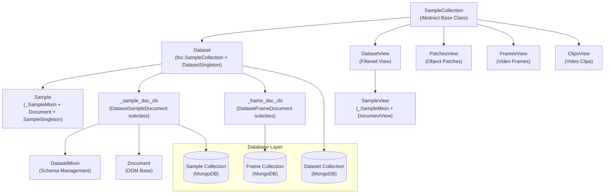
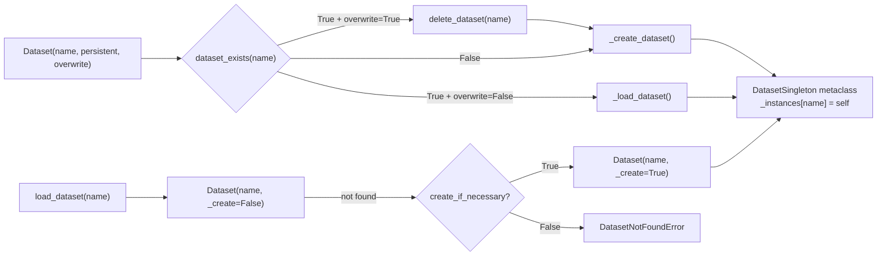
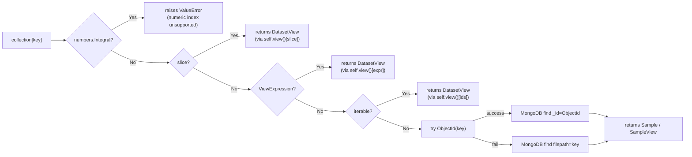
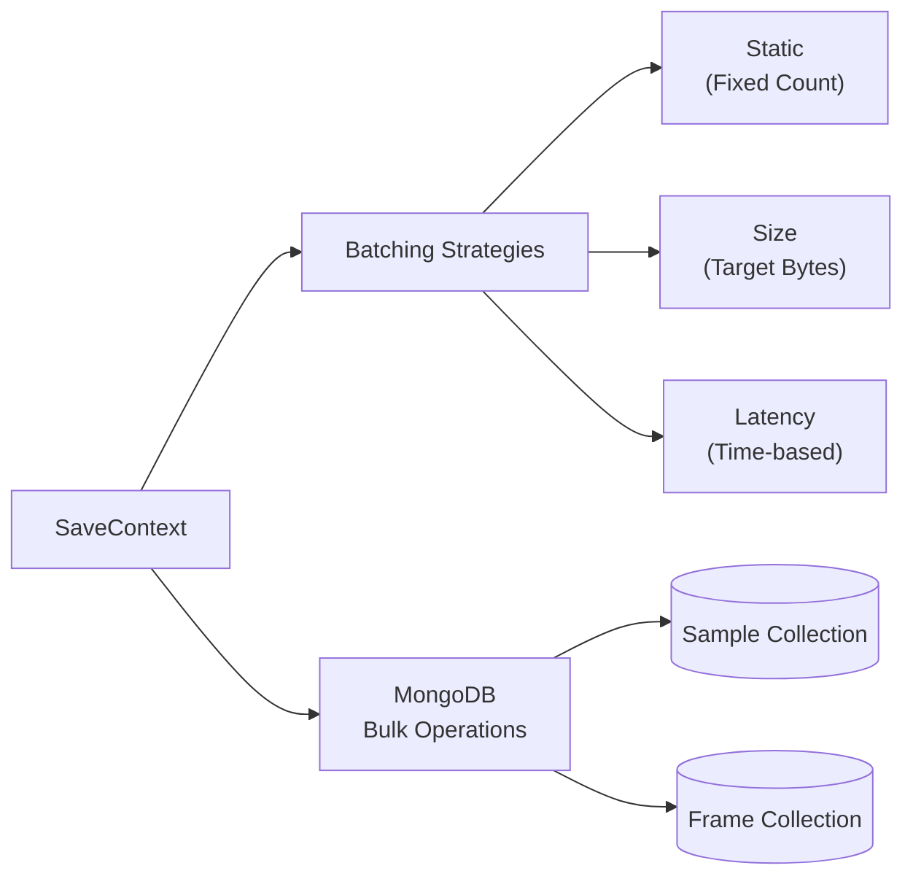
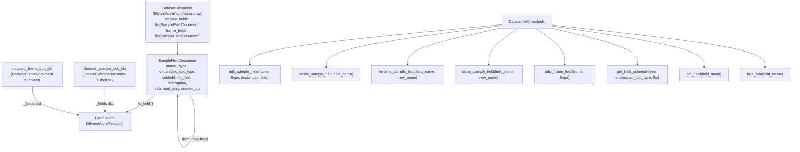
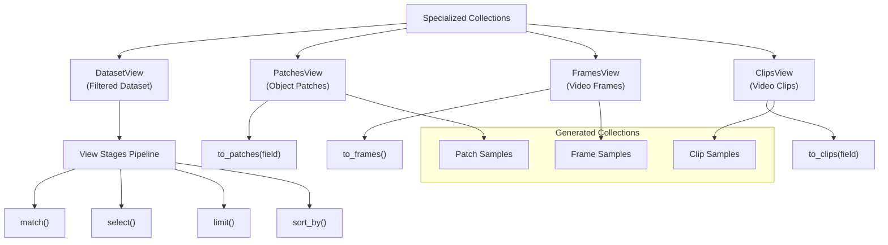
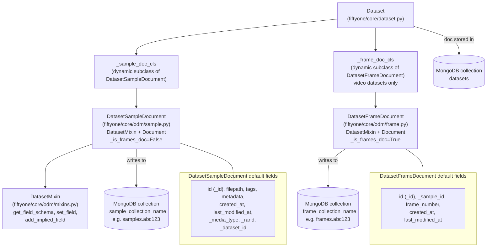
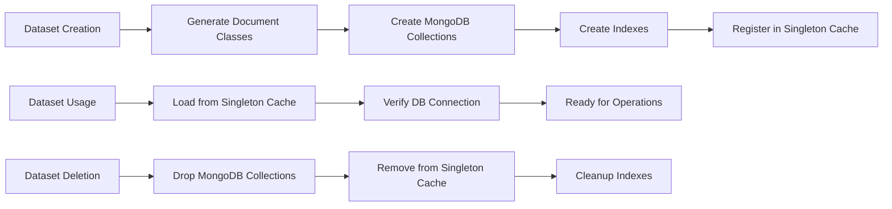

<!-- source: DeepWiki mcp.deepwiki.com · repo voxel51/fiftyone · page 2.1 Datasets and Sample Collections · fetched 2026-10-21 -->

# Datasets and Sample Collections

Relevant source files

The following files were used as context for generating this wiki page:

- [fiftyone/__public__.py](fiftyone/__public__.py)
- [fiftyone/core/aggregations.py](fiftyone/core/aggregations.py)
- [fiftyone/core/clips.py](fiftyone/core/clips.py)
- [fiftyone/core/collections.py](fiftyone/core/collections.py)
- [fiftyone/core/dataset.py](fiftyone/core/dataset.py)
- [fiftyone/core/document.py](fiftyone/core/document.py)
- [fiftyone/core/expressions.py](fiftyone/core/expressions.py)
- [fiftyone/core/fields.py](fiftyone/core/fields.py)
- [fiftyone/core/frame.py](fiftyone/core/frame.py)
- [fiftyone/core/labels.py](fiftyone/core/labels.py)
- [fiftyone/core/odm/dataset.py](fiftyone/core/odm/dataset.py)
- [fiftyone/core/odm/document.py](fiftyone/core/odm/document.py)
- [fiftyone/core/odm/embedded_document.py](fiftyone/core/odm/embedded_document.py)
- [fiftyone/core/odm/mixins.py](fiftyone/core/odm/mixins.py)
- [fiftyone/core/odm/sample.py](fiftyone/core/odm/sample.py)
- [fiftyone/core/odm/utils.py](fiftyone/core/odm/utils.py)
- [fiftyone/core/patches.py](fiftyone/core/patches.py)
- [fiftyone/core/sample.py](fiftyone/core/sample.py)
- [fiftyone/core/stages.py](fiftyone/core/stages.py)
- [fiftyone/core/video.py](fiftyone/core/video.py)
- [fiftyone/core/view.py](fiftyone/core/view.py)
- [tests/unittests/aggregation_tests.py](tests/unittests/aggregation_tests.py)
- [tests/unittests/dataset_tests.py](tests/unittests/dataset_tests.py)
- [tests/unittests/odm_tests.py](tests/unittests/odm_tests.py)
- [tests/unittests/patches_tests.py](tests/unittests/patches_tests.py)
- [tests/unittests/video_tests.py](tests/unittests/video_tests.py)
- [tests/unittests/view_tests.py](tests/unittests/view_tests.py)

This document covers the core data structures that represent collections of samples in FiftyOne: the `Dataset` class and the `SampleCollection` abstract interface. These classes provide the fundamental API for managing, querying, and manipulating collections of media samples with their associated metadata and labels.

For information about individual samples, see [Labels and Fields](#2.3). For information about views and filtering operations, see [Views and View Stages](#2.2).

## Core Architecture

The sample collection system in FiftyOne is built around a class hierarchy with `SampleCollection` as the abstract base class and `Dataset` as the primary concrete implementation:

**Sources:** [fiftyone/core/collections.py:237-243](), [fiftyone/core/dataset.py:276-310](), [fiftyone/core/view.py:33-70](), [fiftyone/core/sample.py:484-508](), [fiftyone/core/odm/sample.py:73-103]()

## Dataset Class

The `Dataset` class is the primary implementation of `SampleCollection` and represents a persistent collection of samples stored in MongoDB. Datasets are singletons, meaning multiple references to the same dataset name will return the same object instance.

### Dataset Creation and Loading

**Diagram: Dataset creation and singleton lifecycle**

Datasets use `DatasetSingleton` as their metaclass ([fiftyone/core/singletons.py]()). All calls to `Dataset(name)` or `load_dataset(name)` within a process return the **same object instance**. `copy()` and `deepcopy()` both return `self`.

**Persistence semantics:** `persistent=False` (default) means the dataset is deleted from the database when `delete_non_persistent_datasets()` is called—typically at server startup. Set `persistent=True` to retain the dataset across sessions. The flag can be changed at any time via `dataset.persistent = True`.

`DatasetNotFoundError` ([fiftyone/core/dataset.py:63-68]()) is raised by `load_dataset()` when the named dataset does not exist and `create_if_necessary=False`.

**Sources:** [fiftyone/core/dataset.py:63-68](), [fiftyone/core/dataset.py:140-175](), [fiftyone/core/dataset.py:306-351](), [fiftyone/core/dataset.py:245-268]()

### Key Dataset Properties and Methods

The `Dataset` class manages several core properties and provides methods for data management. Properties that mutate state call `self.save()` internally to persist changes to the `datasets` MongoDB collection.

#### Identity and Metadata

| Property | Purpose | Location |
|----------|---------|----------|
| `name` | Unique display name; must not clash with existing names | [fiftyone/core/dataset.py:679-699]() |
| `slug` | URL-safe slug derived from `name` at creation/rename time | [fiftyone/core/dataset.py:701-704]() |
| `persistent` | If `False` (default), dataset is deleted when the session ends | [fiftyone/core/dataset.py:746-756]() |
| `tags` | List of string tags on the dataset | [fiftyone/core/dataset.py:758-781]() |
| `description` | Optional free-text description | [fiftyone/core/dataset.py:783-801]() |
| `info` | User-defined `dict` of auxiliary metadata | [fiftyone/core/dataset.py:803-825]() |
| `app_config` | `DatasetAppConfig` controlling App visualization defaults | [fiftyone/core/dataset.py:827-867]() |
| `created_at` | `datetime` when the dataset was created | [fiftyone/core/dataset.py:706-709]() |
| `last_modified_at` | `datetime` of last dataset-level metadata change | [fiftyone/core/dataset.py:711-732]() |
| `last_deletion_at` | `datetime` of last sample deletion, or `None` | [fiftyone/core/dataset.py:734-739]() |
| `last_loaded_at` | `datetime` the dataset was last loaded | [fiftyone/core/dataset.py:741-744]() |

#### Media and Schema

| Property | Purpose | Location |
|----------|---------|----------|
| `media_type` | One of `"image"`, `"video"`, `"point-cloud"`, `"3d"`, `"group"` | [fiftyone/core/dataset.py:452-480]() |
| `group_field` | Field name used for grouping in group datasets | [fiftyone/core/dataset.py:533-548]() |
| `group_slice` | Active group slice name; settable | [fiftyone/core/dataset.py:550-590]() |
| `group_slices` | All slice names for a group dataset | [fiftyone/core/dataset.py:592-610]() |
| `group_media_types` | `dict` mapping slice name → media type | [fiftyone/core/dataset.py:612-630]() |
| `default_group_slice` | Default group slice; settable | [fiftyone/core/dataset.py:632-671]() |

#### Label Configuration

| Property | Purpose | Location |
|----------|---------|----------|
| `classes` | `dict` mapping field name → list of class label strings | [fiftyone/core/dataset.py:869-895]() |
| `default_classes` | Fallback class list for all label fields | [fiftyone/core/dataset.py:897-921]() |
| `mask_targets` | `dict` mapping field name → pixel-value-to-label mapping | [fiftyone/core/dataset.py:923-978]() |
| `default_mask_targets` | Fallback mask targets for all segmentation fields | [fiftyone/core/dataset.py:980-1026]() |
| `skeletons` | `dict` mapping field name → `KeypointSkeleton` | [fiftyone/core/dataset.py:1028-1062]() |
| `default_skeleton` | Fallback `KeypointSkeleton` for all keypoint fields | [fiftyone/core/dataset.py:1064-1095]() |
| `camera_intrinsics` | `dict` mapping sensor name → `CameraIntrinsics` | [fiftyone/core/dataset.py:1097-1134]() |
| `static_transforms` | `dict` mapping frame relationship key → `StaticTransform` | [fiftyone/core/dataset.py:1187-1233]() |

**Sources:** [fiftyone/core/dataset.py:452-1240](), [fiftyone/core/odm/dataset.py:1-450]()

## SampleCollection Interface

`SampleCollection` ([fiftyone/core/collections.py:329-335]()) is the abstract base class for all collections. Both `Dataset` and `DatasetView` implement it. It provides a consistent API for sample iteration, aggregation, schema inspection, and view construction.

`DatasetView` delegates dataset-level properties (`tags`, `info`, `classes`, `mask_targets`, etc.) back to its `_root_dataset` rather than maintaining its own copies. Mutations through a view affect the underlying `Dataset`.

### Core Interface Methods

**Diagram: SampleCollection method surface by category**

```mermaid
graph TD
    SC["SampleCollection\n(fiftyone/core/collections.py)"] --> Iter["Iteration"]
    SC --> Query["Query"]
    SC --> Mutate["Mutation"]
    SC --> Agg["Aggregation"]
    SC --> ViewConstruct["View Construction"]
    SC --> Schema["Schema"]

    Iter --> iter_samples["iter_samples(progress, autosave,\nbatch_size, batching_strategy)"]
    Iter --> iter_groups["iter_groups(group_slices)"]

    Query --> count["count(field_or_expr)"]
    Query --> first["first()"]
    Query --> last["last()"]
    Query --> exists["exists(field)"]

    Mutate --> add_sample["add_sample(sample, expand_schema)"]
    Mutate --> add_samples["add_samples(samples, num_workers)"]
    Mutate --> delete_samples["delete_samples(samples_or_ids)"]
    Mutate --> set_values["set_values(field, values, key_field)"]
    Mutate --> compute_metadata["compute_metadata(overwrite)"]
    Mutate --> apply_model["apply_model(model, label_field)"]
    Mutate --> merge_samples["merge_samples(samples, key_field)"]

    Agg --> aggregate["aggregate(aggregations)"]
    Agg --> distinct["distinct(field)"]
    Agg --> values["values(field, unwind)"]
    Agg --> bounds["bounds(field)"]
    Agg --> sum_["sum(field)"]

    ViewConstruct --> match["match(filter)"]
    ViewConstruct --> select["select(sample_ids)"]
    ViewConstruct --> limit["limit(count)"]
    ViewConstruct --> sort_by["sort_by(field, reverse)"]
    ViewConstruct --> shuffle["shuffle(seed)"]
    ViewConstruct --> view["view()"]

    Schema --> get_field_schema["get_field_schema(ftype, flat)"]
    Schema --> get_frame_field_schema["get_frame_field_schema()"]
    Schema --> add_sample_field["add_sample_field(name, ftype)"]
    Schema --> delete_sample_field["delete_sample_field(field_name)"]
```

**Sources:** [fiftyone/core/collections.py:329-400](), [fiftyone/core/collections.py:710-960](), [fiftyone/core/collections.py:1247-2000]()

### Sample Access Patterns

The `__getitem__` method on both `Dataset` and `DatasetView` dispatches on the key type:

**Diagram: `__getitem__` dispatch for Dataset and DatasetView**

**Sources:** [fiftyone/core/dataset.py:365-397](), [fiftyone/core/view.py:102-134]()

## Sample Management Operations

### Adding and Removing Samples

Collections provide methods for managing their sample contents with comprehensive data management patterns:

```mermaid
graph TD
    SampleOps["Sample Operations"] --> AddOps["Add Operations"]
    SampleOps --> DeleteOps["Delete Operations"]
    SampleOps --> UpdateOps["Update Operations"]
    SampleOps --> BulkOps["Bulk Operations"]
    
    AddOps --> add_sample["add_sample(sample, expand_schema)"]
    AddOps --> add_samples["add_samples(samples, num_workers)"]
    AddOps --> add_dir["add_dir(dataset_dir, tags)"]
    AddOps --> add_archive["add_archive(archive_path)"]
    AddOps --> add_images["add_images(paths_or_samples)"]
    AddOps --> add_videos["add_videos(paths_or_samples)"]
    
    DeleteOps --> delete_samples["delete_samples(samples_or_ids)"]
    DeleteOps --> keep["keep(sample_ids)"]
    DeleteOps --> keep_fields["keep_fields(field_names)"]
    DeleteOps --> clear["clear()"]
    DeleteOps --> clear_sample_field["clear_sample_field(field)"]
    
    UpdateOps --> set_values["set_values(field, values, key_field)"]
    UpdateOps --> compute_metadata["compute_metadata(overwrite, num_workers)"]
    UpdateOps --> apply_model["apply_model(model, label_field)"]
    UpdateOps --> sync_last_modified_at["sync_last_modified_at()"]
    
    BulkOps --> clone["clone(name, persistent)"]
    BulkOps --> merge_samples["merge_samples(samples, key_field)"]
    BulkOps --> save_context["save_context(batch_size, batching_strategy)"]
    
    subgraph "Batch Processing Strategies"
        SaveContext["SaveContext"]
        Static["Static Batching"]
        Size["Size-based Batching"] 
        Latency["Latency-based Batching"]
        SaveContext --> Static
        SaveContext --> Size
        SaveContext --> Latency
    end
```

**Sources:** [fiftyone/core/collections.py:1501-2000](), [fiftyone/core/collections.py:2200-2800](), [fiftyone/core/collections.py:80-235]()

### Save Context for Batch Operations

The `SaveContext` class provides efficient batching for large-scale sample updates:

**Sources:** [fiftyone/core/collections.py:80-235]()

## Schema and Field Management

### Field Schema System

The dataset schema is stored as a list of `SampleFieldDocument` objects embedded in the `DatasetDocument` in the `datasets` MongoDB collection. Whenever a field is added or removed, the document is updated in-place and the dataset's `_sample_doc_cls` (or `_frame_doc_cls`) is updated to match.

**Diagram: Schema storage and management (code entities)**

#### Field Types

| Field class | Value type | Notes |
|-------------|-----------|-------|
| `StringField` | `str` | |
| `IntField` | `int` | |
| `FloatField` | `float` | |
| `BooleanField` | `bool` | |
| `DateTimeField` | `datetime` | |
| `ListField(subfield)` | `list` | Parameterized by inner field type |
| `EmbeddedDocumentField(doc_type)` | `EmbeddedDocument` | Used for `Label` subclasses, `Metadata` |
| `ArrayField` | `numpy.ndarray` | Binary-serialized NumPy array |
| `VectorField` | `numpy.ndarray` | Stored as a list; used for embeddings |
| `DictField` | `dict` | Arbitrary JSON-serializable mapping |
| `ObjectIdField` | `bson.ObjectId` | |

#### Schema auto-expansion

When a sample is added with a field not currently in the schema, `set_field(..., create=True)` (the default) calls `add_implied_field()` on the backing document, which calls `_create_implied_field()` and writes the updated `sample_fields` list back to the `datasets` collection. This means the schema grows automatically as new data is ingested.

**Sources:** [fiftyone/core/odm/dataset.py:58-161](), [fiftyone/core/odm/mixins.py:130-200](), [fiftyone/core/fields.py:1-300](), [fiftyone/core/collections.py:2900-3400]()

## Views and Derived Collections

### Specialized Collection Types

FiftyOne provides several specialized collection types that derive from `SampleCollection`:

**Sources:** [fiftyone/core/view.py:33-61](), [fiftyone/core/patches.py:48-66](), [fiftyone/core/video.py:35-46](), [fiftyone/core/clips.py:28-43]()

## Database Integration

### ODM and Persistence Layer

Each `Dataset` has two dynamically generated MongoEngine document classes. These classes are created at dataset-creation time and registered with MongoEngine under names matching the collection names.

**Diagram: Document class hierarchy to MongoDB collections (code entities)**

The `_rand` field on each sample document is a float in `[0.999, 1.0]` seeded by the filepath; it is used by the `shuffle()` view stage for reproducible shuffling without requiring a full collection scan.

When a sample has not yet been inserted into a dataset, its backing document is a `NoDatasetSampleDocument` instance ([fiftyone/core/odm/sample.py:104-146]()). When `add_sample()` is called, the document is replaced with an instance of `_sample_doc_cls` and assigned a MongoDB `ObjectId`.

**Sources:** [fiftyone/core/odm/sample.py:73-147](), [fiftyone/core/odm/mixins.py:55-200](), [fiftyone/core/dataset.py:306-345]()

### Collection Lifecycle Management

**Sources:** [fiftyone/core/dataset.py:3700-3850](), [fiftyone/core/singletons.py:1-100]()

---

