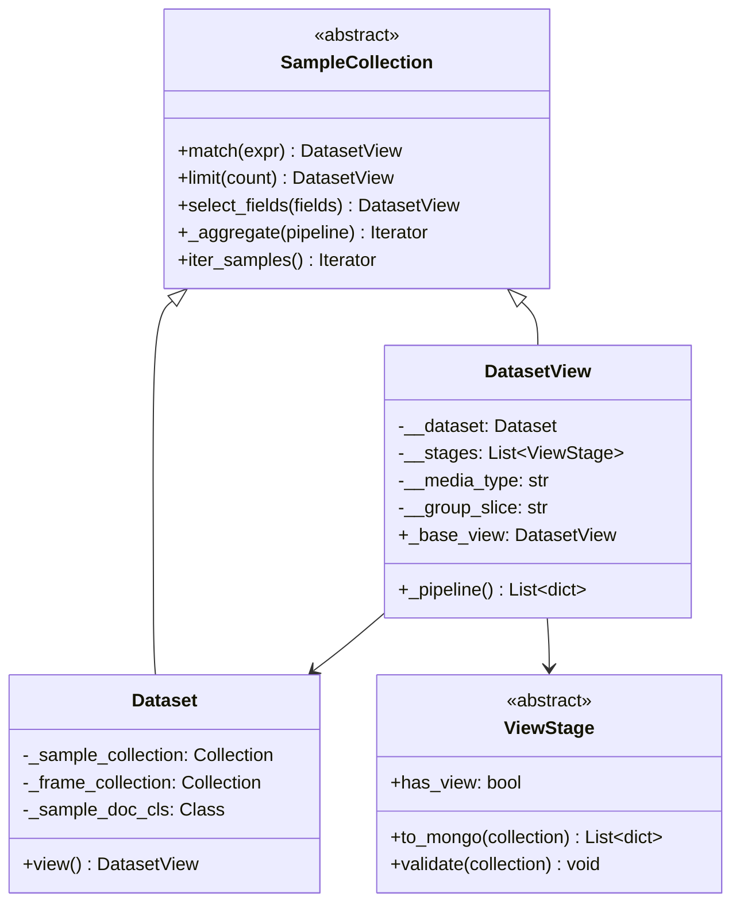
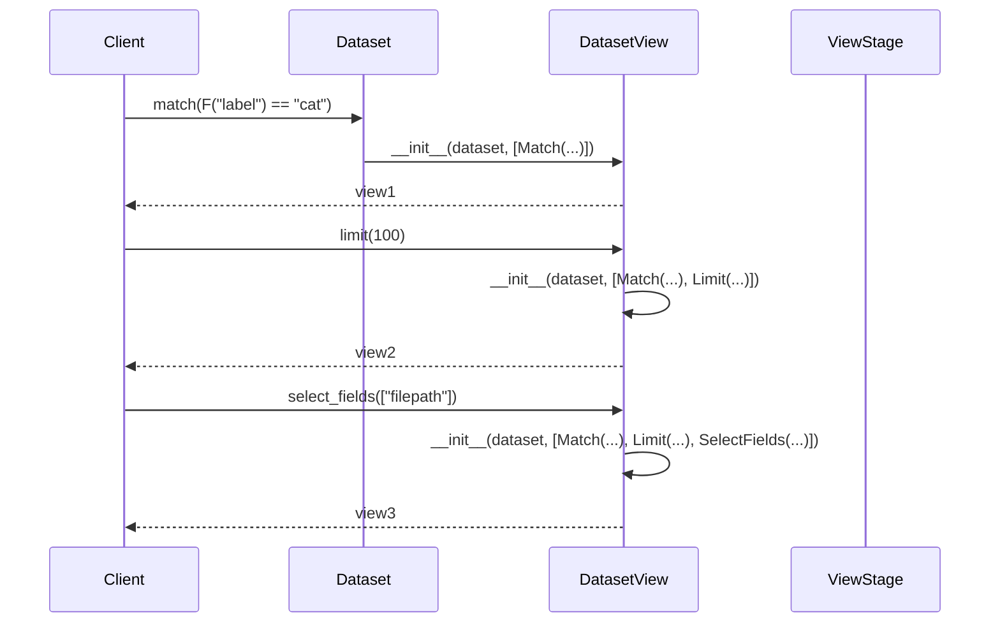
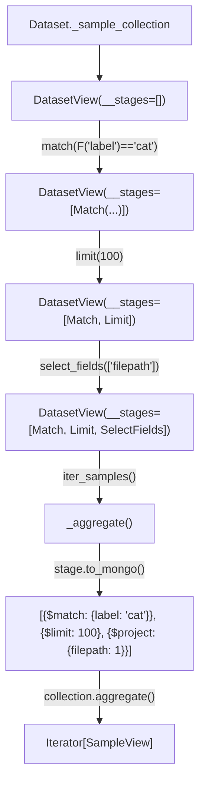
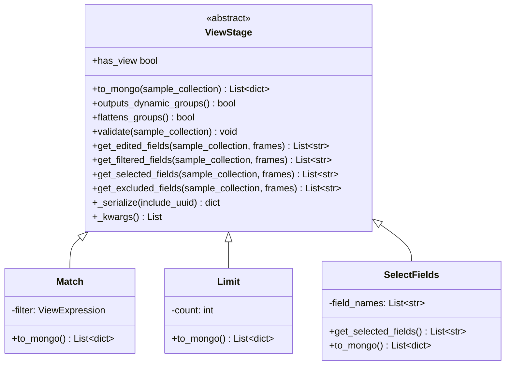
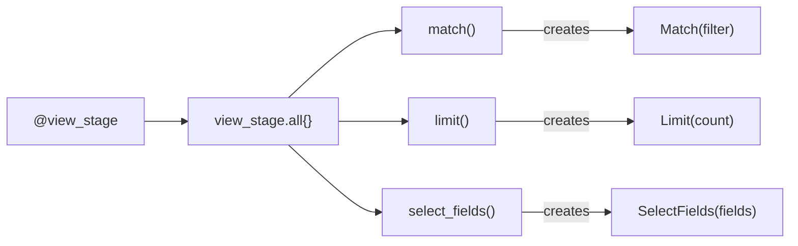
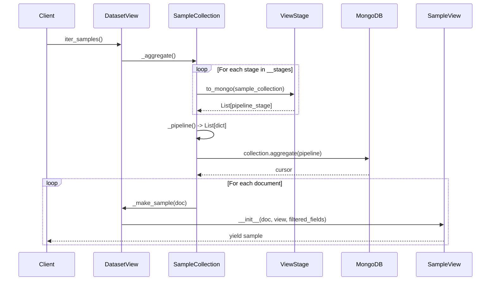
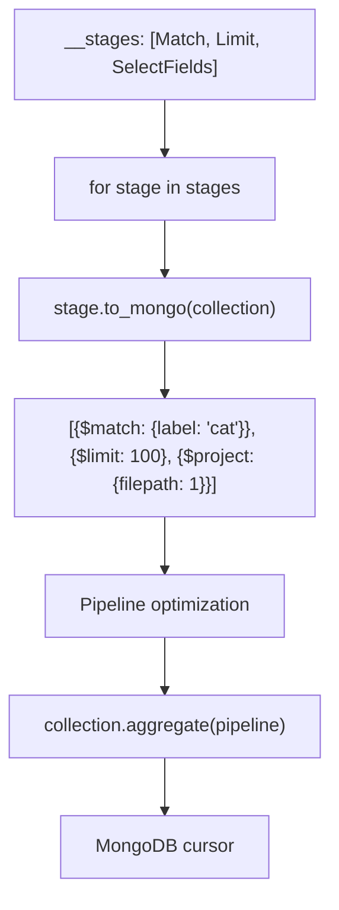
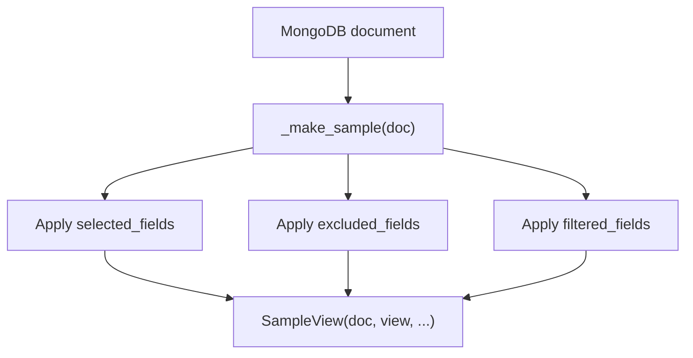
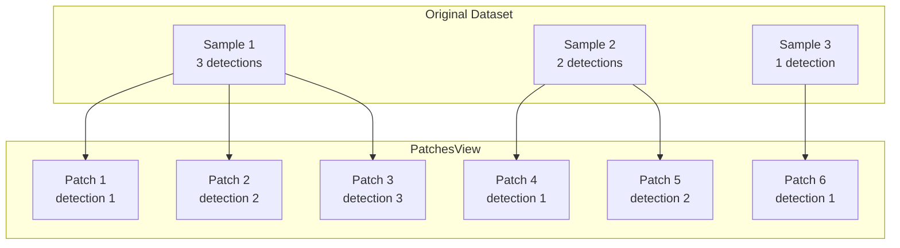

<!-- source: DeepWiki mcp.deepwiki.com · repo voxel51/fiftyone · page 2.2 Views and View Stages · fetched 2026-10-21 -->

# Views and View Stages

Relevant source files

The following files were used as context for generating this wiki page:

- [fiftyone/__public__.py](fiftyone/__public__.py)
- [fiftyone/core/aggregations.py](fiftyone/core/aggregations.py)
- [fiftyone/core/clips.py](fiftyone/core/clips.py)
- [fiftyone/core/collections.py](fiftyone/core/collections.py)
- [fiftyone/core/dataset.py](fiftyone/core/dataset.py)
- [fiftyone/core/document.py](fiftyone/core/document.py)
- [fiftyone/core/expressions.py](fiftyone/core/expressions.py)
- [fiftyone/core/fields.py](fiftyone/core/fields.py)
- [fiftyone/core/frame.py](fiftyone/core/frame.py)
- [fiftyone/core/labels.py](fiftyone/core/labels.py)
- [fiftyone/core/odm/dataset.py](fiftyone/core/odm/dataset.py)
- [fiftyone/core/odm/document.py](fiftyone/core/odm/document.py)
- [fiftyone/core/odm/embedded_document.py](fiftyone/core/odm/embedded_document.py)
- [fiftyone/core/odm/mixins.py](fiftyone/core/odm/mixins.py)
- [fiftyone/core/odm/sample.py](fiftyone/core/odm/sample.py)
- [fiftyone/core/odm/utils.py](fiftyone/core/odm/utils.py)
- [fiftyone/core/patches.py](fiftyone/core/patches.py)
- [fiftyone/core/sample.py](fiftyone/core/sample.py)
- [fiftyone/core/stages.py](fiftyone/core/stages.py)
- [fiftyone/core/video.py](fiftyone/core/video.py)
- [fiftyone/core/view.py](fiftyone/core/view.py)
- [tests/unittests/aggregation_tests.py](tests/unittests/aggregation_tests.py)
- [tests/unittests/dataset_tests.py](tests/unittests/dataset_tests.py)
- [tests/unittests/odm_tests.py](tests/unittests/odm_tests.py)
- [tests/unittests/patches_tests.py](tests/unittests/patches_tests.py)
- [tests/unittests/video_tests.py](tests/unittests/video_tests.py)
- [tests/unittests/view_tests.py](tests/unittests/view_tests.py)

The FiftyOne view system provides a pipeline-based approach for filtering, transforming, and querying datasets through lazy, chainable operations that never modify the underlying data. Views are implemented as immutable transformation pipelines that generate optimized MongoDB aggregation queries at execution time.

Views enable complex data operations through stage chaining: `dataset.match(F("confidence") > 0.5).limit(100).select_fields(["filepath", "predictions"])`. Each method call adds a `ViewStage` to the pipeline without executing any database operations until the view is iterated or aggregated.

For information about the base `Dataset` and `SampleCollection` classes that views operate on, see [Datasets and Sample Collections](#2.1). For details about the field and label structures that views can filter and select, see [Labels and Fields](#2.3).

## View Pipeline Architecture

The view system is built around a pipeline architecture where `DatasetView` objects maintain an ordered sequence of `ViewStage` transformations that are applied lazily when the view is executed.

**Core View Architecture**

**DatasetView Internal Structure**

The `DatasetView` class maintains the view state through several key attributes:

| Attribute | Type | Purpose |
|-----------|------|---------|
| `__dataset` | `Dataset` | Reference to underlying dataset |
| `__stages` | `List[ViewStage]` | Ordered transformation pipeline |
| `__media_type` | `str` | Media type override for the view |
| `__group_slice` | `str` | Current group slice for grouped datasets |

Sources: [fiftyone/core/view.py:72-88](), [fiftyone/core/collections.py:237-270]()

Views inherit from `SampleCollection`, providing the same fluent interface as datasets. Each view method creates a new `DatasetView` instance with an additional stage appended to the pipeline, implementing immutable transformations.

**View Creation and Chaining**

Sources: [fiftyone/core/view.py:139-147](), [fiftyone/core/collections.py:1200-1300]()

## ViewStage System

Each `ViewStage` represents a single transformation operation that generates MongoDB aggregation pipeline stages. Stages are executed sequentially to build complex database queries from simple, composable operations.

**ViewStage Execution Pipeline**

**ViewStage Interface**

The abstract `ViewStage` class defines the contract for all transformation stages:

**ViewStage Core Methods**

| Method | Purpose |
|--------|---------|
| `to_mongo(sample_collection)` | Generates MongoDB aggregation pipeline stages |
| `has_view` | Returns `True` if stage uses `load_view()` instead of `to_mongo()` |
| `validate(sample_collection)` | Validates stage compatibility with collection |
| `get_*_fields(sample_collection)` | Returns fields affected by the stage |

Sources: [fiftyone/core/stages.py:47-355](), [fiftyone/core/stages.py:264-282]()

**View Method Registration**

View stage methods are registered on `SampleCollection` using the `@view_stage` decorator:

This registration system enables the fluent API where methods can be chained: `dataset.match(expr).limit(100).select_fields(fields)`.

Sources: [fiftyone/core/collections.py:60-77](), [fiftyone/core/collections.py:1200-1400]()

## ViewStage Categories

FiftyOne provides numerous built-in view stages organized into functional categories. Each stage generates specific MongoDB aggregation operators to perform its transformation.

### Sample Selection Stages

These stages control which samples pass through the pipeline:

| Stage Class | Method | MongoDB Operator | Purpose |
|-------------|--------|------------------|---------|
| `Match` | `match(filter)` | `$match` | Filter by field expressions |
| `Select` | `select(ids)` | `$match` | Include samples by IDs |
| `Exclude` | `exclude(ids)` | `$match` | Remove samples by IDs |
| `ExcludeBy` | `exclude_by(field, values)` | `$match` | Remove by field values |
| `SelectBy` | `select_by(field, values)` | `$match` | Include by field values |
| `MatchTags` | `match_tags(tags)` | `$match` | Filter by sample tags |

**Sample Ordering Stages**

| Stage Class | Method | MongoDB Operator | Purpose |
|-------------|--------|------------------|---------|
| `Limit` | `limit(count)` | `$limit` | Limit sample count |
| `Skip` | `skip(count)` | `$skip` | Skip first N samples |
| `SortBy` | `sort_by(field)` | `$sort` | Sort by field values |
| `Shuffle` | `shuffle(seed)` | `$sample` | Randomize order |
| `Take` | `take(count, seed)` | `$sample` | Random sampling |

Sources: [fiftyone/core/stages.py:1500-1800](), [fiftyone/core/stages.py:513-678]()

### Field Manipulation Stages

These stages modify which fields are included in sample documents:

| Stage Class | Method | MongoDB Operator | Purpose |
|-------------|--------|------------------|---------|
| `SelectFields` | `select_fields(fields)` | `$project` | Include only specified fields |
| `ExcludeFields` | `exclude_fields(fields)` | `$project` | Remove specified fields |
| `SetField` | `set_field(field, expr)` | `$addFields` | Add/modify field values |
| `MapValues` | `map_values(field, map)` | `$addFields` | Transform field values |

Sources: [fiftyone/core/stages.py:680-775](), [fiftyone/core/stages.py:1901-2100]()

### Label-Level Operations

These stages operate on labels within `Detection`, `Classification`, and other label fields:

| Stage Class | Method | MongoDB Operator | Purpose |
|-------------|--------|------------------|---------|
| `FilterLabels` | `filter_labels(field, filter)` | `$addFields` | Filter labels within fields |
| `LimitLabels` | `limit_labels(field, limit)` | `$addFields` | Limit labels per field |
| `SelectLabels` | `select_labels(ids)` | `$addFields` | Select labels by ID |
| `ExcludeLabels` | `exclude_labels(ids)` | `$addFields` | Remove labels by ID |
| `MapLabels` | `map_labels(field, map)` | `$addFields` | Transform label values |

Sources: [fiftyone/core/stages.py:2200-2700]()

### Dataset Structure Transformations

These stages create derived views with fundamentally different sample structures:

| Stage Class | Method | Purpose |
|-------------|--------|---------|
| `ToPatches` | `to_patches(field)` | Convert detections to patch samples |
| `ToFrames` | `to_frames()` | Convert video to frame samples |
| `ToClips` | `to_clips(field)` | Extract temporal video clips |
| `Flatten` | `flatten()` | Flatten grouped datasets |
| `GroupBy` | `group_by(field)` | Create dynamic groupings |

Sources: [fiftyone/core/stages.py:3000-4000]()

### Frame and Video Operations

Specialized stages for video datasets:

| Stage Class | Method | Purpose |
|-------------|--------|---------|
| `MatchFrames` | `match_frames(filter)` | Filter frames in video samples |
| `SelectFrames` | `select_frames(frames)` | Select specific frame numbers |
| `ExcludeFrames` | `exclude_frames(frames)` | Remove specific frames |

Sources: [fiftyone/core/stages.py:2800-3000]()

## View Execution Model

Views are executed lazily through MongoDB aggregation pipelines. Execution is deferred until the view is iterated (`iter_samples()`) or aggregated (`aggregate()`, `count()`, etc.).

**Lazy Execution Pipeline**

**Pipeline Construction Process**

The `_aggregate()` method in `SampleCollection` orchestrates pipeline construction:

1. **Stage Iteration**: Iterates through `_stages` list calling `to_mongo()` on each stage
2. **Pipeline Assembly**: Concatenates MongoDB stages from each `ViewStage`
3. **Optimization**: Applies pipeline optimizations for performance
4. **Execution**: Calls `collection.aggregate(pipeline)` on the MongoDB collection

Sources: [fiftyone/core/collections.py:4000-4200](), [fiftyone/core/view.py:546-561]()

**Sample Document Processing**

Documents retrieved from MongoDB are converted to `SampleView` instances that respect view field filtering:

The `_make_sample()` method uses cached functions that understand the view's field constraints:

- **Selected Fields**: Only include specified fields in the sample interface
- **Excluded Fields**: Hide specified fields from the sample interface  
- **Filtered Fields**: Mark array fields that have been filtered by label stages

Sources: [fiftyone/core/view.py:574-598](), [fiftyone/core/sample.py:484-530]()

**Performance Considerations**

Views generate efficient MongoDB queries through several optimizations:

1. **Pipeline Ordering**: Stages that reduce document count (`$match`, `$limit`) are placed early
2. **Index Usage**: `$match` and `$sort` stages leverage database indexes
3. **Field Projection**: `$project` stages reduce network transfer by selecting only needed fields
4. **Cursor Reuse**: Iterator patterns avoid loading all documents into memory

Sources: [fiftyone/core/collections.py:3500-4000]()

## Specialized View Types

FiftyOne supports specialized view types that provide domain-specific functionality beyond basic dataset views.

### PatchesView

Patches views convert object detection datasets into collections where each sample represents a single detected object rather than a full image.

Sources: [fiftyone/core/patches.py:48-66](), [fiftyone/core/stages.py:5000-5200]()

`PatchesView` characteristics:
- Extends `DatasetView` with patch-specific functionality
- Each patch sample contains bounding box and label information
- Maintains references to original sample and detection IDs
- Supports both evaluation patches and general object patches

### FramesView

Frames views convert video datasets into collections where each sample represents a single video frame.

Sources: [fiftyone/core/video.py:35-50](), [fiftyone/core/stages.py:5500-5700]()

`FramesView` characteristics:
- Converts video samples to frame samples
- Preserves frame-level labels and metadata
- Maintains reference to original video sample
- Enables frame-level analysis and filtering

### ClipsView

Clips views create temporal segments from video datasets based on label temporal extents.

Sources: [fiftyone/core/clips.py:28-50](), [fiftyone/core/stages.py:5300-5500]()

`ClipsView` characteristics:
- Extracts temporal clips based on label support
- Maintains temporal detection information
- Useful for action recognition and temporal analysis
- Preserves relationship to source video samples

Sources: [fiftyone/core/view.py:1-700](), [fiftyone/core/stages.py:1-400](), [fiftyone/core/collections.py:237-600](), [fiftyone/core/patches.py:1-100](), [fiftyone/core/video.py:1-50](), [fiftyone/core/clips.py:1-50]()

---

